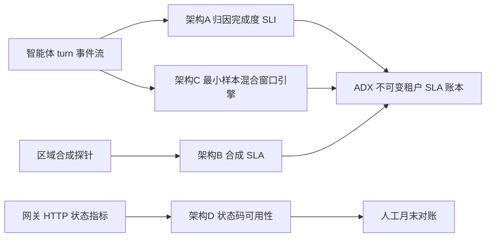
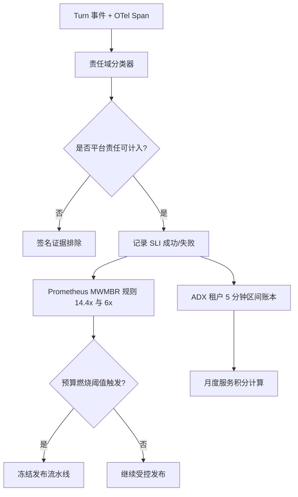
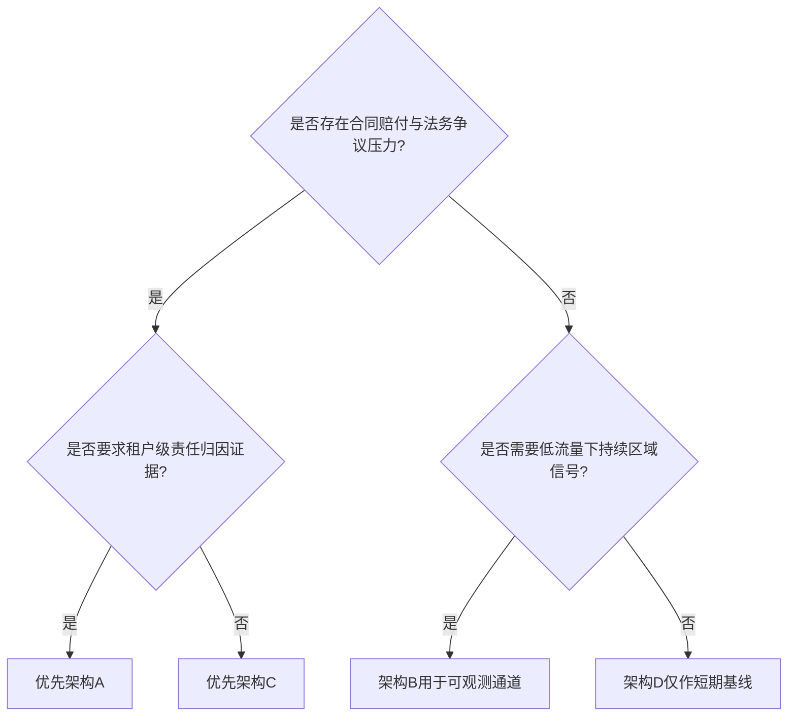

# B2B 智能体合同 SLA 选型 FAQ：责任归因 MWMBR + ADX 赔付账本 vs 合成探针 vs 网关状态码可用性
> **适用场景**：签署合同可用性条款的企业级 B2B AI SaaS、行业托管智能体服务商、以及内部 Tier-0 AI 平台组织。
> **决策压力**：在法律合同、SRE 误差预算、财务服务积分赔付之间建立可核验的一致口径。
> **核心目标**：构建可审计的 turn 完成度 SLI 与服务积分引擎，能通过法务、采购与客户争议审查。

## 1. 执行摘要
- 合同型 AI 智能体 SLA 若脱离业务完成语义，常在赔付结算阶段失真。
- 对流式 SSE/WebSocket，`HTTP 200` 头部成功不等于业务成功完成。
- 客户自托管连接器故障不应消耗平台责任侧合同预算。
- 低流量租户会放大统计偏差并触发伪违约窗口。
- 架构 A 在法务可辩护性与工程可执行性上最强。
- 架构 B 在全时段区域健康信号上最稳定，但租户隔离故障可见性不足。
- 架构 C 在低流量公平性与争议复算能力上平衡最佳。
- 架构 D 初期最省事，但长期会放大误赔和争议工时。
- 多窗口多燃烧率门禁优于单阈值告警，能更早拦截失控发布。
- ADX 不可变租户账本可显著降低财务/SRE/法务对账摩擦。
- 仅在依赖同样冗余时，主动双活才会提高合同可承诺 SLA。
- 选型应由 SRE、平台、财务、法务共同决策而非单方拍板。

## 2. 适用边界与明确非目标
- 适用于 `99.9%` / `99.95%` 等月度合同可用性承诺场景。
- 适用于 `10%` / `25%` / `50%` 等阶梯服务积分赔付条款。
- 适用于 turn 完成度 SLI 与责任域签名归因体系。
- 适用于 `14.4x` 与 `6x` 的 MWMBR 门禁及自动冻结发布。
- 本文不等同于 3.1 中延迟对冲与降级环运行时流量调度。
- 本文不等同于 3.7 中 token 成本分摊（chargeback/showback）议题。
- 本文不等同于 3.8 中多区域故障切换演练方案。
- 不覆盖合同法律条文撰写本身。
- 不覆盖客服流程工具的通用选型。

## 3. 场景约束与故障物理
- 流式调用可能在 `80ms` 返回 `HTTP 200`，但 `14s` 后中途中断失败。
- 客户侧 MCP/SAP 连接器 `504` 常导致责任边界模糊。
- 稀疏流量租户在 `5-minute` 视角下容易出现伪高失败率。
- 平台需要租户级不可变证据支撑赔付与免责判定。
- 发布门禁必须快速感知真实预算燃烧并抑制噪声告警。
- 月度服务积分计算必须可复算、可审计、可追责。
- 架构决策必须同时保护客户信任与供应方毛利。

## 4. 四类候选架构
- **架构 A**：责任域归因 turn 完成度 SLI + MWMBR + ADX 不可变 SLA 账本。
- **架构 B**：持续合成 Golden Path 探针 SLA。
- **架构 C**：最小样本混合窗口（真实流量 + 合成回填）合同模型。
- **架构 D**：网关状态码可用性 + 月末人工赔付校正。
- A 强在归因精度与合同辩护能力。
- B 强在持续观测覆盖，不依赖租户真实流量。
- C 强在低流量公平性与争议复算可解释性。
- D 强在上线快，但长期治理质量最低。

## 5. 架构 A 细节（归因完成度 SLI + MWMBR + ADX 账本）
- SLI 以终态 `turn.completed` 为准，而非头部成功。
- 责任分类明确拆分 `platform_fault`、`foundry_upstream`、`customer_dependency`、`client_invalid`。
- 仅在“平台责任且可计入”turn 上计算合同 SLA。
- 通过签名边界证据可排除客户侧超时/配额异常。
- Managed Prometheus 记录短窗与长窗预算燃烧率。
- 发布冻结可对接 GitHub Actions 或 Argo 流水线。
- ADX 提供租户-月份不可变结算账本与争议证据。
- A 适用于高价值、强法务审计的企业合同业务。

## 6. 架构 B 细节（持续合成探针 SLA）
- 每 `60s` 对确定性 Golden Path 执行区域探针。
- 即使租户无流量也可持续计算可用性。
- 探针标准化有利于跨区域横向比较。
- 对租户隔离类故障（密钥、分片、配额争抢）盲区明显。
- 合成成功不一定代表真实租户体验成功。
- 仍需持续维护探针脚本与夹具稳定性。
- 适合作为基础平台健康趋势与回归雷达。
- 不宜单独作为合同赔付主账本来源。

## 7. 架构 C 细节（最小样本混合窗口）
- 当 `N >= N_min`（如 `5-minute` 窗口 `N >= 10`）使用真实租户流量。
- 当流量不足时回退到租户所属 stamp 的合成健康信号。
- 可避免低流量租户被统计噪声误判违约。
- KQL 区间结果可复算并直接用于客户争议沟通。
- 该模式与主流云厂商区间误差率口径一致。
- 需维护租户与 stamp 的映射治理与版本策略。
- 在租户流量分布极不均衡时通常最实用。
- 常作为 A 的补充或过渡路径。

## 8. 架构 D 细节（状态码可用性 + 人工月结）
- 以网关 `5xx` 比率作为主可用性指标。
- Day-1 实施最简单，组织门槛最低。
- 对 SSE/WebSocket 中途失败无感，误判为成功概率高。
- 无法稳定区分客户依赖故障与平台故障。
- 财务/SRE/法务月末人工对账工时高且不可预测。
- 长期误赔与漏赔风险会同时上升。
- 不适合大客户组合和强合同执行场景。
- 仅建议短期过渡，尽快迁移至归因完成度模型。

## 9. 十二维架构对比矩阵
| 维度 | 架构 A | 架构 B | 架构 C | 架构 D |
|---|---|---|---|---|
| 合同可辩护性 | 最高 | 中 | 高 | 低 |
| 流式终态正确性 | 最高 | 中 | 高 | 最低 |
| 故障归因精度 | 最高 | 低 | 高 | 最低 |
| 低流量租户公平性 | 高 | 中 | 最高 | 低 |
| 运维自动化深度 | 最高 | 中 | 高 | 低 |
| 发布门禁就绪度 | 最高 | 中 | 高 | 低 |
| 财务对账工作量 | 最低 | 中 | 低 | 最高 |
| 客户争议复算能力 | 最高 | 中 | 最高 | 低 |
| Day-1 上线速度 | 中 | 高 | 中 | 最高 |
| Day-2 治理复杂度 | 中高 | 中 | 中高 | 高 |
| 规模化成本可预测性 | 高 | 中 | 高 | 低 |
| 毛利保护能力 | 最高 | 中 | 高 | 最低 |

## 10. 四架构拓扑总览


## 11. 责任归因、MWMBR 门禁与月度赔付账本流程


## 12. SA 决策树


### Q1. 串行依赖与双活并行 SLA 数学，以及负毛利风险
- 串行关键依赖会通过乘法压低可承诺上限。
- `SLA_serial = Π A_i` 是不可规避的物理上限。
- 双活 stamp 的可用性可按 `1 - (1 - A_stamp)^2` 估算。
- 若关键单区域依赖仅 `99.9%`，却承诺 `99.95%`，必然挤压毛利。
- 合同承诺必须受“不可冗余最弱依赖”约束。
- 赔付预算模型应纳入真实事故分布和尾部风险。
- 免责条款必须绑定可测量、可签名归因证据。
- SRE 与财务应共同维护最坏赔付包络模型。
- 过度承诺常在少量事故下触发显著 ARR 毛利侵蚀。

### Q2. SSE/WebSocket 终帧 SLI 契约如何定义
- 头部成功仅代表传输层起始，不代表业务完成。
- 合同 SLI 应以终态 `turn.completed` 事件为准。
- 终态失败需覆盖中断、超时、非法分块终止等类型。
- 网关 2xx 仅可作为链路指标，不应直接作为合同成功指标。
- 会话关联 ID 需贯穿头部 span 与终态记录。
- 该策略可消除“头部成功、结果失败”的假绿。
- 对外 SLA 口径文档需明确写入终态定义。
- SDK 层应返回 completion receipt 供租户留存核对。
- 这是公平赔付计算的前提条件。

### Q3. 责任域加密签名证据如何支撑免责成立
- 客户侧连接器故障免责需要可校验边界证据。
- 代理层应对超时/配额事件签名并附带不可抵赖元数据。
- 证据包应包含租户、turn、连接器、时间戳、策略哈希。
- 证据不可变且可回放，采购/法务接受度更高。
- 免责规则必须确定性执行并可版本追踪。
- 平台责任故障在同模型下必须不可被排除。
- 需定期抽检分类器与签名链正确性。
- 证据保存时长应覆盖合同争议追溯窗口。
- 该模式可显著降低归责不清导致的误赔。

### Q4. `14.4x` 与 `6x` MWMBR + 自动冻结发布如何落地
- 短窗燃烧率用于快速捕捉突发回归。
- 长窗燃烧率用于识别持续性预算侵蚀。
- 双窗口联合可在低误报下保持高敏感度。
- 达阈值后应自动阻断高风险发布路径。
- 人工解冻需审批并保留事后审计理由。
- 告警必须一键映射 runbook 与责任人。
- 门禁触发证据应附着到发布记录中。
- SLO 策略修改需纳入变更治理与版本控制。
- 该机制把可靠性信号闭环到发布速度治理。

### Q5. ADX `5-minute` 混合 SLA 与阶梯赔付 KQL 生产实现
- 先做责任可计入过滤，再计算区间可用率。
- `N >= N_min` 用真实流量，否则回退合成可用率。
- 月度 SLA 应来自区间聚合，不应直接平均原始请求。
- 阶梯赔付应与合同阈值严格映射。
- 查询结果需不可变、可导出、可向客户复核。

```kusto
let n_min = 10;
let intervals = TurnLedger
| summarize
    eligible = countif(is_eligible_platform == true),
    success = countif(is_eligible_platform == true and turn_completed == true)
  by tenant_id, bin(timestamp, 5m), stamp_id;
let with_rate = intervals
| join kind=leftouter StampCanary on stamp_id, timestamp
| extend avail = iif(eligible >= n_min, todouble(success) / eligible, canary_availability);
with_rate
| summarize monthly_sla = avg(avail) by tenant_id, month = startofmonth(timestamp)
| extend credit_tier = case(monthly_sla < 0.990, "50%", monthly_sla < 0.995, "25%", monthly_sla < 0.999, "10%", "0%");
```

```promql
(
  sum(rate(platform_eligible_turn_failures_total[5m])) /
  sum(rate(platform_eligible_turn_total[5m]))
) / (1 - 0.999)
```

```json
{
  "service_credit_policy": {
    "target_sla": 0.999,
    "tiers": [
      { "if_monthly_sla_lt": 0.999, "credit": "10%" },
      { "if_monthly_sla_lt": 0.995, "credit": "25%" },
      { "if_monthly_sla_lt": 0.990, "credit": "50%" }
    ]
  }
}
```

### Q6. `25/250/2,000` 租户三年财务暴露与运维 TCO 对比
- 财务暴露取决于真实故障率与归因精度的乘积。
- 人工模型的法务/SRE 工时会随租户规模非线性上升。
- 自动归因不可变账本可降低争议与误赔泄漏。
- 混合窗口模型可提升低流量租户公平性。

| 租户规模 | 架构 A | 架构 B | 架构 C | 架构 D |
|---|---:|---:|---:|---:|
| 25 | \$0.70M–\$1.20M | \$0.80M–\$1.40M | \$0.75M–\$1.30M | \$0.95M–\$1.70M |
| 250 | \$5.60M–\$9.10M | \$6.40M–\$10.30M | \$5.90M–\$9.60M | \$8.40M–\$13.90M |
| 2,000 | \$33.00M–\$52.00M | \$38.00M–\$60.00M | \$35.00M–\$55.00M | \$61.00M–\$96.00M |

| 租户规模 | 责任归因账本可减少的误归因赔付幅度（典型） | 月度争议处理工时降低幅度（典型） |
|---|---:|---:|
| 25 | 28%–44% | 22%–35% |
| 250 | 39%–57% | 34%–52% |
| 2,000 | 48%–66% | 43%–61% |

- 法务可辩护归因能力直接影响毛利保护能力。
- MWMBR 门禁质量直接影响事故频次与赔付尾部风险。
- 财务应按季度用最新事故数据重算暴露曲线。

## 13. Day-0 上线清单
- 定义合同 SLI：终态完成语义与计入边界。
- 落地责任分类体系与签名证据结构。
- 建立可计入 turn 过滤规则与免责映射。
- 配置 Prometheus MWMBR 记录/告警规则。
- 打通发布冻结自动化控制链路。
- 建立 ADX 租户区间不可变账本。
- 实现月度赔付查询与审批工作流。
- 发布客户可见的 SLA 方法学文档。

## 14. Day-2 运维清单
- 审计分类器漂移与签名校验通过率。
- 复盘 MWMBR 告警精度与冻结误触发率。
- 监控低流量租户回填公平性与正确性。
- 校验租户-stamp 映射在拓扑变更后的完整性。
- 演练争议报告导出与法务证据链提交流程。
- 对比合成信号与真实流量 SLA 偏差趋势。
- 细化流式终态失败类别 runbook。
- 按季度重算赔付暴露与预算门限。

## 15. 适配场景与不适配场景
| 类别 | 建议 |
|---|---|
| ✅ Good fit | 有合同赔付、采购审查、法务争议压力的大客户 B2B 平台。 |
| ✅ Good fit | 需要租户级责任归因与可复算争议证据的组织。 |
| ✅ Good fit | 具备成熟 SRE 门禁与财务治理能力的平台团队。 |
| ⛔ Not for | 无合同赔付约束的内部非关键业务场景。 |
| ⛔ Not for | 不愿运维归因管线与不可变账本的团队。 |
| ⛔ Not for | 可接受长期人工表格月结与高争议工时的组织。 |

## 16. 五步落地指南
1. 明确定义终态完成 SLI 与可计入边界合同规则。
2. 实现签名责任归因与不可变证据存储。
3. 部署 MWMBR 规则并联动自动冻结发布。
4. 建立 ADX 区间 SLA 与月度服务积分计算管线。
5. 固化争议处置 playbook 与周期治理评审机制。

## 17. 季度治理指标包
- 追踪可计入 turn 的终态完成成功率。
- 追踪“头部成功但终态失败”假绿比例。
- 追踪责任分类器在各类别的精度与召回。
- 追踪签名证据校验通过率与拒绝数。
- 追踪按免责原因拆分的排除流量占比。
- 追踪低流量回填触发频率。
- 追踪合成与真实区间 SLA 偏差趋势。
- 追踪 MWMBR 短窗与长窗告警触发率。
- 追踪发布冻结触发次数与人工解冻比例。
- 追踪冻结平均持续时长与止损效果。
- 追踪租户月度 SLA 分位分布。
- 追踪各赔付档位月度金额占比。
- 追踪误归因赔付纠正量。
- 追踪争议数量、解决时长与法务工时。
- 追踪 ADX 账本查询时延与完整性校验。
- 追踪影响合同计算的遥测丢失事件。
- 追踪合同策略与运行时执行版本漂移。
- 追踪客户门户 SLA 报告生成成功率。
- 追踪按发布批次关联的平台故障复发率。
- 追踪导致重复免责的租户热点依赖。
- 追踪 SLA 证据控制相关审计发现数量。
- 追踪 SLA 赔付导致的毛利波动。
- 追踪值班团队在合同 SLA 事件上的 toil 工时。
- 追踪月度赔付结算可信度评分。
- 追踪客户争议中免责证据被接受的有效比例。
- 追踪燃烧率告警触发到缓解上线完成的中位时长。
- 追踪冻结后回滚成功且无二次事故的比例。
- 追踪 SDK 版本中 SLI 契约不一致缺陷数量。
- 追踪合成探针夹具漂移发现与修复提前期。
- 追踪 SLA 事故发生后租户通知触达时延。
- 追踪赔付账本回填触发频率与根因分类。
- 追踪月度赔付审批流程中的人工介入比例。
- 追踪已关闭 SLA 案件被法务重开复核比例。
- 追踪季度“预测赔付档位”与“实际档位”偏差率。
- 追踪三年财务暴露预测误差与偏差来源。
- 维护 SLA 策略变更的架构决议记录。

## 18. 数据来源声明
- `anonymized_reported`：文中公式、归因控制与财务暴露区间来自匿名化企业合同 SLA 实践，采用可复现假设归纳。
