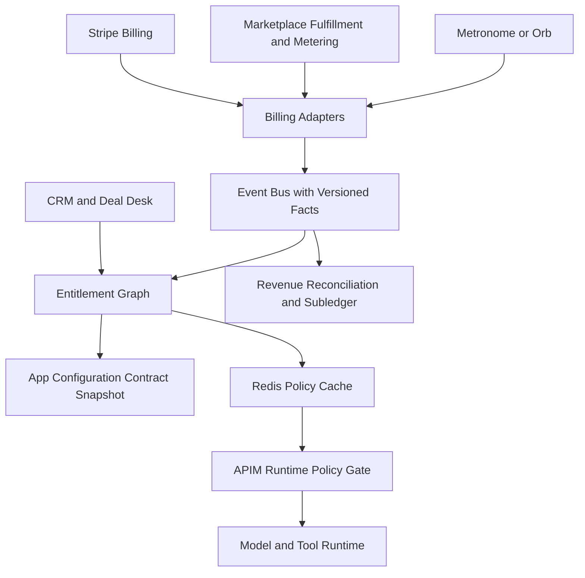
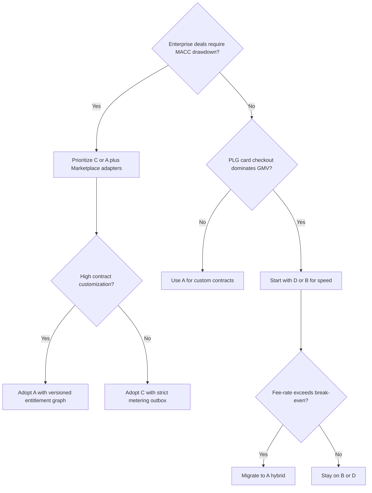
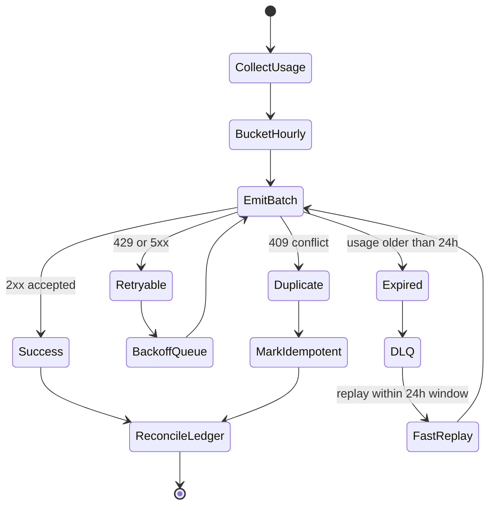

# Enterprise B2B AI SaaS multi-rail monetization and realtime entitlement selection FAQ: Marketplace Private Offer + MACC vs Metronome/Orb vs APIM/Redis entitlement plane

> 🌐 **Language Switch**: [中文](./b2b-ai-saas-entitlement-multi-rail-billing-marketplace-private-offer-macc-vs-metronome-orb-vs-apim-redis-entitlement-plane-selection-faq.md) | **English (current)**
> **Audience**: Cloud & AI Solution Architects, ISV platform engineering teams, billing platform owners, FinOps, GTM, and Revenue Operations teams.
> **Problem Context**: The same AI SaaS often sells through PLG card checkout, enterprise contracts, and Azure Marketplace Private Offers at the same time.
## 1. Why “runtime entitlement equals billing status” is unsafe in multi-rail commerce

Many teams gate runtime features directly from payment-webhook state.
That can appear acceptable in single-rail commerce but fails in three-rail enterprise monetization.

Enterprise contracts include custom model rate cards, rollover commitments, and add-ons that do not map to standard plan enums.
Marketplace Private Offer introduces independent fulfillment, metering, and settlement semantics.

If runtime gating reads billing-provider state directly, billing turbulence becomes a production availability incident.
The durable pattern is to separate commercial facts from runtime authorization and bridge them with replayable events.

## 2. Three high-frequency production failure chains
Failure chain one is `<5ms` entitlement checks breaking when GTM negotiates bespoke terms.

A contract can add `DeepResearch + o3-pro + EU-DataZone + CMK`, while app code still expects old tiers.
Failure chain two is Marketplace metering leakage due to window and dedup constraints.

`batchUsageEvent` deduplicates hourly by `(resourceId, dimension, effectiveStartTime)` and returns `409` on duplicates.
Usage submitted later than `24h` can be rejected as `UsageEventExpired`, silently leaking revenue during outages.

Failure chain three is out-of-order amendment webhooks causing entitlement rollback races.
Concurrent Stripe, CRM, and Marketplace callbacks can temporarily grant or deny incorrect capabilities without version control.

## 3. Reference architecture: decoupled realtime entitlement plane and multi-rail adapters


Runtime reads only entitlement-plane decisions, never raw provider status.
Billing rails emit commercial facts, and entitlement applies deterministic versioned merge and policy evaluation.

## 4. Architecture A: custom realtime entitlement plane with multi-rail adapters
Architecture A uses PostgreSQL/Cosmos for entitlement graph, App Configuration for contract snapshots, and Redis for `<3ms` policy decisions.

APIM evaluates capability vectors such as model tier, tool allow-list, seat cap, and pooled credit cap.
Strength is zero-deploy enterprise override activation with strict runtime isolation from provider outages.

This pattern is best for heavy contract customization and strict low-latency runtime policy enforcement.
Trade-off is in-house engineering for rating, reconciliation, correction replay, and financial audit evidence.

## 5. Architecture B: purpose-built billing platform (Metronome/Orb)
Architecture B delegates usage rating, commit drawdown, rollover, and sub-ledger concerns to specialized vendors.

Strength is mature support for custom enterprise price books and accounting-ready data structures.
Some vendors provide Marketplace and Stripe connectors out of the box, reducing adapter burden.

The trade-off is platform take-rate, often `0.5%–1.2%` of GMV.
At scale, fee accumulation can exceed the annualized cost of a custom entitlement stack.

## 6. Architecture C: Azure-native Marketplace-first metering pipeline
Architecture C centers on Fulfillment v2 and Metering API, with Event Hubs and Durable Functions for hourly aggregation.

It aligns strongly with Fortune 500 procurement and MACC drawdown motions.
Third-party footprint is minimal and governance boundaries remain Azure-native.

Constraints include hourly emission granularity and strict `24h` late-submission cliff.
C also does not natively provide PLG card checkout, so additional rails are still required.

## 7. Architecture D: Stripe-centric entitlement sync
Architecture D couples runtime gating to Stripe Billing Meters and Entitlements for fastest Day-1 rollout.

It fits PLG-heavy phases with limited enterprise customization.
Strength is rapid implementation and familiar operations tooling.

Weakness is poor MACC alignment and limited expression of complex enterprise contract structures.
As enterprise mix grows, Stripe-only entitlement logic usually becomes a scaling constraint.

## 8. Quantitative formulas: leakage risk, MACC velocity, and take-rate break-even
Marketplace leakage approximation is `Leakage = late_expired_usage + conflict_dropped_usage + replay_gap_usage`.

With monthly GMV `V` and leakage ratio `g`, expected leakage is `V * g`.
MACC-driven velocity uplift can be measured as `VelocityGain = close_rate_macc / close_rate_non_macc`.

Billing-platform fee break-even is approximately `GMV_break_even = self_build_annual_cost / fee_rate`.
If `GMV > GMV_break_even`, hybrid or custom entitlement economics usually dominate.

Runtime policy latency budget can be expressed as `P95_gate = redis_lookup + policy_eval + cache_miss_penalty`.
## 9. 12-dimension enterprise comparison matrix

| Dimension | A Custom entitlement plane | B Metronome/Orb | C Marketplace first | D Stripe centric |
|---|---|---|---|---|
| Runtime entitlement latency | Highest (`<3ms` feasible) | High | Medium-High | High |
| Multi-rail contract expressiveness | Highest | High | Medium | Medium-Low |
| MACC alignment | High | Medium-High | Highest | Low |
| PLG checkout maturity | Medium | Medium-High | Low | Highest |
| Marketplace metering governance | High | High | Highest | Low |
| Reconciliation and audit completeness | High (custom) | High (vendor) | Medium-High | Medium |
| Platform fee burden | Low | Medium-High | Low | Medium |
| Time to launch | Medium | High | Medium | Highest |
| Vendor lock-in risk | Low | Medium | Low | Medium |
| Operational complexity | High | Medium | Medium-High | Medium |
| Enterprise deal flexibility | Highest | High | Medium | Medium-Low |
| 3-year TCO competitiveness | High (at scale) | Medium-High (early) | High (marketplace-led) | Medium (PLG-led) |
## 10. Commercial decision tree: align GTM motion first, then stack


Common migration patterns are `D -> B -> A` or `C -> A`, depending on procurement and co-sell motion.


## 11. Production artifacts: hourly metering outbox and `<3ms` entitlement evaluator

```python
from dataclasses import dataclass
from datetime import datetime, timezone
from collections import defaultdict
import hashlib
import json
@dataclass(frozen=True)
class UsageEvent:
    resource_id: str
    tenant_id: str
    dimension: str
    quantity: float
    ts: datetime

def hour_bucket(ts: datetime) -> datetime:
    t = ts.astimezone(timezone.utc)
    return t.replace(minute=0, second=0, microsecond=0)
def aggregate_hourly(events: list[UsageEvent]) -> list[dict]:
    grouped = defaultdict(float)
    for e in events:
        key = (e.resource_id, e.dimension, hour_bucket(e.ts))
        grouped[key] += e.quantity
    payload = []
    for (resource_id, dimension, start_time), quantity in grouped.items():
        idem = hashlib.sha256(f"{resource_id}|{dimension}|{start_time.isoformat()}".encode()).hexdigest()[:32]
        payload.append(
            {
                "resourceId": resource_id,
                "dimension": dimension,
                "effectiveStartTime": start_time.isoformat().replace("+00:00", "Z"),
                "quantity": round(quantity, 6),
                "idempotencyKey": idem,
            }
        )
    return payload

def classify_metering_response(status_code: int) -> str:
    if 200 <= status_code < 300:
        return "accepted"
    if status_code == 409:
        return "duplicate"
    if status_code in (429, 500, 502, 503, 504):
        return "retryable"
    return "dead_letter"
```
```xml
<policies>
  <inbound>
    <base />
    <cache-lookup-value key="@("ent:"+context.Request.Headers.GetValueOrDefault("x-tenant-id",""))" variable-name="entJson" />
    <choose>
      <when condition="@(!context.Variables.ContainsKey("entJson"))">
        <return-response>
          <set-status code="403" reason="Entitlement not found" />
        </return-response>
      </when>
    </choose>
    <set-variable name="modelTier" value="@(context.Request.Headers.GetValueOrDefault("x-model-tier",""))" />
    <choose>
      <when condition="@(!((string)context.Variables["entJson"]).Contains((string)context.Variables["modelTier"]))">
        <return-response>
          <set-status code="402" reason="Model tier not entitled" />
        </return-response>
      </when>
    </choose>
  </inbound>
  <backend><base /></backend>
  <outbound><base /></outbound>
</policies>
```

```yaml
entitlement_contract:
  tenant_id: "t-924"
  version: 20261124
  capabilities:
    - deep_research
    - eu_datazone
    - cmk
  model_tiers:
    - gpt-6.1-terra
    - o3-pro
  quotas:
    seat_cap: 220
    monthly_credit: 900000
    pooled_hard_limit: 1050000
  commercial_rails:
    stripe: true
    marketplace_private_offer: true
    metering_dimension_map:
      deep_research_calls: dr_call
      o3_pro_tokens: o3_pro_tok
```
## 12. ARR cohort scenarios and KPI outcomes

`$2M ARR` usually remains PLG-heavy and prioritizes delivery speed and low ops overhead.
`$15M ARR` often enters mixed enterprise mode and needs concurrent card plus custom-contract support.

`$60M ARR` typically relies on Marketplace plus co-sell and demands strict leakage prevention.
Core KPI set should include close velocity, leakage ratio, entitlement false-deny rate, and dispute ratio.

| KPI | A Custom entitlement | B Billing platform | C Marketplace first | D Stripe centric |
|---|---:|---:|---:|---:|
| Entitlement gate P95 | `2.1ms` | `3.8ms` | `4.5ms` | `3.2ms` |
| Annualized leakage ratio | `0.18%` | `0.24%` | `0.31%` | `0.46%` |
| Private Offer onboarding lead time | `5-10d` | `3-7d` | `2-5d` | `10-20d` |
| Contract amendment activation | `<15min` | `<1h` | `1-4h` | `4-24h` |
| Billing dispute ratio | `0.7%` | `0.9%` | `1.1%` | `1.4%` |
### 3-year TCO (`$2M / $15M / $60M` ARR cohorts)

| Option | `$2M ARR` | `$15M ARR` | `$60M ARR` | 3-year total |
|---|---:|---:|---:|---:|
| A Custom entitlement plane | `$1.45M` | `$4.90M` | `$13.60M` | `$19.95M` |
| B Metronome/Orb | `$1.10M` | `$5.35M` | `$18.90M` | `$25.35M` |
| C Marketplace first | `$1.28M` | `$4.60M` | `$12.80M` | `$18.68M` |
| D Stripe centric | `$0.95M` | `$4.20M` | `$16.40M` | `$21.55M` |
| A+C hybrid | `$1.36M` | `$4.45M` | `$11.90M` | `$17.71M` |
## 13. Day-0 / Day-1 / Day-2 rollout checklist

### Day-0
1. Define unified commercial-fact schema across three rails with `tenant_contract_id` and version semantics.

2. Define entitlement contract schema covering capability, model tier, seat, credit, and residency constraints.
3. Implement Marketplace hourly outbox with deterministic idempotency-key rules.

4. Add APIM tenant-entitlement cache lookup and normalized deny codes (402/403).
5. Define `<24h` expiry alerts and DLQ fast-replay runbook.

### Day-1
1. Bridge Stripe, Marketplace, and CRM event feeds into one versioned event bus.

2. Enable dual-write reconciliation for high-value tenants (billing invoice vs entitlement ledger).
3. Add replay tests for upgrade, downgrade, and amendment out-of-order events.

4. Parameterize sales contract templates to support zero-deploy add-on activation.
5. Add weekly leakage and dispute thresholds with automated audit triggers.

### Day-2
1. Continuously evaluate billing-platform fee versus custom-stack break-even by GMV tier.

2. Prioritize Marketplace path for MACC-heavy accounts with dedicated metering dimensions.
3. Optimize entitlement gate P95 to avoid runtime SLO interference.

4. Automate financial sub-ledger settlement and month-end variance explainability.
5. Revisit Good fit/Not for boundaries quarterly to prevent GTM-path drift.

## 14. Quantitative Q&A (Q1~Q6)
### Q1: Why must entitlement be isolated from billing-provider availability?

Runtime allow/deny decisions are millisecond-critical and cannot depend on provider transient health.
Event-layer decoupling preserves runtime continuity and contract fidelity.

### Q2: Does Marketplace `409 Conflict` always mean failure?
Not always; it usually indicates the hourly tuple was already accepted.

The correct action is idempotent mark-and-reconcile, not blind retry storm.
### Q3: How can `UsageEventExpired` leakage be reduced?

Use near-real-time hourly aggregation and replay, not day-end batch flushes.
Also enforce automatic replay and manual fallback before the `24h` cutoff.

### Q4: When should teams migrate from B to A?
Migrate when `GMV * fee_rate` persistently exceeds annualized build-and-run cost and customization pressure rises.

A staged A+B hybrid migration reduces risk while replacing rating and ledger components.
### Q5: How do you prevent out-of-order event rollback?

Attach monotonic version or logical clock to every contract event.
Entitlement plane should apply only newer versions and keep replayable event history.

### Q6: How do you optimize both MACC velocity and PLG growth?
Keep Stripe self-serve for product-led growth and Marketplace/contract rail for enterprise motions.

Converge both rails into one entitlement plane so runtime behavior stays consistent.
## 15. Good fit / Not for and runtime alert dictionary

**Good fit**
- SaaS businesses simultaneously operating PLG, direct enterprise contracts, and Marketplace co-sell.
- Fine-grained runtime capabilities with frequent contract customization.
- Teams with event-driven platform and reconciliation engineering capacity.

**Not for**
- Very early single-plan card-only products with minimal enterprise variance.
- Teams that cannot maintain versioned event and audit pipelines.
- Regional businesses with no MACC or Marketplace requirement.

**Runtime alert dictionary**
- `ALERT_MARKETPLACE_USAGE_EXPIRED`: usage nearing or exceeding `24h` submission window.
- `ALERT_ENTITLEMENT_VERSION_ROLLBACK`: stale event attempted to overwrite newer entitlement state.
- `ALERT_GATING_P95_OVER_5MS`: policy gate latency budget breach.
- `ALERT_REVENUE_LEAKAGE_DRIFT`: leakage ratio moved beyond expected baseline.
- `ALERT_BILLING_RECON_MISMATCH`: invoice and entitlement sub-ledger mismatch beyond threshold.
