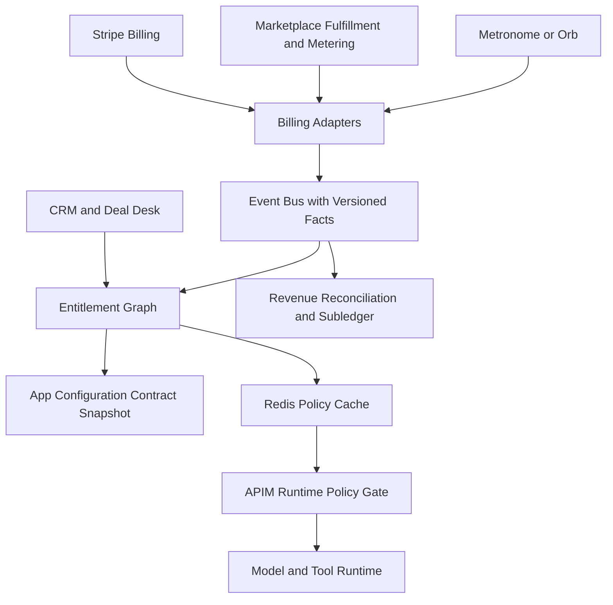
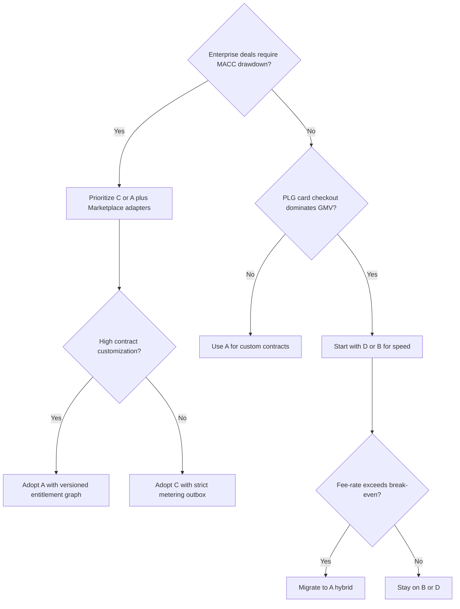
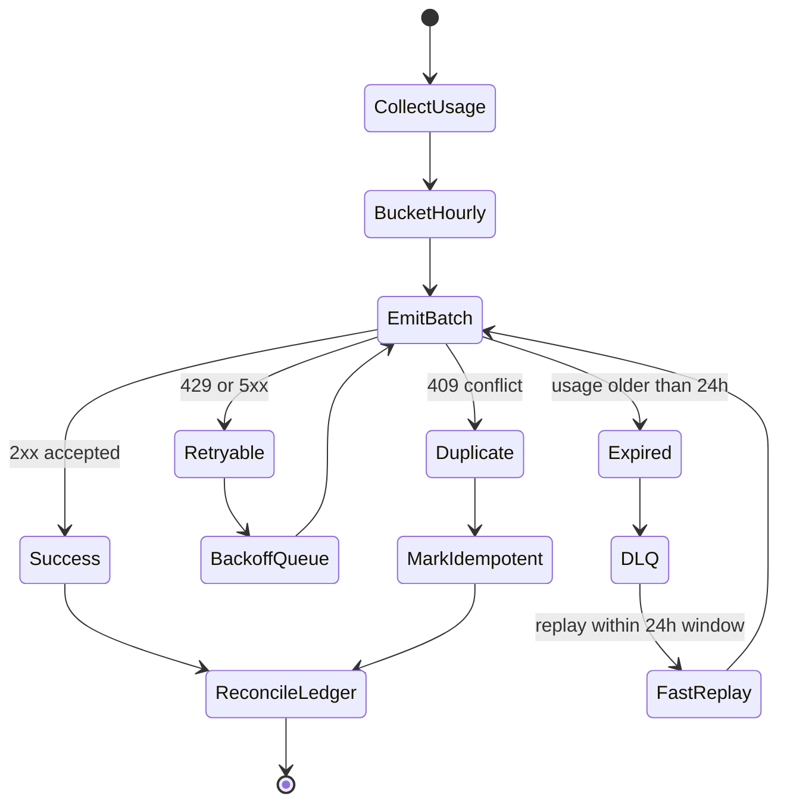

# 企业 B2B AI SaaS 多轨商业化与实时权益选型 FAQ：Marketplace Private Offer + MACC vs Metronome/Orb vs APIM/Redis 权益平面

> 🌐 **Language Switch**：**中文（当前）** | [English](./b2b-ai-saas-entitlement-multi-rail-billing-marketplace-private-offer-macc-vs-metronome-orb-vs-apim-redis-entitlement-plane-selection-faq.en.md)
> **适用对象**：Cloud & AI Solution Architect、ISV 平台工程、计费平台、FinOps、GTM 与 Revenue Operations 团队。
> **问题背景**：同一 AI SaaS 平台同时走 PLG 卡付费、企业合同、Azure Marketplace Private Offer 三条商业轨道，运行时权益与计费对账很容易失配。
## 1. 为什么多轨商业化下“运行时权益=计费状态”是危险假设

很多团队把“是否开功能”直接绑定到某个支付网关 webhook 状态。
在单轨道时代这种做法可勉强运行，但在三轨并行后会产生系统性错配。

企业合同常有定制模型价卡、超量折扣、跨月结转和一次性 add-on，不会体现在标准套餐字段中。
Marketplace Private Offer 又有独立的 Fulfillment、Metering、结算周期与幂等规则。

如果运行时直接读取计费系统状态，计费抖动会放大成实时服务可用性事故。
正确做法是把“商业合同事实”与“运行时授权决策”分层，并用可回放事件桥接。

## 2. 三类高频生产故障链
故障链一是 `<5ms` 权益检查被 GTM 定制条款打爆。

例如销售新增 `DeepResearch + o3-pro + EU-DataZone + CMK` 组合，但应用代码仍只认老套餐枚举。
故障链二是 Marketplace 计量窗口错过导致收入漏记。

`batchUsageEvent` 以小时粒度去重，`(resourceId, dimension, effectiveStartTime)` 重复会 `409`，超 `24h` 提交会 `UsageEventExpired`。
故障链三是升级/降级/修订事件乱序到达，引发授权状态回滚。

当 Stripe、CRM、Marketplace webhook 并发回调，若无版本门控，系统会短暂给错配能力。
## 3. 参考架构：解耦实时权益平面 + 多轨计费适配器


运行时只访问权益平面，不直接依赖任一计费供应商实时可用性。

计费轨道只负责产生“商业事实事件”，由权益平面做版本化归并与策略求值。
## 4. Architecture A：自建实时权益平面 + 多轨适配器

A 用 PostgreSQL/Cosmos 存权益图，App Configuration 存合约快照，Redis 做 `<3ms` 缓存门控。
APIM 只读取租户能力向量，例如模型级别、工具白名单、座席上限、credit 配额。

优势是商业条款变更可零部署生效，且运行时与 Stripe/Marketplace 故障隔离。
它特别适合“企业定制多、合同变化快、运行时延迟要求严”的 B2B AI SaaS。

代价是需要自建 rating、账单对账、回溯修正和审计报表能力。
## 5. Architecture B：Metronome/Orb 计费中台 + 原生多轨连接器

B 将用量计费、commit drawdown、rollover、账务子分类交给专门计费平台。
其优势是复杂费率与 ASC 606 子账能力成熟，能快速支持 enterprise 特殊条款。

部分平台已内建 Marketplace 与 Stripe 连接器，可减少自研 bridge 代码量。
但平台 fee 通常占 GMV 的 `0.5%–1.2%`，ARR 增长后费用会显著放大。

因此 B 的关键问题是 fee 与自研成本的 break-even 点何时到达。
## 6. Architecture C：Azure Marketplace First 原生计量流水线

C 以 Fulfillment v2 + Metering API 为主轨，Event Hubs + Durable 做小时窗口聚合与重放。
它对 Fortune 500 的 MACC 采购最友好，销售推进速度通常更快。

并且第三方依赖少，平台合规边界清晰。
约束是计量天然小时粒度，且 `24h` 迟到上限严格，不适合无序离线补账。

同时 C 不自带 PLG 卡结账能力，仍需额外集成 Stripe 或 CPQ 流程。
## 7. Architecture D：Stripe 为中心的 entitlement 同步

D 以 Stripe Meters + Entitlements 直连应用门控，Day-1 上线速度最快。
它适合 PLG 占比高、企业私有条款少、Marketplace 需求弱的 SaaS 阶段。

优势是团队学习曲线低，运营后台成熟，开发路径短。
缺点是无法消化 MACC 预算路径，企业共售和大单采购效率受限。

此外复杂多年度合同与分层承诺逻辑在 Stripe 原生模型里表达成本较高。
## 8. 定量公式：漏收风险、MACC 成交速度与 fee 临界点

Marketplace 漏收可估算为 `Leakage = late_expired_usage + conflict_dropped_usage + replay_gap_usage`。
若每小时窗口缺口比例为 `g`，月 GMV 为 `V`，则漏收近似 `V * g`。

MACC 驱动成交速度提升可写作 `VelocityGain = close_rate_macc / close_rate_non_macc`。
计费中台 fee 临界点近似 `GMV_break_even = self_build_annual_cost / fee_rate`。

当 `GMV > GMV_break_even` 时，长期看自建或混合方案更有成本优势。
运行时门控预算可表达为 `P95_gate = redis_lookup + policy_eval + cache_miss_penalty`。

## 9. 12 维企业级比较矩阵（中文）
| 维度 | A 自建权益平面 | B Metronome/Orb | C Marketplace First | D Stripe 中心 |
|---|---|---|---|---|
| 运行时权益时延 | 最高（可 `<3ms`） | 高 | 中高 | 高 |
| 多轨合同表达能力 | 最高 | 高 | 中 | 中低 |
| MACC 对齐能力 | 高 | 中高 | 最高 | 低 |
| PLG 自助结账成熟度 | 中 | 中高 | 低 | 最高 |
| Marketplace 计量治理 | 高 | 高 | 最高 | 低 |
| 对账与审计完备度 | 高（自建） | 高（现成） | 中高 | 中 |
| 平台 fee 负担 | 低 | 中高 | 低 | 中 |
| 上线速度 | 中 | 高 | 中 | 最高 |
| 供应商锁定风险 | 低 | 中 | 低 | 中 |
| 运营复杂度 | 高 | 中 | 中高 | 中 |
| 大客户定制弹性 | 最高 | 高 | 中 | 中低 |
| 3 年 TCO 竞争力 | 高（规模后） | 中高（早期） | 高（Marketplace 主导） | 中（PLG 主导） |

## 10. 商业路径决策树：先看成交动因，再定技术栈


实务中常见路线是 `D -> B -> A` 或 `C -> A`，取决于 GTM 与采购结构。


## 11. 生产级代码片段：小时聚合计量 + `<3ms` 权益门控
```python
from dataclasses import dataclass
from datetime import datetime, timezone
from collections import defaultdict
import hashlib
import json

@dataclass(frozen=True)
class UsageEvent:
    resource_id: str
    tenant_id: str
    dimension: str
    quantity: float
    ts: datetime
def hour_bucket(ts: datetime) -> datetime:
    t = ts.astimezone(timezone.utc)
    return t.replace(minute=0, second=0, microsecond=0)

def aggregate_hourly(events: list[UsageEvent]) -> list[dict]:
    grouped = defaultdict(float)
    for e in events:
        key = (e.resource_id, e.dimension, hour_bucket(e.ts))
        grouped[key] += e.quantity
    payload = []
    for (resource_id, dimension, start_time), quantity in grouped.items():
        idem = hashlib.sha256(f"{resource_id}|{dimension}|{start_time.isoformat()}".encode()).hexdigest()[:32]
        payload.append(
            {
                "resourceId": resource_id,
                "dimension": dimension,
                "effectiveStartTime": start_time.isoformat().replace("+00:00", "Z"),
                "quantity": round(quantity, 6),
                "idempotencyKey": idem,
            }
        )
    return payload
def classify_metering_response(status_code: int) -> str:
    if 200 <= status_code < 300:
        return "accepted"
    if status_code == 409:
        return "duplicate"
    if status_code in (429, 500, 502, 503, 504):
        return "retryable"
    return "dead_letter"
```

```xml
<policies>
  <inbound>
    <base />
    <cache-lookup-value key="@("ent:"+context.Request.Headers.GetValueOrDefault("x-tenant-id",""))" variable-name="entJson" />
    <choose>
      <when condition="@(!context.Variables.ContainsKey("entJson"))">
        <return-response>
          <set-status code="403" reason="Entitlement not found" />
        </return-response>
      </when>
    </choose>
    <set-variable name="modelTier" value="@(context.Request.Headers.GetValueOrDefault("x-model-tier",""))" />
    <choose>
      <when condition="@(!((string)context.Variables["entJson"]).Contains((string)context.Variables["modelTier"]))">
        <return-response>
          <set-status code="402" reason="Model tier not entitled" />
        </return-response>
      </when>
    </choose>
  </inbound>
  <backend><base /></backend>
  <outbound><base /></outbound>
</policies>
```
```yaml
entitlement_contract:
  tenant_id: "t-924"
  version: 20261124
  capabilities:
    - deep_research
    - eu_datazone
    - cmk
  model_tiers:
    - gpt-6.1-terra
    - o3-pro
  quotas:
    seat_cap: 220
    monthly_credit: 900000
    pooled_hard_limit: 1050000
  commercial_rails:
    stripe: true
    marketplace_private_offer: true
    metering_dimension_map:
      deep_research_calls: dr_call
      o3_pro_tokens: o3_pro_tok
```

## 12. 三类 ARR 规模场景与 KPI 对照
`$2M ARR` 场景通常以 PLG 为主，重点是上线速度与低运维。

`$15M ARR` 场景常进入 enterprise 混合期，需同时支持卡付费与私有合同条款。
`$60M ARR` 场景一般会深度绑定 Marketplace 与共售，需要严格防漏收与对账闭环。

多轨路径下，关键 KPI 应同时追踪成交速度、漏收率、门控拒绝误判率与账单争议率。
| KPI 指标 | A 自建权益平面 | B 计费中台 | C Marketplace First | D Stripe 中心 |
|---|---:|---:|---:|---:|
| 权益门控 P95 | `2.1ms` | `3.8ms` | `4.5ms` | `3.2ms` |
| 漏收率（年化） | `0.18%` | `0.24%` | `0.31%` | `0.46%` |
| Private Offer 上线时长 | `5-10d` | `3-7d` | `2-5d` | `10-20d` |
| 合同定制变更生效 | `<15min` | `<1h` | `1-4h` | `4-24h` |
| 账单争议率 | `0.7%` | `0.9%` | `1.1%` | `1.4%` |

### 三年 TCO（`$2M / $15M / $60M` ARR 阶梯）
| 方案 | `$2M ARR` | `$15M ARR` | `$60M ARR` | 三年总成本 |
|---|---:|---:|---:|---:|
| A 自建权益平面 | `$1.45M` | `$4.90M` | `$13.60M` | `$19.95M` |
| B Metronome/Orb | `$1.10M` | `$5.35M` | `$18.90M` | `$25.35M` |
| C Marketplace First | `$1.28M` | `$4.60M` | `$12.80M` | `$18.68M` |
| D Stripe 中心 | `$0.95M` | `$4.20M` | `$16.40M` | `$21.55M` |
| A+C 混合 | `$1.36M` | `$4.45M` | `$11.90M` | `$17.71M` |

## 13. Day-0 / Day-1 / Day-2 落地清单
### Day-0

1. 梳理三轨商业事实模型，统一 `tenant_contract_id` 与版本语义。
2. 定义 entitlement contract schema，覆盖 capability、model tier、seat、credit 与地域约束。

3. 建立 Marketplace 小时聚合 outbox 与 idempotency key 规则。
4. 在 APIM 引入租户权益 cache lookup 与拒绝码规范（402/403）。

5. 制定 `24h` 迟到窗口告警与 DLQ fast replay 应急手册。
### Day-1

1. 打通 Stripe、Marketplace、CRM 事件桥，统一进入 versioned event bus。
2. 对高价值租户启用双写对账（计费平台账单 vs entitlement ledger）。

3. 建立商业变更回放测试，验证升级/降级乱序处理正确性。
4. 将销售条款模板参数化，支持零部署 add-on 生效。

5. 设置漏收率与争议率周度阈值，触发自动审计任务。
### Day-2

1. 依据 GMV 与 fee_rate 动态评估中台 vs 自建 break-even。
2. 对 MACC 占比高客户启用 Marketplace 优先路径与专属 meter 维度。

3. 持续压缩权限门控 P95，确保不会影响模型调用 SLO。
4. 引入财务子账自动核销，减少月末人工调账。

5. 每季度复盘 Good fit/Not for 边界，避免商业路径漂移。
## 14. 六个量化问答（Q1~Q6）

### Q1: 为什么权益平面必须独立于计费供应商可用性？
因为运行时拒绝/放行是毫秒级链路，不能被账务系统瞬时抖动拖垮。

把供应商状态隔离在事件层，可保证运行时连续性与合同一致性。
### Q2: Marketplace `409 Conflict` 是否等于失败？

不等于失败，多数场景表示该小时桶已被成功提交过。
系统应标记幂等命中并继续对账，而非重复冲撞接口。

### Q3: 如何减少 `UsageEventExpired` 漏收？
必须将聚合与重放设计为小时级 near-real-time，而不是日终批处理。

并为异常链路设置 `<24h` 内自动补交与人工兜底双通道。
### Q4: 何时应从 B 迁移到 A？

当 `GMV * fee_rate` 长期高于自建年化成本，且合同定制压力持续增加时应迁移。
迁移可先走 A+B 混合，逐步替换 rating 与 ledger 模块。

### Q5: 多轨乱序事件如何防回滚？
每个租户合同事件需携带单调版本号或逻辑时钟。

权益平面仅接受“新版本覆盖旧版本”，并保留可回放事件日志。
### Q6: 如何同时优化 MACC 成交速度与 PLG 增长？

前台产品保持 Stripe 自助路径，企业大单走 Marketplace/合同路径。
后端统一进入同一权益平面，确保两条 GTM 轨道共享一致运行时行为。

## 15. Good fit / Not for 与告警字典
**Good fit**

- 同时经营 PLG、自销企业合同与 Marketplace 共售的大中型 AI SaaS。
- 运行时能力颗粒度细，且合同条款经常定制。
- 财务与平台团队具备事件驱动与对账工程能力。
**Not for**

- 仅有单一卡付费套餐、几乎无企业定制条款的早期产品。
- 无法维护事件版本与审计链路的极小团队。
- 对 MACC 与 Marketplace 完全无需求的区域化业务。
**运行告警字典**

- `ALERT_MARKETPLACE_USAGE_EXPIRED`：检测到接近或超过 `24h` 提交窗口。
- `ALERT_ENTITLEMENT_VERSION_ROLLBACK`：收到旧版本事件尝试回滚权益。
- `ALERT_GATING_P95_OVER_5MS`：运行时门控超预算，可能影响模型 SLO。
- `ALERT_REVENUE_LEAKAGE_DRIFT`：漏收率偏离基线阈值。
- `ALERT_BILLING_RECON_MISMATCH`：计费账单与权益子账差异超阈值。
