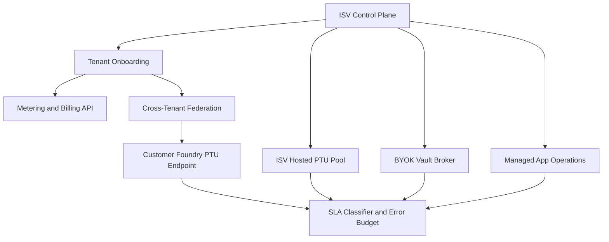
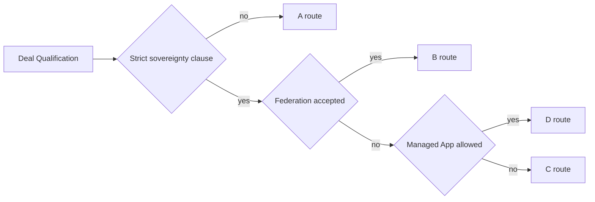
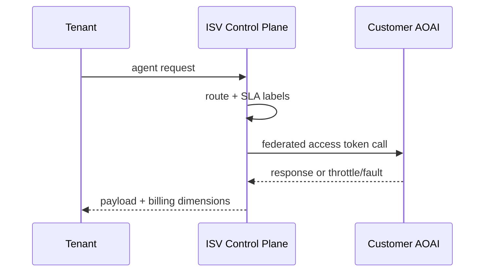

# Enterprise B2B AI SaaS BYOK/BYO-Foundry-PTU monetization selection FAQ: cross-tenant private connectivity, SLA boundaries, and MACC alignment

> 🌐 **Language Switch**: [中文](./b2b-saas-byok-byo-foundry-ptu-monetization-entra-cross-tenant-privatelink-vs-isv-hosted-pool-vs-managed-app-selection-faq.md) | **English (current)**
> **Audience**: Cloud & AI Solution Architects, ISV platform leads, enterprise procurement leaders, and FinOps teams.
> **Decision scope**: how an ISV remains profitable when customers demand inference in their own Azure subscription and reject token markups.

## 1. Why BYO-Foundry/BYO-PTU has become a hard enterprise deal gate

Enterprise buyers now write explicit sovereignty clauses requiring inference, policy controls, and telemetry residency within their own tenant boundaries.

When customers already own Foundry PTU capacity and Purview governance, forcing traffic through an ISV-owned pool is often rejected during security review.

The strategic question is no longer model connectivity but commercial survivability: how to preserve gross margin without storing customer secrets.

This pushes ISVs from token resale economics to platform subscription and Agent Work Unit monetization anchored on orchestration value.

## 2. Four architecture patterns and boundary ownership

Architecture A optimizes speed and central operations by hosting inference in the ISV estate, usually with the best initial gross margin profile.

Architecture B prioritizes sovereignty by using cross-tenant federation and customer-side RBAC, with no raw API keys persisted by the ISV.

Architecture C addresses heterogeneous multi-cloud estates through managed key brokerage and dynamic routing backed by contract probes.

Architecture D places data plane execution in customer subscriptions through Marketplace Managed Applications, maximizing residency control.

## 3. End-to-end reference: onboarding, metering, SLA attribution, and settlement



A viable control plane must output route ownership, billing ownership, and fault ownership in one schema to avoid contract and support disputes.

Large enterprise contracts typically require upstream-fault exclusion labels so customer-side 429 and 5xx events do not count against ISV availability.

## 4. Architecture A: ISV-hosted multi-tenant inference pool

Architecture A commonly combines ISV Foundry PTU, global standard spillover, APIM metering, and Marketplace SaaS transact for rapid onboarding.

Its strengths are deterministic operations and multiplexing efficiency across large tenant sets with similar workload patterns.

At 500-plus tenants with complementary peak profiles, A can reduce unit compute cost by roughly 18% to 32% versus isolated deployment.

Its weakness is sovereignty posture; contracts should include migration clauses into B or D for strategic accounts.

## 5. Architecture B: zero-secret cross-tenant BYO-Foundry/BYO-PTU

Architecture B uses Entra multi-tenant application trust and workload identity federation so runtime calls use short-lived delegated tokens.

Cross-tenant private endpoint approvals are the critical path, and they should be stitched into one auditable workflow with RBAC and legal controls.

Revenue shifts from token markup toward platform tier plus Agent Work Units tied to orchestration, tools, and evaluation outcomes.

B materially improves close rates for regulated enterprises but increases pre-onboarding engineering depth and tenant-specific support.

## 6. Architecture C: multi-cloud BYOK vault broker

Architecture C introduces a BYOK broker that wraps tenant credentials with envelope keys in managed HSM and routes by tenant policy.

Because model and filter contracts drift over time, automated canary probes should validate compatibility before release and on schedule.

C requires explicit fault-domain labeling so customer-upstream errors are separated from ISV platform errors in SLA calculations.

This path fits multi-cloud groups with decentralized procurement and heterogeneous policy frameworks.

## 7. Architecture D: customer-hosted data plane with Managed Application

Architecture D deploys the workload into customer subscriptions via Marketplace Managed Application, with publisher-governed upgrades and telemetry.

It is often the preferred pattern for sovereign, public sector, healthcare, and financial workloads where residency is non-negotiable.

Operationally, D demands stronger release choreography because customer change windows constrain upgrade velocity.

For long-duration strategic contracts, D can create high renewal stickiness due to deep compliance integration.

## 8. Quantitative models: margin, SLA, error budgets, and work-unit pricing

Gross margin can be modeled as `GrossMargin = Revenue - (Compute + Network + Operations + Support)` and segmented by architecture path.

Availability can be modeled as `SLA = 1 - (ISV_Downtime / Total_Time)` with explicit upstream-fault exclusions for customer endpoints.

Work-unit economics can be modeled as `UnitCost = PlatformCost / AgentWorkUnits`, supporting value-based pricing in B and C paths.

Commercial governance should track `MACC_Coverage = MarketplaceBillable / ContractValue` to align sales incentives with cloud commitments.

## 9. Twelve-dimension quantitative comparison matrix

| Dimension | Architecture A: ISV-hosted pool | Architecture B: cross-tenant BYO PTU | Architecture C: BYOK vault broker | Architecture D: Managed App customer data plane |
|---|---|---|---|---|
| Inference residency | ISV subscription | Customer subscription | Policy-routed mixed residency | Customer subscription |
| Secret exposure risk | Medium | Low | Medium-low | Low |
| Onboarding lead time | 1–2 weeks | 2–6 weeks | 3–7 weeks | 4–10 weeks |
| Gross margin band | 38%–62% | 22%–45% | 24%–42% | 18%–36% |
| Enterprise close rate | Medium | High | Medium-high | High |
| SLA attribution clarity | High | Medium-high | High | Medium-high |
| MACC alignment | High | Medium | Medium | High |
| Ops effort per tenant | 0.8–1.5h/month | 1.6–3.5h/month | 2.0–4.0h/month | 2.2–4.8h/month |
| Cross-region complexity | Medium | High | High | Medium-high |
| Fault isolation granularity | Medium | High | High | High |
| Renewal stickiness | Medium | High | Medium-high | High |
| Best-fit contract profile | Standardized mid-market | Large sovereign enterprise | Multi-cloud conglomerate | Regulated long-term strategic |

## 10. Decision flow from deal qualification to renewal governance





Deal governance should decide boundary first and discount second; reversing the order usually creates avoidable technical debt.

## 11. Production templates: Bicep and APIM policy

```bicep
param location string = 'eastus2'
param uamiId string
resource apim 'Microsoft.ApiManagement/service@2023-09-01-preview' = {
  name: 'isv-byo-apim'
  location: location
  sku: { name: 'Premium' capacity: 2 }
  identity: { type: 'SystemAssigned,UserAssigned', userAssignedIdentities: { '${uamiId}': {} } }
}
resource privateEndpoint 'Microsoft.Network/privateEndpoints@2023-09-01' = {
  name: 'cross-tenant-aoai-pe'
  location: location
  properties: {
    subnet: { id: '/subscriptions/.../subnets/apim' }
    privateLinkServiceConnections: [{
      name: 'aoai-conn'
      properties: { privateLinkServiceId: '/subscriptions/.../accounts/customer-aoai'; groupIds: ['account'] }
    }]
  }
}
```

```xml
<policies>
  <inbound>
    <set-variable name="tenant-id" value="@(context.Request.Headers.GetValueOrDefault("x-tenant-id","unknown"))" />
    <authentication-managed-identity resource="https://cognitiveservices.azure.com" />
    <set-header name="x-sla-route" exists-action="override">
      <value>@(context.Variables.GetValueOrDefault<string>("slaRoute", "unclassified"))</value>
    </set-header>
  </inbound>
</policies>
```

Version Bicep and APIM policy together so boundary controls and SLA labels cannot drift across environments.

## 12. Production code: BYO probes and SLA classifier

```python
from dataclasses import dataclass

@dataclass
class ProbeResult:
    tenant: str
    latency_ms: int
    status_code: int
    contract_ok: bool

def classify(result: ProbeResult) -> str:
    if result.status_code in (429, 500, 502, 503) and not result.contract_ok:
        return 'customer_upstream_fault'
    if result.status_code >= 500:
        return 'isv_platform_fault'
    if result.latency_ms > 4500:
        return 'isv_latency_degradation'
    return 'healthy'

def work_units(tokens_in: int, tokens_out: int, tool_calls: int, eval_rounds: int) -> float:
    return tokens_in/1000*0.25 + tokens_out/1000*0.40 + tool_calls*0.80 + eval_rounds*0.60
```

Probe outcomes should feed both operational telemetry and billing data so support, finance, and customer success teams operate on the same evidence.

## 13. Enterprise scenario A: mixed 50–300 tenant industrial portfolio

Scenario A represents an ISV serving 50 to 300 enterprise tenants across industrial and manufacturing domains with mixed compliance requirements.

The platform uses A for standardized customers and B for sovereignty-sensitive accounts, reducing average onboarding from nine weeks to roughly five and a half weeks.

The most valuable change was explicit upstream-fault labeling, which prevented avoidable SLA credits caused by customer-side capacity shortages.

Commercially, splitting pricing into platform subscription and work-unit value made procurement conversations more transparent and renewal-friendly.

## 14. Enterprise scenario B: 300–1,500 tenant global distribution network

Scenario B represents a global distribution network scaling from 300 to 1,500 tenants with strict regional boundary requirements.

The provider applies C for multi-cloud policy diversity and D for hard sovereignty contracts, while preserving a single governance schema for reporting.

Although integration complexity increases, renewal rates improve because compliance evidence becomes deterministic and contract reviews shorten.

At this scale, architecture portfolio management outperforms single-path optimization because deal terms continuously reshape technical boundaries.

### Three-year TCO and margin model (50 / 300 / 1,500 tenants)

| Path | 50 tenants (ISV cost / buyer cost) | 300 tenants (ISV cost / buyer cost) | 1,500 tenants (ISV cost / buyer cost) | 3-year ISV gross margin | 3-year buyer savings |
|---|---:|---:|---:|---:|---:|
| A hosted pool | 2.8M / 4.1M | 11.4M / 18.9M | 47.5M / 86.0M | 56% | 12% |
| B BYO PTU | 3.4M / 3.9M | 14.7M / 16.8M | 58.2M / 71.5M | 39% | 24% |
| C BYOK broker | 3.9M / 4.0M | 15.6M / 17.2M | 61.8M / 73.9M | 35% | 22% |
| D managed app | 4.2M / 3.7M | 16.5M / 15.9M | 63.0M / 67.8M | 33% | 28% |
| A+B hybrid | 3.1M / 3.9M | 12.9M / 17.0M | 52.4M / 74.2M | 44% | 26% |

## 15. Day-0/1/2 checklist, worked Q&A, fit boundaries, and runtime alerts

### Day-0

1. Map contract clauses to architecture controls for sovereignty, key ownership, and SLA exclusions.

2. Define pricing dimensions across platform tier, work units, tool calls, and evaluation loops.

3. Implement cross-tenant identity and private connectivity approval workflows with audit IDs.

4. Standardize fault-domain labels in APIM, telemetry, and finance pipelines.

5. Align Marketplace metering cadence with accounting close windows.

6. Run first-pass tenant contract probes and produce pre-sales evidence packets.

### Day-1

1. Reconcile tenant route labels with billing dimensions every day.

2. Track ratio changes between customer-upstream and isv-platform faults.

3. Monitor cross-tenant private endpoint approval cycle time.

4. Review work-unit output value against customer adoption outcomes.

5. Refresh sales playbooks with boundary and SLA attribution FAQs.

6. Validate contract probe precision on model and filter drift alerts.

### Day-2

1. Tune work-unit pricing weights weekly against observed delivery value.

2. Reconcile margin profile and customer savings metrics monthly.

3. Run quarterly failover drills for federation and private connectivity failures.

4. Revalidate compliance templates and evidence retention workflows quarterly.

5. Shift tenant portfolio mix away from low-value high-support paths.

6. Feed renewal retrospectives back into architecture roadmap decisions.

### Q1: How should an ISV compare A and B margin outcomes?

Compute `MarginDelta = Margin_A - Margin_B` and then include incremental deal wins enabled by sovereignty compliance in B.

A typical portfolio sees raw margin drop on B, but net margin gap narrows after additional high-value contracts become winnable.

### Q2: How should BYO-PTU pricing be packaged?

Split price into `PlatformTier + AgentWorkUnit` so value is tied to orchestration and governance outcomes rather than token resale.

This structure reduces procurement friction when customers already own PTU capacity and need transparent non-token economics.

### Q3: How can SLA exclusions stay auditable?

Separate `isv_platform_fault` and `customer_upstream_fault` with mandatory evidence fields per event.

If customer endpoint 429 and 5xx events are proven by probes, those minutes should not count as ISV downtime in SLA settlement.

### Q4: Why can D reduce buyer-side TCO despite higher ISV effort?

Managed App reduces recurring security assessment and remediation overhead for regulated buyers.

In heavily regulated environments, governance labor and audit friction often exceed incremental infrastructure spend.

### Q5: How do we avoid multi-cloud contract drift incidents in C?

Run automated contract probes for model version, filter policy, response schema, and rate limits before each release.

A failed probe should block rollout and trigger a joint remediation workflow between ISV and tenant operations teams.

### Q6: When should an ISV migrate from A toward B or D?

Migrate when sovereignty objections become the dominant close blocker and strategic-account share keeps rising.

If more than half of top accounts require tenant-contained inference, staying A-only usually amplifies pipeline loss.

### Good fit vs Not for

Good fit: enterprise B2B SaaS portfolios balancing sovereignty constraints, measurable SLA attribution, and long-term monetization strategy.

Not for: small internal tools with simple contracts, no tenant-boundary requirements, and low governance obligations.

### Runtime alert dictionary

| Alert key | Trigger condition | Immediate action | Owner |
|---|---|---|---|
| `tenant_route_mismatch` | Route does not match contracted boundary | Block request and force safe route | Platform Engineering |
| `federation_token_fail` | Cross-tenant token acquisition failure | Switch to degraded mode and open identity incident | Identity Platform |
| `private_endpoint_pending` | Private endpoint approval timeout | Notify customer network team and reschedule cutover | Delivery Team |
| `billing_dim_drift` | Missing or misaligned billing dimensions | Pause metering writes and replay logs | FinOps |
| `upstream_429_spike` | Tenant upstream throttling spike | Mark exclusion window and recommend capacity action | Customer Success |
| `contract_probe_fail` | Model or filter contract probe failure | Block release and create remediation task | Release Engineering |
| `marketplace_meter_lag` | Marketplace metering callback lag | Run compensation job and manual reconciliation | Finance Systems |
| `sla_label_gap` | Missing SLA attribution label | Apply fallback label and trigger alert | Observability Team |

### Commercial governance deep-dive for renewal safety

A renewal-safe architecture must preserve one-to-one traceability from technical execution to contractual charge dimensions, because enterprise procurement teams increasingly demand replayable evidence for every invoice dispute and every SLA credit claim.

When BYO-PTU tenants adopt their own capacity policies, the ISV should continuously publish utilization diagnostics that separate controllable orchestration inefficiency from customer-side quota saturation, otherwise the support backlog becomes a pricing argument instead of a reliability discussion.

In multi-year agreements, price-protection clauses should be coupled with explicit architecture migration rights so customers can move from hosted pool to tenant-contained routes without renegotiating the entire legal framework under outage pressure.

For strategic accounts, quarterly governance should include an attribution review that compares booked revenue, work-unit output quality, escalations avoided, and customer labor savings, ensuring monetization remains anchored to measurable delivered value rather than opaque token arithmetic.

A practical pattern is to run a dual-ledger close process where billing records and telemetry records are reconciled by the same immutable request IDs, reducing the probability of silent drift between operational truth and financial truth during rapid release cycles.

Procurement teams also evaluate exit-cost exposure, so architecture docs should define how tenant routes, policy bundles, and historical evidence can be exported if contract ownership changes, which directly improves trust during expansion and co-sell motions.

Finally, governance maturity should be measured not only by uptime but by dispute-resolution cycle time, attribution confidence, and correction latency, because these dimensions determine whether large enterprises perceive the ISV as a platform partner or merely a model reseller.

### Source references (captured on 2026-11-23)

1. Azure API Management AI Gateway: https://learn.microsoft.com/azure/api-management/ai-gateway-overview

2. Azure Marketplace metered billing API: https://learn.microsoft.com/partner-center/marketplace-offers/marketplace-metering-service-apis

3. Managed Applications overview: https://learn.microsoft.com/azure/azure-resource-manager/managed-applications/overview

4. Entra workload identity federation: https://learn.microsoft.com/entra/workload-id/workload-identity-federation

5. Azure OpenAI RBAC and networking guidance: https://learn.microsoft.com/azure/ai-services/openai/how-to/role-based-access-control
