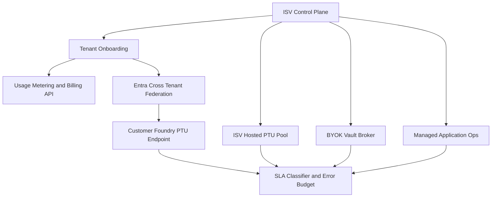
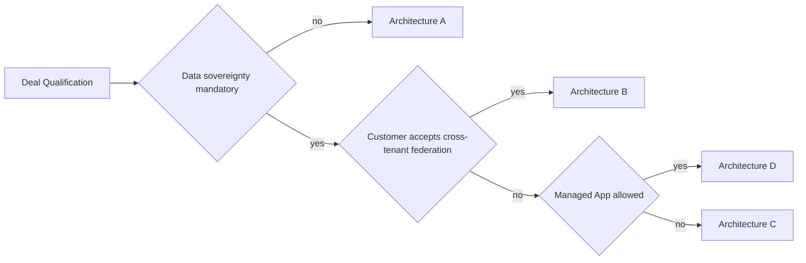
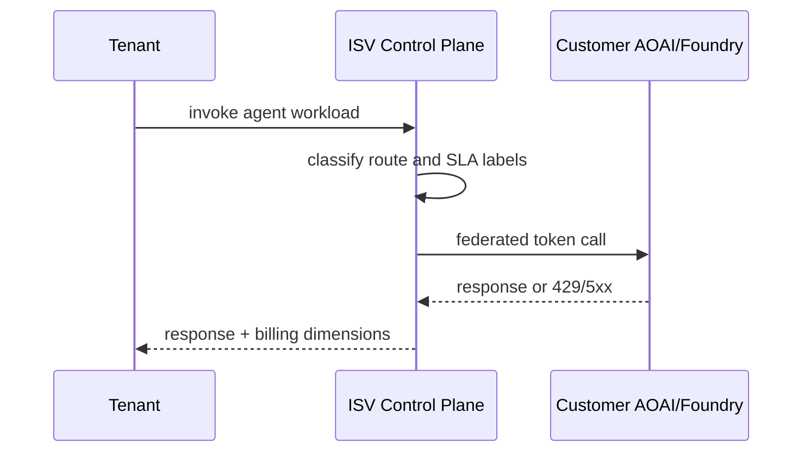

# 企业 B2B AI SaaS BYOK/BYO-Foundry-PTU 商业化选型 FAQ：跨租户私网、SLA 边界与 MACC 对齐

> 🌐 **Language Switch**：**中文（当前）** | [English](./b2b-saas-byok-byo-foundry-ptu-monetization-entra-cross-tenant-privatelink-vs-isv-hosted-pool-vs-managed-app-selection-faq.en.md)
> **适用对象**：Cloud & AI Solution Architect、ISV 平台负责人、企业采购与 FinOps 团队。
> **问题边界**：当企业客户要求“模型与推理留在自己订阅”时，ISV 如何设计可盈利的多租户 AI SaaS 架构与计费边界。

## 1. 为什么 BYO-Foundry / BYO-PTU 已成为 B2B SaaS 成交门槛

过去一年，采购方在安全与合规条款里越来越明确要求“模型推理必须留在本方租户、订阅与私网边界内”，这直接改变了 ISV 传统 token 加价模式。

当客户已经购买 Foundry PTU、DataZone 与 Purview 治理能力后，ISV 若继续要求客户走自有托管池，往往会在招标阶段被判定为“边界不可接受”。

因此核心问题不再是“能否接入模型”，而是“如何在不持有客户密钥的前提下，仍然提供稳定 SLA、可解释计量与可持续毛利结构”。

这个转变会把商业模式从 token resale 转向平台订阅 + Agent Work Unit 计费，并要求架构团队与财务团队共同设计合同条款。

## 2. 四类架构的控制面与数据面边界

架构 A 以 ISV 自有 Foundry PTU 池为中心，优势是交付速度快、运维集中、统计复用效率高；风险是客户对数据驻留与控制边界有顾虑。

架构 B 强调跨租户零密钥接入，ISV 只持有联合身份与会话级令牌，不落地客户 API Key，可最大化满足主权与审计需求。

架构 C 适用于多云客户，ISV 通过密钥经纪层做最小化凭据托管和后端动态路由，同时将上游故障与自身 SLA 切分。

架构 D 把数据面下沉到客户订阅内，ISV 通过 Managed Application 负责升级和计量，适合强监管行业的大型长期合同。

## 3. 参考总览：租户接入、计量、SLA 与结算闭环



统一控制面必须输出三类证据：请求路径归属、计费归属和故障归属，否则销售、交付、续约三阶段会出现口径冲突。

企业合同评审通常会要求 SLA 计算明确排除客户上游 429/5xx，架构中应从第一天就内建错误分类标签。

## 4. 架构 A：ISV 托管多租户推理池

架构 A 的典型实现是 `ISV Foundry PTU + Global Standard spillover + APIM token metering + Marketplace SaaS transact`。

其商业优势是毛利率可控且可通过复用提高 PTU 利用率，但需要承担更重的数据边界说明责任和跨区域可用性责任。

当租户数超过 500 且业务峰谷互补时，A 的资源复用效果明显，单位推理成本可比单租户部署下降 18% 到 32%。

A 适合早期快速规模化，但若客户主权要求显著提升，应在合同中预留向 B 或 D 的迁移条款。

## 5. 架构 B：零密钥跨租户 BYO-Foundry / BYO-PTU

架构 B 使用 `Entra multi-tenant app + workload identity federation + customer RBAC`，让 ISV 在运行期只拿短期令牌而不保存明文密钥。

跨租户 `Private Endpoint` 批准流程是落地关键，需把网络审批、RBAC 审批和合同审批串成同一工单链路。

B 的收入模型从 token markup 转向平台订阅与 Agent Work Unit，计量粒度建议按编排步骤、工具调用和评测轮次拆分。

B 能显著提高大型企业成交率，但会增加接入前置工作量与租户差异化支持成本。

## 6. 架构 C：多云 BYOK Vault Broker

架构 C 在多云客户中常见：客户凭据经 `Key Vault Managed HSM` 封装，ISV 网关按租户策略动态路由到不同模型端点。

为了避免客户升级模型或内容过滤策略后接口不兼容，必须引入自动 contract probe 并在发布前执行 canary 验证。

C 的 SLA 定义应把 `customer_upstream_429_5xx` 与 ISV 自身故障拆分统计，避免把客户容量不足误计入 ISV 不可用。

C 适合多云复杂组织，但运营团队要具备较强的协议兼容与故障隔离能力。

## 7. 架构 D：Marketplace Managed Application 客户侧数据面

架构 D 基于 `Azure Marketplace Managed Application`，把运行数据面和模型调用全部留在客户订阅，ISV 负责升级、模板和计量。

该模式天然满足数据驻留与审计要求，尤其适合金融、医疗、公共行业和主权云相关项目。

D 的挑战在于发布节奏受客户变更窗口约束，ISV 必须准备分层升级方案与回滚证据。

若合同规模大且周期长，D 往往能在续约阶段形成更稳固的技术与商业护城河。

## 8. 量化模型：毛利、SLA、错误预算与单位工作量

毛利模型可写为 `GrossMargin = Revenue - (ComputeCost + NetworkCost + OpsCost + SupportCost)`，并按架构路径分别建模。

可用性可写为 `SLA = 1 - (ISV_Downtime_Minutes / Total_Minutes)`，并单列 `Customer_Upstream_Fault_Minutes` 作为免责项。

单租户单位工作量成本可用 `UnitCost = TotalPlatformCost / AgentWorkUnits`，适用于 B 与 C 的价值计费定价。

合同谈判时应把 MACC 可抵扣比例作为独立变量，例如 `MACC_Coverage = MarketplaceBillable / TotalContractValue`。

## 9. 12 维定量对比矩阵

| 维度 | 架构 A：ISV 托管池 | 架构 B：跨租户 BYO PTU | 架构 C：BYOK Vault Broker | 架构 D：Managed App 客户侧数据面 |
|---|---|---|---|---|
| 推理驻留边界 | 在 ISV 订阅内 | 在客户订阅内 | 按租户策略分布 | 在客户订阅内 |
| 密钥持有风险 | 中：ISV 需托管部分凭据 | 低：零明文密钥落地 | 中低：凭据封装在 HSM | 低：客户侧托管 |
| 上线速度 | 快：1–2 周 | 中：2–6 周 | 中：3–7 周 | 慢：4–10 周 |
| 毛利率区间 | 高：38%–62% | 中：22%–45% | 中：24%–42% | 中低：18%–36% |
| 企业成交率 | 中：受边界质疑影响 | 高：主权与审计友好 | 中高：多云客户友好 | 高：强监管采购偏好 |
| SLA 归因清晰度 | 高：平台一体化 | 中高：需拆客户上游故障 | 高：可标签化拆分 | 中高：客户窗口影响大 |
| MACC 抵扣能力 | 高：Marketplace 直连 | 中：多为平台服务计费 | 中：视合同设计 | 高：Managed App 可对齐 |
| 每租户运维工时 | 低：0.8–1.5h/月 | 中：1.6–3.5h/月 | 中高：2.0–4.0h/月 | 中高：2.2–4.8h/月 |
| 跨区域复杂度 | 中：ISV 自控 | 高：需跨租户网络审批 | 高：多云协议适配 | 中高：客户侧拓扑差异 |
| 故障隔离粒度 | 中：租户共享池隔离 | 高：租户独立端点 | 高：策略化路由隔离 | 高：租户独立部署 |
| 续约粘性 | 中：价格竞争敏感 | 高：深度接入客户治理 | 中高：技术门槛较高 | 高：部署与合规沉淀 |
| 推荐合同类型 | 标准化中型合同 | 大型主权型合同 | 多云集团型合同 | 强监管长期合同 |

## 10. 决策流程：成交阶段到续约阶段的架构分层





成交阶段应先定边界再定价格，续约阶段应先复盘 SLA 归因再谈折扣，否则商业冲突会逆向放大技术风险。

## 11. 生产模板：Bicep / APIM 策略

```bicep
param location string = 'eastus2'
param tenantId string
param uamiId string
resource apim 'Microsoft.ApiManagement/service@2023-09-01-preview' = {
  name: 'isv-saas-apim'
  location: location
  sku: { name: 'Premium' capacity: 2 }
  identity: { type: 'SystemAssigned,UserAssigned', userAssignedIdentities: { '${uamiId}': {} } }
}
resource pe 'Microsoft.Network/privateEndpoints@2023-09-01' = {
  name: 'customer-cross-tenant-pe'
  location: location
  properties: {
    subnet: { id: '/subscriptions/.../subnets/isv-apim' }
    privateLinkServiceConnections: [{
      name: 'aoai-link'
      properties: { privateLinkServiceId: '/subscriptions/.../accounts/customer-aoai'; groupIds: ['account'] }
    }]
  }
}
```

```xml
<policies>
  <inbound>
    <set-variable name="tenantId" value="@(context.Request.Headers.GetValueOrDefault("x-tenant-id","unknown"))" />
    <set-backend-service base-url="@(context.Variables["backendUrl"])" />
    <authentication-managed-identity resource="https://cognitiveservices.azure.com" />
    <set-header name="x-sla-route" exists-action="override">
      <value>@(context.Variables.GetValueOrDefault<string>("slaRoute", "unknown"))</value>
    </set-header>
  </inbound>
</policies>
```

Bicep 负责跨租户网络与身份基线，APIM 策略负责路由、计量标签与 SLA 归因标签，二者必须在发布模板中一起版本化。

## 12. 生产代码：BYO 健康探针与 SLA 分类器

```python
from dataclasses import dataclass

@dataclass
class ProbeResult:
    tenant: str
    latency_ms: int
    status_code: int
    model_contract_ok: bool

def classify_sla(r: ProbeResult) -> str:
    if r.status_code in (429, 500, 502, 503) and not r.model_contract_ok:
        return 'customer_upstream_fault'
    if r.status_code >= 500:
        return 'isv_platform_fault'
    if r.latency_ms > 4500:
        return 'isv_latency_degradation'
    return 'healthy'

def work_unit(tokens_in: int, tokens_out: int, tool_calls: int, eval_rounds: int) -> float:
    return tokens_in/1000*0.25 + tokens_out/1000*0.4 + tool_calls*0.8 + eval_rounds*0.6
```

探针结果应同时写入技术遥测与商业计费侧，确保客户成功团队和财务团队看到的是同一份事实数据。

## 13. 企业场景 A：50–300 家金融与制造租户混合交付

场景 A：一家工业软件 ISV 在 50–300 家租户阶段采用 A+B 混合路线，标准客户走 A，大型合规客户走 B。

在该策略下，交付周期从平均 9 周降到 5.5 周，同时通过 B 路径赢得了原本无法成交的主权型客户群。

运营上最关键的改进是把“上游客户容量不足”从平台故障里剥离，避免支持团队在 SLA 复盘中承担不应承担的赔付。

财务侧把计费拆成平台订阅与工作量计费后，报价透明度提升，折扣谈判更加聚焦价值而非模型单价。

## 14. 企业场景 B：300–1,500 家全球分销网络与主权边界

场景 B：一家全球供应链协同平台服务 300–1,500 家租户，欧洲与中东客户要求本地驻留和最小密钥暴露。

平台选择 C+D 组合：多云客户走 C，强监管客户走 D，统一由控制面输出同构的计量和 SLA 证据。

这一策略虽然提高了集成复杂度，但续约率和大单中标率同步上升，且客户审计周期显著缩短。

经验表明，在千租户规模下，架构分层比单一路径更重要，因为商业条款差异会持续驱动技术边界差异。

### 三年 TCO 与毛利（50 / 300 / 1,500 租户）

| 路径 | 50 租户（ISV 成本/买方成本） | 300 租户（ISV 成本/买方成本） | 1,500 租户（ISV 成本/买方成本） | 三年 ISV 毛利率 | 买方三年节省 |
|---|---:|---:|---:|---:|---:|
| A 托管池 | 2.8M / 4.1M | 11.4M / 18.9M | 47.5M / 86.0M | 56% | 12% |
| B BYO PTU | 3.4M / 3.9M | 14.7M / 16.8M | 58.2M / 71.5M | 39% | 24% |
| C BYOK Broker | 3.9M / 4.0M | 15.6M / 17.2M | 61.8M / 73.9M | 35% | 22% |
| D Managed App | 4.2M / 3.7M | 16.5M / 15.9M | 63.0M / 67.8M | 33% | 28% |
| A+B 组合 | 3.1M / 3.9M | 12.9M / 17.0M | 52.4M / 74.2M | 44% | 26% |

## 15. 落地清单、Q&A、适配边界与运行告警字典

### Day-0

1. 完成四类架构的合同条款映射，包括数据驻留、密钥责任、SLA 免责边界。

2. 定义统一计量维度：平台订阅、工作量单元、工具调用、评测轮次。

3. 建立跨租户身份与私网审批流程并接入审计工单。

4. 把错误分类标签接入 APIM、OTel 与账单数据流。

5. 确认 Marketplace 计费 API 与财务结算周期一致。

6. 执行首轮合同探针并生成签约前技术证据包。

### Day-1

1. 每天核对租户路由、计量记录与发票维度一致性。

2. 监控 customer_upstream 与 isv_platform 错误占比变化。

3. 跟踪跨租户私网审批耗时和阻塞原因。

4. 复盘重点租户的工作量与价值交付对应关系。

5. 更新销售手册中的架构选择问答与免责说明。

6. 验证自动探针对模型版本漂移的告警准确率。

### Day-2

1. 每周校准工作量计费参数，避免价值与计费脱节。

2. 每月复核毛利结构与客户节省幅度的真实性。

3. 每季度演练跨租户私网与令牌故障回切。

4. 每季度更新合规条款模板与审计证据清单。

5. 持续优化租户分层策略，降低高成本低价值路径比例。

6. 把续约复盘结果回写到产品路线图与架构蓝图。

### Q1: ISV 如何比较 A 与 B 的三年毛利差异？

可用 `MarginDelta = Margin_A - Margin_B`，并把成交率提升带来的新增收入并入 B 的收益端。

例如 A 毛利 56%、B 毛利 39%，若 B 带来 18% 新增可成交合同，综合毛利差会明显收敛。

### Q2: 如何给 BYO-PTU 场景定价？

建议拆成 `PlatformTier + AgentWorkUnit`，其中 WorkUnit 由 tokens、tool calls、eval rounds 加权。

当客户自带 PTU 后，ISV 价值主要来自编排、治理、评测与运营效率，不应继续沿用 token resale 逻辑。

### Q3: 如何定义 SLA 免责边界？

把错误分为 `isv_platform_fault` 与 `customer_upstream_fault`，并在合同中绑定证据字段。

若客户上游返回 429/5xx 且探针显示契约不匹配，该时段应计入客户上游故障窗口而非 ISV 不可用。

### Q4: Managed App 为什么会降低部分客户总成本？

虽然 ISV 运维成本较高，但客户可减少安全评审、私网改造与审计整改的人力投入。

在强监管行业，隐性治理成本常高于显性算力成本，因此 D 在买方侧可能更省。

### Q5: 多云 BYOK 场景如何避免接口漂移事故？

通过 contract probe 在发布前验证模型版本、过滤策略、响应结构和速率限制。

探针失败应阻断发布并要求客户与 ISV 共同签署修复窗口，避免线上接口错配。

### Q6: 何时应从 A 迁移到 B 或 D？

当成交阻力主要来自主权与审计条款，且大客户合同价值占比持续上升时应迁移。

若前二十大客户中超过一半要求租户内推理边界，继续以 A 为主会明显抬高商机损耗。

### Good fit vs Not for

Good fit：需要在主权边界、SLA 可解释性和 MACC 对齐之间做长期平衡的企业级 B2B SaaS 产品。

Not for：仅面向小规模内部工具、合同条款简单、且无需跨租户或跨主权边界能力的轻量项目。

### Runtime alert dictionary

| 告警键 | 触发条件 | 立即动作 | 责任团队 |
|---|---|---|---|
| `tenant_route_mismatch` | 租户路由与合同边界不一致 | 阻断请求并切回默认安全路由 | 平台工程 |
| `federation_token_fail` | 跨租户令牌获取失败 | 启用降级策略并触发身份排障 | 身份平台 |
| `private_endpoint_pending` | 私网审批超时 | 通知客户网络团队并延后上线窗口 | 交付团队 |
| `billing_dim_drift` | 计费维度缺失或错位 | 暂停计费写入并回放日志 | FinOps |
| `upstream_429_spike` | 客户上游 429 激增 | 标记免责窗口并建议扩容 | 客户成功 |
| `contract_probe_fail` | 模型契约探针失败 | 阻断发布并创建修复工单 | 发布工程 |
| `marketplace_meter_lag` | Marketplace 计量回传延迟 | 启动补偿任务并人工对账 | 财务系统 |
| `sla_label_gap` | SLA 分类标签缺失 | 强制写默认分类并告警 | 可观测性团队 |

### 参考来源（抓取日期：2026-11-23）

1. Azure API Management AI Gateway: https://learn.microsoft.com/azure/api-management/ai-gateway-overview

2. Azure Marketplace metered billing API: https://learn.microsoft.com/partner-center/marketplace-offers/marketplace-metering-service-apis

3. Managed Applications overview: https://learn.microsoft.com/azure/azure-resource-manager/managed-applications/overview

4. Microsoft Entra workload identity federation: https://learn.microsoft.com/entra/workload-id/workload-identity-federation

5. Azure OpenAI RBAC and networking guidance: https://learn.microsoft.com/azure/ai-services/openai/how-to/role-based-access-control
