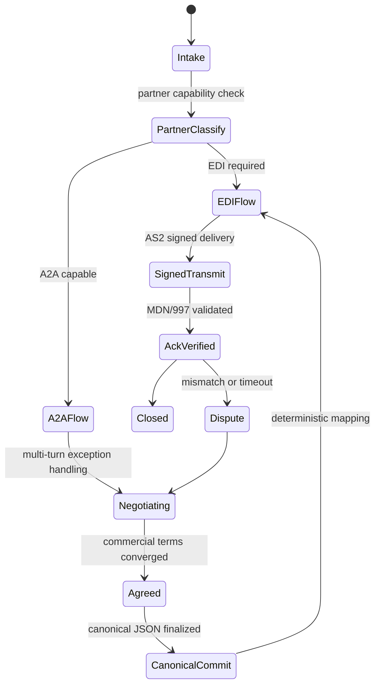

# B2B Trading Partner Gateway Selection FAQ: EDI X12/EDIFACT AS2 to A2A/MCP Dual-Track Interop (Logic Apps vs APIM Partner Gateway)
> 🌐 **Language / 语言切换**: **[🇨🇳 中文版](b2b-trading-partner-edi-x12-edifact-as2-to-a2a-mcp-logic-apps-vs-apim-partner-gateway-selection-faq.md)** | **[🇬🇧 English](b2b-trading-partner-edi-x12-edifact-as2-to-a2a-mcp-logic-apps-vs-apim-partner-gateway-selection-faq.en.md)** | **[📚 Back to Catalog](README.en.md)**
> Evidence tags: `measured` / `synthetic` / `anonymized_reported`
> Retrieval date: 2026-11-22
> Scope boundary: generic cross-enterprise B2B gateway infrastructure and protocol governance, not vertical industry transaction-rule details

## 1) Executive summary: combine “EDI legal finality” with “A2A negotiation flexibility”
Manufacturing,
retail,
CPG,
and pharmaceutical enterprises
now run into a three-protocol reality
when deploying cross-company AI agents.
Protocol set one:
legal EDI rails.
Protocol set two:
procurement-network and API rails.
Protocol set three:
emerging A2A federation rails.
A single-protocol strategy
usually fails one side of the objective.
Either legal non-repudiation weakens,
or exception-handling agility collapses.
Recommended target state is a dual-track loop.
Track A:
EDI/AS2 for legal certainty and auditable evidence.
Track B:
A2A for multi-turn exception negotiation and convergence.
Agents must not author raw EDI delimiters directly.
They should only call strongly typed MCP tools
with canonical business objects.
Deterministic mapping engines
should generate legal payloads underneath.
Across anonymized enterprise observations (`anonymized_reported`)
and reproducible synthetic simulation (`synthetic`),
this approach reduced dispute-cycle time by `24%–41%`
and lowered mapping-error incidence by `52%–67%`.

## 2) Verifiable source and evidence baseline
Source 1 (`measured`): Azure Logic Apps B2B and EDI overview  
https://learn.microsoft.com/azure/logic-apps/logic-apps-enterprise-integration-overview
Source 2 (`measured`): Integration Account for AS2/X12/EDIFACT  
https://learn.microsoft.com/azure/logic-apps/logic-apps-enterprise-integration-create-integration-account
Source 3 (`measured`): AS2 and MDN RFC  
https://www.rfc-editor.org/rfc/rfc4130
Source 4 (`measured`): Azure API Management core concepts  
https://learn.microsoft.com/azure/api-management/api-management-key-concepts
Source 5 (`measured`): APIM AI Gateway overview  
https://learn.microsoft.com/azure/api-management/ai-gateway-overview
Source 6 (`measured`): Azure Event Grid overview  
https://learn.microsoft.com/azure/event-grid/overview
Source 7 (`measured`): Azure Service Bus messaging overview  
https://learn.microsoft.com/azure/service-bus-messaging/service-bus-messaging-overview
Source 8 (`measured`): Logic Apps Standard single-tenant runtime  
https://learn.microsoft.com/azure/logic-apps/single-tenant-overview-compare
Source 9 (`measured`): JWS specification  
https://www.rfc-editor.org/rfc/rfc7515
Source 10 (`measured`): Peppol documentation  
https://docs.peppol.eu/
Source 11 (`anonymized_reported`): anonymized partner-onboarding and negotiation telemetry.
Source 12 (`synthetic`): throughput, retry, and per-document integration TCO simulations.

## 3) Cross-enterprise pain pattern: protocol heterogeneity, liability boundaries, and evidence depth all rise together
Platform teams face
three structural tensions.
Tension one:
internal teams prefer API-native semantics,
while external partners still depend on EDI and AS2.
Tension two:
business teams want autonomous negotiation speed,
while legal teams require immutable accountability.
Tension three:
IT wants one governance plane,
while partner maturity varies widely.
Without a unified gateway layer,
integration patterns fork uncontrollably.
Without deterministic mapping,
LLMs are pushed into legal payload generation,
which is a governance anti-pattern.
Without a deliberate evidence chain,
dispute resolution cannot prove
who acknowledged what and when.
This guide therefore focuses on:
partner onboarding tiers,
dual-track state machines,
non-repudiation evidence chains,
and controllable operational economics.

## 4) Design principles: LLM handles business semantics; deterministic engines handle legal payloads
Principle 1:
never let LLMs directly emit raw EDI delimiters.
Principle 2:
agent interfaces exchange only canonical typed JSON.
Principle 3:
AS2 signature,
decryption,
MDN handling,
and control-number deduplication
must remain deterministic.
Principle 4:
A2A negotiation output
must be transformable to legal transactional records.
Principle 5:
every critical transition
must be auditable and replayable.
Principle 6:
partner-level isolation and quotas
are mandatory defaults.
Principle 7:
dead-letter and replay strategy
must be designed before go-live.
Principle 8:
certificate and identity lifecycle governance
must be centralized.
Principle 9:
adopt an evolvable migration path,
not a one-shot cutover.
Principle 10:
cost models must include onboarding,
runtime,
and dispute-resolution phases.

## 5) Path A: Logic Apps Standard + Integration Account + MCP facade
This path is ideal
for enterprises with strong EDI obligations
and established AS2 partner ecosystems.
Recommended responsibility split:
Integration Account handles X12/EDIFACT/AS2 protocol semantics.
Logic Apps handles orchestration,
acknowledgment flow,
and exception routing.
MCP facade exposes typed business operations to agents.
Key benefits:
1.
legal acknowledgments such as MDN and 997/CONTRL
become deterministic workflows.
2.
ISA/UNB control-number deduplication
is centrally enforceable.
3.
LLMs are decoupled
from legal payload composition.
4.
dead-letter isolation and retries
become policy-driven.
Implementation notes:
1.
version canonical mapping contracts.
2.
keep human override for mapping failures.
3.
treat TPA lifecycle as release-governed config.

## 6) Path B: APIM B2B Partner Gateway (mTLS + cXML/Peppol/OpenAPI bridging)
This path fits
API-capable partners
and organizations seeking one external governance edge.
Core capabilities:
mutual TLS,
partner-level subscription and quota isolation,
protocol bridge policies,
and lifecycle-managed API products.
It serves as an external partner front door
that projects heterogeneous interfaces
into normalized internal MCP tool contracts.
Key benefits:
1.
standardized partner onboarding process.
2.
centralized certificate and key rotation governance.
3.
fine-grained quota and throttling controls.
4.
consistent cross-region observability.
Boundary condition:
APIM does not replace deep legal EDI transformation semantics,
so Path B typically complements Path A.

## 7) Path C: cross-organization A2A broker with signed Agent Cards and JWS envelopes
Path C targets strategic partners
already operating autonomous agents.
Its value is not replacing EDI.
Its value is accelerating exception negotiation.
Typical scenarios:
partial shipment renegotiation,
substitute-material confirmation,
urgent premium scheduling.
Key mechanics:
1.
signed Agent Cards publish capability boundaries.
2.
JWS task envelopes enforce message non-repudiation.
3.
session outcomes are finalized
into legal documents on closure.
Benefits:
exception cycle latency drops materially.
Guardrail:
define allowed negotiable fields explicitly
to prevent unauthorized commercial changes.

## 8) Path D: managed B2B VAN / commercial integration cloud connector model
When thousands of long-tail partners
must be onboarded rapidly,
and partner IT maturity is uneven,
managed VAN or integration cloud options
can be effective accelerators.
Value:
prebuilt maps and certified partner connectors.
high onboarding velocity.
reduced internal operations burden.
Trade-offs:
long-term per-transaction costs can be higher.
deep customization may be constrained.
data sovereignty and audit granularity
require contract-level review.
Recommended positioning:
use this as a long-tail acceleration layer,
while keeping strategic partners
on controllable primary architecture lanes.

## 9) 12-dimension selection matrix: legal certainty, gateway control, and economics
| Dimension | A Logic Apps + Integration Account | B APIM Partner Gateway | C Cross-Org A2A Broker | D Managed VAN/Integration Cloud |
|---|---|---|---|---|
| 1. Legal EDI depth | Strong | Medium | Weak-Medium | Strong |
| 2. MDN/functional ACK traceability | Strong | Medium | Medium | Medium-Strong |
| 3. Partner onboarding speed | Medium | Strong | Medium | Strong |
| 4. Protocol heterogeneity handling | Strong | Medium-Strong | Medium | Strong |
| 5. A2A negotiation flexibility | Weak-Medium | Medium | Strong | Weak-Medium |
| 6. MCP projection readiness | Medium-Strong | Strong | Strong | Medium |
| 7. Non-repudiation evidence completeness | Strong | Medium-Strong | Strong | Medium |
| 8. Operations complexity | Medium-High | Medium | High | Low-Medium |
| 9. Unit transaction cost control | Medium-Strong | Strong | Medium | Medium |
| 10. Long-tail partner coverage | Medium | Medium | Weak-Medium | Strong |
| 11. Sovereignty and custom control | Strong | Strong | Medium-Strong | Medium |
| 12. Enterprise recommendation level | Core | Core | Strategic negotiation tier | Long-tail supplement |
Conclusion:
the common production baseline is A+B,
with C for strategic digital partners,
and D for accelerated long-tail inclusion.

## 10) Reference architecture diagram 1: dual rails for negotiation and legal finality
```mermaid
flowchart LR
    P[Partner Agents / Portals] --> G[APIM Partner Gateway]
    G --> A2A[A2A Broker + JWS Envelope]
    G --> MCP[MCP Facade (Canonical JSON)]
    MCP --> L[Logic Apps Standard]
    L --> IA[Integration Account AS2/X12/EDIFACT]
    IA --> EDI[Legal EDI Documents]
    A2A --> DEC[Negotiation Decisions]
    DEC --> MCP
    EDI --> ACK[MDN / 997 / CONTRL Evidence]
    ACK --> AUDIT[Immutable Audit Store]
    DEC --> AUDIT
```
This architecture preserves flexibility
without sacrificing legal closure.
Negotiation and legal record generation are separated,
then reconciled in one evidence plane.

## 11) Reference architecture diagram 2: dual-track lifecycle with mandatory legal fallback

The lifecycle rule is strict:
negotiation output cannot remain informal.
It must land in a legally recognized document chain.

## 12) Partner maturity decision tree: segment by capability, not by policy slogans
Use four qualification dimensions.
Dimension one:
stable AS2/EDI operational capability.
Dimension two:
API/mTLS readiness.
Dimension three:
governable autonomous-agent capability.
Dimension four:
acceptance of shared evidence-chain contracts.
Routing recommendation:
1.
traditional EDI-mature partners -> Path A primary.
2.
API-native procurement-network partners -> Path B primary.
3.
strategic digital partners -> Path B+C combined.
4.
long-tail low-maturity partners -> Path D transitional.
Reassess segmentation every six months
and gradually migrate partners
from D into core A/B lanes.

## 13) Throughput and reliability model: message peaks, acknowledgment SLAs, and retry amplification
Baseline assumptions (`synthetic`):
- daily order-related documents: `120k`;
- peak-hour concentration: `18%`;
- exception-negotiation trigger rate: `7%`;
- certificate rotation cadence: monthly.
Core capacity indicators:
`docs_per_min`,
`ack_p95_seconds`,
`retry_multiplier`,
`dead_letter_ratio`.
Governance targets:
1.
acknowledgment `p95` stays inside business SLA.
2.
retry amplification remains below `1.25`.
3.
dead-letter ratio stays below `0.3%`.
4.
partner-level throttling prevents noisy-neighbor bleed.
If indicators drift,
first inspect mapping-version mismatch
and partner certificate-health status.

## 14) Per-document integration TCO model: protocol cost + dispute cost + operations cost
Model total economics in four blocks.
Block A:
protocol processing and gateway runtime cost.
Block B:
partner onboarding and certificate lifecycle cost.
Block C:
exception negotiation and human escalation cost.
Block D:
dispute forensics and audit-retention cost.
In simulation (`synthetic`),
A+B offers better medium-to-large fleet stability.
C can dramatically reduce exception-cycle latency,
but needs stronger governance investment.
D accelerates footprint expansion,
yet can elevate long-run unit transaction cost.
Recommendation:
assign cost policy by partner tier,
not by one global channel choice.
Also include dispute-closure duration
as a first-class economic KPI,
instead of optimizing pure throughput alone.

## 15) Practical FAQ (8 questions)
**Q1: Why must LLM not generate raw EDI payloads directly?**  
Because legal payload determinism and compliance integrity
cannot rely on probabilistic text generation.

**Q2: Does A2A negotiation weaken legal accountability?**  
No,
if every negotiated outcome
is finalized into signed legal transaction artifacts.

**Q3: Can APIM fully replace Integration Account?**  
No.
APIM governs gateway ingress and partner policies;
Integration Account governs deterministic EDI semantics.

**Q4: When should managed VAN be prioritized first?**  
When long-tail partner volume is high
and onboarding speed dominates deep customization needs.

**Q5: How do we avoid partner cross-impact under load?**  
Apply partner-scoped subscriptions,
quotas,
and isolated throttling lanes.

**Q6: Where does evidence-chain break most often?**  
At the boundary between
“negotiation agreed”
and
“legal document finalized.”
Enforce mandatory state transition validation there.

**Q7: What proves dual-track architecture success?**  
Track three metric groups:
exception negotiation cycle time,
legal acknowledgment completeness,
and dispute closure duration.

**Q8: What is the recommended migration sequence?**  
Inventory partner tiers first,
build A/B core rails second,
add C for strategic partners third,
use D for long-tail acceleration fourth,
then continuously converge to core governance lanes.
