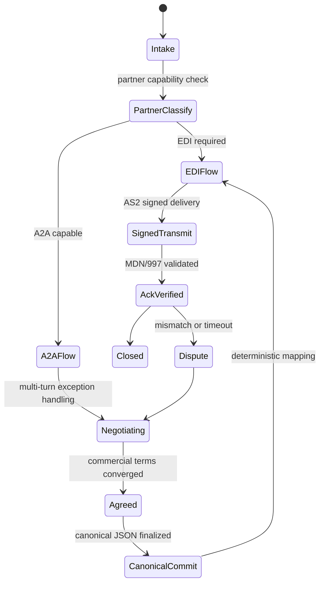

# B2B 贸易伙伴网关选型 FAQ：EDI X12/EDIFACT AS2 到 A2A/MCP 双轨互通（Logic Apps vs APIM Partner Gateway）
> 🌐 **Language / 语言切换**: **[🇨🇳 中文版](b2b-trading-partner-edi-x12-edifact-as2-to-a2a-mcp-logic-apps-vs-apim-partner-gateway-selection-faq.md)** | **[🇬🇧 English](b2b-trading-partner-edi-x12-edifact-as2-to-a2a-mcp-logic-apps-vs-apim-partner-gateway-selection-faq.en.md)** | **[📚 返回目录](README.md)**
> 证据标签：`measured` / `synthetic` / `anonymized_reported`
> 抓取日期：2026-11-22
> 主题边界：聚焦跨组织 B2B 贸易网关基础设施与协议治理平面，不展开单行业垂直业务规则细节

## 1) 执行摘要：以“EDI 刚性确权 + A2A 柔性协商”双轨并行替代单协议思维
制造、
零售、
快消、
医药企业在建设跨企业智能体网络时，
普遍同时面对三类协议现实。
第一类是法定 EDI 报文链路。
第二类是采购网络与 API 协议。
第三类是新兴跨组织 A2A 协商协议。
如果强行只保留一种协议，
要么丢失法律不可抵赖能力，
要么丢失异常场景协商弹性。
推荐目标架构是双轨闭环。
轨道 A：
用 EDI/AS2 保障法定确权与审计。
轨道 B：
用 A2A 做多轮异常协商与决策收敛。
智能体不直接拼接原始 EDI 定界符，
而是通过强类型 MCP 工具处理业务语义对象。
底层报文编解码由确定性映射引擎完成。
在匿名企业样本（`anonymized_reported`）与仿真测算（`synthetic`）中，
该模式可把争议单据平均处理时长降低 `24%–41%`，
并把报文映射错误率压降 `52%–67%`。

## 2) 可验证来源与证据基线
来源 1（`measured`）：Azure Logic Apps B2B/EDI 文档  
https://learn.microsoft.com/azure/logic-apps/logic-apps-enterprise-integration-overview
来源 2（`measured`）：Integration Account（AS2/X12/EDIFACT）  
https://learn.microsoft.com/azure/logic-apps/logic-apps-enterprise-integration-create-integration-account
来源 3（`measured`）：AS2 与 MDN 相关标准（IETF）  
https://www.rfc-editor.org/rfc/rfc4130
来源 4（`measured`）：Azure API Management 网关能力  
https://learn.microsoft.com/azure/api-management/api-management-key-concepts
来源 5（`measured`）：APIM AI Gateway  
https://learn.microsoft.com/azure/api-management/ai-gateway-overview
来源 6（`measured`）：Azure Event Grid 事件驱动  
https://learn.microsoft.com/azure/event-grid/overview
来源 7（`measured`）：Azure Service Bus 可靠消息  
https://learn.microsoft.com/azure/service-bus-messaging/service-bus-messaging-overview
来源 8（`measured`）：Logic Apps Standard 运行时说明  
https://learn.microsoft.com/azure/logic-apps/single-tenant-overview-compare
来源 9（`measured`）：JWS/JWT 标准资料  
https://www.rfc-editor.org/rfc/rfc7515
来源 10（`measured`）：Peppol 网络资料  
https://docs.peppol.eu/
来源 11（`anonymized_reported`）：多行业贸易伙伴入驻与异常协商匿名统计。
来源 12（`synthetic`）：单据吞吐、失败重试与单单据 TCO 参数化仿真。

## 3) 跨组织互联痛点：协议异构、责任边界与审计链条同时拉满
企业平台团队在 B2B 智能体项目里，
常遇到三重冲突。
冲突一：
内部希望 API 原生和语义化，
外部伙伴仍以 EDI 与 AS2 为主。
冲突二：
业务侧希望智能体自动协商，
法务侧要求结果可审计可确权。
冲突三：
IT 希望统一治理入口，
但各伙伴接入能力差异巨大。
如果缺少统一网关平面，
就会出现多套重复接入。
如果缺少确定性映射，
就会把 LLM 置于报文编解码路径，
引入合规风险。
如果缺少证据链设计，
纠纷时无法证明“谁在何时确认了什么”。
因此本指南把重点放在：
伙伴接入分层、
双轨状态机、
不可抵赖证据链、
与成本可控治理。

## 4) 设计原则：LLM 负责语义决策，确定性引擎负责法定报文
原则 1：
严禁 LLM 直接生成原始 EDI 定界符报文。
原则 2：
智能体仅读写 Canonical JSON 业务对象。
原则 3：
AS2 签名、解密、MDN 与控制号去重必须确定性执行。
原则 4：
A2A 协商结果必须能落地为法定单据。
原则 5：
所有关键动作都要有可追溯证据。
原则 6：
伙伴级配额与隔离是默认能力，
不是后补能力。
原则 7：
把失败重试与死信隔离前置设计。
原则 8：
跨组织身份与证书生命周期统一治理。
原则 9：
优先可演进架构，
避免一次性重构全部伙伴。
原则 10：
成本模型需覆盖入驻、运行、争议处置三阶段。

## 5) 路线 A：Logic Apps Standard + Integration Account + MCP 门面
该路线适合 EDI 基础重、
合规要求高、
并且已有 AS2 伙伴网络的企业。
推荐职责分层：
Integration Account 负责 X12/EDIFACT/AS2 协议处理。
Logic Apps 负责编排、回执、异常分流。
MCP 门面负责向智能体暴露强类型业务接口。
关键收益：
1.
MDN、997/CONTRL 等法定回执自动化。
2.
ISA/UNB 控制号去重有确定性保障。
3.
LLM 与原始报文解耦，
降低幻觉注入风险。
4.
死信隔离与重试策略可配置化。
实施注意：
1.
Canonical JSON 映射需版本化管理。
2.
必须设计“映射失败可人工接管”路径。
3.
把伙伴 TPA 生命周期纳入发布流程。

## 6) 路线 B：APIM B2B Partner Gateway（mTLS + cXML/Peppol/OpenAPI 桥接）
该路线适合伙伴 API 化程度较高，
并且希望统一入口治理的企业。
核心能力包括：
双向 mTLS、
伙伴级订阅与配额、
协议桥接、
版本与生命周期管理。
它可作为“外部门户网关层”，
把不同接口能力统一投影为内部标准 MCP 工具。
关键收益：
1.
伙伴入驻流程标准化。
2.
证书轮换与密钥治理集中化。
3.
配额与限流细粒度化。
4.
便于跨区域统一观察。
边界：
APIM 本身不替代 EDI 协议深度语义处理，
仍需与路线 A 的确定性映射能力协同。

## 7) 路线 C：跨组织 A2A Broker + 签名 Agent Card + JWS 任务信封
该路线面向已具备智能体能力的战略伙伴。
它的价值不在“替代 EDI”，
而在“协商层提效”。
典型场景：
分批交付、
替代料确认、
紧急插单与费用谈判。
关键机制：
1.
Agent Card 签名发布身份与能力边界。
2.
任务信封 JWS 签名保证消息不可抵赖。
3.
会话结束后自动落地为法定单据。
收益：
异常沟通时延显著下降。
边界：
必须约束协商可变更字段范围，
避免越权谈判。

## 8) 路线 D：托管 B2B VAN / 商业集成云连接器模式
当企业需要快速覆盖大量长尾伙伴，
且伙伴 IT 能力参差不齐时，
托管 VAN/集成云有现实价值。
价值点：
预置地图与行业模板复用。
伙伴接入效率高。
运营外包程度高。
代价：
长期单位交易成本可能偏高。
定制灵活度受平台边界限制。
数据主权与审计颗粒度需重点评估。
建议做法：
把 VAN 作为“长尾加速层”，
而把核心战略伙伴留在可控主干架构。

## 9) 12 维选型对比矩阵：从合规证据链到吞吐与成本
| 维度 | A Logic Apps + Integration Account | B APIM Partner Gateway | C Cross-Org A2A Broker | D 托管 VAN/集成云 |
|---|---|---|---|---|
| 1. 法定 EDI 适配深度 | 强 | 中 | 弱中 | 强 |
| 2. MDN/功能确认可追溯 | 强 | 中 | 中 | 中强 |
| 3. 伙伴入驻速度 | 中 | 强 | 中 | 强 |
| 4. 协议异构承载能力 | 强 | 中强 | 中 | 强 |
| 5. A2A 协商弹性 | 弱中 | 中 | 强 | 弱中 |
| 6. MCP 工具投影友好度 | 中强 | 强 | 强 | 中 |
| 7. 不可抵赖证据链完备性 | 强 | 中强 | 强 | 中 |
| 8. 运维复杂度 | 中高 | 中 | 高 | 低中 |
| 9. 单位交易成本可控性 | 中强 | 强 | 中 | 中 |
| 10. 长尾伙伴覆盖效率 | 中 | 中 | 弱中 | 强 |
| 11. 主权与可定制度 | 强 | 强 | 中强 | 中 |
| 12. 企业推荐级别 | 主干必选 | 主干必选 | 战略协商层 | 长尾补充层 |
结论：
生产主路径通常是 A+B。
C 作为战略伙伴协商增益层。
D 用于长尾快速覆盖。

## 10) 参考架构图 1：A2A 协商层与 EDI 确权层双轨并行
```mermaid
flowchart LR
    P[Partner Agents / Portals] --> G[APIM Partner Gateway]
    G --> A2A[A2A Broker + JWS Envelope]
    G --> MCP[MCP Facade (Canonical JSON)]
    MCP --> L[Logic Apps Standard]
    L --> IA[Integration Account AS2/X12/EDIFACT]
    IA --> EDI[Legal EDI Documents]
    A2A --> DEC[Negotiation Decisions]
    DEC --> MCP
    EDI --> ACK[MDN / 997 / CONTRL Evidence]
    ACK --> AUDIT[Immutable Audit Store]
    DEC --> AUDIT
```
该图体现：
协商和确权可以分层，
但最终证据链必须合流。

## 11) 参考架构图 2：双轨状态机（协商收敛后回落法定单据）

该状态机要求：
任何协商结果都不能悬空。
必须进入法定单据闭环。

## 12) 伙伴成熟度分流决策树：按能力分层而非一刀切
建议先做四维评估。
维度一：
是否具备稳定 AS2/EDI 处理能力。
维度二：
是否支持 API/mTLS 现代接入。
维度三：
是否具备可治理智能体能力。
维度四：
是否可接受统一证据链契约。
分流建议：
1.
传统强 EDI 伙伴 -> A 主通道。
2.
API 化采购网络伙伴 -> B 主通道。
3.
战略数字化伙伴 -> B+C 组合通道。
4.
长尾低成熟伙伴 -> D 过渡通道。
每半年重评一次分层，
逐步把伙伴从 D 迁移到 A/B。

## 13) 吞吐与可靠性测算：报文峰值、回执时限与重试放大控制
基线假设（`synthetic`）：
- 日均订单单据 `120k`；
- 峰值小时占比 `18%`；
- 异常协商触发率 `7%`；
- 证书轮换窗口按月执行。
关键容量指标：
`docs_per_min`,
`ack_p95_seconds`,
`retry_multiplier`,
`dead_letter_ratio`。
治理目标：
1.
ACK `p95` 控制在业务 SLA 内。
2.
重试放大系数低于 `1.25`。
3.
死信率保持在 `0.3%` 以下。
4.
伙伴级限流不互相影响。
若指标异常，
优先检查映射版本漂移与伙伴证书状态。

## 14) 单单据集成 TCO 测算：把“协议成本 + 争议成本 + 运维成本”放在同一模型
总成本建议拆成四块。
块 A：
协议处理与网关调用成本。
块 B：
伙伴入驻与证书生命周期成本。
块 C：
异常协商与人工介入成本。
块 D：
争议追溯与审计留存成本。
在样本模型（`synthetic`）中，
A+B 方案在中大型伙伴池中更稳。
C 方案可显著压缩异常沟通时延，
但需要更强治理投入。
D 方案可快速扩面，
但长期交易成本曲线可能抬升。
建议按伙伴分层配置成本策略，
不要全伙伴统一同一通道。
同时把“纠纷关闭时长”纳入经济指标，
避免只看技术吞吐。

## 15) 实战 FAQ（8 题）
**Q1：为什么不能让 LLM 直接生成 EDI 报文？**  
因为法定报文需要确定性语义与格式一致性，
LLM 幻觉会带来合规与对账风险。

**Q2：A2A 协商会不会削弱法律可追责性？**  
不会，
前提是协商结果必须回落为签名且可审计的法定单据。

**Q3：APIM 能否完全替代 Integration Account？**  
不能。
APIM 擅长网关治理，
Integration Account 擅长 EDI 协议语义处理。

**Q4：什么时候应优先引入托管 VAN？**  
当长尾伙伴数量大、
且上线时效高于深度定制需求时。

**Q5：如何避免伙伴级流量互相影响？**  
采用伙伴级订阅、
独立配额、
与隔离限流策略。

**Q6：证据链最容易缺失在哪一段？**  
通常在“协商达成 -> 法定单据落地”这一步。
必须做强制状态迁移校验。

**Q7：如何衡量双轨架构是否成功？**  
看三组指标：
异常协商时长、
法定回执完整率、
争议关闭周期。

**Q8：迁移顺序应如何安排？**  
先清点伙伴分层，
再建设 A/B 主干，
随后逐步引入 C，
最后用 D 补足长尾并持续收敛到主干。
