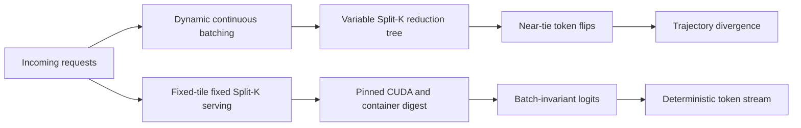
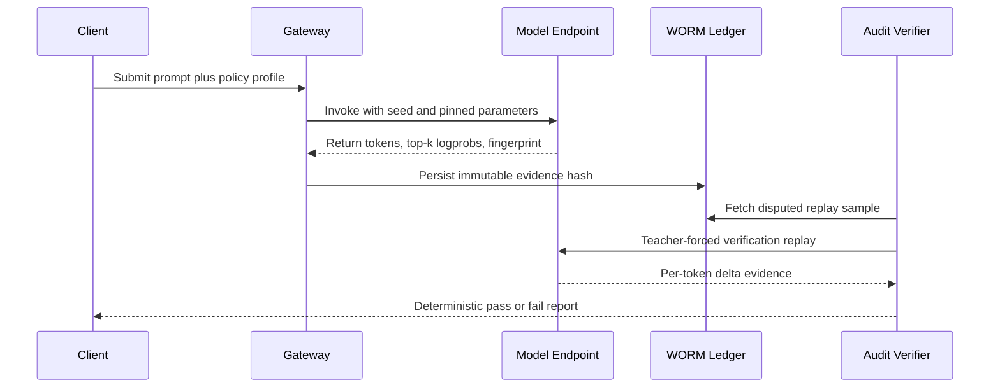
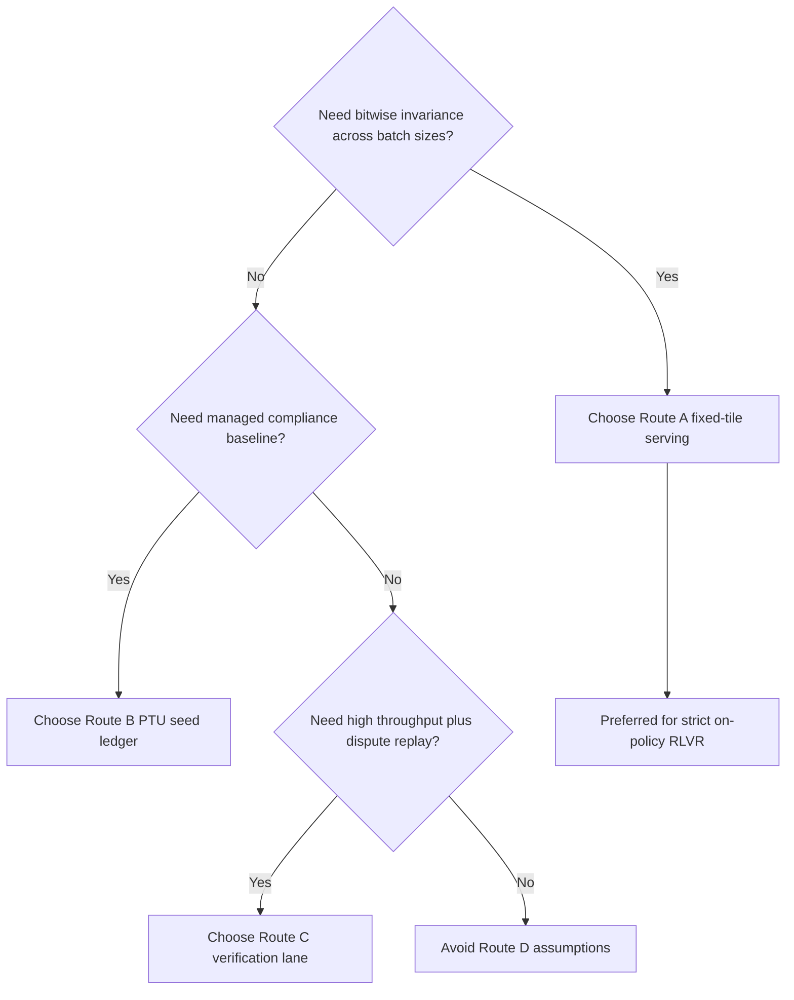

# Batch-invariant and bitwise-reproducible LLM inference selection FAQ: fixed Split-K vLLM on AKS vs PTU seed ledger vs verification lane
> **Audience**: regulated financial AI teams, model-risk governance groups, LLMOps owners, and distributed RL engineering leads.
> **Mission**: guarantee auditable replay and stable trajectory behavior under real production concurrency.

## 1. Executive Summary
`temperature=0` is not a reproducibility guarantee in production-scale inference systems.
Dynamic continuous batching changes reduction trees, introducing tiny logit perturbations.
Near-tie token margins then flip argmax choices and produce divergent downstream tool-call trajectories.
Route A enforces mathematical batch invariance and is strongest for strict audit and on-policy RLVR.
Route B offers a managed enterprise pathway with robust immutable compliance records.
Route C preserves throughput while adding dispute-grade verification evidence.
Route D incorrectly assumes deterministic behavior on shared dynamic-batching endpoints.

## 2. Core Problem: Why Greedy Decoding Still Drifts
Most drift is caused by floating-point reduction-order variability rather than sampling randomness.
Continuous batching, chunked prefill, and variable Split-K GEMM alter arithmetic grouping.
In BF16/FP8 arithmetic, `(a ⊕ b) ⊕ c != a ⊕ (b ⊕ c)` can generate `1e-3` to `1e-2` logit deltas.
If top-1 and top-2 logits are close, these deltas can flip token decisions.
MoE router top-k boundaries are similarly sensitive and can trigger expert-path divergence.
Therefore seed-only controls are insufficient for compliance-grade reproducibility.

## 3. Route A Deep Dive: Batch-Invariant Kernel Serving on AKS GPU
Route A fixes tile and Split-K behavior so arithmetic reduction order remains invariant across load states.
Deployment on `ND H200 v5` includes pinned container digest, pinned CUDA driver, and fixed attention split sizes.
vLLM/SGLang runtime parameters are frozen, including kernel strategy and thread-layout assumptions.
This yields bitwise-stable logits and token streams independent of runtime batch composition.
The trade-off is throughput tax, typically `15%-28%`, which buys deterministic compliance confidence.

## 4. Route B Deep Dive: PTU plus seed plus system_fingerprint and WORM audit ledger
Route B uses dedicated PTU deployments with pinned model versions and operational fingerprint checks.
Prompts, parameters, fingerprints, and responses are hashed into immutable evidence stores.
Azure Confidential Ledger or immutable blob retention provides non-repudiable record continuity.
This route does not guarantee kernel-level bitwise invariance but provides strong governance practicality.
For institutions governed by `SEC 17a-4` and `SR 11-7`, Route B is often the fastest managed baseline.

## 5. Route C Deep Dive: Teacher-Forced Prefix Verification Lane
Route C keeps high-throughput dynamic serving online while collecting per-token IDs and top-k logprobs.
During disputes, a teacher-forced replay validates each token under controlled deterministic audit settings.
If `|Δl_t| <= ε_fp`, trajectory consistency can be proven within bounded numerical tolerance.
This pattern is useful where throughput must remain high but post-hoc evidence quality is mandatory.
Its success depends on chain-of-custody rigor across captured telemetry and replay infrastructure.

## 6. Route D Anti-Pattern: Shared Dynamic Batching Equals Determinism
Route D treats greedy decoding as inherently deterministic in shared multi-tenant infrastructure.
In practice, CI gates can exhibit `3%-9%` trajectory divergence over long token chains.
Compliance replay mismatches become difficult to explain, and RL training can drift off-policy.
Short-term convenience turns into long-term governance debt and escalated investigation cost.

## 7. Architecture Principles and Quantitative Formulas
Reproducibility should be managed as an explicit architecture contract with measurable thresholds.
Recommended formulas include:
1. Cumulative divergence probability: `P_div(L) = 1 - Π_{t=1..L}(1 - p_flip,t)`.
2. Flip probability approximation: `p_flip,t = Pr(|l_(1),t - l_(2),t| < δ_batch)`.
3. Throughput tax of invariance: `η_inv = 1 - TPS_fixed_tile / TPS_dyn_split`.
4. Verification tolerance bound: `|l_prod - l_audit|_∞ <= ε_mach * sqrt(d_model)`.
5. Immutable replay integrity hash: `hash(req||resp||seed||fingerprint)`.

## 8. Dynamic Reduction Drift vs Fixed-Tile Batch-Invariant Pipeline


## 9. Regulated Audit and Drift Detection Sequence


## 10. Selection Decision Tree


## 11. Twelve-Dimension Comparison Matrix
| Dimension | Route A | Route B | Route C | Route D |
|---|---|---|---|---|
| Batch-invariant bitwise reproducibility | High | Medium | Medium-low | Low |
| Regulatory audit readiness | High | High | Medium-high | Low |
| Throughput efficiency | Medium | High | High | High |
| Trajectory divergence suppression | High | Medium | Medium | Low |
| On-policy RL alignment | High | Medium | Medium | Low |
| Operational complexity | High | Medium-low | Medium | Low apparent and high hidden |
| Drift detectability | High | High | High | Low |
| Cost predictability | Medium | High | Medium-high | Medium |
| Evidence-chain completeness | High | High | Medium-high | Low |
| Multi-tenant isolation fit | Medium | High | Medium | Low |
| CI stability | High | Medium-high | Medium | Low |
| Three-year economic value | High | Medium-high | Medium | Low |

## 12. Python Production Reference: Logit Margin and Fingerprint Verifier
```python
from __future__ import annotations
from dataclasses import dataclass
from typing import Sequence

@dataclass
class ReplayRecord:
    token_ids: Sequence[int]
    prod_logits: Sequence[float]
    audit_logits: Sequence[float]
    fingerprint: str
    expected_fingerprint: str

def verify_record(r: ReplayRecord, eps: float) -> tuple[bool, float]:
    if r.fingerprint != r.expected_fingerprint:
        return False, float('inf')
    max_delta = max(abs(a - b) for a, b in zip(r.prod_logits, r.audit_logits))
    return max_delta <= eps, max_delta
```

## 13. YAML Production Reference: AKS vLLM Batch-Invariant Manifest
```yaml
serving:
  runtime: vllm
  gpuSku: ND_H200_v5
  fixedTileMode: true
  splitK:
    mode: fixed
    value: 1
  flashAttention:
    fixedSplitSize: 128
image:
  digest: "sha256:PINNED_CONTAINER_DIGEST"
cuda:
  driver: "535.183.06"
audit:
  captureFingerprint: true
  immutableLedger: true
```

### Q1: Why does greedy decoding diverge even with fixed seed
A fixed seed does not control floating-point reduction topology under dynamic kernel scheduling.
Near-tie logits can flip when reduction order and accumulation paths drift across batches.
This means determinism depends on execution invariance, not only sampling configuration.
Route A explicitly targets that execution-level invariance.

### Q2: How should throughput tax be evaluated for batch-invariant mode
Measure `TPS_dyn_split` and `TPS_fixed_tile` across representative latency and concurrency envelopes.
Then compare tax against compliance replay failure cost, CI flake cost, and model-risk remediation effort.
In high-regulation sectors, deterministic guarantees frequently justify the measured throughput penalty.
A cost model without governance loss terms systematically understates Route D risk.

### Q3: What does `system_fingerprint` solve and what does it not solve
Fingerprint monitoring is an effective drift sentinel for managed endpoint stack changes.
It can trigger freeze-and-revalidate workflows when serving internals change unexpectedly.
However fingerprint checks alone do not prove bitwise equivalence under all runtime batch states.
That is why Route B benefits from Route C replay evidence or Route A baseline controls.

### Q4: Why teacher-forced replay reduces audit dispute resolution cost
It transforms replay disagreement into token-level numerical evidence with explicit tolerance bounds.
Teams can localize divergence origin without rerunning full downstream business workflows.
This sharply reduces investigation cycle time for compliance and model-risk committees.
Chain-of-custody integrity remains essential for admissible evidence.

### Q5: Why on-policy RLVR is sensitive to production inference drift
On-policy updates assume rollout distribution matches training-time policy trajectories.
If serving drift introduces hidden off-policy behavior, KL expansion and reward misestimation can occur.
Batch-invariant serving materially reduces this mismatch and improves convergence stability.
Route D tends to hide this issue until late-stage training regressions appear.

### Q6: How to define acceptable logit tolerance for compliance replay
Start from machine precision and model dimension scaling bounds, then calibrate with historical replay variance.
Use stricter tolerances for high-impact decisions and route borderline cases to human review.
All tolerance updates should be evidence-backed, reviewed, and version-controlled.
Post-incident ad-hoc threshold widening should be prohibited by policy.

## 14. Enterprise Scenario A: Tier-1 Bank Credit Underwriting Agent
This scenario requires deterministic replay and explainable evidence under model-risk governance reviews.
Route A is preferred for primary underwriting decisions, while Route B can support managed adjacencies.
Route C provides additional dispute replay traceability at lower incremental runtime burden.
Decision chains should map to `SR 11-7` control objectives and immutable evidence retention.

## 15. Enterprise Scenario B: Distributed On-Policy Agentic RLVR
This scenario prioritizes rollout-to-trainer logprob alignment across distributed generation workers.
Route A provides the strongest reproducibility baseline for stable policy optimization.
Route B and Route C can be used for comparison lanes and governance evidence capture.
Route D should not be used as a convergence baseline for policy quality claims.

## 16. Three-Year TCO Model
| Route | Three-Year Platform Cost | Compliance and Replay Cost | Net Value Outlook |
|---|---:|---:|---:|
| Route A | `$4.1M-$5.8M` | Low | High |
| Route B | `$3.5M-$5.0M` | Medium-low | Medium-high |
| Route C | `$3.0M-$4.4M` | Medium | Medium |
| Route D | `$2.2M-$3.4M` | High | Low |
When compliance dispute handling and training instability are priced in, Route A and Route B generally outperform Route D.

## 17. Go-Live Acceptance Checklist
1. Pin model, image digest, CUDA stack, kernel strategy, and serving parameters.
2. Run batch-variance regression matrix across `B=1/8/32/64` and representative prompt classes.
3. Enable fingerprint drift alarms with automatic freeze and rollback control.
4. Validate immutable ledger hash reconciliation for all regulated workloads.
5. Operationalize teacher-forced replay tooling and forensic SOP.
6. Define CI flakiness gates and escalation paths for deterministic failures.
7. Publish quarterly tolerance review process for governance boards.

## 18. Day-2 Drift Operations and Governance
After launch, monitor divergence rate, margin distribution, and replay pass-rate over changing concurrency profiles.
High-risk prompt classes should receive higher replay sampling and stricter tolerance thresholds.
Capacity or scheduling changes must trigger deterministic regression checks before rollout expansion.
Policy updates should co-update risk registers, audit controls, and operational runbooks.
Comparing production and audit lanes continuously is key to early drift detection.

## 19. Authoritative References
- IEEE 754 floating-point arithmetic and non-associativity behavior.
- vLLM and SGLang official serving-runtime and kernel-configuration documentation.
- Azure OpenAI PTU, seed controls, and `system_fingerprint` behavioral guidance.
- Azure Confidential Ledger and immutable blob WORM retention documentation.
- SEC 17a-4 and SR 11-7 supervisory guidance for evidence retention and model-risk governance.

## 20. Final Recommendation
Choose Route A when bitwise reproducibility and strict on-policy alignment are non-negotiable.
Choose Route B when managed operations and immutable compliance evidence are top priorities.
Use Route C to complement high-throughput production with dispute-grade verification capability.
Avoid Route D as a compliance or RL baseline in production.
Determinism is an architecture property, not a single decoding parameter.

## 21. Milestone Governance Metrics and Audit Artifact Template
To prevent long-term control drift, reproducibility should be managed as a quarterly governance objective.
Any model, driver, kernel, or scheduling change should trigger a fixed-batch replay matrix before promotion.
For external audits, prepare standardized evidence bundles instead of assembling ad-hoc forensic data.
Minimum bundles should include request digests, parameter snapshots, fingerprints, response hashes, replay reports, and approvals.
In multi-region deployments, add region-level divergence analytics to expose infrastructure heterogeneity effects.
The table below is a practical baseline for regulated financial and high-assurance sectors:

| Metric | Definition | Target | Trigger Action |
|---|---|---|---|
| `trajectory_divergence_rate` | Cross-batch trajectory mismatch ratio | `< 0.5%` | Freeze release and rerun regression |
| `fingerprint_drift_events` | Fingerprint change events | `0` in protected windows | Require change approval and re-signoff |
| `replay_pass_rate` | Teacher-forced replay verification pass ratio | `>= 99.5%` | Escalate to human review below threshold |
| `audit_evidence_completeness` | Required evidence field completeness | `= 100%` | Block go-live if incomplete |
| `ci_flaky_gate_rate` | Unstable deterministic CI gate ratio | `< 1%` | Investigate kernels and batching policy |

## 22. Suggested 90-Day Delivery Cadence
Days 0-30: establish A/B/C baselines, capacity economics, and a shared evidence contract.
Days 31-60: migrate high-risk workflows to Route A or Route B plus C with mandatory replay gates.
Days 61-90: integrate deterministic controls into quarterly audit routines and model-risk operations.
This cadence enables governance maturity without stalling enterprise delivery velocity.
