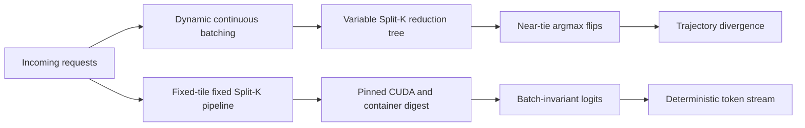
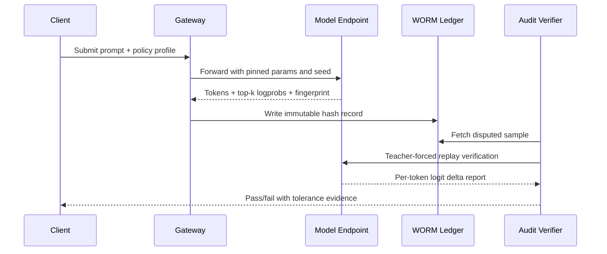
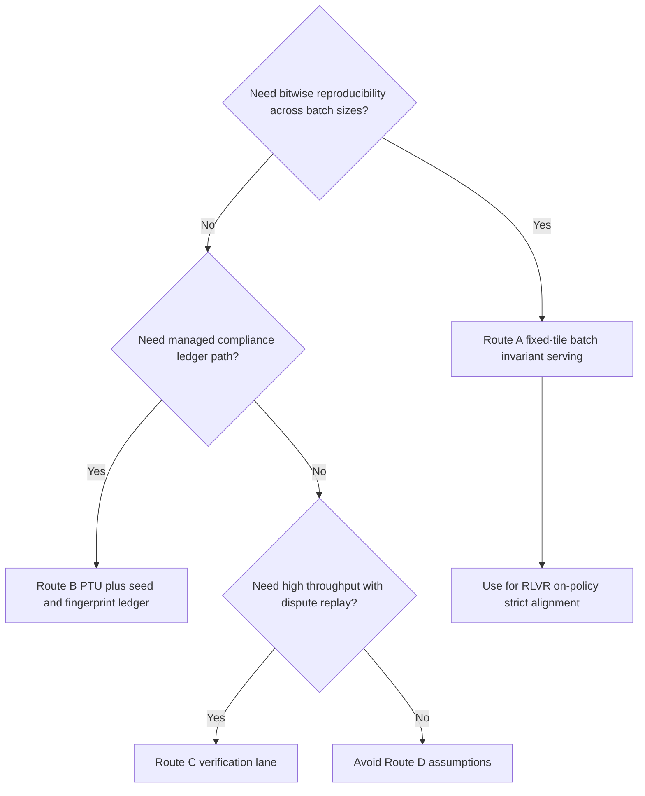

# 企业批次不变与位级可复现 LLM 推理选型 FAQ：固定 Split-K vLLM/AKS vs PTU+Seed 审计账本 vs 验证通道 vs 动态批次反模式
> **适用对象**：金融合规 AI 平台团队、模型风险管理团队、LLMOps 团队、分布式 RL 工程团队。
> **关键目标**：在生产负载波动下保证可审计、可回放、可解释的一致推理轨迹。

## 1. Executive Summary
很多团队把 `temperature=0` 误解为“天然确定性”，这是生产事故的起点。
在动态连续批处理下，归约树变化会引入细小 logit 扰动，近边界 token 会翻转。
单次翻转看似微小，但在长链工具调用中会放大为轨迹分叉。
Route A 提供数学意义上的批次不变，适合严监管审计与 on-policy RLVR。
Route B 提供托管可审计路径，适合希望降低内核自运维复杂度的企业。
Route C 在高吞吐前提下增加核验通道，适合折中治理与取证。
Route D 则会导致 CI 抖动、审计重放失败与训练策略漂移。

## 2. Core Problem: Why `temperature=0` Still Drifts
推理非确定性常来自浮点非结合律，而非采样随机性。
动态 batching、chunked prefill、Split-K reduction 改变了计算图与归约顺序。
在 BF16/FP8 下，`(a ⊕ b) ⊕ c != a ⊕ (b ⊕ c)` 会造成 `1e-3` 到 `1e-2` 级别扰动。
当 top-1 与 top-2 margin 接近时，这些扰动足以改变 argmax token。
MoE router 在 top-k 边界附近同样敏感，会触发专家路由差异与后续链式分歧。
因此“固定 seed + temperature=0”并不等价于“批次不变与位级复现”。

## 3. Route A Deep Dive: Batch-Invariant Kernel Serving on AKS GPU
A 通过固定 tile、固定 Split-K 或禁用可变 Split-K，稳定每一步归约路径。
在 `ND H200 v5` 上配合固定容器镜像 digest 与 CUDA 驱动版本钉扎。
FlashAttention 使用固定 split-size，避免负载变化引起 tile 级路径漂移。
vLLM/SGLang 运行参数保持严格一致，包括线程布局和算子策略。
A 可以在不同并发批次下输出位级一致 logits 与 token 序列。
代价是吞吐税通常在 `15%-28%`，但换来强合规可复现实验能力。

## 4. Route B Deep Dive: PTU + seed + system_fingerprint + WORM Ledger
B 利用托管 PTU 的容量稳定性，结合 `seed` 和 `system_fingerprint` 漂移探测。
每次请求的 prompt、参数、响应摘要写入不可篡改账本。
Azure Confidential Ledger 或 Immutable Blob 可用于监管留痕。
该方案不保证位级数学不变，但具备较强企业审计和运维可控性。
在 `SEC 17a-4`、`SR 11-7` 等框架下，B 是现实可落地的托管路径。

## 5. Route C Deep Dive: Teacher-Forced Prefix Verification Lane
C 允许线上使用高吞吐动态批处理，同时保存 token 与 top-k logprob。
争议场景下通过单次 teacher-forced forward 对照核验每一步 logit。
只要 `|Δl_t| <= ε_fp`，即可证明生产轨迹在数值容差内一致。
C 适合“吞吐优先但审计可证”的企业，兼顾性能与治理。
其关键在于核验管道的完整性与不可篡改证据链。

## 6. Route D Anti-Pattern: Shared Dynamic Batching Equals Determinism
D 假设共享端点在所有负载下都会输出同一轨迹，这在实践中并不成立。
CI 结果会随并发波动出现 `3%-9%` 的轨迹分叉。
在合规回放与 on-policy RL 中，这种分叉会被放大为不可解释偏差。
D 的短期便利会转化为长期质量债务与审计风险。

## 7. Architecture Principles and Quantitative Formulas
建议把一致性治理从“经验判断”升级为“可计算约束”。
核心公式如下：
1. 轨迹分叉概率：`P_div(L) = 1 - Π_{t=1..L}(1 - p_flip,t)`。
2. 翻转概率近似：`p_flip,t = Pr(|l_(1),t - l_(2),t| < δ_batch)`。
3. 批次不变吞吐税：`η_inv = 1 - TPS_fixed_tile / TPS_dyn_split`。
4. 核验容差上界：`|l_prod - l_audit|_∞ <= ε_mach * sqrt(d_model)`。
5. 审计完整性：`hash(req||resp||fingerprint||seed)` 必须可重算一致。

## 8. Dynamic Drift vs Fixed-Tile Batch-Invariant Pipeline


## 9. Regulated Audit and Drift Detection Sequence


## 10. Selection Decision Tree


## 11. 12-Dimension Comparison Matrix
| 维度 | Route A | Route B | Route C | Route D |
|---|---|---|---|---|
| 批次不变位级一致性 | 高 | 中 | 中低 | 低 |
| 监管可审计性 | 高 | 高 | 中高 | 低 |
| 吞吐效率 | 中 | 高 | 高 | 高 |
| 轨迹分叉抑制 | 高 | 中 | 中 | 低 |
| On-policy RL 对齐 | 高 | 中 | 中 | 低 |
| 运维复杂度 | 高 | 中低 | 中 | 低表面/高风险 |
| 漂移可检测性 | 高 | 高 | 高 | 低 |
| 成本可预测性 | 中 | 高 | 中高 | 中 |
| 证据链完整性 | 高 | 高 | 中高 | 低 |
| 多租户隔离友好度 | 中 | 高 | 中 | 低 |
| CI 稳定性 | 高 | 中高 | 中 | 低 |
| 三年综合收益 | 高 | 中高 | 中 | 低 |

## 12. Python Reference: Logit Margin and Fingerprint Verifier
```python
from __future__ import annotations
from dataclasses import dataclass
from typing import Sequence

@dataclass
class ReplayRecord:
    token_ids: Sequence[int]
    prod_logits: Sequence[float]
    audit_logits: Sequence[float]
    fingerprint: str
    expected_fingerprint: str

def verify_record(r: ReplayRecord, eps: float) -> tuple[bool, float]:
    if r.fingerprint != r.expected_fingerprint:
        return False, float('inf')
    max_delta = max(abs(a - b) for a, b in zip(r.prod_logits, r.audit_logits))
    return max_delta <= eps, max_delta
```

## 13. YAML Reference: AKS vLLM Batch-Invariant Manifest
```yaml
serving:
  runtime: vllm
  gpuSku: ND_H200_v5
  fixedTileMode: true
  splitK:
    mode: fixed
    value: 1
  flashAttention:
    fixedSplitSize: 128
image:
  digest: "sha256:PINNED_CONTAINER_DIGEST"
cuda:
  driver: "535.183.06"
audit:
  enableFingerprintCapture: true
  immutableLedger: true
```

### Q1: 为什么温度为 0 仍会出现轨迹分叉
温度为 0 只消除了采样噪声，但没有消除数值归约顺序差异。
当 top-1 与 top-2 margin 很小时，微小扰动就会改变 argmax。
动态批次、Split-K、chunked prefill 都会改变归约路径。
因此确定性必须在算子与执行拓扑层面治理。

### Q2: 批次不变吞吐税如何评估是否可接受
先测量 `TPS_dyn_split` 与 `TPS_fixed_tile` 的差值。
再对比审计失败成本、CI 抖动成本和训练偏移成本。
当合规代价高于吞吐损失时，A 往往更经济。
金融与监管行业通常满足这一条件。

### Q3: `system_fingerprint` 在托管路径里能解决什么
它可作为运行环境与模型栈变化的漂移哨兵。
一旦 fingerprint 变化，可自动触发回归与冻结机制。
但 fingerprint 不能替代位级一致性证明。
因此 B 常与核验通道或基线回放联合使用。

### Q4: Teacher-forced 核验通道为何能降低争议成本
它把“结果是否一致”分解为逐 token 的数值证据。
无需重跑全链路业务动作，也能定位分叉根因。
在外部审计或内部复核时，该方式更高效且可解释。
关键是保证核验样本与原始请求关联不可篡改。

### Q5: On-policy RLVR 为什么特别依赖批次不变
策略训练要求 rollout 分布与训练分布一致。
若推理侧因批次变化而分叉，训练会变成隐式 off-policy。
这会引发 KL 膨胀与 reward 估计失真。
A 能显著降低该类分布错配风险。

### Q6: 如何定义合规可接受的数值容差
建议结合 `ε_mach`、模型维度和历史方差设定分层阈值。
高风险业务可采用更严格阈值并启用人工复核。
阈值变更应伴随回放证据和审批记录。
避免在事故后临时放宽标准。

## 14. Enterprise Scenario A: Tier-1 Bank Credit Underwriting Agent
该场景要求每次决策可重放并可对监管问询给出证据链。
Route A 适用于核心授信链路，B 适用于托管外围流程。
C 可作为争议核验补充，降低重审成本。
关键流程需绑定 `SR 11-7` 模型风险管理控制项。

## 15. Enterprise Scenario B: Distributed On-Policy Agentic RLVR
该场景强调 rollout 到 trainer 的 logprob 一致性。
Route A 可把策略偏移降到最低，保障训练稳定。
B 与 C 可作为对照与审计辅助层。
不应在 D 路径上直接进行策略收敛评估。

## 16. 3-Year TCO Model
| 路线 | 三年平台成本 | 合规/回放成本 | 综合价值 |
|---|---:|---:|---:|
| Route A | `$4.1M-$5.8M` | 低 | 高 |
| Route B | `$3.5M-$5.0M` | 中低 | 中高 |
| Route C | `$3.0M-$4.4M` | 中 | 中 |
| Route D | `$2.2M-$3.4M` | 高 | 低 |
若计入合规争议处理与模型偏移成本，A/B 往往优于 D。

## 17. Go-Live Acceptance Checklist
1. 固定模型、镜像、驱动、算子策略与启动参数。
2. 建立批次变化回归测试矩阵（`B=1/8/32/64`）。
3. 建立 fingerprint 漂移告警与自动冻结策略。
4. 建立不可篡改审计账本与哈希校验流程。
5. 建立 teacher-forced 核验服务与取证 SOP。
6. 建立 CI 波动门禁与人工复核升级路径。
7. 建立季度阈值复审与监管报告模板。

## 18. Day-2 Governance and Drift Operations
上线后应持续跟踪分叉率、margin 分布与告警命中率。
对 high-risk prompt 需执行更严格 replay 采样策略。
当并发结构变化时，先做稳定性回归再放量。
策略变更需同时更新审计文档和风险登记项。
定期对比生产与核验通道差异，识别潜在系统漂移。

## 19. Authoritative References
- IEEE 754 浮点运算与非结合律相关规范说明。
- vLLM / SGLang 官方文档与推理内核参数说明。
- Azure OpenAI PTU、`seed`、`system_fingerprint` 行为文档。
- Azure Confidential Ledger 与 Immutable Blob WORM 文档。
- SEC 17a-4、SR 11-7 模型风险与留痕合规指南。

## 20. Final Recommendation
若业务要求位级复现与严格 on-policy 对齐，优先 Route A。
若组织偏托管并强调合规留痕，优先 Route B 并补充 C。
在高吞吐场景，可采用 C 强化争议核验与取证。
避免把 D 作为合规或训练基线。
一致性是系统属性，不是单一参数开关。

## 21. 里程碑治理指标与审计工件模板
为避免“上线时严格、半年后放松”的常见问题，建议把一致性能力纳入季度里程碑考核。
每次模型、驱动或编排策略变更前，都需要触发固定批次矩阵回放与差异分析。
对于外部审计，建议预置标准化证据包，减少临时拼接导致的证据断裂风险。
证据包至少应包含请求摘要、参数快照、fingerprint、响应哈希、核验结果与审批流水。
在多地区多租户环境，建议增加区域级漂移统计，以识别基础设施异构造成的偏差。
下表可作为金融与高合规行业的最小治理集：

| 指标 | 定义 | 建议阈值 | 触发动作 |
|---|---|---|---|
| `trajectory_divergence_rate` | 同提示跨批次分叉比例 | `< 0.5%` | 超阈值冻结发布并回归 |
| `fingerprint_drift_events` | 指纹变化事件数 | `0`（生产窗口） | 触发审批与重签核 |
| `replay_pass_rate` | Teacher-forced 核验通过率 | `>= 99.5%` | 低于阈值升级人审 |
| `audit_evidence_completeness` | 证据字段完整率 | `= 100%` | 缺失即拒绝上线 |
| `ci_flaky_gate_rate` | CI 不稳定门禁比例 | `< 1%` | 排查算子与批次策略 |

## 22. 交付节奏建议（90 天）
第 0-30 天：完成 A/B/C 三条路径的基线对照与成本测量，建立统一证据结构。
第 31-60 天：将高风险业务切至 A 或 B+C 组合，启用强制 replay 门禁。
第 61-90 天：纳入季度审计流程，形成可持续的模型风险与运维联动机制。
该节奏可在不牺牲业务交付速度的前提下，逐步建立可监管的一致性平台能力。
在组织治理层面，建议将“轨迹一致性偏差”纳入模型风险委员会固定议题，并与模型上线审批绑定。
在工程流程层面，建议把批次矩阵回放结果作为合并门禁的一部分，避免后置发现导致返工。
在成本治理层面，建议同时记录吞吐税与审计争议处理工时，形成完整 ROI 视图。
在人才能力层面，平台团队需要同时具备推理内核理解、合规审计语言与业务链路建模能力。
在跨团队协作层面，风险、审计、平台、业务四方应共建统一术语，减少口径偏差。
上述治理补充可显著提升 400+ 规模知识库在真实生产中的复用质量与可追责性。
在年度外部检查前，建议执行一次全量样本抽检回放，验证证据链完整率与阈值执行一致性。
该动作可提前暴露系统性薄弱环节。
