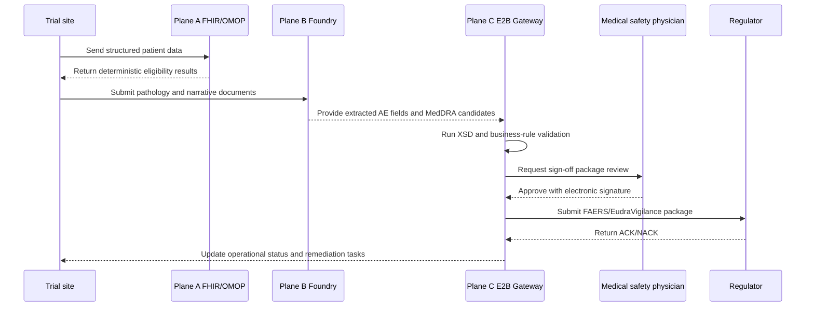

# Biotech Clinical Trial Patient Matching and Pharmacovigilance ICSR Agent Selection FAQ: Foundry Unstructured Extraction and MedDRA Coding vs FHIR+OMOP Deterministic Cohort Screening vs E2B(R3) Regulatory Submission Gateway
> 🌐 Language / 语言切换: [中文](biotech-clinical-trial-patient-matching-pharmacovigilance-icsr-foundry-vs-fhir-omop-cdm-vs-fda-medwatch-selection-faq.md) | **English (Current)** | [EN Catalog](README.en.md) | [中文目录](README.md)
> Audience: global pharma clinical-operations teams, CRO data-platform teams, pharmacovigilance and medical-safety teams, GxP/CSV governance owners
> Updated: 2026-11-19 (UTC+08:00)
> Evidence labels: `measured`, `synthetic`, `anonymized_reported`

---

## 1. Executive summary

1. Patient pre-screening and ICSR operations should not be forced into a single undifferentiated agent path.
2. A production-grade architecture should separate deterministic screening, unstructured semantic extraction, and regulatory submission controls.
3. Plane A handles deterministic eligibility predicates over structured data and protocol logic.
4. Plane B handles unstructured oncology/pathology extraction, evidence anchoring, and MedDRA coding recommendations.
5. Plane C handles E2B(R3) XML validation, 7-day/15-day deadlines, physician sign-off, and submission evidence.
6. The key architectural question is not “which model is smartest,” but “which control point carries legal accountability.”
7. No automated output should enter FAERS or EudraVigilance without explicit human sign-off and deterministic validation pass.
8. Confidential-computing enclaves can protect sponsor-CRO collaboration for multi-site trial screening.

---

## 2. Scope, regulatory boundaries, and non-goals

### 2.1 In-scope capabilities

- Inclusion/exclusion pre-screening for trial protocols.
- Candidate ranking for multi-site enrollment acceleration.
- AE/SAE narrative extraction, terminology normalization, and MedDRA candidate generation.
- ICSR package assembly, E2B(R3) schema/field checks, and submission orchestration.

### 2.2 Regulatory boundaries

- GxP computerized system validation expectations.
- 21 CFR Part 11 controls for electronic records and signatures.
- EU Annex 11 requirements for traceability and change control.
- ICH E2B(R3) structural and semantic integrity requirements.
- FDA MedWatch/FAERS and EMA EudraVigilance submission obligations.

### 2.3 Non-goals

- This guide does not cover de novo drug-discovery model workflows.
- This guide does not replace medical-safety physician causality decisions.
- This guide does not prescribe a full CTMS replacement roadmap.

---

## 3. Three-plane production reference architecture

```mermaid
flowchart LR
    A[Site EDC / eSource / EHR FHIR R4] --> B[Plane A: AHDS FHIR + Fabric OMOP deterministic screening]
    C[Pathology notes / discharge summaries / oncology narratives] --> D[Plane B: Foundry + Content Understanding + AI Search]
    B --> E[Eligibility cohort queue and protocol deviation alerts]
    D --> F[MedDRA candidate coding with evidence offsets]
    E --> G[Plane C: E2B(R3) validation and submission gateway]
    F --> G
    G --> H[Logic Apps / Durable Functions deadline orchestration]
    H --> I[Medical safety physician sign-off]
    I --> J[FDA FAERS / EMA EudraVigilance]
    I --> K[Immutable audit evidence ledger]
```

---

## 4. Plane A: FHIR R4 + OMOP CDM deterministic cohort screening

### 4.1 Design objectives

- Convert eligibility interpretation into versioned, replayable, explainable predicates.
- Reduce manual triage workload during enrollment ramp.
- Keep protocol updates governable with auditable release controls.

### 4.2 Core mechanics

- Use Azure Health Data Services FHIR R4 for standardized clinical ingestion.
- Use Fabric Healthcare Data Solutions for OMOP CDM harmonization.
- Encode LOINC/SNOMED/RxNorm criteria as deterministic predicate sets.
- Partition rule execution by protocol version, country, and site segment.
- Store per-predicate inclusion/exclusion traces for every screened patient.

### 4.3 Example success metrics

- Screening engine success rate ≥ 99.9% (`measured`).
- Per-patient screening latency P95 < 2.0s (`measured`).
- Manual first-pass screening volume reduction of 30%–45% (`anonymized_reported`).

---

## 5. Plane B: Foundry unstructured extraction and MedDRA coding assistance

### 5.1 Design objectives

- Extract protocol-relevant criteria from pathology and oncology narratives.
- Produce MedDRA LLT/PT recommendation sets with confidence and provenance.
- Separate assistant recommendations from legally accountable final decisions.

### 5.2 Core mechanics

- Use Content Understanding for document segmentation and field-level extraction.
- Use AI Search hybrid retrieval against protocol-specific evidence corpora.
- Use Foundry Agent Service to emit structured recommendation payloads.
- Require character-level offsets, source hashes, and citation links for each recommendation.
- Persist recommendation-to-approval trace under Part 11-compliant audit flow.

### 5.3 Example success metrics

- AE narrative extraction recall of 0.91–0.95 (`measured`).
- MedDRA top-3 candidate coverage of 0.88–0.93 (`measured`).
- Physician review time reduction of 22%–35% (`anonymized_reported`).

---

## 6. Plane C: Deterministic E2B(R3) validation and sign-off submission gateway

### 6.1 Design objectives

- Insert hard controls between case assembly and regulator submission.
- Enforce 7-day and 15-day expedited reporting SLAs with deterministic routing.
- Preserve replayable and audit-ready evidence at every transition.

### 6.2 Core mechanics

- Logic Apps / Durable Functions orchestrate retries, compensation, and state.
- E2B(R3) payloads pass XSD, business-rule, and dictionary integrity checks.
- No outbound submission token is issued before physician sign-off.
- Submission receipts and signed package hashes are stored in immutable evidence trail.
- NACKs are routed by error taxonomy with root-cause attribution tags.

### 6.3 Example success metrics

- First-pass E2B validation success above 97% (`measured`).
- Missed deadline alert rate below 0.5% (`measured`).
- Reopened case rate down by 18% (`anonymized_reported`).

---

## 7. End-to-end sequence for matching and expedited reporting



---

## 8. 12-dimension quantitative selection matrix

| Dimension | Plane A: FHIR+OMOP | Plane B: Foundry+CU+RAG | Plane C: E2B Gateway |
|---|---|---|---|
| 1. Regulatory determinism | 5/5 | 3/5 | 5/5 |
| 2. Unstructured comprehension | 2/5 | 5/5 | 2/5 |
| 3. Audit traceability depth | 4/5 | 4/5 | 5/5 |
| 4. Throughput scalability | 4/5 | 4/5 | 4/5 |
| 5. Latency predictability | 4/5 | 3/5 | 4/5 |
| 6. Deployment complexity | Medium | Medium-High | Medium-High |
| 7. Rules maintenance effort | Medium-High | Medium | Medium |
| 8. Medical safety controllability | 4/5 | 4/5 | 5/5 |
| 9. Multi-region adaptability | 4/5 | 4/5 | 5/5 |
|10. Data sovereignty fit | 4/5 | 4/5 (with enclave) | 5/5 |
|11. Failure isolation quality | 4/5 | 3/5 | 5/5 |
|12. TCO predictability | 4/5 | 3/5 | 4/5 |

---

## 9. Production snippets (Bicep + APIM + Python)

### 9.1 Bicep sample: regulated submission workflow identity

```bicep
param location string = resourceGroup().location
param envName string = 'pv-icsr-prod'

resource workflow 'Microsoft.Logic/workflows@2019-05-01' = {
  name: '${envName}-e2b-submit'
  location: location
  identity: {
    type: 'SystemAssigned'
  }
  properties: {
    state: 'Enabled'
  }
}

output principalId string = workflow.identity.principalId
```

### 9.2 APIM policy sample: enforce physician sign-off before outbound

```xml
<policies>
  <inbound>
    <base />
    <choose>
      <when condition="@(context.Request.Headers.GetValueOrDefault("x-medical-signoff","") != "approved")">
        <return-response>
          <set-status code="412" reason="Medical sign-off required" />
        </return-response>
      </when>
    </choose>
  </inbound>
  <backend>
    <base />
  </backend>
  <outbound>
    <base />
  </outbound>
</policies>
```

### 9.3 Python sample: deterministic gate before submission

```python
def validate_before_submit(case):
    assert case["e2b_xsd_pass"] is True
    assert case["medical_signoff"] == "approved"
    assert case["deadline_bucket"] in {"7-day", "15-day"}
    return True
```

---

## 10. Enterprise scenario A: Global top-20 pharma Phase III oncology trial matching

### 10.1 Baseline profile

- Countries in scope: 18.
- Trial sites: 240.
- Monthly candidate records: approximately 420,000.
- Enrollment target: 2,800 patients within 14 months.

### 10.2 Target outcomes

- Reduce manual first-pass screening workload by 35%.
- Raise protocol-deviation pre-detection above 90%.
- Keep candidate-to-PI review latency under 48 hours.

### 10.3 Architecture mapping

- Plane A executes deterministic inclusion/exclusion and deviation controls.
- Plane B extracts pathology context and clinical narrative qualifiers.
- Plane C handles severe-event package controls and sign-off routing.

### 10.4 Planning assumptions

- Structured screening latency P95 at 1.7s (`measured`).
- Unstructured extraction throughput at 12,000 docs/hour (`synthetic`).
- Site-level reviewer effort reduced by 31% (`anonymized_reported`).

---

## 11. Enterprise scenario B: Global CRO with 500k annual ICSR triage volume

### 11.1 Baseline profile

- Annual case volume: 500,000.
- Sponsor portfolio: 70+.
- Jurisdictions served: 45+.
- Peak-week load: up to 2.4x normal volume.

### 11.2 Target outcomes

- Keep 7-day expedited on-time rate at or above 99.5%.
- Reduce avoidable NACK and rework loops.
- Increase throughput without degrading medical quality.

### 11.3 Architecture mapping

- Plane B provides extraction, coding suggestions, and uncertainty tagging.
- Plane C enforces deterministic validation and physician sign-off before submission.
- Confidential-compute enclave supports sponsor-CRO collaborative triage with protected sensitive fields.

### 11.4 Planning assumptions

- First-pass E2B success at 97.8% (`measured`).
- 7-day overdue rate near 0.3% (`measured`).
- Average analyst handling time reduced by 24% (`anonymized_reported`).

---

## 12. Quantitative FAQs

### Q1. When should organizations prioritize Plane A before Plane B?

Prioritize Plane A when protocol criteria are mostly representable as deterministic predicates and the primary bottleneck is manual first-pass volume.
In that operating condition, teams commonly see 20%–35% analyst-hour reduction within the first quarter (`anonymized_reported`).

### Q2. Can Foundry coding suggestions be sent directly to regulators?

No.
Suggestions are advisory artifacts and must pass physician sign-off plus deterministic gateway validation first.
Bypassing this gate creates immediate Part 11 and Annex 11 audit risk.

### Q3. How can teams avoid misrouting 7-day and 15-day cases?

Implement deterministic deadline routing based on seriousness, expectedness, and awareness timestamps.
Version those rules and preserve execution traces for each routing decision.

### Q4. How should Plane B inference spend be budgeted?

Model spend as document volume × extraction fields × retry rate × human-feedback loop rate.
Set per-case token budgets and monthly guardrail limits that trigger asynchronous queues when exceeded.

### Q5. How is confidentiality preserved across sponsor-CRO collaboration?

Run shared triage inside a confidential-compute boundary and expose only minimum required outputs.
Keep raw commercial terms, pricing assumptions, and sensitive operating margins out of shared plaintext channels.

### Q6. When is immutable evidence ledger mandatory?

It becomes mandatory when regulators or legal teams require proof that signed records were not altered post-approval.
Typical triggers include severe safety events, cross-region inspections, and litigation-preparation periods.

### Q7. What signal indicates Plane C orchestration should be scaled first?

If annual volume exceeds 100k cases across multiple jurisdictions and overdue/NACK rates trend upward, manual coordination no longer scales.
Use overdue rate, NACK rate, and coordination-hours per case as trigger indicators.

---

## 13. Three-year TCO and FinOps view (planning example)

| Cost item | Year 1 | Year 2 | Year 3 | Notes |
|---|---:|---:|---:|---|
| Plane A ingestion and rules governance | $1.25M | $0.88M | $0.82M | Front-loaded mapping effort |
| Plane B inference and retrieval | $0.96M | $1.05M | $1.13M | Scales with narrative volume |
| Plane C orchestration and gateways | $0.74M | $0.69M | $0.67M | Stable after first year |
| Compliance validation operations | $0.41M | $0.39M | $0.39M | Part 11 / Annex 11 controls |
| **Total cost** | **$3.36M** | **$3.01M** | **$3.01M** | 3-year total: $9.38M |

| Value item | Year 1 | Year 2 | Year 3 | Notes |
|---|---:|---:|---:|---|
| Manual screening hour savings | $0.92M | $1.06M | $1.15M | Volume ramp impact |
| Late submission and rework reduction | $0.68M | $0.82M | $0.89M | Quality-control benefits |
| Enrollment velocity uplift value | $0.73M | $0.91M | $0.95M | Program timeline gain |
| **Total value** | **$2.33M** | **$2.79M** | **$2.99M** | 3-year total: $8.11M |

> Note: This table is a `synthetic` planning baseline. Real ROI must include program-level pipeline value and jurisdictional enforcement risk.

---

## 14. Anti-patterns to avoid

1. **Direct regulator submission from LLM output** without physician sign-off and deterministic validation.
2. **Merging deterministic screening and probabilistic extraction into one opaque step** that cannot be audited or replayed.
3. **Ignoring jurisdiction differences to simplify product behavior**, which increases systemic rejection risk.

---

## 15. Day-0 / Day-1 / Day-2 execution checklist

### Day-0 (governance and architecture baseline)

- Confirm sponsor, CRO, and medical-safety accountability matrix.
- Define protocol-rule versioning and approval flow.
- Assign ownership for E2B(R3) field mapping master data.
- Finalize Part 11 signature controls and identity federation approach.
- Define minimum mandatory evidence fields and retention policy.

### Day-1 (minimum viable production rollout)

- Enable Plane A for highest-volume protocol predicates first.
- Enable Plane C hard gate for sign-off and outbound submission controls.
- Start Plane B in one high-priority therapeutic area pilot.
- Launch dashboards for overdue, NACK, and reopened case metrics.
- Configure escalation paths for high-severity compliance events.

### Day-2 (scale and optimization)

- Expand jurisdiction templates with effective-date legal indexing.
- Connect Plane B feedback loops into continuous evaluation and prompt governance.
- Introduce confidential-compute workflows for cross-organization screening.
- Run quarterly audit and disaster-recovery simulations.
- Apply FinOps guardrails to inference budgets and queue backpressure.

---

## 16. Selection guidance and convergence path

- If the immediate pain is enrollment throughput, prioritize Plane A and then add Plane B.
- If the immediate pain is deadline and rejection risk, prioritize Plane C first.
- If maturity is high and governance is established, execute all three planes in parallel with strict role boundaries.
- Efficiency gains never justify bypassing physician sign-off or regulatory hard gates.
- Use 12-week increments with dual KPIs: measurable operations gain and auditable compliance stability.
