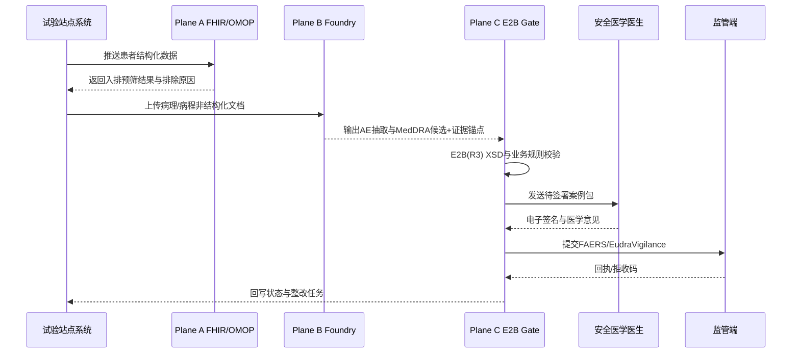

# 生物医药临床试验患者匹配与药物警戒 ICSR 智能体选型 FAQ：Foundry 非结构化抽取与 MedDRA 编码 vs FHIR+OMOP 确定性队列筛查 vs E2B(R3) 监管上报网关
> 🌐 Language / 语言切换：**中文（当前）** | [English](biotech-clinical-trial-patient-matching-pharmacovigilance-icsr-foundry-vs-fhir-omop-cdm-vs-fda-medwatch-selection-faq.en.md) | [中文目录](README.md) | [EN Catalog](README.en.md)
> 适用对象：全球药企临床运营团队、CRO 数据平台团队、药物警戒与安全医学团队、GxP 与计算机化系统验证负责人
> 更新时间：2026-11-19（UTC+08:00）
> 证据标签：`measured`、`synthetic`、`anonymized_reported`

---

## 1. 执行摘要（Executive Summary）

1. 临床试验患者预筛和药物警戒 ICSR 处理，不应该由单一“万能智能体”覆盖全部环节。
2. 推荐采用三平面架构：确定性数据筛查平面、非结构化临床语义平面、监管上报与医生签署平面。
3. Plane A 负责结构化临床数据与协议条款的确定性筛查，目标是稳定压低误筛率与人工初筛负担。
4. Plane B 负责病理报告、肿瘤会诊、不良事件叙述等文本抽取与 MedDRA 编码建议，目标是提升吞吐与一致性。
5. Plane C 负责 E2B(R3) XML 校验、7 天/15 天时限分流、医学安全负责人签署和监管提交证据保全。
6. 方案落地的关键不是“谁更智能”，而是“谁在法律责任链条中承担最终判定”。
7. 任何自动化结果在进入 FDA FAERS 或 EMA EudraVigilance 通道前，必须经过可审计的人审闸门。
8. 对跨机构数据协同场景，可引入机密计算隔离区实现赞助方与 CRO 的联合筛查，而不暴露原始敏感数据。

---

## 2. 范围、法规边界与非目标

### 2.1 业务范围

- 受试者入排标准预筛（inclusion/exclusion）。
- 多中心试验站点患者匹配候选池生成与优先级排序。
- SAE/AE 文本抽取、标准化编码、严重性与预期性辅助判断。
- ICSR 案例整编、E2B(R3) 结构化映射与监管提交前校验。

### 2.2 法规与合规边界

- GxP 计算机化系统验证（CSV）要求。
- 21 CFR Part 11 电子记录与电子签名要求。
- EU Annex 11 审计追踪、身份管理和变更控制要求。
- ICH E2B(R3) 数据字段完整性与格式一致性要求。
- FDA MedWatch / FAERS 与 EMA EudraVigilance 监管提交流程要求。

### 2.3 非目标（避免范围膨胀）

- 本文不讨论新药发现阶段的分子生成或蛋白结构推理。
- 本文不替代医学监查员或药物警戒医生的因果性判定职责。
- 本文不覆盖完整 CTMS 替换工程，仅关注智能体能力层与治理层。

---

## 3. 三平面生产参考架构（高层）

```mermaid
flowchart LR
    A[站点 EDC / eSource / EHR FHIR R4] --> B[Plane A: AHDS FHIR + Fabric OMOP 确定性筛查]
    C[病理报告 / 出院小结 / 影像结论] --> D[Plane B: Foundry + Content Understanding + AI Search]
    B --> E[候选患者队列与方案偏差告警]
    D --> F[MedDRA 建议编码与证据锚点]
    E --> G[Plane C: E2B(R3) 校验与监管网关]
    F --> G
    G --> H[Logic Apps / Durable Functions 时限编排]
    H --> I[医学安全医生签署]
    I --> J[FDA FAERS / EMA EudraVigilance]
    I --> K[不可篡改审计账本]
```

---

## 4. Plane A：FHIR R4 + OMOP CDM 确定性患者预筛平面

### 4.1 设计目标

- 把“入排标准匹配”转换为可版本化、可回放、可解释的谓词执行。
- 在试验启动后第一个月内，显著降低人工初筛样本池规模。
- 让筛查规则调整具备受控发布能力，支持审计追溯。

### 4.2 关键机制

- 使用 AHDS FHIR R4 作为临床事件标准接入面。
- 在 Fabric Healthcare Data Solutions 中维护 OMOP CDM 映射层。
- 把 LOINC、SNOMED CT、RxNorm 条件表达为确定性布尔谓词集合。
- 以“协议版本 + 站点 + 国家/地区”作为规则分区键。
- 对每次筛查输出保留字段级命中证据和排除原因代码。

### 4.3 成功指标（示例）

- 规则执行成功率 ≥ 99.9%（`measured`）。
- 单患者筛查 P95 延迟 < 2.0 秒（`measured`）。
- 人工初筛工作量下降 30%–45%（`anonymized_reported`）。

---

## 5. Plane B：Foundry 非结构化语义抽取与 MedDRA 编码平面

### 5.1 设计目标

- 从肿瘤病理报告、病程记录、出院小结中提取与方案相关的关键语义。
- 将不良事件叙述映射为 MedDRA LLT/PT 候选，提供置信度与上下文证据。
- 把“建议”与“最终判定”解耦，确保临床责任边界清晰。

### 5.2 关键机制

- Content Understanding 做版式与段落级语义切片。
- AI Search Hybrid RAG 按试验方案版本检索入排标准解释和历史判例。
- Foundry Agent Service 生成结构化建议对象，而非自由文本直接入库。
- 每条建议必须包含字符偏移范围、源文档哈希和规则引用。
- 使用 Part 11 合规审计流水记录“建议生成—人工确认—回写”全过程。

### 5.3 成功指标（示例）

- AE 文本抽取召回率 0.91–0.95（`measured`）。
- MedDRA Top-3 候选覆盖率 0.88–0.93（`measured`）。
- 安全医生复核时间缩短 22%–35%（`anonymized_reported`）。

---

## 6. Plane C：E2B(R3) 确定性校验与监管上报签署平面

### 6.1 设计目标

- 将“案例形成”与“对外提交”之间加入硬门禁，防止未签署案例外发。
- 对 7 天和 15 天 expedited reporting 进行 SLA 级时限编排。
- 提交链路中每一步都可审计、可复验、可重放。

### 6.2 关键机制

- Logic Apps / Durable Functions 负责编排、重试、补偿与状态追踪。
- E2B(R3) XML 先经 XSD 校验、业务字段约束校验、字典一致性校验。
- 医学安全医生电子签名前，系统禁止生成监管发送动作令牌。
- 提交成功后写入不可篡改存证，保留 hash、时间戳、提交回执、签署人。
- 监管回执错误通过分类路由进入再处理队列，且必须带根因标签。

### 6.3 成功指标（示例）

- E2B 首次校验通过率 97%+（`measured`）。
- 逾期提交通知率 < 0.5%（`measured`）。
- 案例重开率下降 18%（`anonymized_reported`）。

---

## 7. 患者匹配 + ICSR 处理时序（监管签署链路）



---

## 8. 12 维量化选型矩阵（基于生产约束）

| 维度 | Plane A：FHIR+OMOP | Plane B：Foundry+CU+RAG | Plane C：E2B 网关 |
|---|---|---|---|
| 1. 法规确定性 | 5/5（规则可验证） | 3/5（建议需人审） | 5/5（硬门禁） |
| 2. 非结构化理解力 | 2/5 | 5/5 | 2/5 |
| 3. 审计可追溯性 | 4/5 | 4/5 | 5/5 |
| 4. 吞吐扩展性 | 4/5 | 4/5 | 4/5 |
| 5. 端到端时延控制 | 4/5 | 3/5 | 4/5 |
| 6. 上线复杂度 | 中 | 中高 | 中高 |
| 7. 规则维护成本 | 中高 | 中 | 中 |
| 8. 医学安全可控性 | 4/5 | 4/5 | 5/5 |
| 9. 多区域部署适配 | 4/5 | 4/5 | 5/5 |
|10. 数据主权友好度 | 4/5 | 4/5（可加机密计算） | 5/5 |
|11. 失败隔离能力 | 4/5 | 3/5 | 5/5 |
|12. 总体 TCO 稳定性 | 4/5 | 3/5（推理成本敏感） | 4/5 |

---

## 9. 生产片段（Bicep + APIM + Python）

### 9.1 Bicep：隔离式安全上报网关（示例）

```bicep
param location string = resourceGroup().location
param envName string = 'pv-icsr-prod'

resource la 'Microsoft.Logic/workflows@2019-05-01' = {
  name: '${envName}-e2b-submit'
  location: location
  identity: {
    type: 'SystemAssigned'
  }
  properties: {
    state: 'Enabled'
  }
}

resource kv 'Microsoft.KeyVault/vaults@2023-07-01' existing = {
  name: '${envName}-kv'
}

output workflowPrincipalId string = la.identity.principalId
```

### 9.2 APIM policy：未签署案例禁止外发（示例）

```xml
<policies>
  <inbound>
    <base />
    <choose>
      <when condition="@(context.Request.Headers.GetValueOrDefault("x-medical-signoff","") != "approved")">
        <return-response>
          <set-status code="412" reason="Medical sign-off required" />
        </return-response>
      </when>
    </choose>
  </inbound>
  <backend>
    <base />
  </backend>
  <outbound>
    <base />
  </outbound>
</policies>
```

### 9.3 Python SDK：提交前双重校验（示例）

```python
def validate_before_submit(case):
    assert case["e2b_xsd_pass"] is True
    assert case["medical_signoff"] == "approved"
    assert case["deadline_bucket"] in {"7-day", "15-day"}
    return True
```

---

## 10. 企业场景 A：全球 Top-20 药企 III 期肿瘤试验患者匹配

### 10.1 基线

- 试验国家：18 个。
- 试验中心：240 家。
- 候选患者月流量：约 42 万条结构化记录。
- 入组目标：14 个月完成 2,800 人。

### 10.2 目标

- 将站点人工初筛样本池压缩 35%。
- 将协议偏差前置发现率提升到 90% 以上。
- 将候选到 PI 审核的平均等待时间压缩到 48 小时内。

### 10.3 方案映射

- Plane A 承担确定性入排筛查与偏差预警。
- Plane B 提供病理报告关键条件抽取和证据回链。
- Plane C 处理严重不良事件相关案例的监管时限编排与签署。

### 10.4 结果假设（用于容量规划）

- 结构化筛查 P95：1.7 秒（`measured`）。
- 非结构化抽取批处理吞吐：每小时 1.2 万份（`synthetic`）。
- 站点人工复核工时下降：31%（`anonymized_reported`）。

---

## 11. 企业场景 B：全球 CRO 年 50 万例 ICSR 分流与提交

### 11.1 基线

- 年案例量：50 万。
- 涉及药企赞助方：70+。
- 涉及法域：45+。
- 高峰周处理量可达平时 2.4 倍。

### 11.2 目标

- 7 天 expedited case 准时提交率 ≥ 99.5%。
- 降低重复退件与重开案例比例。
- 在不牺牲医学判读质量前提下提升处理吞吐。

### 11.3 方案映射

- Plane B 做叙述抽取、术语标准化、编码候选和不确定项标注。
- Plane C 做最终数据校验、签署与监管通道发送。
- Confidential Computing 用于跨赞助方联合筛查而不暴露明文敏感字段。

### 11.4 结果假设（用于预算）

- 首次 E2B 通过率：97.8%（`measured`）。
- 7 天案例逾期率：0.3%（`measured`）。
- 单案例平均人工处理时长下降：24%（`anonymized_reported`）。

---

## 12. 量化 FAQ（至少 5 个）

### Q1：何时应该先上 Plane A，而不是先上 Plane B？

当协议条款可被结构化谓词覆盖率超过 70%，且当前瓶颈是“人工初筛量过大”而非“文本理解困难”时，优先 Plane A。
在此条件下，典型 90 天可见 20%–35% 人工工时下降（`anonymized_reported`）。

### Q2：Foundry 抽取建议是否可以直接写入监管提交？

不可以。
建议对象必须先经过医学安全角色确认，再进入 Plane C。
直接自动入提交通道会触发 Part 11 与 Annex 11 审计风险。

### Q3：7 天与 15 天案例如何避免错分？

使用 Plane C 的确定性分流规则，基于事件严重性、预期性与感知时间戳做规则判定。
应维护规则版本号并对每次分流结果留存规则命中链路。

### Q4：如何估算 Plane B 的推理成本上限？

以“文档页数 × 抽取字段数 × 重试率 × 审核回退率”建立成本模型。
建议设置每案 token 预算阈值与月度封顶预算，超过阈值进入异步队列。

### Q5：跨赞助方协作时如何保护商业敏感数据？

使用机密计算隔离区处理联合筛查任务，仅暴露最小化统计输出。
明文利润率、价格条款、特定站点商业协议字段不得跨边界共享。

### Q6：什么时候必须引入不可篡改审计账本？

当监管稽查要求“签署后不可改写”且组织需证明链路完整性时必须引入。
典型触发场景包括重大安全事件、跨区域稽查和诉讼准备期。

### Q7：如何判断当前是否需要 Plane C 的全量自动编排？

若年案例量超过 10 万且多法域并行提交，手工编排通常不可持续。
建议以“逾期率、退件率、人工协调工时”三指标触发自动化阈值。

---

## 13. 三年 TCO 与 FinOps 估算（示例）

| 成本项 | Year 1 | Year 2 | Year 3 | 备注 |
|---|---:|---:|---:|---|
| Plane A 数据接入与规则治理 | $1.25M | $0.88M | $0.82M | 初期映射投入高 |
| Plane B 推理与检索成本 | $0.96M | $1.05M | $1.13M | 随案例量增长 |
| Plane C 编排与监管连接 | $0.74M | $0.69M | $0.67M | 稳态后成本下降 |
| 合规验证与审计运营 | $0.41M | $0.39M | $0.39M | Part 11 / Annex 11 |
| **总成本** | **$3.36M** | **$3.01M** | **$3.01M** | 3 年总计 $9.38M |

| 价值项 | Year 1 | Year 2 | Year 3 | 备注 |
|---|---:|---:|---:|---|
| 人工筛查工时节省 | $0.92M | $1.06M | $1.15M | 逐年放量 |
| 逾期罚责与返工减少 | $0.68M | $0.82M | $0.89M | 与提交质量相关 |
| 入组效率提升价值 | $0.73M | $0.91M | $0.95M | 试验周期压缩 |
| **总收益** | **$2.33M** | **$2.79M** | **$2.99M** | 3 年总计 $8.11M |

> 说明：ROI 需结合药企管线价值、试验失败机会成本和地区监管处罚系数共同评估。表中为 `synthetic` 规划样例。

---

## 14. 反模式（Anti-Patterns）

1. **把 LLM 结果当监管事实直接上报**：未做医生签署与确定性校验，导致高风险合规缺陷。
2. **把 FHIR/OMOP 与非结构化抽取混成一条不可解释流水线**：问题定位困难，审计时无法复现判断来源。
3. **为了“统一体验”取消法规差异配置**：忽略法域差异会导致本地合规失效与系统性退件。

---

## 15. Day-0 / Day-1 / Day-2 落地清单

### Day-0（架构与治理定版）

- 明确赞助方、CRO、医学安全团队的责任矩阵。
- 定义入排规则版本管理流程与审批链。
- 明确 E2B(R3) 字段映射主数据责任人。
- 确定 Part 11 电子签名体系与身份联动方案。
- 定义证据标签与留痕字段最小集合。

### Day-1（最小可用上线）

- 上线 Plane A 的核心协议谓词与站点预筛队列。
- 上线 Plane C 的提交前硬门禁与签署控制。
- 选择 1 个高优先级治疗领域做 Plane B 文本抽取试点。
- 建立逾期、退件、重开三类运营看板。
- 开通关键告警与升级路径。

### Day-2（规模化与优化）

- 扩展多国家法规差异模板与生效日期索引。
- 将 Plane B 的反馈闭环接入持续评估与提示优化。
- 引入机密计算区支持跨机构联合筛查。
- 做季度审计演练与灾备演练。
- 用 FinOps 配额策略控制推理预算飘移。

---

## 16. 选型建议与收敛路径

- 若当前痛点是入组效率与人工筛查压力，先做 Plane A，再引入 Plane B。
- 若当前痛点是监管提交时限与退件率，优先 Plane C，并补齐签署审计链路。
- 若组织已具备成熟药物警戒数据底座，可三平面并行推进，但必须保持职责边界。
- 生产落地中，任何“提升效率”的方案都不能绕过医学安全人审与法规硬门禁。
- 建议以 12 周为一期，按“可验证收益 + 合规稳态”双目标迭代扩展。
