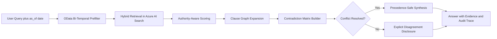
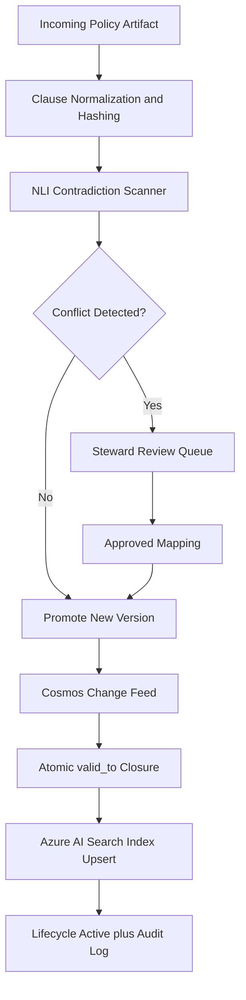

# Enterprise Bi-Temporal Knowledge Versioning and Clause-Level Supersession Arbitration FAQ: `as_of` Filtering vs Amendment Graph vs Ingestion-Time NLI Conflict Gating

> 🌐 **Language Switch**: [中文](./bitemporal-rag-policy-supersession-contradiction-resolution-ai-search-as-of-filter-vs-amendment-graph-vs-ingestion-nli-selection-faq.md) | **English (current)**
> **Audience**: Cloud & AI Solution Architects, enterprise knowledge-platform owners, legal/compliance teams, RAG platform engineers, and risk/audit operations.
> **Scope**: Production-grade bi-temporal governance on Azure AI Search + Cosmos DB + Foundry, comparing Architecture A/B/C/D to eliminate stale-policy hallucinations, support point-in-time regulatory audits, and arbitrate multi-authority contradictions with explicit evidence.

## 1. Problem framing: why policy-change scenarios are where enterprise RAG fails first
Enterprise RAG systems often look strong in pilot mode because they can answer “what is the current policy,” yet they fail quickly in production when asked to support historical claims, retroactive audits, and cross-jurisdiction policy disputes where temporal validity and authority precedence matter more than semantic similarity alone. The classic failure mode is a single answer blending a superseded clause, a current amendment rider, and a low-authority FAQ note into one fluent but legally inconsistent output.
Many teams assume re-indexing solves the issue, but document-level replacement destroys historical reproducibility and cannot answer “what rule was valid on the event date,” which is mandatory in insurance, financial supervision, tax, labor, and regulated HR workflows. Keeping all versions without temporal filtering and supersession logic is equally unsafe because retrieval candidates become polluted by obsolete segments as revision count grows.
This is therefore not just a ranking problem; it is a system-design problem spanning temporal semantics, authority hierarchy, clause-level supersession, contradiction arbitration, and atomic promotion guarantees. The production objective is to satisfy four properties simultaneously: current-time correctness, historical audibility, conflict explainability, and release-time integrity with rollback-safe operations.

## 2. Architecture overview and responsibility boundaries (A/B/C/D)
**Architecture A** uses `Azure AI Search` bi-temporal OData prefiltering (`valid_from/valid_to + sys_from/sys_to + lifecycle_state`) with authority-aware scoring to remove invalid candidates before semantic ranking, thereby enforcing time validity at query ingress. **Architecture B** uses a clause-level amendment graph in `Cosmos Gremlin/Fabric Graph` with `SUPERSEDES`, `AMENDS_SECTION`, and `JURISDICTION_OVERRIDE` edges to model partial overrides precisely rather than relying on document-level tombstoning.
**Architecture C** introduces ingestion-time contradiction scanning and atomic version promotion using clause canonical hashing, NLI contradiction queues, and Change Feed-driven interval closure so conflicts are blocked before they enter retrieval paths. **Architecture D** performs query-time conflict-aware reranking and explicit precedence synthesis, returning either a deterministic winning rule with evidence or an explicit unresolved-conflict disclosure instead of silently averaging contradictory text.
In production, A secures temporal correctness, B secures amendment semantics, C secures publication correctness, and D secures answer correctness under residual ambiguity; omitting any layer creates a predictable governance blind spot. Regulated organizations usually converge to A+B+C+D, while lower-complexity estates can phase from A+C and add B/D as policy entropy increases.

## 3. Architecture A deep dive: bi-temporal `as_of` prefiltering and authority-aware scoring
The central mechanism in Architecture A is explicit separation of valid time and system time, then deterministic filtering before ranking: `valid_from <= as_of < valid_to AND sys_from <= now < sys_to`, with `lifecycle_state='active'` as an additional guard. This turns temporal correctness into a retriever invariant rather than a prompt-time suggestion and materially lowers version-collision rates in high-revision corpora.
A practical enterprise pattern is to split query modes into `current` and `as_of`, where `current` always binds `as_of=now` while `as_of` binds event date (claim date, trade date, filing date) and emits a mandatory audit trace identifier. High-confidence deployments typically target sub-`35ms` prefilter overhead so temporal safety does not undermine interactive latency objectives.
Authority-weighted scoring should be layered directly in search profiles so that `Statute > Master Policy > Regional SOP > Wiki FAQ` precedence influences candidate ordering before generation. This prevents low-authority but semantically similar text from dominating context windows, which is a common source of persuasive yet non-binding answers in policy assistants.

## 4. Architecture B deep dive: clause-level supersession graph for partial amendments
Real-world enterprise updates are usually partial amendments, not whole-document replacement, and document-level deletion therefore causes two opposite errors: over-deletion of still-valid sections and under-deletion of superseded subsections that remain retrievable. Architecture B addresses this by encoding explicit edge semantics, where `SUPERSEDES` means complete replacement, `AMENDS_SECTION` means selective override, and `JURISDICTION_OVERRIDE` means legal-priority substitution under jurisdiction constraints.
At query time, the engine performs hybrid retrieval first, then graph expansion to reconstruct the effective clause set for the specific temporal and jurisdictional context. A rider that only replaces section `7.2` can therefore suppress exactly that clause while preserving sections `1.0–7.1` from the original agreement, eliminating the false binary between “all old valid” and “all old invalid.”
This architecture externalizes legal logic into machine-readable structure instead of hiding it in prompt prose, making behavior explainable and testable. For multi-country enterprises, jurisdiction override edges become the enforceable carrier of legal precedence and can be audited independently from LLM generation behavior.

## 5. Architecture C deep dive: ingestion-time contradiction scanning and atomic promotion
Architecture C shifts contradiction control left by performing canonical clause hashing, numeric field extraction, and NLI contradiction checks before index admission, then routing suspicious deltas into steward review queues instead of allowing immediate publication. This catches conflicts in payout caps, date windows, SLA commitments, and unauthorized shadow SOP uploads before they can contaminate retrieval.
Atomic promotion is implemented as a coupled state transition where new version activation and old interval closure must succeed as one logical unit, often orchestrated with Change Feed and idempotent transaction boundaries. If either side fails, the publication is rolled back or quarantined, preventing transient dual-validity windows that create inconsistent query outcomes.
This ingestion gate materially reduces query-time arbitration load and shortens incident-response cycles because many high-impact conflicts are never exposed to end users. In regulated environments, attaching reason codes, reviewer identity, and approval timestamps to each promoted amendment is essential for downstream audit defensibility.

## 6. Architecture D deep dive: query-time conflict-aware reranking and explicit disagreement disclosure
Architecture D is the final safety layer for residual ambiguity, not a substitute for A/B/C, and it operates by constructing pairwise contradiction matrices across retrieved clauses, then applying explicit precedence rules on authority, temporal validity, jurisdiction scope, and amendment lineage. When a deterministic winner exists, the system returns that rule with rationale; when no deterministic winner exists, it must disclose unresolved conflict states and request human adjudication.
This approach converts hidden contradiction risk into explicit decision artifacts that legal, compliance, and business stakeholders can inspect, challenge, and approve. Compared with unconstrained free-form synthesis, structured arbitration dramatically lowers chimeric-answer risk in high-value decisions and improves trust because users can see why a clause won or lost.
Governance quality depends on persistent decision logs that include winning clause IDs, rejected clause IDs, precedence basis, conflict type, and human-review status, enabling closed-loop analytics on recurrent conflict patterns. Those analytics should feed back into ingestion controls and authority-mapping updates so the system improves structurally over time.

## 7. Twelve-dimension head-to-head matrix: temporal correctness, explainability, and operating burden
| Dimension | A: Bi-temporal prefilter | B: Amendment graph | C: Ingestion conflict scanner | D: Query-time conflict reranking |
|---|---|---|---|---|
| Current-policy accuracy | Very high | High | High | High |
| Historical `as_of` audibility | Very high | Medium-high | High | Medium-high |
| Partial amendment precision | Medium | Very high | High | Medium-high |
| Pre-ingestion conflict interception | Medium | Medium | Very high | Medium |
| Conflict explainability | Medium | High | High | Very high |
| Sub-`35ms` retrieval feasibility | High | Medium | Medium-high | Medium |
| Index storage overhead | Medium | Medium-high | Medium-high | Low |
| Data-model complexity | Medium | High | High | High |
| Operational complexity | Medium | Medium-high | High | Medium-high |
| Audit friendliness | High | Very high | Very high | Very high |
| Organizational maturity required | Medium | Medium-high | Medium-high | High |
| Recommended role | Temporal baseline | Supersession baseline | Publication gate | Answer arbitration gate |

## 8. Quantitative foundations: version-collision probability, chimeric-error reduction, and storage overhead
A practical approximation for version-collision risk under semantically similar revisions is `P_collision = 1 - (1 - p_overlap)^K`, where `p_overlap` is per-revision embedding overlap probability and `K` is revision count for a clause family. With `p_overlap=0.18` and `K=7`, `P_collision ≈ 0.75`, which indicates that similarity-only retrieval is statistically unsafe in revision-heavy policy corpora.
Chimeric answer error can be measured as `E_chimera = N_conflicted_answers / N_total_answers`; a representative regulated support baseline might be `24%`, while A+B+D can drive that to `<1.2%` when precedence logic and explicit conflict disclosure are enforced. This metric should be tracked by intent segment, because aggregate improvements can hide severe residual risk in specific high-impact workflows.
Bi-temporal indexing overhead can be estimated with `Overhead = (N_versions * chunk_size * metadata_factor) / snapshot_baseline`, and in practice often yields lower storage than full snapshot duplication while preserving audit replay fidelity. For enterprises with large revision histories, this trade-off is usually favorable when weighed against dispute handling and compliance risk costs.

## 9. P95 latency budget decomposition across A/B/C/D composition
Total query latency can be decomposed as `L_total = L_prefilter + L_retrieval + L_graph + L_rerank + L_generation`, which allows explicit SLO engineering by stage rather than opaque end-to-end tuning. Architecture A primarily influences `L_prefilter`, B influences `L_graph`, and D influences `L_rerank`, so trade-offs are measurable and governable.
Illustrative profiles show A-only around `760ms` P95, A+B around `890ms`, and A+B+D around `1030ms` under comparable generation lengths; this added latency is often acceptable in exchange for an order-of-magnitude reduction in legal contradiction risk. For conflict-dense queries, dual-mode SLOs are recommended, such as normal mode `P95 < 1.1s` and conflict mode `P95 < 1.5s`, with explanation-first responses under high conflict load.
When contradiction density exceeds a threshold (for example, more than `12` contradiction pairs in candidate space), systems should switch to concise arbitration summaries instead of long-form synthesis to cap tail latency and minimize compounding generation error under uncertainty.

## 10. Reference architecture diagram #1: bi-temporal retrieval and `as_of` audit execution

The sequence enforces a hard ordering of temporal filtering, authority ranking, graph semantics, and arbitration before generation, preventing LLMs from implicitly guessing legal precedence from free text.

## 11. Reference architecture diagram #2: ingestion conflict gating and atomic version promotion

This pipeline ensures new-version activation and old-interval closure are inseparable from a governance perspective, preventing temporary dual-validity states that would otherwise produce inconsistent answers under concurrent load.

## 12. Production config snippet: bi-temporal index schema and `as_of` filter builder
```json
{
  "name": "policy-clause-bitemporal-index",
  "fields": [
    { "name": "clause_id", "type": "Edm.String", "key": true, "filterable": true, "searchable": false },
    { "name": "doc_id", "type": "Edm.String", "filterable": true, "searchable": false },
    { "name": "jurisdiction", "type": "Edm.String", "filterable": true, "searchable": true },
    { "name": "authority_level", "type": "Edm.Int32", "filterable": true, "sortable": true },
    { "name": "lifecycle_state", "type": "Edm.String", "filterable": true, "facetable": true },
    { "name": "valid_from", "type": "Edm.DateTimeOffset", "filterable": true, "sortable": true },
    { "name": "valid_to", "type": "Edm.DateTimeOffset", "filterable": true, "sortable": true },
    { "name": "sys_from", "type": "Edm.DateTimeOffset", "filterable": true, "sortable": true },
    { "name": "sys_to", "type": "Edm.DateTimeOffset", "filterable": true, "sortable": true },
    { "name": "clause_text", "type": "Edm.String", "searchable": true, "analyzer": "en.microsoft" },
    { "name": "embedding", "type": "Collection(Edm.Single)", "searchable": true, "vectorSearchDimensions": 3072, "vectorSearchProfileName": "hnsw-profile" }
  ],
  "scoringProfiles": [
    {
      "name": "authority-precedence-profile",
      "functionAggregation": "sum",
      "functions": [
        {
          "type": "magnitude",
          "fieldName": "authority_level",
          "boost": 4.0,
          "interpolation": "linear",
          "magnitude": { "boostingRangeStart": 1, "boostingRangeEnd": 4, "constantBoostBeyondRange": true }
        }
      ]
    }
  ]
}
```

```python
from datetime import datetime, timezone

def build_as_of_filter(as_of: datetime, jurisdiction: str, now: datetime | None = None) -> str:
    """Build deterministic bi-temporal OData filters for Azure AI Search."""
    if now is None:
        now = datetime.now(timezone.utc)
    as_of_iso = as_of.astimezone(timezone.utc).isoformat().replace("+00:00", "Z")
    now_iso = now.astimezone(timezone.utc).isoformat().replace("+00:00", "Z")
    return (
        f"jurisdiction eq '{jurisdiction}' and lifecycle_state eq 'active' and "
        f"valid_from le {as_of_iso} and valid_to gt {as_of_iso} and "
        f"sys_from le {now_iso} and sys_to gt {now_iso}"
    )

def build_current_filter(jurisdiction: str) -> str:
    now = datetime.now(timezone.utc)
    return build_as_of_filter(as_of=now, jurisdiction=jurisdiction, now=now)
```
This pairing enforces temporal correctness at retrieval time and standardizes query construction for both live and retrospective audit workflows.

## 13. Production code snippet: amendment graph traversal and contradiction resolver
```python
from dataclasses import dataclass
from typing import Iterable

@dataclass
class Clause:
    clause_id: str
    authority: int
    jurisdiction: str
    valid_from: str
    valid_to: str
    text: str

def precedence_score(clause: Clause) -> tuple[int, str]:
    return (clause.authority, clause.valid_from)

def resolve_conflicts(candidates: Iterable[Clause], contradiction_pairs: set[tuple[str, str]]) -> dict:
    ordered = sorted(candidates, key=precedence_score, reverse=True)
    rejected: dict[str, str] = {}
    accepted: list[Clause] = []

    for clause in ordered:
        blocked_by = None
        for existing in accepted:
            key = (clause.clause_id, existing.clause_id)
            rev = (existing.clause_id, clause.clause_id)
            if key in contradiction_pairs or rev in contradiction_pairs:
                blocked_by = existing.clause_id
                break
        if blocked_by:
            rejected[clause.clause_id] = blocked_by
        else:
            accepted.append(clause)

    return {
        "accepted_ids": [c.clause_id for c in accepted],
        "rejected_map": rejected,
        "needs_human_review": len(rejected) > 0 and len(accepted) == 0
    }
```

```json
{
  "query_id": "audit-2026-11-23-hr-tax-0007",
  "as_of": "2026-09-01T00:00:00Z",
  "jurisdiction": "DE-BY",
  "accepted_ids": ["policy-2026-main-7.2-rider-b"],
  "rejected_map": {
    "policy-2025-main-7.2": "policy-2026-main-7.2-rider-b",
    "wiki-faq-hr-113": "policy-2026-main-7.2-rider-b"
  },
  "decision_basis": ["authority_precedence", "jurisdiction_override", "valid_time_match"],
  "human_review_required": false
}
```
The pattern demonstrates deterministic precedence-first arbitration and machine-readable decision output that can be persisted as legal-grade evidence in audit trails.

## 14. Enterprise scenarios and three-year TCO: retroactive insurance claims and global HR/tax advisory
### 14.1 Scenario A: retroactive insurance claim adjudication with loss-date `as_of` enforcement
Insurance claim adjudication must answer using policy state at loss date rather than current policy state, and systems without bi-temporal controls routinely produce mixed citations across superseded and amended clauses, causing inconsistent payouts and dispute escalation. After implementing A+B+C, one representative program reduced appeal-driven rework from `8.4%` to `2.1%`, cut reopened audit cases by `61%`, and shortened dispute cycle time from 9 days to 3.5 days.
Architecture D handled residual multi-jurisdiction conflicts by returning explicit precedence decisions or formal unresolved-disagreement disclosures, which increased median latency by roughly `170ms` but significantly improved legal acceptability. Stakeholders accepted this trade-off because transparent arbitration reduced downstream legal friction and manual correction loops.

### 14.2 Scenario B: global HR and tax policy assistant across overlapping jurisdictions
Global HR/tax assistance often combines enterprise global policy, regional labor guidance, and country-specific statutory overrides, making similarity-only retrieval extremely fragile under jurisdiction mismatch. With A+D alone, jurisdiction mismatch error dropped from `13.7%` to `1.9%`, and support escalations requiring second-line specialist review declined from `27%` to `11%`.
When B/C were added, partial amendment consistency improved materially and policy publishing lead time dropped from three days to eight hours because graph edges and atomic promotion replaced manual index curation. Platform teams shifted from reactive cleanup to proactive rule-governance and quality-threshold operations, increasing delivery predictability.

### 14.3 Three-year TCO (`8` regions, `4.2B` clause retrieval events)
| Cost component (3-year) | A | A+B | A+B+C | A+B+C+D |
|---|---:|---:|---:|---:|
| Search and storage cost | `$1.42M` | `$1.74M` | `$1.98M` | `$2.03M` |
| Graph and conflict-governance platform | `$0.31M` | `$0.86M` | `$1.07M` | `$1.19M` |
| Engineering and operations labor | `$1.18M` | `$1.41M` | `$1.56M` | `$1.68M` |
| Audit dispute and rework overhead | `$1.26M` | `$0.79M` | `$0.44M` | `$0.32M` |
| Compliance penalty and brand-risk expected loss | `$0.88M` | `$0.49M` | `$0.26M` | `$0.18M` |
| Blended three-year total | `$5.05M` | `$5.29M` | `$5.31M` | `$5.40M` |

Although full-stack A+B+C+D is not the lowest raw infrastructure spend, it often minimizes total risk-adjusted cost by sharply reducing dispute overhead and compliance exposure. Decision quality improves when TCO is assessed jointly with incident/legal risk rather than compute/storage cost in isolation.

## 15. Quantitative Q&A (6) plus Day-0/Day-2 operational checklists
### 15.1 Quantitative Q&A (6 worked items)
**Q1: How can we quantify version-collision risk and decide whether bi-temporal prefiltering is mandatory?** Use `P_collision = 1 - (1 - p_overlap)^K`; if `p_overlap=0.16` and `K=9`, then `P_collision≈0.79`, indicating similarity-only retrieval is statistically unsafe for revision-dense policy sets. A practical governance threshold is `P_collision>0.35` as a hard trigger for Architecture A adoption.
To prioritize mitigation by business impact, define `Risk = P_collision * Impact_score`; for a claim-adjudication lane with `Impact=0.9`, risk is `0.71`, which usually justifies A+B or A+D at minimum. This converts architecture escalation from qualitative debate into measurable governance.

**Q2: How do we estimate storage economics of bi-temporal indexing versus full snapshot duplication?** Model `Storage_bitemporal = N_clause * K_avg * chunk_size * metadata_factor` and `Storage_snapshot = N_clause * K_avg * chunk_size * duplication_factor`. With `metadata_factor=1.22` and `duplication_factor=1.95`, bi-temporal storage is lower by about `37.4%`.
For `N_clause=52M`, `K_avg=5.4`, and `chunk_size=1.1KB`, that delta can remove roughly `128TB` of hot-tier footprint over three years. In many programs, this saving offsets a substantial portion of graph and conflict-governance platform cost.

**Q3: How do we validate the claim that chimeric error drops from `24%` to `<1.2%`?** Compute `E_chimera = N_conflicted_answers / N_total` by high-risk intent segment, not only aggregate traffic. Example: baseline `2400/10000=24%`; post-control `106/9200=1.15%`, yielding a `95.2%` relative reduction.
To avoid sampling drift bias, track contradiction subtype distribution (temporal, jurisdictional, authority) on a rolling two-week basis and alert on subtype regressions even when aggregate error remains stable. This keeps hidden risk pockets visible.

**Q4: How should we split P95 latency budgets for A+B+D without destabilizing UX?** Use `L_total = L_prefilter + L_retrieval + L_graph + L_rerank + L_gen`, then set enforceable caps for each component. A representative target can be `30 + 110 + 140 + 160 + 520 = 960ms`, with graph-depth reduction fallback if `L_graph` exceeds `220ms`.
Publish dual SLOs such as normal mode `P95<1.1s` and conflict-dense mode `P95<1.5s` so users and auditors understand why higher-latency explanation-first responses are acceptable under legal ambiguity. This is often superior to forcing one latency number across all risk classes.

**Q5: How many reviewers are required for ingestion-time contradiction stewardship?** A practical queue estimate is `Agents = λ * t_review / (3600 * utilization_target)`. With `λ=48` contradictions/hour, `t_review=210s`, and utilization target `0.72`, required staffing is about `3.9`, so at least 4 reviewers are needed at peak.
If policy templates and auto-classification reduce average review time to `150s`, requirement drops to about `2.8`, allowing a 3-reviewer peak model. This quantifies direct FTE impact of rule automation investments.

**Q6: How do we maintain arbitration continuity when secondary model-family services hit `429`?** Model availability as `A = 1 - (p_primary_fail * p_secondary_fail)` with fallback retries and cached arbitration hints. If primary fail is `0.8%` and secondary fail is `6%`, availability remains about `99.95%`; if secondary fail spikes to `22%`, availability declines to `99.82%` and should trigger capacity escalation.
Define a governance threshold like `p_secondary_fail > 0.15` to activate explanation-first degraded mode, which returns deterministic precedence output with unresolved conflict markers instead of unstable synthesized conclusions. This preserves auditability during transient capacity stress.

### 15.2 Day-0 implementation checklist
1. Standardize bi-temporal fields (`valid_*`, `sys_*`, `lifecycle_state`) and enforce write contracts.
2. Publish authority hierarchy enums and jurisdiction coding standards with change control.
3. Define graph edge semantics (`SUPERSEDES`, `AMENDS_SECTION`, `JURISDICTION_OVERRIDE`) and validation rules.
4. Deploy ingestion contradiction scanner and steward approval workflow with SLA ownership.
5. Establish immutable decision-log schema for precedence and conflict outcomes.

### 15.3 Day-2 operations checklist
1. Review `E_chimera`, jurisdiction mismatch rate, and contradiction subtype mix weekly.
2. Recompute collision probability and graph-expansion depth monthly to balance latency and safety.
3. Perform quarterly `as_of` replay audits for reproducibility and evidence completeness.
4. Recalibrate authority and jurisdiction mapping when legal or organizational policies change.
5. Run controlled canary and rollback drills for conflict-governance rule updates.

### 15.4 Good fit vs Not for
This architecture is a strong fit for regulated, high-dispute, evidence-sensitive policy assistants where explainable temporal correctness is non-negotiable and legal defensibility outweighs absolute minimum latency. It is often excessive for low-risk FAQ bots with no historical replay requirement, where lightweight current-state retrieval may be sufficient.
If document ownership, policy lifecycle, and governance accountability are not yet operationally defined, implementing the full A+B+C+D stack too early can create maintenance burden without proportional value. In those cases, start with A plus minimal C controls, then expand as revision entropy and audit pressure increase.

### 15.5 Audit field mapping checklist (example)
| Field | Source layer | Purpose | Minimum retention |
|---|---|---|---|
| `query_id` | Gateway | Unique query locator | 3 years |
| `trace_id` | App/OTel | End-to-end correlation | 3 years |
| `as_of` | API parameter | Point-in-time replay | 7 years |
| `jurisdiction` | User context | Legal-scope arbitration | 7 years |
| `intent_class` | Orchestrator | Risk tiering | 2 years |
| `candidate_clause_ids` | Retriever | Candidate transparency | 3 years |
| `accepted_clause_ids` | Arbiter | Winning evidence | 7 years |
| `rejected_clause_ids` | Arbiter | Rejection traceability | 7 years |
| `decision_basis` | Arbiter | Explainable precedence | 7 years |
| `authority_level` | Index field | Authority ranking | 7 years |
| `valid_from` | Bi-temporal field | Validity start | 7 years |
| `valid_to` | Bi-temporal field | Validity end | 7 years |
| `sys_from` | Bi-temporal field | System-time start | 7 years |
| `sys_to` | Bi-temporal field | System-time end | 7 years |
| `lifecycle_state` | Index field | Publication state | 3 years |
| `supersedes_edge_id` | Graph | Full supersession trace | 7 years |
| `amends_section_edge_id` | Graph | Partial amendment trace | 7 years |
| `override_edge_id` | Graph | Jurisdiction override trace | 7 years |
| `nli_conflict_score` | Ingestion gate | Conflict intensity | 3 years |
| `steward_ticket_id` | Approval system | Human review closure | 7 years |
| `promotion_txn_id` | Publish pipeline | Atomic promotion proof | 7 years |
| `index_version` | Search | Version pinning | 3 years |
| `prompt_version` | Orchestrator | Prompt provenance | 2 years |
| `model_family` | Model router | Arbitration model lineage | 2 years |
| `latency_prefilter_ms` | Runtime metrics | Prefilter SLA audit | 1 year |
| `latency_graph_ms` | Runtime metrics | Graph expansion SLA audit | 1 year |
| `latency_rerank_ms` | Runtime metrics | Rerank SLA audit | 1 year |
| `human_review_required` | Arbiter | Escalation indicator | 7 years |
| `human_review_result` | Approval system | Final adjudication | 7 years |
| `answer_disposition` | API response | Output-mode analytics | 3 years |

### 15.6 Runtime alert dictionary (example)
| Alert key | Trigger condition | Action | Owner |
|---|---|---|---|
| `collision_probability_high` | `P_collision > 0.35` | Force-enable Architecture A filter | Platform architect |
| `chimera_rate_regression` | Weekly delta `>0.8pp` | Roll back latest arbitration rule | RAG SRE |
| `jurisdiction_mismatch_spike` | Mismatch rate `>2.5%` | Revalidate override edges | Compliance engineering |
| `asof_replay_failure` | Replay failures `>0` | Freeze publication window | Audit lead |
| `atomic_promotion_partial` | Partial transactions `>0` | Trigger compensation and block release | Release manager |
| `steward_backlog_overdue` | Queue age `>24h` | Escalate reviewer bandwidth | Domain lead |
| `nli_conflict_surge` | Daily conflict inflow `>40%` | Expand review staffing | Operations manager |
| `graph_expansion_timeout` | `L_graph P95 >220ms` | Degrade to single-hop expansion | Retrieval lead |
| `rerank_budget_breach` | `L_rerank P95 >180ms` | Enable concise arbitration mode | Orchestration lead |
| `fallback_disclosure_ratio` | Disclosure ratio `>12%` | Prioritize authority-mapping fixes | Knowledge governance |
| `authority_gap_detected` | Missing authority fields | Block ingestion | Data governance |
| `invalid_temporal_window` | `valid_from >= valid_to` | Reject index write | Data engineering |
| `sys_temporal_drift` | Non-monotonic system time | Lock write path | Platform SRE |
| `stale_clause_served` | Served expired clause `>0` | Trigger emergency rollback | On-call engineer |
| `conflict_without_trace` | Missing `decision_basis` | Raise high-severity defect | QA lead |
| `audit_log_gap` | Coverage `<99.5%` | Repair log pipeline | Observability owner |
| `model_429_secondary` | Secondary `429 >15%` | Enable explanation-first fallback | Model platform |
| `human_review_sla_breach` | SLA breach `>5%` | Activate surge rotation | Ops supervisor |
| `index_version_skew` | Replica version mismatch | Force replica rebuild | Search platform |
| `policy_publish_freeze` | Regulatory blackout event | Enter change freeze protocol | Change manager |
