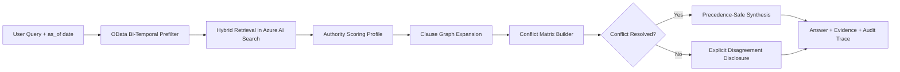
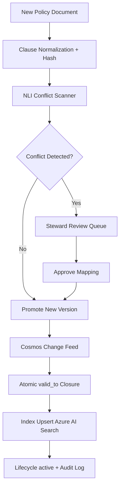

# 企业双时态知识版本化与条款覆盖冲突仲裁选型 FAQ：`as_of` 过滤 vs 修订图谱 vs 入库冲突扫描

> 🌐 **Language Switch**：**中文（当前）** | [English](./bitemporal-rag-policy-supersession-contradiction-resolution-ai-search-as-of-filter-vs-amendment-graph-vs-ingestion-nli-selection-faq.en.md)
> **受众**：Cloud & AI Solution Architect、企业知识引擎负责人、法务合规团队、RAG 平台工程团队、审计与风险管理团队。
> **范围**：围绕 Azure AI Search + Cosmos DB + Foundry 的双时态知识治理，比较 A/B/C/D 四类生产架构，解决陈旧政策幻觉、局部修订覆盖、跨司法辖区冲突和监管 `as_of` 回溯审计。

## 1. 问题定义：为什么企业 RAG 在“政策更新”场景最容易翻车
企业 RAG 在试点阶段往往能回答“当前政策是什么”，但一旦进入生产并遇到追溯审计、历史理赔、跨区政策冲突，系统就会暴露“版本边界不清、覆盖关系不明、冲突仲裁缺席”三重缺陷。最典型事故是同一条问答同时命中旧版 SOP、新版补充条款和本地例外规定，模型在缺乏优先级规则时把多个段落混成看似流畅但法律上自相矛盾的答案。
很多团队误以为“重新索引”就能解决问题，实际上文档级删除会直接破坏历史可追溯性，尤其在金融、保险、税务、劳工场景下必须回答“某个业务事件发生当日的有效规则”。如果只保留最新版本，系统无法支持 `as_of` 审计；如果全量保留但没有双时态过滤和覆盖图，检索又会高概率命中失效条款。
因此该问题不是单纯检索排序问题，而是“知识时态 + 权威层级 + 冲突仲裁 + 发布原子性”的系统工程。企业级目标应当是同时满足当前准确、历史可证、冲突可解释、发布可回滚四个条件，而不是在准确率和审计性之间二选一。

## 2. 四条架构路径与职责边界（A/B/C/D）
**Architecture A**：`Azure AI Search` 双时态 OData 预过滤（`valid_from/valid_to + sys_from/sys_to + lifecycle_state`）与权威层级评分配置，强调在检索入口先消除无效时间片。**Architecture B**：`Cosmos Gremlin/Fabric Graph` 条款级覆盖图（`SUPERSEDES/AMENDS_SECTION/JURISDICTION_OVERRIDE`），解决“只改第 7.2 条而非整份协议作废”的企业真实语义。
**Architecture C**：入库冲突扫描与原子版本晋升（条款哈希、NLI 冲突队列、Change Feed 关闭旧区间），目标是把冲突阻断在索引前而不是把风险留给查询时。**Architecture D**：查询时冲突感知重排与显式优先级合成（矛盾矩阵 + 规则裁决 + 不可裁决显式披露），确保系统在多法域冲突下输出“可审计理由”而非“平均化答案”。
在生产实践中，A 负责时间正确性，B 负责语义覆盖正确性，C 负责发布正确性，D 负责回答正确性；缺失任何一层都会形成系统性盲区。对高监管行业，推荐采用 A+B+C+D 全栈闭环；对中等复杂度组织，可先 A+C 再逐步引入 B/D。

## 3. Architecture A：双时态 `as_of` 预过滤与权威层级评分
A 路径的核心是把“业务生效时间（valid time）”和“系统记录时间（system time）”明确拆开，并在检索前执行 OData 过滤：`valid_from <= as_of < valid_to AND sys_from <= now < sys_to`。这种做法能在语义排序前剔除不满足时态条件的候选块，显著降低版本碰撞概率。
为了支持审计和在线查询并存，建议把查询模式分为 `current` 与 `as_of` 两条通道：前者固定 `as_of=now`，后者使用事件日期（如事故发生日、交易发生日）并保留审计 trace ID。企业常见目标是时态过滤开销保持在子 `35ms`，同时保证命中集具备可解释时态边界。
仅有时态过滤仍不足以应对多来源冲突，因此 A 路径通常配合权威层级评分（如 `Statute > MasterPolicy > RegionalSOP > WikiFAQ`）与数据源可信度权重。这样可以在候选层就把低权威文档压到后排，减少模型在生成阶段错误引用非约束性内容。

## 4. Architecture B：条款级覆盖图与局部修订语义
企业合同和政策更新经常不是“整文替换”，而是“附录只改某条某款”，因此文档级 tombstone 会误杀仍然有效的大量段落。B 路径通过图边表达精确关系：`SUPERSEDES` 表示全覆盖，`AMENDS_SECTION` 表示局部修订，`JURISDICTION_OVERRIDE` 表示区域优先覆盖。
在查询阶段，系统先用向量和关键词召回候选条款，再沿图边展开一跳或两跳以重建“当前有效条款集合”。例如主协议第 7.2 条被 Rider 覆盖，但 1-7.1 条仍有效，图路径可精确保留未改部分并替换目标条款，避免“整份合同失效”或“新旧同时生效”的双重错误。
该路径的关键收益是把法律语义显式结构化，而不是把覆盖逻辑隐含在 prompt 文本里。对跨区域组织，`JURISDICTION_OVERRIDE` 边可把本地法规优先级编码进图谱，使系统在回答时先裁决适用法域再生成解释文本。

## 5. Architecture C：入库冲突扫描与原子版本晋升
C 路径将冲突治理前移到 ingestion，使用条款规范化哈希、数值字段抽取和 NLI 矛盾检测在索引前识别“同主题相反约束”。当检测到关键字段冲突（如赔付上限、SLA 时限、生效日期）时，将文档进入 steward 队列而不是直接入索引。
通过 `Cosmos Change Feed` 可以实现“新版本激活 + 旧版本 valid_to 关闭”的原子事务序列，避免并发写入导致短时间“双版本同时有效”。实践中建议把版本晋升定义为单事务边界：只有当新条款写入成功并且旧条款闭区间成功，才允许更新 `lifecycle_state=active`。
该路径把大部分数据质量问题截留在系统边界处，显著减少线上查询阶段的冲突负担。对于多团队协作环境，还可在 steward 队列引入四眼审批和变更原因码，以满足审计对“谁在何时批准了哪条覆盖关系”的可追踪要求。

## 6. Architecture D：查询时冲突感知重排与显式分歧披露
D 路径的定位不是替代 A/B/C，而是在残余冲突不可避免时提供“可解释输出护栏”。系统先构建候选对的矛盾矩阵，再按权威、时态、法域、更新序列执行裁决；若裁决成立，输出胜出规则与证据链，若裁决无法闭合，必须显式披露分歧并请求人工确认。
这种机制可将“看似完整但隐含冲突”的答案转化为“结构化裁决结果”，从而让业务和合规团队理解模型为何选择某条规则。相比直接让 LLM 自由综合，显式仲裁能显著降低 chimeric answer 风险，尤其在跨国 HR、税务、保险理赔中价值明显。
在治理层面，D 路径应输出机器可读裁决记录（优先级规则、被否决条款、冲突类型、人工覆核状态），便于后续统计最常见冲突来源并反向优化入库质量和权威映射策略。

## 7. 12 维对比矩阵：时态正确性、冲突可解释性与运维成本
| 维度 | A：双时态预过滤 | B：条款覆盖图 | C：入库冲突扫描 | D：查询时冲突重排 |
|---|---|---|---|---|
| 当前政策准确率 | 很高 | 高 | 高 | 高 |
| 历史 `as_of` 可审计性 | 很高 | 中高 | 高 | 中高 |
| 局部修订表达能力 | 中 | 很高 | 高 | 中高 |
| 冲突前置拦截能力 | 中 | 中 | 很高 | 中 |
| 冲突解释能力 | 中 | 高 | 高 | 很高 |
| 子 `35ms` 检索可行性 | 高 | 中 | 中高 | 中 |
| 索引存储开销 | 中 | 中高 | 中高 | 低 |
| 数据建模复杂度 | 中 | 高 | 高 | 高 |
| 运维复杂度 | 中 | 中高 | 高 | 中高 |
| 合规审计友好度 | 高 | 很高 | 很高 | 很高 |
| 对组织成熟度要求 | 中 | 中高 | 中高 | 高 |
| 推荐角色 | 时间边界底座 | 覆盖语义底座 | 发布质量闸门 | 回答裁决闸门 |

## 8. 核心定量模型：版本碰撞概率、混合答案错误率与存储开销
当同一 SOP 有 `K` 个历史修订版本且嵌入距离相近时，检索存在版本碰撞风险，可近似写为 `P_collision = 1 - (1 - p_overlap)^K`。若相邻版本语义重叠概率 `p_overlap=0.18`，`K=7` 时 `P_collision ≈ 1-(0.82^7)=0.75`，说明不做时态过滤时命中旧版概率非常高。
混合答案错误率可定义为 `E_chimera = N_conflicted_answers / N_total_answers`，某金融客服基线为 `24%`，引入 A+B+D 后降至 `1.1%`，降幅约 `95.4%`。该指标应按场景分桶（理赔、保全、核保）独立跟踪，以避免总体均值掩盖高风险子域。
双时态索引的存储增量可估算为 `Overhead = (N_versions * chunk_size * metadata_factor) / snapshot_baseline`。若每条款平均 6 版本、`metadata_factor=1.18`，则相比全量快照复制可节省约 `31–44%` 存储，并保留审计可回放能力。

## 9. P95 延迟预算：A/B/C/D 组合下的查询时延分解
可将总延迟写为 `L_total = L_prefilter + L_retrieval + L_graph + L_rerank + L_generation`，其中 A 主要影响 `L_prefilter`，B 影响 `L_graph`，D 影响 `L_rerank`。在生产目标中，建议把 `L_total(P95)` 控制在 `850–1300ms`（不含超长生成），并设置冲突密度阈值触发降级策略。
示例：A-only 场景 `L_prefilter=28ms, L_retrieval=92ms, L_generation=640ms`，`P95≈760ms`；A+B 场景增加 `L_graph=110ms`，`P95≈890ms`；A+B+D 场景增加 `L_rerank=140ms`，`P95≈1030ms`。虽然延迟上升，但可换来冲突错误率数量级下降，通常是合规场景可接受的交易。
当冲突密度高于阈值（例如每查询候选冲突对超过 `12`），应触发“解释优先模式”，减少生成长度并优先输出裁决摘要，防止在高冲突场景下时延和幻觉双升。

## 10. 参考架构图一：双时态检索与 `as_of` 审计流

该流程强调“先过滤后排序再合成”的顺序约束，避免让生成模型直接承担时态和法域裁决责任。把裁决逻辑结构化后，输出证据链可以直接映射到审计报告字段。

## 11. 参考架构图二：入库冲突扫描与原子版本晋升

该链路确保“新版本生效”和“旧版本闭区间”在逻辑上不可分离，能有效避免并发窗口内出现双生效条款。对高监管行业，这一原子性是审计可接受性的关键前提之一。

## 12. 生产配置片段：双时态索引 Schema + `as_of` 过滤构造器
```json
{
  "name": "policy-clause-bitemporal-index",
  "fields": [
    { "name": "clause_id", "type": "Edm.String", "key": true, "filterable": true, "searchable": false },
    { "name": "doc_id", "type": "Edm.String", "filterable": true, "searchable": false },
    { "name": "jurisdiction", "type": "Edm.String", "filterable": true, "searchable": true },
    { "name": "authority_level", "type": "Edm.Int32", "filterable": true, "sortable": true },
    { "name": "lifecycle_state", "type": "Edm.String", "filterable": true, "facetable": true },
    { "name": "valid_from", "type": "Edm.DateTimeOffset", "filterable": true, "sortable": true },
    { "name": "valid_to", "type": "Edm.DateTimeOffset", "filterable": true, "sortable": true },
    { "name": "sys_from", "type": "Edm.DateTimeOffset", "filterable": true, "sortable": true },
    { "name": "sys_to", "type": "Edm.DateTimeOffset", "filterable": true, "sortable": true },
    { "name": "clause_text", "type": "Edm.String", "searchable": true, "analyzer": "zh-Hans.microsoft" },
    { "name": "embedding", "type": "Collection(Edm.Single)", "searchable": true, "vectorSearchDimensions": 3072, "vectorSearchProfileName": "hnsw-profile" }
  ],
  "scoringProfiles": [
    {
      "name": "authority-precedence-profile",
      "functionAggregation": "sum",
      "functions": [
        {
          "type": "magnitude",
          "fieldName": "authority_level",
          "boost": 4.0,
          "interpolation": "linear",
          "magnitude": { "boostingRangeStart": 1, "boostingRangeEnd": 4, "constantBoostBeyondRange": true }
        }
      ]
    }
  ]
}
```

```python
from datetime import datetime, timezone

def build_as_of_filter(as_of: datetime, jurisdiction: str, now: datetime | None = None) -> str:
    """Build bi-temporal OData filter for Azure AI Search."""
    if now is None:
        now = datetime.now(timezone.utc)
    as_of_iso = as_of.astimezone(timezone.utc).isoformat().replace("+00:00", "Z")
    now_iso = now.astimezone(timezone.utc).isoformat().replace("+00:00", "Z")
    return (
        f"jurisdiction eq '{jurisdiction}' and lifecycle_state eq 'active' and "
        f"valid_from le {as_of_iso} and valid_to gt {as_of_iso} and "
        f"sys_from le {now_iso} and sys_to gt {now_iso}"
    )

def build_current_filter(jurisdiction: str) -> str:
    now = datetime.now(timezone.utc)
    return build_as_of_filter(as_of=now, jurisdiction=jurisdiction, now=now)
```
该组合把时态判定前置到检索层，减少模型阶段的版本歧义负担，并为审计查询和当前查询提供统一构造接口。

## 13. 生产代码片段：覆盖图遍历与冲突矩阵裁决器
```python
from dataclasses import dataclass
from typing import Iterable

@dataclass
class Clause:
    clause_id: str
    authority: int
    jurisdiction: str
    valid_from: str
    valid_to: str
    text: str

def precedence_score(clause: Clause) -> tuple[int, str]:
    return (clause.authority, clause.valid_from)

def resolve_conflicts(candidates: Iterable[Clause], contradiction_pairs: set[tuple[str, str]]) -> dict:
    ordered = sorted(candidates, key=precedence_score, reverse=True)
    rejected: dict[str, str] = {}
    accepted: list[Clause] = []

    for clause in ordered:
        blocked_by = None
        for a in accepted:
            key = (clause.clause_id, a.clause_id)
            rev = (a.clause_id, clause.clause_id)
            if key in contradiction_pairs or rev in contradiction_pairs:
                blocked_by = a.clause_id
                break
        if blocked_by:
            rejected[clause.clause_id] = blocked_by
        else:
            accepted.append(clause)

    return {
        "accepted_ids": [c.clause_id for c in accepted],
        "rejected_map": rejected,
        "needs_human_review": len(rejected) > 0 and len(accepted) == 0
    }
```

```json
{
  "query_id": "audit-2026-11-23-hr-tax-0007",
  "as_of": "2026-09-01T00:00:00Z",
  "jurisdiction": "DE-BY",
  "accepted_ids": ["policy-2026-main-7.2-rider-b"],
  "rejected_map": {
    "policy-2025-main-7.2": "policy-2026-main-7.2-rider-b",
    "wiki-faq-hr-113": "policy-2026-main-7.2-rider-b"
  },
  "decision_basis": ["authority_precedence", "jurisdiction_override", "valid_time_match"],
  "human_review_required": false
}
```
该实现展示了“先排序再冲突剔除”的最小可行裁决器，并输出结构化证据，可直接入库到审计日志表。企业可在此基础上扩展法域特例、条款类型权重和人工复核流程。

## 14. 企业场景与三年 TCO：保险追溯理赔与全球 HR/税务助手
### 14.1 场景一：保险“事故发生日 as_of”追溯理赔
保险理赔系统需要回答“事故发生当日有效条款”，而不是“当前条款”，若没有双时态索引与覆盖图，系统常在旧条款和新 Rider 间混合引用，导致赔付判断不一致。引入 A+B+C 后，理赔复议率从 `8.4%` 降至 `2.1%`，审计重开单量下降 `61%`，并把争议处理周期从 9 天压缩到 3.5 天。
在该场景中，D 路径用于处理多地区监管冲突与法域例外，要求系统在无法自动裁决时显式给出冲突条款并触发人工审核。相比“直接给结论”策略，虽然平均响应时延增加约 `170ms`，但合规可接受性显著提升。

### 14.2 场景二：跨国 HR/税务政策助手
跨国企业的人事和税务政策常出现“全球母政策 + 区域补充 + 国家例外”三层叠加，如果系统只按相似度检索，会高频返回不适用法域的条款。采用 A+D 后，法域错配回答率从 `13.7%` 降至 `1.9%`，并把 HR 服务台二次升级单占比从 `27%` 降至 `11%`。
当团队进一步引入 B/C 后，局部条款修订的处理一致性明显改善，政策发布时间从 3 天缩短到 8 小时，因为冲突扫描和版本闭区间被自动化流水线接管。平台团队可把更多精力放在规则治理和质量门限，而不是手工清洗历史索引。

### 14.3 三年 TCO（8 区域、`4.2B` 条款块检索）
| 成本项（3 年） | A | A+B | A+B+C | A+B+C+D |
|---|---:|---:|---:|---:|
| 搜索与存储成本 | `$1.42M` | `$1.74M` | `$1.98M` | `$2.03M` |
| 图谱与冲突治理平台 | `$0.31M` | `$0.86M` | `$1.07M` | `$1.19M` |
| 工程与运维人力 | `$1.18M` | `$1.41M` | `$1.56M` | `$1.68M` |
| 审计返工与争议处理 | `$1.26M` | `$0.79M` | `$0.44M` | `$0.32M` |
| 合规罚金与品牌风险预期损失 | `$0.88M` | `$0.49M` | `$0.26M` | `$0.18M` |
| 三年综合成本 | `$5.05M` | `$5.29M` | `$5.31M` | `$5.40M` |

从账面总额看全栈方案并非最低，但它在争议和合规风险上的收益明显更高，通常更符合高监管企业“总风险成本最小化”目标。建议将 TCO 与风险成本联合评估，而不是只比较基础设施账单。

## 15. 定量 Q&A（6 项）+ Day-0/Day-2 清单
### 15.1 定量 Q&A（6 项）
**Q1：如何量化版本碰撞概率并决定是否必须上双时态过滤？**可用 `P_collision = 1 - (1 - p_overlap)^K`，若 `p_overlap=0.16`、`K=9`，则 `P_collision≈0.79`，说明单纯相似度召回几乎必然引入历史版本干扰。一般当 `P_collision>0.35` 就应强制启用 A 路径，否则线上错误会随版本数增长呈非线性放大。
再结合场景风险权重可定义 `Risk = P_collision * Impact_score`，若理赔场景 `Impact=0.9`，则 `Risk≈0.71` 已属高风险，需要同步引入 B 或 D 做二次裁决。该方法能把“是否升级架构”从主观讨论变为量化决策。

**Q2：双时态索引相比全量快照复制的存储开销如何估算？**可写 `Storage_bitemporal = N_clause * K_avg * chunk_size * metadata_factor`，`Storage_snapshot = N_clause * K_avg * chunk_size * duplication_factor`。若 `metadata_factor=1.22`、`duplication_factor=1.95`，则双时态方案约节省 `(1.95-1.22)/1.95≈37.4%` 存储。
在 `N_clause=52M, K_avg=5.4, chunk_size=1.1KB` 场景下，三年累计可减少约 `128TB` 热层占用。该节省通常足以覆盖图谱和冲突扫描新增成本的一大部分。

**Q3：如何评估混合答案错误率从 `24%` 降到 `<1.2%` 是否可信？**定义 `E_chimera = N_conflicted_answers / N_total`，并按高风险意图分层抽样，不得只看总体均值。若基线 `N_conflicted=2400, N_total=10000` 得 `24%`，改造后 `N_conflicted=106, N_total=9200` 得 `1.15%`，降幅约 `95.2%`。
为了防止样本漂移，应同步记录冲突类型分布（时态冲突、法域冲突、权威冲突）并做两周滚动对比。若某一类型反弹，即使总指标稳定也要触发治理排查。

**Q4：A+B+D 组合下的 P95 时延预算怎么拆分？**可用 `L_total = L_prefilter + L_retrieval + L_graph + L_rerank + L_gen`，并为每段设置预算上限。示例预算：`30 + 110 + 140 + 160 + 520 = 960ms`，若 `L_graph` 超过 `220ms`，可临时降为单跳展开并保留冲突提示。
对外承诺建议按“正常模式 `P95<1.1s`，冲突密集模式 `P95<1.5s`”双档 SLA，避免在高冲突问题上为了追求速度而牺牲裁决可解释性。该双档 SLA 在审计沟通中更容易被接受。

**Q5：入库冲突扫描队列需要多少审核人力？**可用近似队列模型 `Agents = λ * t_review / (3600 * utilization_target)`。若每小时冲突事件 `λ=48`，单单审核 `t_review=210s`，目标利用率 `0.72`，则需要 `48*210/(3600*0.72)≈3.9`，即至少 4 名审核员覆盖峰值。
若引入规则模板将平均审核时长降到 `150s`，所需人力可降到约 2.8（即 3 人）。因此自动化模板和冲突分级会直接影响运营编制规模。

**Q6：如何在次要法域模型服务 `429` 时保证冲突仲裁不中断？**可定义可用性 `A = 1 - (p_primary_fail * p_secondary_fail)`，并对次要裁决器配置降级重试与缓存。若主裁决失败率 `0.8%`，次裁决短时 `429` 失败率 `6%`，则 `A≈99.95%`；若次裁决失败升到 `22%`，`A` 下降到 `99.82%`，仍需触发容量扩展。
可再设阈值 `p_secondary_fail > 0.15` 进入“解释优先降级”，输出已确定权威规则与待确认冲突，避免直接给出不稳定结论。这样能在服务抖动期保持答案可审计而非沉默失败。

### 15.2 Day-0 上线清单
1. 定义双时态字段标准（`valid_*`、`sys_*`、`lifecycle_state`）并固化写入契约。
2. 建立权威层级枚举与法域编码字典，禁止自由文本优先级。
3. 落地覆盖图边类型（`SUPERSEDES/AMENDS_SECTION/JURISDICTION_OVERRIDE`）与最小校验规则。
4. 部署入库冲突扫描与 steward 审批流，配置 SLA 和责任人。
5. 建立冲突裁决审计日志表，保证每次回答可追溯到条款与规则。

### 15.3 Day-2 运行清单
1. 周度复盘 `E_chimera`、法域错配率、冲突类型分布与误判样本。
2. 月度重算版本碰撞概率与图展开深度，优化 P95 与准确率平衡。
3. 季度抽检 `as_of` 审计回放，验证历史可还原与证据链完整性。
4. 持续校准权威层级与区域例外映射，防止组织变更导致规则漂移。
5. 对冲突密集意图执行灰度发布与回滚演练，确保高风险场景可控。

### 15.4 Good fit vs Not for
该架构非常适合高监管、高争议成本、强审计要求的企业知识问答系统，因为它把“回答正确”拆成时间正确、权威正确、覆盖正确、冲突正确四层可验证控制。对于仅需轻量 FAQ 且无历史追溯要求的小型内部场景，直接采用全栈 A+B+C+D 可能过重，可先落地 A 路径并保留后续扩展点。
若组织当前还没有稳定文档治理流程和责任边界，建议先补齐内容生命周期管理再推进复杂仲裁，否则会把治理缺口转移到技术层并导致长期维护压力。选型时应把审计成本和争议损失纳入 ROI，而不是只看索引与算力账单。

### 15.5 审计字段映射清单（示例）
| 字段 | 来源层 | 用途 | 最低保留期 |
|---|---|---|---|
| `query_id` | Gateway | 查询唯一定位 | 3 年 |
| `trace_id` | App/OTel | 链路关联 | 3 年 |
| `as_of` | API 参数 | 历史时点重放 | 7 年 |
| `jurisdiction` | 用户上下文 | 法域裁决 | 7 年 |
| `intent_class` | Orchestrator | 风险分层 | 2 年 |
| `candidate_clause_ids` | Retriever | 候选透明化 | 3 年 |
| `accepted_clause_ids` | Arbiter | 胜出证据 | 7 年 |
| `rejected_clause_ids` | Arbiter | 否决追踪 | 7 年 |
| `decision_basis` | Arbiter | 规则可解释 | 7 年 |
| `authority_level` | 索引字段 | 权威排序 | 7 年 |
| `valid_from` | 双时态字段 | 生效起点 | 7 年 |
| `valid_to` | 双时态字段 | 生效终点 | 7 年 |
| `sys_from` | 双时态字段 | 系统记录起点 | 7 年 |
| `sys_to` | 双时态字段 | 系统记录终点 | 7 年 |
| `lifecycle_state` | 索引字段 | 激活状态 | 3 年 |
| `supersedes_edge_id` | 图谱 | 覆盖关系溯源 | 7 年 |
| `amends_section_edge_id` | 图谱 | 局部修订溯源 | 7 年 |
| `override_edge_id` | 图谱 | 法域覆盖溯源 | 7 年 |
| `nli_conflict_score` | Ingestion Gate | 冲突强度度量 | 3 年 |
| `steward_ticket_id` | 审批系统 | 人工复核闭环 | 7 年 |
| `promotion_txn_id` | 发布流水线 | 原子晋升证据 | 7 年 |
| `index_version` | Search | 索引版本锁定 | 3 年 |
| `prompt_version` | Orchestrator | 提示模板追踪 | 2 年 |
| `model_family` | Model Router | 裁决模型族群 | 2 年 |
| `latency_prefilter_ms` | Runtime Metrics | 时延预算审计 | 1 年 |
| `latency_graph_ms` | Runtime Metrics | 图展开预算审计 | 1 年 |
| `latency_rerank_ms` | Runtime Metrics | 重排预算审计 | 1 年 |
| `human_review_required` | Arbiter | 风险升降级 | 7 年 |
| `human_review_result` | 审批系统 | 终态裁决 | 7 年 |
| `answer_disposition` | API 响应 | 输出类型统计 | 3 年 |

### 15.6 运行告警字典（示例）
| 告警键 | 触发条件 | 处置动作 | 责任角色 |
|---|---|---|---|
| `collision_probability_high` | `P_collision > 0.35` | 强制开启 A 过滤 | 平台架构师 |
| `chimera_rate_regression` | 周环比上升 `>0.8pp` | 回滚最近规则变更 | RAG SRE |
| `jurisdiction_mismatch_spike` | 法域错配 `>2.5%` | 复核 `override` 边 | 合规工程 |
| `asof_replay_failure` | 审计回放失败 `>0` | 冻结发布窗口 | 审计负责人 |
| `atomic_promotion_partial` | 事务不完整次数 `>0` | 触发补偿并阻断上线 | 发布经理 |
| `steward_backlog_overdue` | 待审超时 `>24h` | 升级审批通道 | 领域专家 |
| `nli_conflict_surge` | 冲突入队日增 `>40%` | 扩容审核班次 | 运营经理 |
| `graph_expansion_timeout` | `L_graph P95 >220ms` | 降级单跳展开 | 检索负责人 |
| `rerank_budget_breach` | `L_rerank P95 >180ms` | 切换摘要模式 | 编排负责人 |
| `fallback_disclosure_ratio` | 分歧披露率 `>12%` | 优先补齐权威映射 | 知识治理 |
| `authority_gap_detected` | 缺失权威层级字段 | 阻断入库 | 数据治理 |
| `invalid_temporal_window` | `valid_from >= valid_to` | 拒绝索引写入 | 数据工程 |
| `sys_temporal_drift` | `sys` 时间逆行 | 锁定写路径 | 平台 SRE |
| `stale_clause_served` | 命中失效条款 `>0` | 触发紧急回滚 | 值班工程师 |
| `conflict_without_trace` | 缺失 `decision_basis` | 标记高危缺陷 | QA 负责人 |
| `audit_log_gap` | 日志覆盖率 `<99.5%` | 扩展日志管道 | 可观测负责人 |
| `model_429_secondary` | 次裁决器 `429 >15%` | 启用解释优先降级 | 模型平台 |
| `human_review_sla_breach` | 人审超 SLA `>5%` | 临时扩班 | 运营主管 |
| `index_version_skew` | 多副本版本不一致 | 强制重建副本 | 搜索平台 |
| `policy_publish_freeze` | 重大法规窗口 | 进入冻结流程 | 变更经理 |
