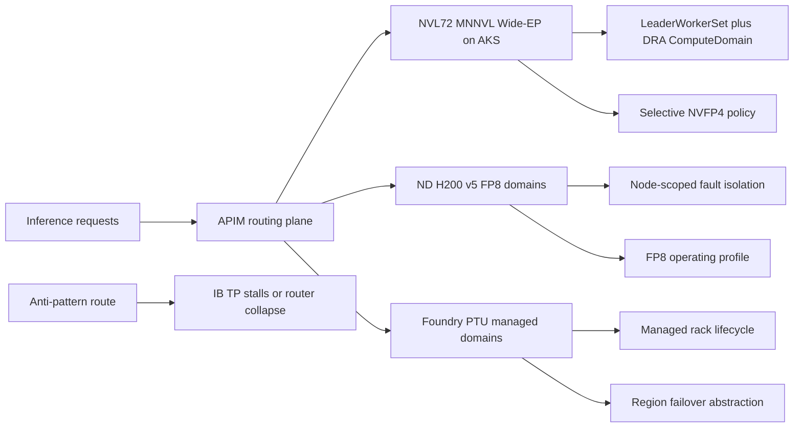
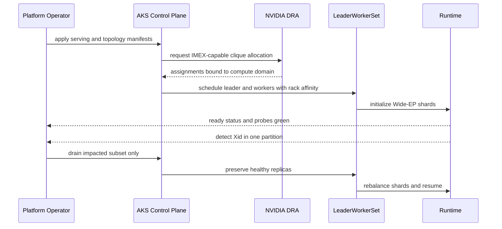
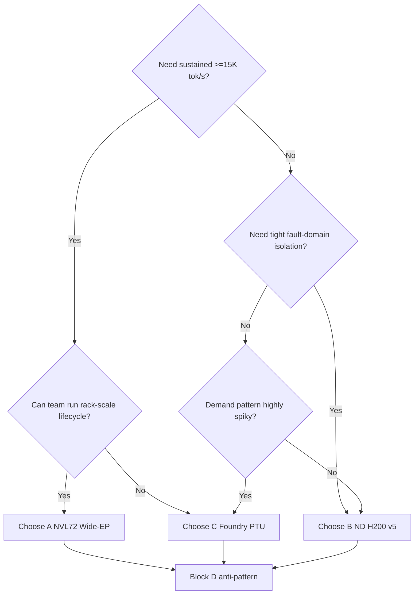

# Enterprise Blackwell `GB200 NVL72` vs `ND H200 v5` vs Foundry PTU selection FAQ: rack-scale `NVFP4 Wide-EP` serving versus 8-GPU `FP8` fault-isolated pods versus managed provisioned abstraction
> **Audience**: Cloud & AI Solution Architects, GPU platform teams, and inference reliability/FinOps owners.
> **Core question**: when to deploy rack-scale `MNNVL` topology, when to stay on 8-GPU domains, and when to transfer complexity to managed PTU.
> **Recommendation**: choose A for sustained ultra-high MoE concurrency, choose B for broad regional resilience and isolation, choose C when operational burden dominates, and prohibit D.

## 1. Executive summary
In Blackwell-era serving, topology and quantization policy often matter more than raw single-device compute.
Architecture A keeps Wide-EP traffic inside the NVLink5 fabric of an `NVL72` domain.
Architecture B limits blast radius to smaller failure domains and supports broader regional deployment patterns.
Architecture C shifts rack lifecycle, IMEX channel operations, and spare-capacity burden to managed service layers.
Architecture D combines either cross-node TP congestion or uncalibrated low-bit router collapse and should be blocked.
This guide quantifies `1.8 TB/s vs 400 Gb/s`, `A_clique = A_VM^m`, `4.5 bpw vs 8.0 bpw`, and three-year TCO bands at `500/15,000/150,000 tok/s`.

## 2. Background: serving bottlenecks moved from FLOPs to fabric and failure domains
Large-MoE inference frequently bottlenecks on expert dispatch communication rather than arithmetic throughput.
When `EP=32/64` traffic crosses low-bandwidth boundaries, interconnect jitter inflates ITL and erodes effective throughput.
At the same time, larger coherence domains increase operational coupling during faults and maintenance.
Therefore architecture selection must jointly optimize bandwidth locality, fault isolation, and platform operability.
The right choice is workload- and organization-dependent, not benchmark-dependent alone.

## 3. Objectives and boundaries
Objective 1: maximize stable production token throughput under explicit SLO constraints.
Objective 2: contain hardware fault impact without unnecessary full-domain disruption.
Objective 3: reduce memory pressure with controlled precision policy while preserving task quality.
Objective 4: convert availability goals into explicit clique-capacity budgeting rules.
Objective 5: define a clear split of responsibilities between self-managed and managed stacks.
Boundary 1: this document focuses on serving, not model training design.
Boundary 2: decisions are made under production operability constraints, not synthetic peak metrics only.
Boundary 3: model quality evaluation remains a parallel track and is not replaced by infra checks.

## 4. Candidate architectures
Architecture A: `Azure ND GB200 v6 NVL72` on `AKS` using `LeaderWorkerSet`, DRA `ComputeDomain/IMEX`, and selective `NVFP4` with Wide-EP runtimes.
Architecture B: `Azure ND H200 v5` 8-GPU `FP8` serving domains emphasizing fault isolation and regional availability.
Architecture C: `Azure AI Foundry PTU` plus APIM multi-region routing and failover abstraction.
Architecture D: cross-node high-order TP over IB bottlenecks or uncalibrated uniform INT4 router quantization.
Default guidance: A for flagship sustained MoE throughput, B for mainstream resilient deployment, C for complexity transfer, D blocked.

## 5. Architecture A deep dive: rack-scale NVLink and selective NVFP4
A delivers value by localizing expert dispatch traffic inside a high-bandwidth rack-scale fabric.
At high EP factors, all-to-all volume dominates decode paths, so fabric choice sets practical ITL floors.
`NVLink5` class bandwidth in `NVL72` domains can avoid many cross-node communication cliffs.
`NVFP4` with micro-block scaling can reduce weight footprint near `4.5 bpw` for selected components.
Critical gates and precision-sensitive control paths should remain in `BF16/FP8` to protect behavior stability.
A's trade-off is operational complexity: clique lifecycle, liquid-cooled rack constraints, and spare-domain planning.

## 6. Architecture B deep dive: node-scoped fault isolation with H200 FP8
B keeps fault containment granular and often simplifies replacement workflows.
When `Xid` anomalies occur, teams can drain or replace limited node scopes rather than broad rack domains.
This profile is frequently easier to replicate across regions due to wider SKU availability.
For many dense workloads and moderate MoE concurrency, B offers strong cost-to-operability balance.
Its downside appears at very large EP scales where inter-node communication overhead rises earlier.

## 7. Architecture C deep dive: managed PTU abstraction
C externalizes rack-level engineering and reserve-capacity management to the managed provider.
For teams without dedicated GPU SRE depth, this can materially reduce operational risk.
Coupled with APIM routing, C supports region-aware failover and policy controls above hardware details.
The trade-off is reduced low-level tuning freedom compared with self-managed domains.
C is often preferable when demand variability prevents efficient amortization of dedicated flagship clusters.

## 8. Architecture D anti-pattern
D1 uses high-order cross-node TP over constrained IB paths and drives sustained decode stalls.
D2 applies uniform low-bit quantization to precision-sensitive router pathways and destabilizes expert selection.
Both patterns produce visible business-level fallout: malformed tool arguments, retry cascades, and latency volatility.
D should be denied by architecture review and CI gate policy.

## 9. Quantitative framing
Bandwidth contrast can be approximated as `1.8 TB/s / 50 GB/s ≈ 36x` under simplified per-link assumptions.
Clique availability follows `A_clique = A_VM^m`, where `m` is VM count inside the serving clique.
Dual-clique high-availability targets require explicit standby-capacity budgeting, not merely topology diagrams.
Precision footprint comparison: `NVFP4 ≈ 4.5 bpw` versus `FP8 = 8.0 bpw` changes memory headroom significantly.
Track ITL P95, stable tok/s, fault-drain MTTR, quality parity gates, and unit-token cost together.

## 10. Twelve-dimension comparison matrix
| Dimension | Architecture A | Architecture B | Architecture C | Architecture D |
|---|---|---|---|---|
| Peak MoE serving ceiling | High | Medium | Medium | Low |
| Fault isolation granularity | Medium | High | Medium-High | Low |
| Operational complexity | High | Medium | Low | Medium-High unstable |
| Topology control | High | Medium-High | Low | Superficial only |
| Precision-risk controllability | Medium | High | Medium-High | Low |
| Regional elasticity | Medium | High | High | Uncertain |
| Capital amortization pressure | High | Medium | Medium-High managed pricing | Unpredictable |
| Deployment velocity | Medium | Medium-High | High | Medium |
| Audit explainability | Medium-High | High | High | Low |
| Recommended stage | Flagship sustained load | Default mainstream | Complexity-constrained teams | Prohibited |
| Primary failure concern | clique lifecycle burden | inter-node comm ceiling | low-level tuning opacity | perf and quality collapse |
| Overall recommendation | conditional strong fit | default fit | conditional fit | reject |

## 11. Topology contrast across NVL72, H200, and PTU


## 12. ComputeDomain bootstrap and sub-clique drain sequence


## 13. Decision tree


### Q1. What is the decisive gain of NVL72 for MoE serving
The decisive gain is communication locality for expert dispatch paths at large EP scales.
When all-to-all traffic stays in high-bandwidth local fabric, ITL volatility is materially reduced.
That stability directly benefits long tool-call chains and multi-step agent reliability.
So the key gain is topology-localized communication, not just aggregate accelerator count.

### Q2. Why does 8-GPU H200 remain a mainstream enterprise option
Production platforms value recoverability and isolation granularity as much as raw ceiling throughput.
Node-scoped domains simplify replacement and regional rollout patterns.
For many practical workloads, this delivers better lifecycle efficiency than extreme-scale domains.
Hence B remains a durable default in many organizations.

### Q3. How should NVFP4 be applied safely
Avoid uniform aggressive low-bit conversion across precision-sensitive pathways.
Keep router gates and critical control paths in higher precision while quantizing suitable expert weights.
Require offline calibration plus online parity gates tied to business outcomes.
Treat quantization policy as a layered control, not a global switch.

### Q4. When is Foundry PTU the right strategic choice
PTU is strong when teams cannot sustainably run rack-scale lifecycle operations.
It is also attractive when demand volatility weakens dedicated-cluster amortization.
Managed abstraction lets teams focus on application-layer governance and routing logic.
This is a deliberate complexity-transfer decision.

### Q5. How does availability math influence capacity planning
`A_clique = A_VM^m` shows that larger cliques magnify VM-availability sensitivity.
High availability therefore requires explicit standby capacity, not just architecture diagrams.
If standby planning is omitted, theoretical HA does not become operational HA.
Capacity budgeting and reliability targets must be co-governed.

### Q6. Five-step rollout and Good fit vs Not for
Step 1: define throughput, ITL, and quality gates per workload class.
Step 2: benchmark A/B/C baselines under identical methodology.
Step 3: inject faults and validate drain/recovery behavior.
Step 4: deploy layered quantization policy and block D-class anti-patterns.
Step 5: finalize route using three-year TCO plus organizational capability review.
Good fit: high-concurrency MoE production workloads with strict SLOs and platform engineering capacity.
Not for: unstable low-volume demos without sustained operations ownership.

## 14. Implementation snippets
```yaml
apiVersion: ai.infrastructure.nvidia.com/v1alpha1
kind: LeaderWorkerSet
metadata:
  name: gb200-nvl72-wide-ep
spec:
  replicas: 2
  leaderWorkerTemplate:
    size: 9
    restartPolicy: RollingUpdate
    template:
      metadata:
        labels:
          app: blackwell-serving
      spec:
        nodeSelector:
          nvidia.com/gpu.product: GB200
        affinity:
          podAntiAffinity:
            requiredDuringSchedulingIgnoredDuringExecution:
              - labelSelector:
                  matchLabels:
                    app: blackwell-serving
                topologyKey: topology.kubernetes.io/zone
        containers:
          - name: runtime
            image: ghcr.io/example/tensorrtllm-gb200:latest
            env:
              - name: DRA_COMPUTE_DOMAIN
                value: "nvl72-clique-a"
              - name: ENABLE_IMEX
                value: "true"
            resources:
              limits:
                nvidia.com/gpu: "8"
```

```python
from dataclasses import dataclass

@dataclass
class SelectiveNvfp4Config:
    router_dtype: str = "bf16"
    attention_dtype: str = "fp8"
    expert_weight_dtype: str = "nvfp4"
    kv_dtype: str = "fp8"
    max_drop: float = 0.005

def layer_policy(layer_name: str) -> str:
    protected = ["router.gate", "attention.out_proj", "tool_head"]
    if any(p in layer_name for p in protected):
        return "bf16" if "router.gate" in layer_name else "fp8"
    return "nvfp4"

def build_quant_plan(layer_names):
    return {name: layer_policy(name) for name in layer_names}

def quality_gate(baseline: float, quantized: float, threshold: float = 0.005) -> bool:
    return (baseline - quantized) <= threshold
```

## 15. Three-year TCO framing at `500 / 15,000 / 150,000 tok/s`
| Tier | Stable throughput target | Recommended route | Cost focus | Primary benefit |
|---|---|---|---|---|
| Tier-1 | 500 tok/s | B or C | availability and base ops | fast stable launch |
| Tier-2 | 15,000 tok/s | A or A+B hybrid | clique lifecycle and orchestration | reduced all-to-all bottlenecks |
| Tier-3 | 150,000 tok/s | multi-clique A with C fallback | standby capacity and automation | high throughput with HA continuity |

## 16. Release checklist
Confirm ComputeDomain and IMEX allocations match intended rack topology.
Confirm LeaderWorkerSet supports partial drain without full-clique restart.
Confirm quantization policy protects router-gate precision pathways.
Confirm ITL, tok/s, and quality parity gates are enforced together.
Confirm region-failover paths are rehearsed and documented.
Confirm standby clique budgeting matches declared HA objectives.
Confirm D anti-pattern variants are explicitly blocked in review policy.
Confirm cost dashboards include hardware, managed service, networking, and ops labor dimensions.
Confirm incident replay links topology, quantization, and runtime events coherently.

## 17. Optimization guidance
Track expert-routing drift daily to detect early router-collapse signals.
Align maintenance windows with demand troughs to reduce business impact.
Segment quality datasets by scenario to avoid averaged-risk blind spots.
Include fault-drain MTTR and rollback rate in platform SLO reporting.
Version calibration workflows for reproducible governance evidence.
Re-evaluate A/B/C traffic mix quarterly against cost and reliability outcomes.

## 18. Conclusion
Blackwell platform selection is a joint optimization across fabric locality, fault domains, and precision policy.
A maximizes large-scale MoE potential, B maximizes operational resilience, and C minimizes platform burden.
D anti-patterns degrade both performance and correctness and should remain blocked.
Sustainable architecture emerges only when throughput goals, organizational capability, and TCO are evaluated together.
The objective is not temporary benchmark wins but durable production inference operations.
In sustained governance, build fixed metrics and accountable ownership for nvlink boundary audits so detection, response, and postmortem evidence remain verifiable, endpoint tag: nvlink boundary audits.
In sustained governance, build fixed metrics and accountable ownership for ib congestion lead indicators so detection, response, and postmortem evidence remain verifiable, endpoint tag: ib congestion lead indicators.
In sustained governance, build fixed metrics and accountable ownership for imex channel drift checks so detection, response, and postmortem evidence remain verifiable, endpoint tag: imex channel drift checks.
In sustained governance, build fixed metrics and accountable ownership for clique standby drills so detection, response, and postmortem evidence remain verifiable, endpoint tag: clique standby drills.
In sustained governance, build fixed metrics and accountable ownership for router gate stability scans so detection, response, and postmortem evidence remain verifiable, endpoint tag: router gate stability scans.
In sustained governance, build fixed metrics and accountable ownership for quant calibration versioning so detection, response, and postmortem evidence remain verifiable, endpoint tag: quant calibration versioning.
In sustained governance, build fixed metrics and accountable ownership for regional supply elasticity so detection, response, and postmortem evidence remain verifiable, endpoint tag: regional supply elasticity.
In sustained governance, build fixed metrics and accountable ownership for cold-kv tier hits so detection, response, and postmortem evidence remain verifiable, endpoint tag: cold-kv tier hits.
In sustained governance, build fixed metrics and accountable ownership for xid severity routing so detection, response, and postmortem evidence remain verifiable, endpoint tag: xid severity routing.
In sustained governance, build fixed metrics and accountable ownership for oncall handbook updates so detection, response, and postmortem evidence remain verifiable, endpoint tag: oncall handbook updates.
In sustained governance, build fixed metrics and accountable ownership for throughput-quality coupling so detection, response, and postmortem evidence remain verifiable, endpoint tag: throughput-quality coupling.
In sustained governance, build fixed metrics and accountable ownership for peak-valley scheduler replay so detection, response, and postmortem evidence remain verifiable, endpoint tag: peak-valley scheduler replay.
In sustained governance, build fixed metrics and accountable ownership for service-mesh backpressure so detection, response, and postmortem evidence remain verifiable, endpoint tag: service-mesh backpressure.
In sustained governance, build fixed metrics and accountable ownership for multi-tenant fairness so detection, response, and postmortem evidence remain verifiable, endpoint tag: multi-tenant fairness.
In sustained governance, build fixed metrics and accountable ownership for maintenance change audits so detection, response, and postmortem evidence remain verifiable, endpoint tag: maintenance change audits.
In sustained governance, build fixed metrics and accountable ownership for ptu reserve reclamation so detection, response, and postmortem evidence remain verifiable, endpoint tag: ptu reserve reclamation.
In sustained governance, build fixed metrics and accountable ownership for ticket closure knowledge capture so detection, response, and postmortem evidence remain verifiable, endpoint tag: ticket closure knowledge capture.
In sustained governance, build fixed metrics and accountable ownership for model upgrade canary gates so detection, response, and postmortem evidence remain verifiable, endpoint tag: model upgrade canary gates.
In sustained governance, build fixed metrics and accountable ownership for rollback stress verification so detection, response, and postmortem evidence remain verifiable, endpoint tag: rollback stress verification.
In sustained governance, build fixed metrics and accountable ownership for network jitter tolerance so detection, response, and postmortem evidence remain verifiable, endpoint tag: network jitter tolerance.
Link `A_clique` projections directly to finance planning workflows so reliability targets and capital commitments stay aligned, endpoint tag: ha-capital-alignment.
Publish ITL P95 and tool-success parity together in benchmark reports to avoid throughput-only misreads, endpoint tag: latency-quality-coupling.
Require dual-review plus rollback plans for quantization policy updates, endpoint tag: quant-change-governance.
Synchronize rack maintenance calendars with release calendars to reduce compounded risk windows, endpoint tag: maintenance-release-sync.
Maintain cross-layer trace maps from topology events to business alerts, endpoint tag: topology-business-linkage.
Apply stricter parity thresholds for high-risk tenants and workflows, endpoint tag: risk-tier-accuracy-gate.
Reconcile PTU and self-host routes monthly to rebalance economics and reliability, endpoint tag: managed-selfhost-rebalance.
Use expert-distribution drift as an early warning signal beyond hardware alerts, endpoint tag: expert-drift-sentinel.
Run quarterly cross-region failover rehearsals with full-path validation, endpoint tag: geo-failover-drill.
Correlate network perturbation telemetry with token-level latency to surface hidden coupling, endpoint tag: network-itl-correlation.
Introduce scaling cooldown windows for clique adjustments to avoid oscillation, endpoint tag: clique-scaling-cooldown.
Archive failed parity samples automatically for governance replay, endpoint tag: accuracy-regression-archive.
Integrate daily cost-anomaly checks into operations patrol routines, endpoint tag: cost-anomaly-watch.
Track fault-isolation success rates as first-class platform SLOs, endpoint tag: fault-isolation-slo.
Continuously review roadmap decisions against throughput, correctness, and operability triad goals, endpoint tag: triple-objective-governance.
Decouple liquid-cooling maintenance windows from business campaign windows to avoid compounded exposure, endpoint tag: liquid-cooling-window-decouple.
Log every cross-node expert rebalance action with traceable audit context for replay diagnostics, endpoint tag: expert-rebalance-audit.
Report clique utilization and idle ratios together in quarterly budget reviews to prevent capital misreads, endpoint tag: clique-utilization-balance.
Govern shared runtime base-image versions across model families to reduce upgrade fragmentation risk, endpoint tag: runtime-image-coherence.
Require canary approval for APIM routing-weight changes to prevent abrupt load skew, endpoint tag: route-weight-governance.
Include compound-failure drills combining partition loss plus cross-region return paths, endpoint tag: compound-failure-drill.
Track fabric-pressure telemetry alongside scheduler-pressure telemetry for early saturation detection, endpoint tag: fabric-scheduler-correlation.
Maintain explicit runbooks for IMEX channel remediation with role ownership and escalation paths, endpoint tag: imex-remediation-runbook.
Record parity-gate exceptions with business justification and expiration dates, endpoint tag: parity-exception-governance.
Run monthly policy lint checks on deployment manifests to catch topology drift before rollout, endpoint tag: topology-policy-linting.
Integrate disaster-recovery rehearsal outcomes into backlog prioritization and staffing plans, endpoint tag: dr-feedback-integration.
Publish blended reliability-cost scorecards so architecture steering remains evidence-driven, endpoint tag: reliability-cost-scorecard.
Tie topology-level incidents to customer-facing SLA narratives to improve executive decision speed, endpoint tag: sla-topology-translation.
Preserve calibration artifacts with immutable checksums to enable deterministic rollback validation, endpoint tag: calibration-artifact-integrity.
Correlate standby-clique occupancy with forecast error to refine reserve-capacity policy, endpoint tag: standby-forecast-calibration.
Review cross-team escalation handoffs after each major incident to remove coordination latency, endpoint tag: escalation-handoff-optimization.
