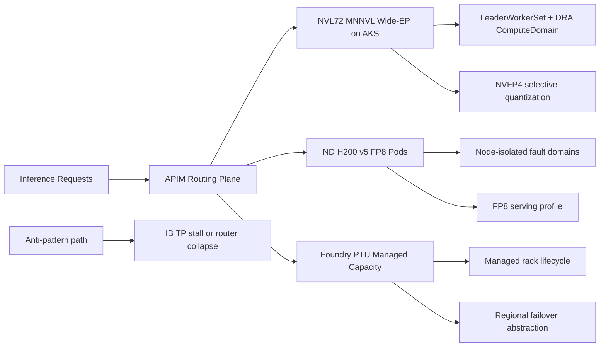
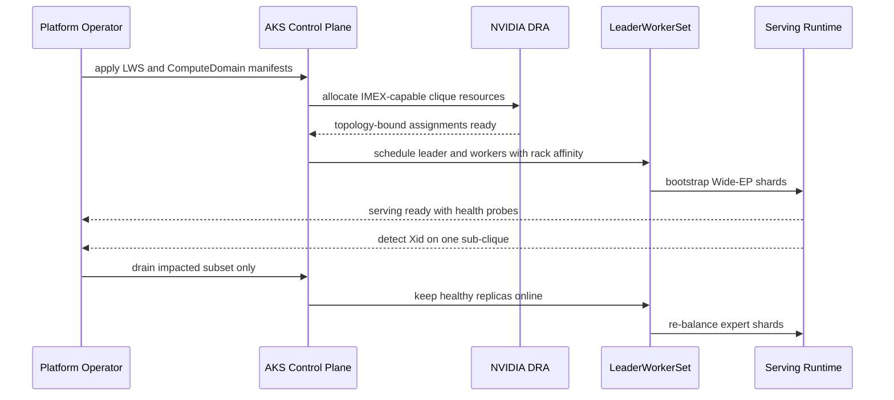
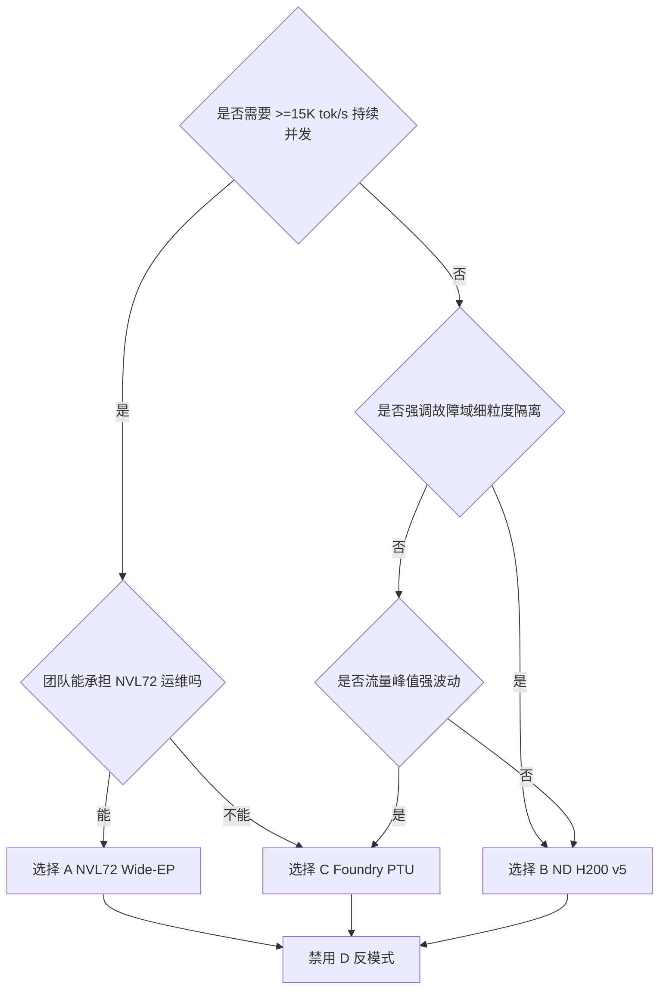

# 企业级 Blackwell `GB200 NVL72` 与 `ND H200 v5` / Foundry PTU 选型 FAQ：`NVFP4 Wide-EP` 机架级推理 vs `8-GPU FP8` 容错隔离 vs 托管 PTU 抽象
> **适用对象**：Cloud & AI Solution Architect、GPU 平台工程团队、推理 FinOps 与可靠性治理团队。
> **核心问题**：何时应选择 `NVL72 MNNVL` 机架级扩展，何时坚持 `8-GPU` 细粒度故障域，何时交给 Foundry PTU 托管容量。
> **建议结论**：超大 MoE 且高并发稳定流量优先 A；中等规模与广域可用性优先 B；运维与资本约束显著时优先 C；D 全面禁用。

## 1. 执行摘要
Blackwell 时代的架构差异不再只是“显存多少”，而是“互联拓扑与量化策略如何决定可行性边界”。
A 通过 `NVL72` 机架级 NVLink5 域把 Wide-EP all-to-all 留在高带宽域内，显著降低跨节点瓶颈。
B 通过 `8-GPU H200` 细粒度故障域控制硬件异常爆炸半径，保持部署弹性。
C 以 PTU 托管方式转移液冷机架、IMEX 生命周期与备份容量压力。
D 典型反模式是跨节点高阶 TP 过度依赖 IB，或未经校准的统一 INT4 路由量化导致专家塌缩。
本文量化四组核心指标：`1.8 TB/s NVLink5 vs 400 Gb/s NDR IB`、`A_clique = A_VM^m`、`4.5 bpw vs 8.0 bpw`、`500/15,000/150,000 tok/s` 三年 TCO。

## 2. 问题背景：MoE 推理瓶颈从算力转向互联与故障域
在大模型推理中，单卡算力提升并不自动带来端到端吞吐提升。
当专家并行 `EP=32/64` 跨越多个节点时，路由 dispatch all-to-all 往往成为主瓶颈。
若 all-to-all 主要走 NDR IB，链路带宽与抖动会拉高 ITL，吞吐曲线出现台阶化退化。
另一方面，机架级超大域又放大了故障关联半径与维护复杂度。
因此选型核心变成三方平衡：互联带宽、故障隔离、运维资本。

## 3. 目标与边界
目标一：在指定 SLO 下获得稳定 token throughput，而非实验室峰值。
目标二：控制硬件故障传播半径，避免单点异常拖垮整域。
目标三：在精度可接受前提下降低显存压力与单位 token 成本。
目标四：把高可用目标映射为可计算的 clique 与容量预算。
目标五：对平台团队明确“自管 vs 托管”的责任边界。
边界一：本文聚焦推理与 serving，不讨论训练集群规划。
边界二：本文以企业生产可运维性为约束，不追求单指标极限跑分。
边界三：本文不代替模型评测，应与业务任务精度评测并行。

## 4. 四类候选架构
Architecture A：`Azure ND GB200 v6 NVL72` + `AKS` + `LeaderWorkerSet` + `DRA ComputeDomain/IMEX`，以 `NVFP4` + `Wide-EP` 为核心。
Architecture B：`Azure ND H200 v5` `8xGPU` 节点级 `FP8` serving，优先故障域隔离与区域供给弹性。
Architecture C：`Azure AI Foundry PTU` + `APIM` 多区域容灾切换，抽象机架与容量细节。
Architecture D：跨节点高阶 TP 过度依赖 IB 或未校准统一 INT4 路由量化的反模式路径。
建议路线：高并发超大 MoE 选 A，中等规模/多区域弹性选 B，团队运维负担重时选 C，D 禁用。

## 5. Architecture A 深入：`NVL72 MNNVL` + `NVFP4 Wide-EP`
A 的核心价值是把专家路由通信保留在机架级 NVLink5 域内。
在 `EP=32/64` 下，专家 dispatch 与 combine 的字节交换量巨大，链路带宽直接决定 ITL 下界。
`1.8 TB/s` 级别双向 NVLink5 与 `400 Gb/s` NDR IB 之间存在数量级差距。
A 还可利用 `Grace-Blackwell NVLink-C2C` 分层处理冷热 KV，减轻 HBM 压力。
在量化方面，`NVFP4` 通过微块缩放降低权重量化存储到约 `4.5 bpw`。
但路由 gate、关键注意力路径仍建议维持 `BF16/FP8` 以保护语义稳健性。
A 的风险在于 clique 生命周期管理、液冷运维与备用 clique 资本开销。

## 6. Architecture B 深入：`ND H200 v5` `8-GPU FP8`
B 的优势是把故障域压缩到节点或双节点范围，便于快速摘除异常实例。
当出现 `Xid` 或拓扑异常时，平台可只替换受影响节点，不必重建整机架 clique。
`H200` 在 `FP8` 下对多数中大型 dense 模型与中等 MoE 负载仍具较好性价比。
B 的区域供给通常更广，有利于跨区域部署与容灾弹性。
不足是跨节点 all-to-all 更容易触碰 IB 瓶颈，超大 EP 规模下吞吐上限较早出现拐点。
因此 B 更适合 `<400B` dense 或中等并发 MoE，而非极限规模 Wide-EP。

## 7. Architecture C 深入：Foundry PTU 托管容量
C 的关键价值是责任转移：把机架细节、容量预留与维护窗口外包给托管平台。
对于缺乏专门 GPU SRE 团队的组织，C 可显著降低平台运营复杂度。
配合 APIM 可构建跨区域流量治理与故障切换策略。
C 的代价是硬件层可控性下降，细粒度拓扑与量化策略可调空间较小。
当业务流量峰谷差大且并发不足以长期摊薄 NVL72 资本时，C 常是更稳妥路径。

## 8. Architecture D 反模式
D1：跨节点 `TP=32/64` 强依赖 IB all-reduce，导致 decode ITL 持续高企。
D2：将 MoE router 统一降到未校准 INT4，破坏专家选择概率稳定性。
这两类反模式会直接表现为 JSON tool 参数漂移、步骤链失败与尾延迟抖动。
D 在生产中往往难以通过可靠性与质量门禁，应在架构审查阶段否决。

## 9. 核心公式与量化框架
带宽对比可近似写为：`BW_NVLink5 / BW_IB = 1.8 TB/s / 50 GB/s ≈ 36x`。
clique 可用度可写为：`A_clique = A_VM^m`，`m` 为 clique 中 VM 数量。
当目标为双 clique 高可用时，需显式预算至少 `2-clique` 容量底座。
量化存储比较：`NVFP4 ≈ 4.5 bpw` vs `FP8 = 8.0 bpw`，直接影响可容纳参数规模与 KV 余量。
建议同时跟踪：ITL P95、tok/s、故障摘除时长、精度守门通过率、单位 token 成本。

## 10. 12 维选型矩阵
| 维度 | Architecture A | Architecture B | Architecture C | Architecture D |
|---|---|---|---|---|
| 超大 MoE 吞吐潜力 | 高 | 中 | 中 | 低 |
| 故障隔离粒度 | 中 | 高 | 中高 | 低 |
| 运维复杂度 | 高 | 中 | 低 | 中高且不稳定 |
| 拓扑可控性 | 高 | 中高 | 低 | 表面高实则不可控 |
| 精度风险可控 | 中 | 高 | 中高 | 低 |
| 区域可用性 | 中 | 高 | 高 | 不确定 |
| 资本摊销要求 | 高 | 中 | 中高（托管定价） | 不可预测 |
| 上线速度 | 中 | 中高 | 高 | 中 |
| 审计与可解释 | 中高 | 高 | 高 | 低 |
| 推荐阶段 | 高并发旗舰 | 通用主力 | 运维受限优先 | 禁止 |
| 主要风险 | clique 运营难度 | 跨节点瓶颈 | 黑盒调优边界 | 性能/质量双崩 |
| 总体建议 | 条件强推 | 默认优选 | 约束优选 | 拒绝 |

## 11. `NVL72` / `H200` / PTU 拓扑对比


## 12. DRA `ComputeDomain` + `IMEX` 启动与故障排空时序


## 13. 决策树


### Q1. `NVL72` 对 MoE 推理最关键的收益是什么
最关键收益是把大规模专家路由通信尽可能留在高带宽低时延域内。
当 all-to-all 不再频繁跨 IB 边界，ITL 抖动与尾延迟更易收敛。
这对长链工具调用与多轮任务稳定性尤为重要。
因此 A 的价值本质是通信拓扑重构，而非单纯堆卡数量。

### Q2. 为什么 `8-GPU H200` 在很多企业场景仍是主力解
企业生产更看重可运维性与故障隔离半径，而不是单一峰值指标。
B 在故障摘除、跨区域供给、渐进扩容方面通常更平滑。
对于中等规模模型与并发需求，B 可在复杂度与性能间取得稳态平衡。
因此 B 常作为默认主力平台长期运行。

### Q3. `NVFP4` 应如何避免精度事故
不要将所有层统一激进量化，尤其避免路由 gate 与精细结构被无差别降精度。
推荐对专家权重优先量化，对关键控制路径保留 BF16/FP8。
同时必须建立离线校准与线上精度守门，确保业务指标不过阈值。
量化策略应是分层策略，而不是单一开关。

### Q4. Foundry PTU 的决定性适用条件是什么
当团队无法长期维护机架级硬件生命周期与跨域容量缓冲时，C 的托管收益显著。
若业务峰谷差大、并发不足以摊薄自管旗舰集群成本，C 也更经济。
C 适合把精力聚焦在应用层路由、评测与治理，而非底层设备工程。
这是一种“复杂度外包”的理性选择。

### Q5. 如何用可用度公式指导高可用容量预算
`A_clique = A_VM^m` 表明 clique 规模越大，对单 VM 可用度越敏感。
双 clique 高可用并不只是拓扑设计，还意味着真实的容量底座预留。
若忽略备用 clique 资本，理论高可用无法转化为生产可用。
因此容量预算必须与可用度目标同一张表管理。

### Q6. 五步落地与 Good fit / Not for
第一步：按业务负载分层定义 `tok/s`、ITL、精度守门阈值。
第二步：分别构建 A/B/C 小规模基线并做同口径压测。
第三步：加入故障注入，验证摘除时长与降级策略有效性。
第四步：建立量化分层策略，禁止 D 的统一激进低比特方案。
第五步：按三年 TCO 与组织能力做最终路线定稿并月度复核。
Good fit：高并发 MoE 生产系统、严格 SLO、可投入平台运维团队的企业。
Not for：流量不稳定且无平台工程能力、只追求短期演示指标的场景。

## 14. 实施片段
```yaml
apiVersion: ai.infrastructure.nvidia.com/v1alpha1
kind: LeaderWorkerSet
metadata:
  name: nvl72-wide-ep-serving
spec:
  replicas: 2
  leaderWorkerTemplate:
    size: 9
    restartPolicy: RollingUpdate
    template:
      metadata:
        labels:
          app: wide-ep-runtime
      spec:
        nodeSelector:
          nvidia.com/gpu.product: GB200
        affinity:
          podAntiAffinity:
            requiredDuringSchedulingIgnoredDuringExecution:
              - labelSelector:
                  matchLabels:
                    app: wide-ep-runtime
                topologyKey: topology.kubernetes.io/zone
        containers:
          - name: runtime
            image: ghcr.io/example/sglang-blackwell:latest
            resources:
              limits:
                nvidia.com/gpu: "8"
            env:
              - name: DRA_COMPUTE_DOMAIN
                value: "mnnvl-clique-a"
              - name: ENABLE_IMEX
                value: "true"
```

```python
from dataclasses import dataclass

@dataclass
class Nvfp4Policy:
    router_dtype: str = "bf16"
    attention_dtype: str = "fp8"
    expert_weight_dtype: str = "nvfp4"
    kv_cache_dtype: str = "fp8"
    max_accuracy_drop: float = 0.005

def should_quantize(layer_name: str) -> bool:
    protected = ["router.gate", "attention.out_proj", "tool_head"]
    return not any(x in layer_name for x in protected)

def apply_policy(model_layers):
    applied = {}
    for name, layer in model_layers.items():
        if should_quantize(name):
            applied[name] = "nvfp4"

        elif "router.gate" in name:
            applied[name] = "bf16"

        else:
            applied[name] = "fp8"

    return applied

def parity_gate(baseline_score: float, quantized_score: float, threshold: float = 0.005) -> bool:
    return (baseline_score - quantized_score) <= threshold
```

## 15. `500 / 15,000 / 150,000 tok/s` 三年 TCO 框架
| 档位 | 稳态吞吐目标 | 推荐组合 | 成本焦点 | 主要收益 |
|---|---|---|---|---|
| Tier-1 | 500 tok/s | B 或 C | 区域供给与基础运维 | 快速上线与稳态可用 |
| Tier-2 | 15,000 tok/s | A 或 A+B 混合 | clique 资本与调度复杂度 | 显著降低 all-to-all 瓶颈 |
| Tier-3 | 150,000 tok/s | 多 clique A + C 灾备 | 备用容量与治理自动化 | 高吞吐与高可用并行达成 |

## 16. 上线核查清单
应确认 `ComputeDomain/IMEX` 资源分配与机架拓扑一致。
应确认 `LeaderWorkerSet` 在子集故障时可局部排空而非全域重启。
应确认量化策略对 router gate 保持保护，不做统一激进降精度。
应确认 ITL、tok/s、精度三类指标有同步门禁阈值。
应确认跨区域故障切换路径具备压测与演练记录。
应确认备用 clique 预算与高可用目标一致，不做纸面冗余。
应确认 D 反模式路径在评审模板中被显式禁用。
应确认成本看板包含硬件、托管、网络与运维人力四维归因。
应确认异常事件可回放到拓扑层、量化层与路由层联合定位。

## 17. 运营优化建议
建议将专家路由分布漂移纳入日常监控，提前发现 router collapse 征兆。
建议把 clique 级维护窗口与业务低峰窗口做统一编排。
建议按业务场景拆分精度守门数据集，避免均值掩盖高风险任务退化。
建议将故障摘除 MTTR 与回滚频率纳入平台治理 KPI。
建议对量化校准流程建立版本化记录，确保可追溯。
建议每季度复盘 A/B/C 混部策略，优化成本与可用性平衡。

## 18. 结论
Blackwell 选型的本质是通信拓扑、故障域与量化策略的联合优化问题。
A 在超大并发 MoE 下提供最高上限，B 提供最稳健的故障隔离与供给弹性，C 提供最低运营负担。
D 反模式会同时侵蚀性能和正确性，应被系统性排除。
以业务吞吐目标、组织能力和三年 TCO 为共同约束，才能得到可持续的生产路线。
最终目标是把“可跑通”升级为“可长期稳定运营”的企业级推理平台能力。
在持续治理中，应围绕“NVLink 域边界审计”建立固定度量与责任人机制，确保发现、处置、复盘三环节具备可追踪证据，落点：NVLink 域边界审计。
在持续治理中，应围绕“IB 拥塞前移预警”建立固定度量与责任人机制，确保发现、处置、复盘三环节具备可追踪证据，落点：IB 拥塞前移预警。
在持续治理中，应围绕“IMEX 通道漂移校验”建立固定度量与责任人机制，确保发现、处置、复盘三环节具备可追踪证据，落点：IMEX 通道漂移校验。
在持续治理中，应围绕“clique 热备切换演练”建立固定度量与责任人机制，确保发现、处置、复盘三环节具备可追踪证据，落点：clique 热备切换演练。
在持续治理中，应围绕“router gate 稳定性巡检”建立固定度量与责任人机制，确保发现、处置、复盘三环节具备可追踪证据，落点：router gate 稳定性巡检。
在持续治理中，应围绕“量化校准版本治理”建立固定度量与责任人机制，确保发现、处置、复盘三环节具备可追踪证据，落点：量化校准版本治理。
在持续治理中，应围绕“跨区供给弹性观测”建立固定度量与责任人机制，确保发现、处置、复盘三环节具备可追踪证据，落点：跨区供给弹性观测。
在持续治理中，应围绕“冷 KV 分层命中”建立固定度量与责任人机制，确保发现、处置、复盘三环节具备可追踪证据，落点：冷 KV 分层命中。
在持续治理中，应围绕“Xid 异常分级处置”建立固定度量与责任人机制，确保发现、处置、复盘三环节具备可追踪证据，落点：Xid 异常分级处置。
在持续治理中，应围绕“平台值班手册更新”建立固定度量与责任人机制，确保发现、处置、复盘三环节具备可追踪证据，落点：平台值班手册更新。
在持续治理中，应围绕“吞吐与精度联动分析”建立固定度量与责任人机制，确保发现、处置、复盘三环节具备可追踪证据，落点：吞吐与精度联动分析。
在持续治理中，应围绕“峰谷调度策略回归”建立固定度量与责任人机制，确保发现、处置、复盘三环节具备可追踪证据，落点：峰谷调度策略回归。
在持续治理中，应围绕“服务网格回压观测”建立固定度量与责任人机制，确保发现、处置、复盘三环节具备可追踪证据，落点：服务网格回压观测。
在持续治理中，应围绕“多租户公平调度”建立固定度量与责任人机制，确保发现、处置、复盘三环节具备可追踪证据，落点：多租户公平调度。
在持续治理中，应围绕“维护窗口变更审计”建立固定度量与责任人机制，确保发现、处置、复盘三环节具备可追踪证据，落点：维护窗口变更审计。
在持续治理中，应围绕“PTU 容量回收策略”建立固定度量与责任人机制，确保发现、处置、复盘三环节具备可追踪证据，落点：PTU 容量回收策略。
在持续治理中，应围绕“工单闭环知识沉淀”建立固定度量与责任人机制，确保发现、处置、复盘三环节具备可追踪证据，落点：工单闭环知识沉淀。
在持续治理中，应围绕“模型升级灰度门禁”建立固定度量与责任人机制，确保发现、处置、复盘三环节具备可追踪证据，落点：模型升级灰度门禁。
在持续治理中，应围绕“回滚路径压测复核”建立固定度量与责任人机制，确保发现、处置、复盘三环节具备可追踪证据，落点：回滚路径压测复核。
在持续治理中，应围绕“网络抖动容忍评估”建立固定度量与责任人机制，确保发现、处置、复盘三环节具备可追踪证据，落点：网络抖动容忍评估。
