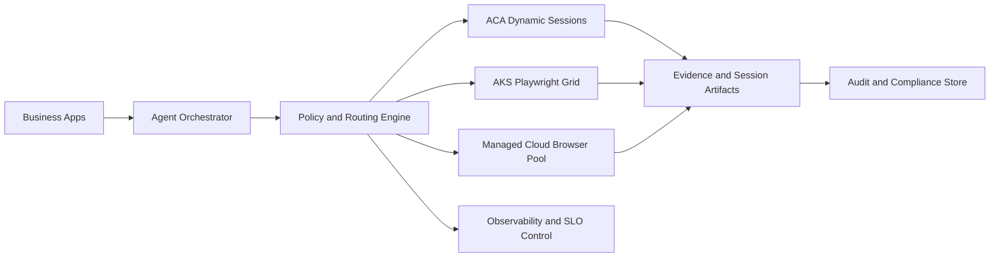
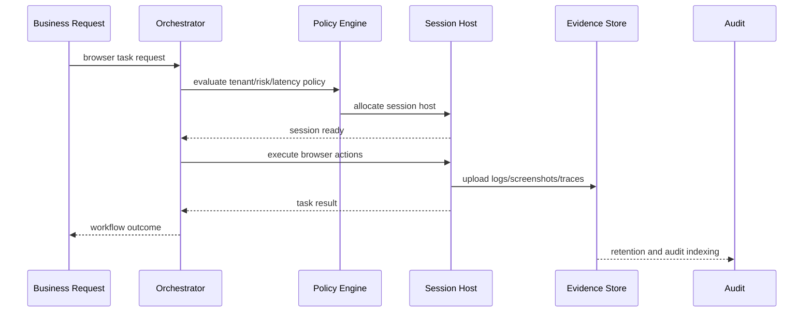

# Enterprise browser-agent session-hosting selection FAQ: ACA Dynamic Sessions vs AKS Playwright Grid vs managed cloud browser pools

> **Audience**: Enterprise Cloud & AI Solution Architects, digital operations platform teams, automation engineering teams, and security/compliance stakeholders.  
> **Core question**: For large-scale Browser/CUA agent workloads, how should enterprises choose session-hosting and isolation orchestration models that balance security, concurrency, cost, and operations complexity.

## 1. Problem framing: browser-agent production is more than launching a browser

Enterprises run browser agents for
service operations, back-office workflows,
partner-portal handling, and financial verification.

Production issues usually start at the host layer:

- Session contamination leaks cross-task state.
- Burst concurrency saturates host capacity.
- CAPTCHA or anti-bot flows trigger retry storms.
- Browser crashes are hard to recover deterministically.

Session-host architecture is therefore
the deciding factor for production success.

## 2. Design objective: isolation, concurrency, recovery, governance

A browser-agent platform should satisfy:

- Strong isolation across tenants, tasks, and credentials.
- Elastic concurrency under burst demand.
- Fast recovery with replayable evidence.
- Governable operations with audit closure.

If one dimension is missing,
core enterprise workflows remain unstable.

## 3. Pattern A: ACA Dynamic Sessions managed sandboxes

Pattern A uses ACA Dynamic Sessions
to create isolated browser session sandboxes.

Typical capabilities:

- Session-level container isolation.
- TTL-based automatic cleanup.
- Integrated gateway policy controls.
- Session events exported to observability.

Strengths:

- Fast adoption with low platform overhead.
- Clear isolation semantics.
- Good elasticity for burst workloads.

Limitations:

- Deep execution customization is limited.
- Browser-extension flexibility may be constrained.
- Special network-topology needs require extra design.

## 4. Pattern B: AKS Playwright Grid self-hosted pools

Pattern B builds browser execution grids on AKS.

Core components:

- Playwright worker pools.
- Scheduler-driven task dispatch.
- Externalized session state and evidence storage.
- Policy sidecars for egress and permission controls.

Strengths:

- Highest customization potential.
- Better integration with enterprise network controls.
- Tunable cost-performance for specific workloads.

Limitations:

- High platform operations complexity.
- Continuous upgrade compatibility burden.
- Ongoing capacity engineering is required.

## 5. Pattern C: managed cloud browser pools

Pattern C consumes third-party managed browser pools.

Common capabilities:

- Rapid regional session provisioning.
- Built-in anti-automation compatibility options.
- Visual replay and diagnostics tooling.
- API-driven integration with agent orchestrators.

Strengths:

- Fast onboarding and iteration speed.
- Strong browser compatibility out of the box.
- Reduced internal platform maintenance.

Limitations:

- Cost model controlled by provider pricing.
- Data-boundary and compliance review is essential.
- Custom governance controls may be limited.

## 6. Pattern D: layered hybrid architecture (recommended)

Enterprises often combine all options:

- Standard workloads on ACA managed sessions.
- High-customization workflows on AKS grids.
- Special sites or global edges via managed pools.

A unified orchestration layer
creates balanced resilience and governance.

## 7. Reference architecture: browser-agent session control plane

Architecture implications:

- Scheduling and permission policy should stay centralized.
- Session evidence needs a normalized schema.
- Retries must avoid cross-session contamination.

## 8. Request flow: allocate, execute, replay, recycle

Flow governance essentials:

- Every allocation should include policy version metadata.
- Session termination must enforce cleanup.
- Evidence must remain correlated with business outputs.

## 9. 12-dimension enterprise comparison matrix

| Dimension | A ACA Sessions | B AKS Grid | C Managed Pool | D Hybrid Layer |
|---|---|---|---|---|
| Session isolation strength | High | High | Medium-high | High |
| Startup speed | High | Medium | High | High |
| Concurrency scaling | High | High | High | Very high |
| Customization depth | Medium | Very high | Medium | High |
| Compliance controllability | High | High | Medium | High |
| Cost predictability | Medium-high | Medium | Medium | High |
| Operations complexity | Low | High | Low-medium | Medium-high |
| Failure recovery quality | High | Medium-high | Medium-high | High |
| Observability depth | Medium-high | High | Medium | High |
| Global site adaptability | Medium | Medium-high | High | High |
| Vendor lock-in risk | Medium | Low | High | Medium |
| Recommended maturity stage | Rapid landing | Platform depth | Fast expansion | Enterprise scale |

## 10. Quantitative break-even: concurrency, stability, and spend

| Metric | A ACA | B AKS | C Managed | D Hybrid |
|---|---:|---:|---:|---:|
| Session startup P95 | 6.8s | 11.2s | 5.9s | 6.1s |
| Peak concurrent sessions | 3,200 | 4,500 | 3,800 | 5,600 |
| Task success rate | 98.7% | 98.9% | 98.1% | 99.2% |
| Cost per 1k tasks | $27 | $24 | $31 | $26 |
| Manual intervention rate | 4.2% | 3.8% | 5.1% | 3.1% |
| Recovery RTO P95 | 2.3m | 3.1m | 2.6m | 1.9m |

Assumptions:

- Monthly volume around 1.6M tasks.
- Average task runtime around 3.7 minutes.
- 23% of tasks require screenshot evidence.
- Peak-to-baseline ratio around 5.1.
- 17% of tasks include controlled-system re-authentication.
- 9% of tasks require human takeover confirmation.
- Retry policy caps at two automatic retries.
- Evidence retention horizon is set to 180 days.
- Peak protection pre-warms capacity 10 minutes ahead.
- Cross-region failover drills run on a quarterly cadence.

Interpretation:

- A wins in landing speed.
- B wins in customization and tuning depth.
- C wins in rapid onboarding.
- D wins in blended enterprise outcomes.
Organizations in rapid expansion should standardize session-governance baselines first.
Audit-intensive workflows should add automated evidence-sampling scripts early.
Frequent site changes require explicit browser-policy release cadence.
High failure-cost workflows should prioritize replay and post-incident closure loops.

## 11. Decision tree: choose by risk and customization needs

Question 1:
Do workloads include regulated internal-system operations?

- Yes: prioritize A, B, or D.
- No: continue to Question 2.

Question 2:
Do workflows need deep browser execution customization?

- Yes: prioritize B or D.
- No: continue to Question 3.

Question 3:
Is rapid global expansion the top objective?

- Yes: prioritize C or D.
- No: continue to Question 4.

Question 4:
Do teams have sustained platform-ops capability?

- Yes: B or D is feasible.
- No: start with A or C.

## 12. Anti-patterns and corrective actions

Anti-pattern 1:
All tasks share one undifferentiated session pool.

Correction:
Introduce tenant and risk-tier session domains.

Anti-pattern 2:
Only final outcomes are stored, no execution evidence.

Mitigation:
Standardize logs, screenshots, and trace capture.

Anti-pattern 3:
Retries run without idempotency keys.

Action:
Use idempotent task keys and replay guards.

Anti-pattern 4:
Scaling depends on manual node operations.

Fix:
Adopt queue-metric-driven autoscaling.

## 13. Governance model: ownership and change gates

Recommended ownership:

- Platform team owns host orchestration and scheduling.
- Security team owns isolation and egress policies.
- Business teams own SLA classes and task criticality.
- Audit teams own evidence retention and sampling.

Change gates:

- High-risk site onboarding requires formal review.
- Session image upgrades require staged rollout.
- Evidence-capture failures require block-or-recover policy.

## 14. Five-step rollout guide (Good fit vs Not for)

Step 1:
Classify browser-agent tasks by risk and SLA tier.

Step 2:
Build a unified policy and session-routing engine.

Step 3:
Enable evidence closure for critical workflows.

Step 4:
Deploy hybrid host policy by workload profile.

Step 5:
Review success rate, latency, and unit cost weekly.

Good fit:

- Multi-department shared browser-agent platforms.
- High concurrency with evidence requirements.
- Need for cross-region continuity.

Not for:

- Low-frequency single-user automation scripts.
- Short-lived prototypes without audit obligations.
- Teams without basic observability and ops discipline.

## 15. Practical FAQ (8 questions)

**Q1: Can ACA Dynamic Sessions cover most enterprise scenarios?**  
A1: It covers many standard scenarios, while deep custom workflows often need AKS or hybrid layering.

**Q2: Is AKS Grid always cheaper?**  
A2: Not always; total cost depends on utilization, staffing, and burst behavior.

**Q3: Are managed browser pools compliant by default?**  
A3: They can be, but data-boundary and evidence controls must be validated first.

**Q4: How do we reduce session contamination risk?**  
A4: Use session-domain isolation, short TTL, and strict cleanup enforcement.

**Q5: Will evidence retention inflate costs too much?**  
A5: Cost stays manageable with tiered storage and risk-based retention windows.

**Q6: Does hybrid architecture become too complex?**  
A6: Complexity rises, but single-host failure risk drops significantly.

**Q7: When should teams move from single host to hybrid?**  
A7: Move when concurrency, compliance pressure, and global expansion rise together.

**Q8: Which KPIs best validate architecture choice?**  
A8: Track startup latency, task success, manual intervention rate, and cost per task.
Also track whether session-isolation violation alerts are trending down over time.
Watch whether abnormal retries concentrate on a small set of target sites.
Run quarterly reviews of host-layer routing and isolation policy decisions.
When high-risk workloads expand, prioritize stronger audit automation coverage.
For managed pools, maintain scheduled provider capability reassessment.
For self-hosted grids, maintain weekly capacity and patch-health scorecards.
For hybrid estates, drill cross-host traffic-failover playbooks routinely.
Across all hosts, standardize failure-reason taxonomy and severity mapping.

