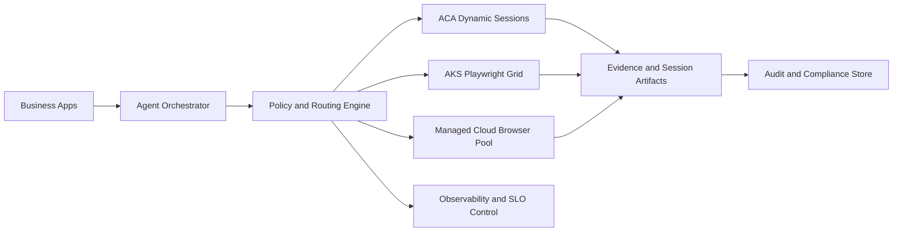
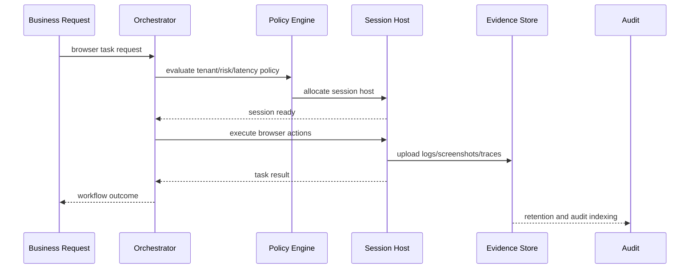

# 企业 Browser Agent 会话宿主选型 FAQ：ACA Dynamic Sessions vs AKS Playwright Grid vs 托管云浏览器池

> **适用角色**：企业 Cloud & AI SA、数字化运营平台团队、自动化测试平台团队、合规与安全团队。  
> **核心问题**：在大规模 Browser/CUA Agent 场景下，如何选择会话宿主与隔离编排方案，以平衡安全隔离、并发能力、成本与运维复杂度。

## 1. 问题定义：Browser Agent 不只是“开个浏览器”

企业将 Browser Agent 用于
客服操作协同、后台工单处理、
供应链门户操作与财务核验流程。

生产问题通常出在会话宿主层：

- 会话相互污染导致数据串读。
- 突发并发把节点资源打满。
- 反爬/验证码场景导致重试风暴。
- 浏览器崩溃后状态恢复困难。

因此会话宿主架构是 Browser Agent 成败关键。

## 2. 目标定义：隔离、并发、恢复、治理四维对齐

Browser Agent 平台应同时满足：

- 强隔离：租户、任务、凭据边界明确。
- 高并发：峰值会话按分钟级扩缩容。
- 快恢复：崩溃后可定位与可重放。
- 可治理：操作证据、权限与审计闭环。

缺少任一维度，
平台都难以稳定进入企业核心流程。

## 3. 模式 A：ACA Dynamic Sessions 托管会话沙箱

模式 A 依赖 ACA Dynamic Sessions
快速创建隔离会话实例。

典型能力：

- 会话级隔离容器。
- TTL 到期自动回收。
- 与网关策略集成限流。
- 会话事件接入监控与日志。

优点：

- 上线快，平台负担低。
- 会话隔离语义清晰。
- 弹性能力适合突发任务。

限制：

- 深度定制能力相对有限。
- 浏览器插件生态可控范围受限。
- 特殊网络拓扑需求需额外设计。

## 4. 模式 B：AKS Playwright Grid 自建会话池

模式 B 在 AKS 自建浏览器网格。

核心组件：

- Playwright workers 池化。
- 调度器按队列分发任务。
- 会话状态与证据外置存储。
- 策略侧车做权限与出网控制。

优点：

- 可深度定制执行环境。
- 与企业网络控制更好集成。
- 可针对特定场景优化成本。

限制：

- 平台运维复杂度高。
- 版本升级与兼容成本高。
- 需要持续容量与故障演练。

## 5. 模式 C：托管云浏览器池（第三方）

模式 C 使用托管浏览器服务。

常见能力：

- 快速按区域启停会话。
- 自带反自动化兼容策略。
- 提供可视化会话回放。
- 以 API 方式接入 Agent 编排。

优点：

- 快速接入，迭代速度快。
- 浏览器兼容能力通常较强。
- 降低自建平台运维负担。

限制：

- 成本模型受供应商约束。
- 数据边界与合规需重点评估。
- 定制治理能力可能受限。

## 6. 模式 D：分层混合（推荐）

企业常见组合方式：

- 标准业务走 ACA 托管会话。
- 高定制流程走 AKS 网格。
- 海外或特殊站点走托管池补位。

通过统一调度平面实现
弹性与治理能力兼得。

## 7. 参考架构：Browser Agent 会话控制平面

架构要点：

- 调度与权限治理应集中而非分散。
- 会话证据需统一格式输出。
- 失败重试必须避免跨会话污染。

## 8. 请求流程：分配、执行、回放、回收

流程治理重点：

- 每次分配要附带策略版本号。
- 会话结束必须触发资源清理。
- 证据与业务结果需强关联。

## 9. 12 维企业选型对比矩阵

| 维度 | A ACA Sessions | B AKS Grid | C 托管池 | D 混合分层 |
|---|---|---|---|---|
| 会话隔离强度 | 高 | 高 | 中高 | 高 |
| 启动速度 | 高 | 中 | 高 | 高 |
| 并发扩展能力 | 高 | 高 | 高 | 极高 |
| 定制能力 | 中 | 极高 | 中 | 高 |
| 合规可控性 | 高 | 高 | 中 | 高 |
| 成本可预测性 | 中高 | 中 | 中 | 高 |
| 运维复杂度 | 低 | 高 | 低中 | 中高 |
| 故障恢复能力 | 高 | 中高 | 中高 | 高 |
| 可观测性深度 | 中高 | 高 | 中 | 高 |
| 全球站点适配 | 中 | 中高 | 高 | 高 |
| 供应商锁定风险 | 中 | 低 | 高 | 中 |
| 推荐成熟阶段 | 快速落地 | 平台深耕 | 快速扩展 | 企业规模化 |

## 10. 量化拐点：并发、稳定性与成本

| 指标 | A ACA | B AKS | C 托管池 | D 混合 |
|---|---:|---:|---:|---:|
| 会话启动 P95 | 6.8s | 11.2s | 5.9s | 6.1s |
| 峰值并发承载 | 3,200 | 4,500 | 3,800 | 5,600 |
| 任务成功率 | 98.7% | 98.9% | 98.1% | 99.2% |
| 每千任务成本 | $27 | $24 | $31 | $26 |
| 人工干预率 | 4.2% | 3.8% | 5.1% | 3.1% |
| 故障恢复 RTO P95 | 2.3m | 3.1m | 2.6m | 1.9m |

测算前提：

- 月任务量 160 万。
- 平均任务时长 3.7 分钟。
- 23% 任务需要上传截图证据。
- 峰谷比约 5.1。
- 17% 任务涉及受控系统二次登录。
- 9% 任务需要人工接管确认。
- 失败重试上限统一设为 2 次。
- 证据保留窗口按 180 天规划。
- 峰值保护阈值提前 10 分钟预热。
- 跨区域容灾演练按季度执行。

结论摘要：

- A 上线效率最佳。
- B 定制与性能空间最大。
- C 接入速度快但治理需审慎。
- D 在综合指标上最优。
若组织处于快速扩张期，建议先统一会话治理基线。
若业务涉及强审计条线，需提前设计证据抽检脚本。
若站点变化频繁，应建立浏览器策略版本发布节奏。
若任务失败成本较高，应优先建设回放与复盘闭环。

## 11. 决策树：按风险等级与定制需求选型

问题 1：
是否存在强监管与内网系统操作？

- 是：优先 A/B/D。
- 否：进入问题 2。

问题 2：
是否要求深度浏览器执行定制？

- 是：优先 B 或 D。
- 否：进入问题 3。

问题 3：
是否以全球快速扩展为首要目标？

- 是：优先 C 或 D。
- 否：进入问题 4。

问题 4：
团队是否具备持续平台运维能力？

- 是：可采用 B 或 D。
- 否：从 A/C 起步更稳妥。

## 12. 反模式与纠偏建议

反模式一：
所有任务共享同一会话池无隔离分层。

纠偏：
按租户与风险级别建立会话域隔离。

反模式二：
只保留最终结果，不保留执行证据。

纠偏：
统一采集截图、日志与操作轨迹。

反模式三：
重试逻辑不带幂等标识。

纠偏：
引入任务幂等键与回放防重机制。

反模式四：
扩容仅靠手工扩节点。

改进：
引入队列指标驱动自动扩缩容。

## 13. 平台治理：角色分工与变更闸门

建议分工：

- 平台团队：维护会话宿主与调度层。
- 安全团队：维护隔离、凭据与出网策略。
- 业务团队：维护任务等级与 SLA 要求。
- 审计团队：维护证据留存与抽检策略。

治理闸门：

- 高风险站点接入需专项评审。
- 会话镜像升级需灰度验证。
- 证据采集失败必须触发阻断或补采。

## 14. 五步落地指南（Good fit vs Not for）

步骤 1：
梳理 Browser Agent 任务分级与风险映射。

步骤 2：
建立统一会话调度与策略引擎。

步骤 3：
对关键任务引入证据闭环与审计链路。

步骤 4：
按负载特征部署混合宿主策略。

步骤 5：
每周复盘成功率、时延与成本曲线。

Good fit：

- 多部门共享 Browser Agent 能力。
- 任务并发波动显著且证据要求高。
- 需要跨区域持续可用能力。

Not for：

- 低频单用户脚本自动化。
- 无审计要求的临时实验场景。
- 缺乏基础可观测与运维能力团队。

## 15. 实战 FAQ（8 问）

**Q1：ACA Dynamic Sessions 能覆盖大多数场景吗？**  
A1：多数标准场景可覆盖，但深度定制流程仍需 AKS 或混合补齐。

**Q2：AKS Grid 一定更便宜吗？**  
A2：不一定，取决于利用率、运维成本与峰值负载形态。

**Q3：托管云浏览器池是否合规可用？**  
A3：可用，但必须先完成数据边界与审计能力评估。

**Q4：如何降低会话串扰风险？**  
A4：采用会话级隔离域、短生命周期和严格清理策略。

**Q5：证据存储会不会带来成本暴涨？**  
A5：可通过分层存储与保留策略控制成本。

**Q6：混合模式会不会过于复杂？**  
A6：复杂度会上升，但能显著降低单一宿主失败风险。

**Q7：什么时候应从单一宿主升级到混合？**  
A7：当并发、合规和全球扩展需求同时上升时应升级。

**Q8：如何衡量选型成效？**  
A8：跟踪启动时延、任务成功率、人工干预率与单位成本曲线。
并持续观察会话隔离违规告警是否下降。
同时关注异常重试是否集中在少数站点。
建议以季度为周期审阅宿主分层策略。
遇到高风险业务扩张时优先提升审计自动化水平。
对托管池供应商应建立定期能力复核机制。
对自建网格应维护容量与补丁健康周报。
对混合架构应定义跨宿主流量切换演练计划。
对全平台应统一失败原因码与事件分级口径。

