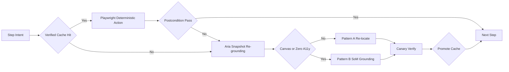
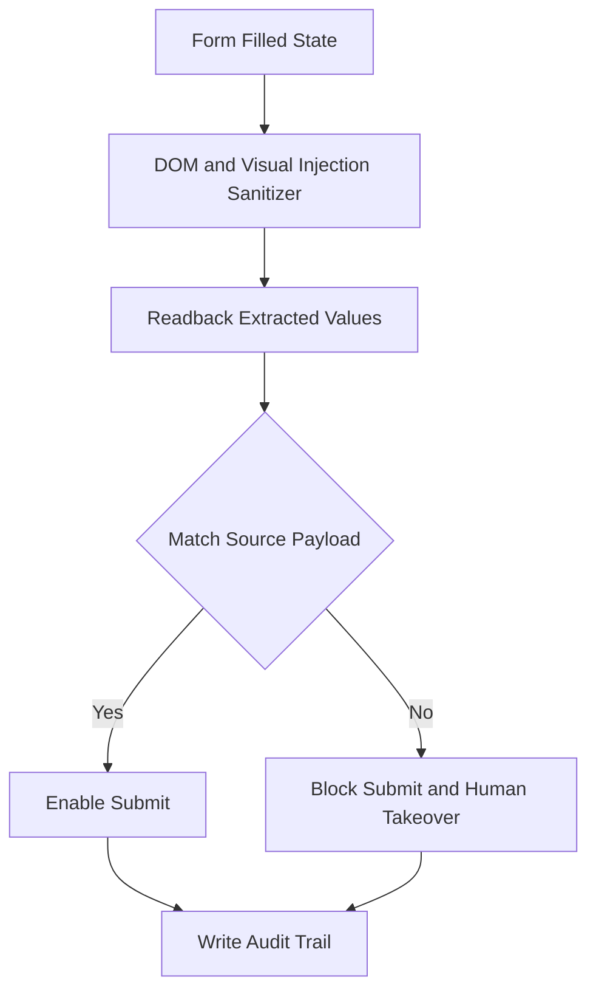

# Enterprise Browser CUA Action Grounding and Self-Healing Replay Selection FAQ (Playwright Aria Snapshot vs OmniParser SoM vs Pixel CUA)
> Topic ID: #463
> Section: 3.5 Multi-Agent Orchestration, Durable Workflows, Realtime Voice, and Enterprise Channels
> Audience: automation platform architects, browser-agent engineering teams, and risk/compliance stakeholders
> Goal: deliver low-latency, low-cost, high-accuracy, and auditable submission safety for high-volume portal automation

## 1) Production problem: pixel-only loops and brittle scripts both fail at scale
Enterprises must run `10,000+` portal transactions per day without official APIs.
Pure pixel CUA captures screenshots and predicts `(x,y)` for each micro-step.
Latency and token cost per step are high in this mode.
A `30`-step workflow can exceed `95s` end-to-end with significant inference spend.
DPI shifts, scrolling, sticky banners, and transient popups increase click-miss rates.
Traditional XPath/CSS scripts break when frontend bundles and class hashes change.
Production needs a tiered engine: semantic fast path, visual fallback, and deterministic commit gate.

## 2) Four architecture patterns
Pattern A: `Playwright` `ariaSnapshot` plus semantic locator cache plus self-healing fallback.
Pattern B: `OmniParser v2` Set-of-Mark grounding with symbolic `#ID` action selection.
Pattern C: native pixel CUA end-to-end loop for exploratory or low-volume long-tail flows.
Pattern D: anti-pattern (uncached screenshot-per-step loops or huge raw DOM dumping).

## 3) Twelve-dimension comparison matrix
| Dimension | Pattern A (semantic cache) | Pattern B (SoM visual) | Pattern C (pixel CUA) | Pattern D (anti-pattern) |
|---|---|---|---|---|
| Per-step latency | Very low (`<50ms` on hit) | Medium-low | High | High |
| Per-step tokens | Near-zero on hit | Medium | High | High |
| Repetitive-flow cost | Very low | Medium | High | High |
| `<canvas>` compatibility | Low | Very high | High | Medium |
| Standard form compatibility | Very high | High | Medium | Low |
| Self-healing recovery | High | Medium-high | Medium | Low |
| Mis-click risk | Low | Medium-low | Medium-high | High |
| Pre-submit verifiability | Very high | High | Medium | Low |
| Prompt-injection exposure | Medium-low | Medium | Medium-high | High |
| Multi-tenant governability | High | High | Medium | Low |
| Three-year TCO | Best | Second-best | Expensive | Worst |
| Enterprise recommendation | Primary | Visual fallback | Long-tail supplement | Avoid |

## 4) Pattern A: semantic grounding cache with self-healing replay (primary)
Model each stable step as semantic intent: `role/name/ref/postcondition`.
Execute deterministic `Playwright` locators from cache first, without LLM calls.
Escalate to slow-path re-grounding only on timeout or failed postcondition checks.
Promote healed locators into shared cache only after canary verification.
This pattern sharply reduces both latency and inference cost for repetitive portal workflows.

## 5) Pattern B: OmniParser SoM symbolic visual grounding (primary for visual-hard pages)
For `<canvas>`, WebGL, or weak-accessibility pages, DOM semantics are insufficient.
`OmniParser v2` labels interactable regions as `[#ID]`.
The model chooses symbolic IDs instead of regressing raw coordinates.
Execution maps each `#ID` to deterministic centroid clicks.
This reduces error on dense icon grids and custom-drawn controls.

## 6) Pattern C: native pixel CUA loop (supplement path)
This path provides broad visual generality for unknown sites.
It is practical for low-frequency exploratory operations.
At high repetition it becomes too costly and too slow.
Production use should enforce pre-submit readback and human takeover boundaries.

## 7) Pattern D: anti-pattern definition
Uncached screenshot-per-step inference compounds token and latency tax.
Feeding large raw DOM payloads increases noise and injection surface.
Missing post-action assertions allows silent drift before final submission.
Production requires step-level verification, replayability, and auditable intent traces.

## 8) Mermaid: tiered fast-path and slow-path execution engine


## 9) Mermaid: safe pre-submit gate and anti-cache-poisoning quarantine


## 10) Quantitative Q1-Q6 formulas and thresholds
Q1: amortized cost model.
`E[Cost] = (1 - h_cache) * C_llm + h_cache * C_playwright`.
At `h_cache=0.92`, `12x–18x` savings are commonly observed.
Q2: amortized latency model.
`E[Latency] = (1 - h_cache) * L_slow + h_cache * L_fast`.
`L_fast` can approach `20–50ms` for deterministic replay hits.
Q3: pixel error rationale.
Scaled patch grids make small `12px` controls vulnerable to quantization misses.
Q4: `ariaSnapshot` compression effect.
Semantic snapshots are usually much smaller than raw HTML/DOM payloads.
Q5: cache-promotion gate.
Require `N=3` independent successful runs plus postcondition pass before shared promotion.
Q6: dynamic branch strategy.
Stable navigation chrome uses cache replay; data-dependent branches use runtime grounding with evidence.

## 11) Production code block 1: Playwright + Redis/Cosmos self-healing executor
```python
import json
from playwright.async_api import async_playwright

async def execute_step(page, cache, step_key, payload):
    cached = cache.get(step_key)
    if cached:
        ok = await try_cached_semantic_locator(page, cached)
        if ok and await verify_postcondition(page, cached["postcondition"]):
            return {"mode": "cache_hit", "healed": False}
    snap = await page.accessibility.snapshot()
    healed = await llm_reground_from_aria_snapshot(snap, payload)
    ok2 = await try_cached_semantic_locator(page, healed)
    passed = ok2 and await verify_postcondition(page, healed["postcondition"])
    if passed and await canary_gate(page, healed):
        cache.set(step_key, healed)
    return {"mode": "self_heal", "healed": passed}

async def try_cached_semantic_locator(page, locator):
    role = locator["role"]
    name = locator["name"]
    await page.get_by_role(role, name=name).click(timeout=1500)
    return True
```

## 12) Production code block 2: OmniParser SoM `#ID` deterministic click bridge
```python
import httpx

async def som_ground_and_click(page, screenshot_bytes, action_text, som_endpoint):
    async with httpx.AsyncClient(timeout=10) as client:
        resp = await client.post(
            som_endpoint,
            files={"image": ("screen.png", screenshot_bytes, "image/png")},
            data={"instruction": action_text},
        )
        data = resp.json()
    target_id = data["selected_id"]
    box = next(b for b in data["boxes"] if b["id"] == target_id)
    cx = (box["x1"] + box["x2"]) / 2
    cy = (box["y1"] + box["y2"]) / 2
    await page.mouse.click(cx, cy)
    return {"id": target_id, "cx": cx, "cy": cy}
```

## 13) Production code block 3: deterministic pre-submit readback guard
```python
from decimal import Decimal

def must_equal(a, b, field):
    if a != b:
        raise ValueError(f"{field} mismatch: ui={a} payload={b}")

def pre_submit_guard(ui_values, source_payload):
    must_equal(ui_values["member_id"], source_payload["member_id"], "member_id")
    must_equal(ui_values["order_id"], source_payload["order_id"], "order_id")
    ui_amount = Decimal(ui_values["amount"])
    src_amount = Decimal(source_payload["amount"])
    if ui_amount != src_amount:
        raise ValueError(f"amount mismatch: ui={ui_amount} payload={src_amount}")
    return {"approved": True, "reason": "exact_match"}
```

## 14) Enterprise scenarios and three-tier three-year TCO
### 14.1 Scenario A: global 3PL and customs platform
Workload spans `180` portals and `42,000` daily shipment operations.
Pattern A handles standard pages; Pattern B covers `<canvas>` slot selectors.
Median workflow time drops from `112s` to `14.6s`.
LLM inference spend drops by roughly `89%`.
### 14.2 Scenario B: US healthcare prior-auth RCM operations
Workload reaches `18,000` daily submissions across `300+` payer portals.
Pre-submit readback gate verifies member IDs, diagnosis codes, and amount values.
This reduces rejection risk from UI-source mismatches.
### 14.3 Three-tier TCO example
| Tier | Daily workflow volume | Recommended architecture | Three-year TCO |
|---|---:|---|---:|
| Tier-1 | 3,000 | A + C | `$0.66M` |
| Tier-2 | 18,000 | A + B + C | `$2.41M` |
| Tier-3 | 42,000 | A primary, B fallback, C long-tail | `$6.88M` |
Cost driver 1: cache-hit ratio and slow-path trigger rate.
Cost driver 2: proportion of visual-hard pages requiring GPU SoM grounding.
Cost driver 3: rework burden from failed submissions and manual review overhead.

## 15) Day-0 / Day-1 / Day-2 action plan (15 actions)
Day-0: define semantic step schema (`role/name/ref/postcondition/tenant_scope`).
Day-0: deploy cache plane with tenant isolation strategy (Redis/Cosmos or hybrid).
Day-0: implement page classifier for standard DOM vs visual-hard pages.
Day-0: define self-heal promotion thresholds and rollback policy.
Day-0: define pre-submit readback whitelist and strict equality rules.
Day-1: launch Pattern A on high-frequency stable workflows first.
Day-1: enable Pattern B fallback for `<canvas>` and weak-accessibility pages.
Day-1: keep Pattern C for low-frequency unknown long-tail journeys.
Day-1: log action, evidence, assertion, and commit-summary audit records.
Day-1: publish SLO dashboards for hit ratio, miss ratio, latency, cost, and gate blocks.
Day-2: replay failed steps weekly and improve semantic locator dictionaries.
Day-2: review cache-poisoning and false-promotion cases monthly.
Day-2: run quarterly drills for major vendor UI redesign recovery.
Day-2: tune A/B/C routing thresholds continuously for cost-success balance.
Day-2: standardize cross-business reusable step templates to reduce duplicated engineering.
### 15.1 Pre-production governance checks
Check for cache-hit paths missing critical postcondition assertions.
Check for shared-cache promotion happening before canary validation.
Check for pre-submit guards comparing text only without decimal precision checks.
Check for cross-tenant locator reuse that can leak behavior across boundaries.
Check for unfiltered screen-injected text entering model context.
Check for unbounded slow-path retries causing runaway spend.
Check for ambiguous human-takeover triggers that leave stuck workflows.
Check for replay logs missing fields needed for root-cause analysis.
Check for release changes without high-frequency regression replay.
Check for KPI bias that rewards automation rate while ignoring mis-submit risk.
### 15.2 Runtime SLO and incident severity guidance
If cache-hit ratio drops below threshold, prioritize page-structure drift and step-schema gaps before increasing model spend.
If postcondition failure rises, verify assertion strength, mapping drift, and async UI stabilization gaps.
If visual slow-path share spikes, decide whether to enrich semantic locators or route the portal to dedicated SoM fallback.
If submit-gate block ratio rises, separate true-risk intercepts from rule false positives to avoid throughput collapse.
If human takeover queues back up, re-prioritize by risk class and SLA window.
If one portal shows clustered failures, trigger site-level circuit break and switch to assisted mode.
If step latency exceeds budget, capture screenshot, locator, network timings, and wait-chain evidence for profiling.
If cross-tenant cache behavior looks abnormal, audit cache keys and tenant-scope partitions.
If prompt-injection alarms trigger, retain both raw page evidence and sanitized context for security review.
If technical success conflicts with business-system receipt failure, classify as technical-pass business-fail for metrics.
### 15.3 Operating model and delivery governance
Platform teams should own a shared action DSL, cache contract, and assertion template catalog.
Security teams should maintain DOM/visual injection signatures and high-risk submit approval policies.
Business teams should own source-of-truth field mapping and critical readback checklists.
Operations teams should maintain portal health profiles with redesign cadence and failure fingerprints.
Use a weekly replay, monthly governance, and quarterly redesign-drill rhythm.
Split KPIs into latency, reliability, safety, and unit-cost dimensions.
Treat mis-submit rate as a hard-constraint KPI that cannot be traded for higher automation rate.
Require progressive rollout and rollback switches for cache-rule updates.
Use dual-lane execution for high-value workflows: automated path plus risk-based sample review.
Standardize cross-system trace IDs as minimum audit keys.
Provide read-only evidence dashboards to third-party operations teams.
Run capacity and replay warmups before seasonal peaks and settlement windows.
Auto-generate a minimum reproducible failure package with snapshot, step, assertion, network log, and model decision excerpt.
Publish a reusable portal capability map to reduce repeated implementation debt.
Formalize monthly architecture review notes with route-mix drift and cache-promotion quality metrics.
Track model-version-to-success-rate correlation to detect hidden grounding regressions.
Maintain a red-team checklist for visual prompt-injection and hidden-text poisoning attempts.
Require explicit owner sign-off before relaxing any submit-gate threshold in production.
Archive post-incident remediation playbooks so new teams can recover without rediscovering root causes.

Sources (fetched 2026-11-27):
- Playwright Accessibility Snapshot: https://playwright.dev/
- OmniParser v2: https://github.com/microsoft/OmniParser
- Azure OpenAI computer-use-preview: https://learn.microsoft.com/azure/ai-services/openai/
