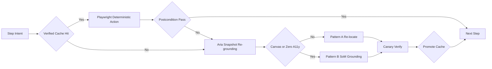
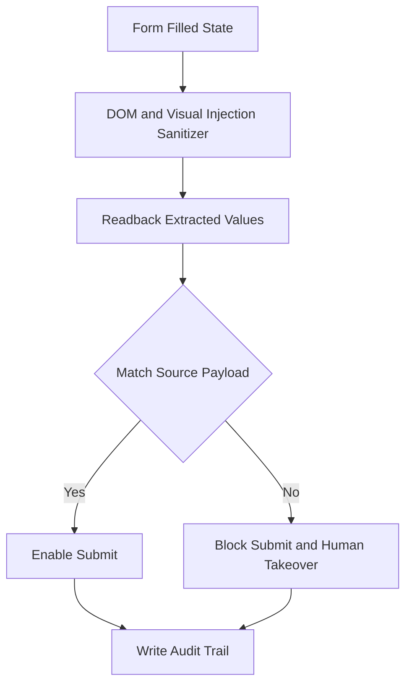

# 企业 Browser CUA 动作锚定与自愈回放选型 FAQ（Playwright Aria Snapshot vs OmniParser SoM vs Pixel CUA）
> Topic ID: #463
> Section: 3.5 多智能体编排、长周期工作流、实时音视频与业务渠道
> 目标读者：企业流程自动化平台架构师、浏览器智能体工程团队、风控与合规负责人
> 目标：在高频门户自动化中同时满足低时延、低成本、高准确与可审计提交安全

## 1) 生产问题：像素万能论与脚本脆弱论的双重困境
企业每天要在无 API 门户执行 `10,000+` 次提交流程。
纯像素 CUA 需要每步截图并回归 `(x,y)`，单步时延与 token 成本都很高。
连续 `30` 步流程可能达到 `95s` 以上并带来显著推理成本。
当页面 DPI、滚动偏移、吸顶条或弹窗变化时，像素回归误点概率明显上升。
传统 XPath/CSS 自动化又会在前端框架升级后频繁失效。
因此企业需要“语义快路径 + 视觉补位 + 提交闸门”的分层执行架构。

## 2) 四类路线定义
Pattern A：`Playwright` `ariaSnapshot` + 语义定位缓存 + 失败自愈重定位。
Pattern B：`OmniParser v2` Set-of-Mark 视觉框选 + 符号化 `#ID` 决策。
Pattern C：原生像素 CUA 端到端循环（低频探索或长尾页面）。
Pattern D：反模式（无缓存逐步截图推理、或直接喂庞大原始 DOM）。

## 3) 12 维对比矩阵
| 维度 | Pattern A（语义缓存） | Pattern B（SoM 视觉） | Pattern C（像素 CUA） | Pattern D（反模式） |
|---|---|---|---|---|
| 单步时延 | 极低（命中时 `<50ms`） | 中低 | 高 | 高 |
| 单步 token | 近零（命中时 0） | 中 | 高 | 高 |
| 重复流程成本 | 极低 | 中 | 高 | 高 |
| 对 `<canvas>` 适配 | 低 | 极高 | 高 | 中 |
| 对标准表单适配 | 极高 | 高 | 中 | 低 |
| 自愈恢复能力 | 高 | 中高 | 中 | 低 |
| 误点击风险 | 低 | 中低 | 中高 | 高 |
| 提交前可校验性 | 极高 | 高 | 中 | 低 |
| Prompt 注入暴露面 | 中低 | 中 | 中高 | 高 |
| 多租户可治理性 | 高 | 高 | 中 | 低 |
| 三年 TCO | 最优 | 次优 | 偏高 | 最差 |
| 企业推荐 | 主路径 | 视觉补位 | 长尾补充 | 禁用 |

## 4) Pattern A：语义锚定缓存与自愈回放（主路径）
先将稳定步骤抽象为语义动作：`role/name/ref/postcondition`。
执行时先查缓存并走确定性 `Playwright` 定位，不触发 LLM。
仅在超时或后置断言失败时才进入慢路径重锚定。
慢路径结果必须经过金丝雀验证再写回共享缓存。
该模式在重复业务流程中可显著降低时延与推理成本。

## 5) Pattern B：OmniParser SoM 视觉符号化（视觉困难页面主路径）
对 `<canvas>`、WebGL、无障碍信息缺失页面，DOM 语义不足。
`OmniParser v2` 将可交互区域编号为 `[#ID]`，模型选择符号而非回归坐标。
执行层把 `#ID` 映射为确定性中心点点击，误差显著小于裸像素回归。
适合密集图标网格、远程桌面嵌入区域、和复杂自绘控件。

## 6) Pattern C：原生像素 CUA 端到端循环（补充路径）
该路径泛化能力强，适合未知页面探索。
但在高频重复场景下成本与延迟通常不可接受。
建议用于低频长尾、临时排障、或无法快速建模的门户。
生产环境应配合提交前读回校验与人工接管阈值。

## 7) Pattern D：反模式定义
无缓存逐步截图推理会放大 token 与时延。
将 `250KB+` 生 DOM 原文直接塞入上下文也会增大注入面与噪声。
缺少后置断言会导致错误动作无感扩散到提交阶段。
企业生产必须要求每一步可验证、可回放、可审计。

## 8) Mermaid：分层快慢路径执行引擎


## 9) Mermaid：提交前安全闸门与缓存防投毒隔离


## 10) Q1-Q6 量化判据与阈值
Q1：摊销成本公式。
`E[Cost] = (1 - h_cache) * C_llm + h_cache * C_playwright`。
当 `h_cache=0.92` 时，常见可获得 `12x–18x` 成本改善。
Q2：摊销时延公式。
`E[Latency] = (1 - h_cache) * L_slow + h_cache * L_fast`。
其中 `L_fast` 可接近 `20–50ms`。
Q3：像素误差解释。
在缩放与补丁离散条件下，细粒度 `12px` 控件更易出现坐标量化偏差。
Q4：`ariaSnapshot` 压缩收益。
相对原始 DOM，语义快照通常显著更小，降低上下文噪声与 token 税。
Q5：缓存晋升门槛。
建议要求 `N=3` 次独立成功且后置断言通过后才允许共享缓存晋升。
Q6：动态分支处理。
稳定导航步骤走缓存，数据依赖分支走实时判断并保留分支证据。

## 11) 生产代码块一：Playwright + Redis/Cosmos 自愈执行器
```python
import json
from playwright.async_api import async_playwright

async def execute_step(page, cache, step_key, payload):
    cached = cache.get(step_key)
    if cached:
        ok = await try_cached_semantic_locator(page, cached)
        if ok and await verify_postcondition(page, cached["postcondition"]):
            return {"mode": "cache_hit", "healed": False}
    snap = await page.accessibility.snapshot()
    healed = await llm_reground_from_aria_snapshot(snap, payload)
    ok2 = await try_cached_semantic_locator(page, healed)
    passed = ok2 and await verify_postcondition(page, healed["postcondition"])
    if passed and await canary_gate(page, healed):
        cache.set(step_key, healed)
    return {"mode": "self_heal", "healed": passed}

async def try_cached_semantic_locator(page, locator):
    role = locator["role"]
    name = locator["name"]
    await page.get_by_role(role, name=name).click(timeout=1500)
    return True
```

## 12) 生产代码块二：OmniParser SoM `#ID` 到确定性点击
```python
import httpx

async def som_ground_and_click(page, screenshot_bytes, action_text, som_endpoint):
    async with httpx.AsyncClient(timeout=10) as client:
        resp = await client.post(
            som_endpoint,
            files={"image": ("screen.png", screenshot_bytes, "image/png")},
            data={"instruction": action_text},
        )
        data = resp.json()
    target_id = data["selected_id"]
    box = next(b for b in data["boxes"] if b["id"] == target_id)
    cx = (box["x1"] + box["x2"]) / 2
    cy = (box["y1"] + box["y2"]) / 2
    await page.mouse.click(cx, cy)
    return {"id": target_id, "cx": cx, "cy": cy}
```

## 13) 生产代码块三：提交前读回与权威载荷对账闸门
```python
from decimal import Decimal

def must_equal(a, b, field):
    if a != b:
        raise ValueError(f"{field} mismatch: ui={a} payload={b}")

def pre_submit_guard(ui_values, source_payload):
    must_equal(ui_values["member_id"], source_payload["member_id"], "member_id")
    must_equal(ui_values["order_id"], source_payload["order_id"], "order_id")
    ui_amount = Decimal(ui_values["amount"])
    src_amount = Decimal(source_payload["amount"])
    if ui_amount != src_amount:
        raise ValueError(f"amount mismatch: ui={ui_amount} payload={src_amount}")
    return {"approved": True, "reason": "exact_match"}
```

## 14) 企业场景与三档三年 TCO
### 14.1 场景 A：全球物流与报关平台
覆盖 `180` 个门户、每日 `42,000` 票操作。
Pattern A 主跑，`<canvas>` 船位选择由 Pattern B 补位。
中位流程时长从 `112s` 降到 `14.6s`，LLM 推理成本下降约 `89%`。
### 14.2 场景 B：美国医疗 RCM 先审先赔流程
每日 `18,000` 份 prior-auth 提交，门户分布 `300+`。
提交前读回闸门强制核对会员号、诊断码与金额。
显著降低“页面显示值与业务源值不一致”导致的拒单风险。
### 14.3 三档三年 TCO（示例）
| 规模层级 | 日均流程量 | 推荐架构 | 三年 TCO |
|---|---:|---|---:|
| Tier-1 | 3,000 | A + C | `$0.66M` |
| Tier-2 | 18,000 | A + B + C | `$2.41M` |
| Tier-3 | 42,000 | A 主、B 补、C 长尾 | `$6.88M` |
成本主因一：缓存命中率决定慢路径触发比例。
成本主因二：视觉复杂页面占比决定 GPU SoM 资源需求。
成本主因三：提交失败返工与人工复核工时。

## 15) Day-0 / Day-1 / Day-2（15 项执行动作）
Day-0：定义动作语义 schema（role/name/ref/postcondition/tenant_scope）。
Day-0：建立缓存存储与租户隔离策略（Redis/Cosmos 二选一或组合）。
Day-0：建立页面分类器，区分标准 DOM 页面与视觉复杂页面。
Day-0：定义自愈晋升门槛与缓存回滚策略。
Day-0：定义提交前读回字段白名单与严格比对规则。
Day-1：先上线 Pattern A 覆盖高频稳定流程。
Day-1：为 `<canvas>` 或弱无障碍页面接入 Pattern B。
Day-1：为长尾未知流程保留 Pattern C 兜底但限制频次。
Day-1：接入审计链路，记录动作、证据、断言与最终提交摘要。
Day-1：建立 SLO 看板（命中率、误点率、时延、成本、拦截率）。
Day-2：每周回放失败步骤并更新定位策略词典。
Day-2：每月复盘缓存污染与误晋升案例并修订门槛。
Day-2：每季度演练门户 UI 大改版情况下的自愈恢复能力。
Day-2：持续优化 A/B/C 路由阈值，确保成本与成功率平衡。
Day-2：沉淀跨业务线通用动作模板，减少重复工程投入。
### 15.1 运行治理补充（上线前核查）
检查是否存在“命中缓存但后置断言未覆盖关键字段”的隐患步骤。
检查是否存在“视觉慢路径结果未过金丝雀就写回共享缓存”的违规流程。
检查是否存在“提交前校验只比对文本不比对金额精度”的薄弱环节。
检查是否存在“跨租户共享定位器”导致的数据外溢风险。
检查是否存在“屏幕注入文本未过滤”进入模型上下文的路径。
检查是否存在“长尾流程无限慢路径重试”导致成本失控。
检查是否存在“人工接管触发条件不清晰”导致异常悬挂。
检查是否存在“回放日志缺失关键字段”导致故障无法复盘。
检查是否存在“变更后未回归高频路径”导致成功率回退。
检查是否存在“只追求自动化率而忽视误提交风险”的指标偏差。
### 15.2 运行期 SLO 与异常分级建议
当缓存命中率持续低于阈值时，应优先排查页面结构变更与步骤建模缺口，而不是直接增加模型预算。
当后置断言失败率上升时，应先定位断言定义是否过弱、字段映射是否漂移、页面状态是否异步延迟。
当视觉慢路径占比异常升高时，应评估是否需要补充语义定位器、或将该门户切入专用 SoM 模型。
当提交流程被闸门阻断率异常升高时，应区分真实风险拦截与规则误报，防止业务吞吐骤降。
当人工接管队列积压时，应自动按风险等级和 SLA 优先级重排，避免关键单据超时。
当同一站点短时间出现集中失败时，应触发站点级熔断并切到人工模式，阻止错误批量扩散。
当单步耗时超过预算时，应采集快照、定位器、网络时延和脚本等待链，形成可复现性能剖面。
当跨租户共享缓存命中异常时，应审计租户边界键设计，确认不存在污染或串扰。
当 prompt 注入告警触发时，应保留原始页面证据和清洗后上下文，便于安全团队复核规则有效性。
当执行成功但业务系统回执失败时，应将结果标记为“技术成功/业务失败”，避免误统计。
### 15.3 组织流程与交付治理建议
平台团队应维护统一动作 DSL、缓存契约、和断言模板库，减少业务线各自实现导致的语义分叉。
安全团队应维护页面注入特征词典、DOM 隐藏文本规则、以及高风险提交白名单审批流程。
业务团队应维护字段映射规则和关键校验项清单，确保读回校验与业务真值一致。
运营团队应维护站点健康画像，跟踪每个门户的改版周期、失败模式和最优路由策略。
建议建立“周回放、月治理、季演练”的节奏：周度修复高频故障，月度复盘成本，季度演练大改版。
建议将 KPI 分为四层：体验（时延）、可靠性（成功率）、安全（拦截率）、经济性（单单成本）。
建议把“误提交率”设为强约束指标，任何优化不得以提升自动化率为由牺牲提交正确性。
建议为每次缓存规则变更保留灰度窗口与回滚开关，避免一次性全量发布造成系统性故障。
建议对高价值流程建立双通道执行（自动 + 审核抽样），在高峰期保持效率，在风险期保持稳健。
建议把跨系统关联 ID（订单号、成员号、事务号）作为最小审计主键，保证端到端追踪一致。
建议对外包或第三方运营团队提供只读证据看板，减少人为改写自动化策略的风险。
建议在大型促销、结算日、医保对账日等特殊窗口前做容量与回放预热，提前消除瓶颈。
建议将“失败样本最小复现包”自动化产出，包括快照、步骤、断言、网络日志与模型决策片段。
建议将知识沉淀到跨团队可复用的门户能力地图，避免每个项目重复踩坑。
建议在大型组织内建立“页面语义基线仓”，按站点维护 role/name/ref 变更谱系与失效时间线，缩短改版后的恢复路径。
建议在每次模型升级后执行回放对照试验，比较同一任务的动作稳定性、断言通过率和提交一致性，避免隐性退化进入生产。
建议将异常样本按“定位失败、元素歧义、视觉错配、断言不一致、业务回执异常”五类统一归档，支持跨团队复用修复经验。
建议为高风险业务动作引入双重签名策略：自动化引擎签名执行证据，业务系统签名回执确认，形成可审计闭环。
建议把提交前读回校验与上游主数据版本绑定，若主数据在执行窗口发生变化应强制重算并阻断旧上下文提交。
建议在跨地域部署中区分语义模型与视觉模型的延迟预算，避免单一全局路由导致区域高峰时段性能抖动。
建议将“安全拦截后人工补录”纳入成本模型，真实评估自动化收益，防止只统计成功路径而低估治理开销。
建议为每月容量评审输出“命中率-成本-正确率”三维曲线，明确下一阶段应优先投资缓存治理、视觉增强还是流程重构。
建议把门户证书过期、脚本权限变更、第三方验证码策略调整等外部依赖纳入健康检查，减少非功能故障导致的误判。
建议建立统一的故障演练题库，覆盖网络抖动、页面改版、模型降级、缓存污染、人工接管超时等典型场景，确保团队持续具备韧性。

来源（抓取日期 2026-11-27）：
- Playwright Accessibility Snapshot: https://playwright.dev/
- OmniParser v2: https://github.com/microsoft/OmniParser
- Azure OpenAI computer-use-preview: https://learn.microsoft.com/azure/ai-services/openai/
