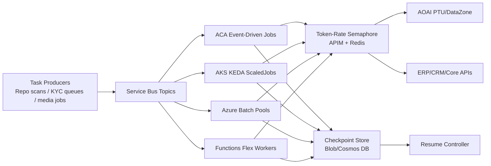
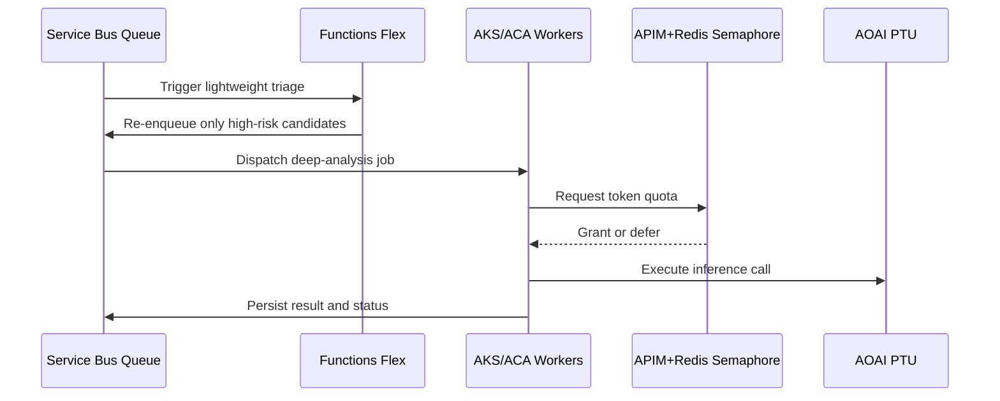

# Enterprise Burst Batch Agent Compute Selection: ACA Event-Driven Jobs vs AKS NAP/Karpenter + KEDA ScaledJobs vs Azure Batch vs Functions Flex Consumption FAQ
> Audience: Cloud & AI Solution Architects, platform engineering leaders, LLMOps operators, and FinOps governance teams.  
> Scope boundary: this guide focuses only on **run-to-completion burst batch agents**, not interactive long-lived chat/session hosts.  
> Scale target: `10K–500K` parallel jobs per hour with Spot preemption handling, deterministic checkpoint resume, and downstream TPM-safe throttling.  
## 1. Executive Summary: Define Backpressure and Resume Semantics Before Selecting the Compute Plane
The largest failure mode in enterprise batch-agent programs is not raw compute shortage.
It is uncontrolled fan-out against constrained downstream dependencies.
Teams over-index on "how many workers can I launch" and under-specify "how many requests can the downstream absorb."
That mismatch turns scale into outage.
Four architecture routes dominate real-world deployments:
- Azure Container Apps Event-Driven Jobs;
- AKS Node Autoprovisioning (NAP/Karpenter) with KEDA ScaledJobs or JobSet;
- Azure Batch Spot/Low-Priority pools with dependency task graphs;
- Azure Functions Flex Consumption for micro-fan-out stages.
The right answer is typically compositional, not exclusive.
A common enterprise pattern is:
- Functions Flex for `<60s` stateless pre-filtering;
- ACA Jobs for moderate containerized execution with low ops overhead;
- AKS NAP + ScaledJobs for heterogeneous resource packing and policy-rich orchestration;
- Azure Batch for very large DAG-heavy engineering or scientific pipelines.
If LLM calls are in the loop, centralized token backpressure is mandatory.
Without APIM/Redis semaphore control,
parallelism growth can quickly DDoS AOAI PTU/DataZone quotas and line-of-business APIs.
## 2. Workload Profiling: Parallelism Alone Is Not a Capacity Model
Architecture selection must start with workload taxonomy.
Do not categorize by team ownership.
Categorize by runtime behavior and recovery requirements.
A practical four-bucket profile:
- Bucket A: `<60s` tasks, CPU-light, stateless, retry-friendly;
- Bucket B: `2–30min` container tasks with moderate external dependency fan-out;
- Bucket C: `30–120min` heavy jobs with memory/GPU or large artifact dependencies;
- Bucket D: dependency-graph pipelines with staged outputs and strict ordering.
A recurring anti-pattern is mapping Bucket C/D workloads onto short-lived autoscaled micro-workers.
It appears cheap in unit tests and fails in production bursts.
Control-plane churn, retry storms, and backpressure collapse usually follow.
Another anti-pattern is equating retryability with resumability.
A task may be retryable from scratch,
yet economically unacceptable when preempted near completion.
Checkpoint granularity is therefore a first-class architecture variable.
## 3. Four Route Positioning: Operational Responsibility and Fit Boundaries
### 3.1 ACA Event-Driven Jobs
ACA Jobs provide low-ops isolated container-per-job execution.
Event triggers via Service Bus, Blob, and Event Hub integrate naturally with burst queues.
Scale-to-zero and per-second billing are attractive for non-steady workloads.
Primary risks:
- environment-level concurrent execution limits;
- image pull cold-start amplification;
- misunderstanding of Dedicated workload profile break-even points.
ACA performs best when batch jobs are containerized,
moderately long,
and teams prioritize speed of platform adoption over deep cluster control.
### 3.2 AKS NAP/Karpenter + KEDA ScaledJobs / JobSet
AKS offers the strongest policy expressiveness and heterogeneous scheduling flexibility.
With NAP/Karpenter, node shapes can be matched to workload classes in near real time.
KEDA/JobSet can drive queue-responsive fan-out at scale.
Primary risks:
- control-plane complexity;
- poor task-class isolation causing scheduler contention;
- aggressive consolidation evicting in-flight long jobs unless guarded.
The `karpenter.sh/do-not-disrupt: "true"` path is critical for long trajectory agents.
Without explicit disruption protection,
cost optimization events can destroy high-value partially completed work.
### 3.3 Azure Batch Spot/Low-Priority
Azure Batch is often superior for very large task graphs and HPC-like fan-out.
Task dependencies, pool lifecycle, and start-task warmups are native concepts.
It avoids Kubernetes API object churn at extreme submission rates.
Primary risks:
- less homogeneous experience for Kubernetes-first teams;
- additional operational skill set for Batch pool and task-graph management;
- integration discipline required for shared identity, secrets, and artifact governance.
Batch is particularly effective for CAD/BIM, geospatial, simulation, and Monte Carlo pipelines.
It is also strong when single-window throughput dominates platform uniformity concerns.
### 3.4 Azure Functions Flex Consumption
Functions Flex is excellent for ultra-fast micro-fan-out under one minute.
It is ideal for triage, classification, lightweight extraction, and routing pre-stages.
Scale response can be sub-2-second in suitable workloads.
Primary risks:
- runtime constraints for heavy compute;
- misuse as a replacement for long-running stateful workers;
- ungoverned downstream request floods under high fan-out.
Functions should usually be a selective front-stage,
not the sole execution substrate for heavy batch-agent pipelines.
## 4. 12-Dimension Comparison Matrix: Throughput, Recovery, Governance, and Cost
| Dimension | ACA Event-Driven Jobs | AKS NAP + KEDA/JobSet | Azure Batch Spot/Low-Priority | Functions Flex |
|---|---|---|---|---|
| Platform operations burden | Low | Medium to high | Medium | Low |
| Medium/long task fitness | Medium | Strong | Strong | Low to medium |
| Heterogeneous CPU/RAM/GPU packing | Medium | Strong | Strong | Low |
| Native task graph support | Low to medium | Medium | Strong | Low |
| Spot preemption resume potential | Medium (custom) | Strong (custom + policy) | Strong | Medium |
| Cold-start control | Medium | Medium | Medium | Strong for micro-tasks |
| Kubernetes control-plane pressure | Low | Medium to high | Low | Low |
| Downstream TPM/QPS throttle integration | Medium | Strong | Strong | Strong (mandatory) |
| Elastic cost profile | Strong | Strong | Strong | Strong for light tasks |
| Deep observability/debuggability | Medium | Strong | Medium to strong | Medium |
| Compliance/audit isolation options | Medium | Strong | Strong | Medium |
| Best-fit summary | Mid-scale container jobs | Enterprise general-purpose core | Very large DAG pipelines | Lightweight pre-filter fan-out |
The matrix should drive tiered routing, not a winner-take-all platform decision.
Most large enterprises end up with at least two compute planes.
The cost of over-standardization is often hidden in failed retries and missed windows.
## 5. Reference Architecture: Burst Compute Planes Coordinated by Shared Backpressure

Two architecture invariants are intentional:
- all compute planes respect one downstream admission controller;
- all long-running jobs emit resumable checkpoints.
Without these invariants, high fan-out quickly devolves into cascading retries.
Cascading retries then consume quota needed by real-time customer workloads.
## 6. ACA Event-Driven Jobs Deep Dive: Concurrency Limits, Cold-Start Math, and Dedicated Break-Even
ACA Jobs can deliver high team productivity for burst workloads.
The trigger model aligns naturally with queued run-to-completion work.
Operationally, this removes a large amount of Kubernetes management overhead.
However, architecture sizing must include environment constraints:
- maximum concurrent running jobs per environment/profile;
- image pull latency under registry contention;
- runtime init overhead from language/toolchain startup.
A practical throughput estimate:
`effective_jobs_per_min ≈ running_slots / (job_duration + cold_start + queue_delay)`
When cold-start becomes a large share of total execution time,
scaling out replicas does not linearly increase useful throughput.
Dedicated profile break-even often appears when:
- sustained utilization remains high for long windows;
- image reuse is strong;
- queue depth is consistently non-trivial.
For highly spiky patterns with long idle intervals,
Consumption can still be superior.
## 7. AKS NAP/Karpenter + KEDA ScaledJobs: Flexibility Requires Discipline
AKS is usually the strongest option when workloads are heterogeneous and policy-rich.
You can mix CPU-heavy refactoring agents, memory-heavy parsers, and GPU helpers in one estate.
NAP/Karpenter can provision target node classes quickly across many VM families.
But freedom without guardrails becomes instability.
Three controls are mandatory:
- workload classification and node selection contracts;
- disruption policy tied to job criticality and remaining runtime;
- queue-scaler admission tied to downstream token budget.
`consolidationPolicy: WhenEmptyOrUnderutilized` is economically attractive.
Yet long-running agents require explicit anti-disruption annotations.
Otherwise, node consolidation can evict jobs near completion.
A practical policy model:
- L1 short tasks: consolidation-friendly;
- L2 medium tasks: consolidation with time-window constraints;
- L3 long tasks: do-not-disrupt while running.
This model balances utilization goals with deterministic completion guarantees.
## 8. Azure Batch: Scale Envelope Beyond Kubernetes Churn Comfort Zones
At very high submission rates,
Batch can outperform Kubernetes-centric approaches by avoiding pod-object churn pressure.
Task and dependency constructs are first-class,
which simplifies very large DAG-style pipelines.
Batch strengths often include:
- scheduler stability at extreme task counts;
- efficient start-task setup for shared binary/data warmup;
- mature Spot/Low-Priority economics for large windows.
Batch still requires architecture rigor:
- robust task idempotency and replay safety;
- checkpoint checkpointing for preempted long tasks;
- explicit dependency failure propagation rules.
If every preempted task restarts from zero,
nominal Spot savings can be erased by recomputation waste.
Resume granularity must therefore be part of cost design.
## 9. Functions Flex Consumption: Ultra-Fast Micro-Fan-Out, Not Heavy Batch Replacement
Functions Flex shines in lightweight batch stages:
- metadata extraction;
- coarse triage;
- routing and prioritization;
- compliance pre-check classification.
This can dramatically reduce pressure on heavyweight compute planes.
Only expensive candidates proceed to ACA/AKS/Batch deep processing.
Design caution:
Functions should not be used as an unconstrained fan-out cannon against AOAI or ERP endpoints.
Its rapid scale-out makes downstream protection more important, not less.
Centralized token/QPS semaphore checks are required per invocation class.
When used this way,
Functions acts as a throughput amplifier for the whole pipeline.
When used without admission control,
it becomes a failure multiplier.
## 10. Quantitative Q&A: Converting Architecture Debates Into Measurable Gates
**Q1: Why is Kubernetes control-plane churn often cited around `~50–100 pods/sec` while Batch can process `100K+` tasks?**  
Kubernetes object lifecycle pressure affects API server, etcd, controllers, and scheduler interactions.
At extreme churn, control-plane overhead can dominate.
Batch task scheduling avoids pod-object lifecycle overhead and can sustain larger graph-oriented submission volumes.
**Q2: How should we evaluate `karpenter.sh/do-not-disrupt` versus idle cost waste?**  
Do-not-disrupt can increase temporary idle capacity.
But evicting a near-complete 25-minute job may waste far more compute and token spend.
Evaluate by expected recomputation loss, not instantaneous node utilization alone.
**Q3: How does a 30-second Spot eviction signal (`SIGTERM`) change economics for a 40-minute agent run?**  
If checkpointing persists state to Blob/Cosmos within that window,
resume can continue at step `18/22` instead of replaying from step `1/22`.
This can avoid roughly `$4` of wasted token/compute in representative refactoring jobs.
**Q4: What formula should bind `maxRunningJobs` to AOAI TPM capacity?**  
A practical bound:
`maxRunningJobs <= floor((TPM_available * safety_factor) / tokens_per_job_per_min)`
Use `safety_factor` around `0.6–0.8` to preserve live interactive capacity.
**Q5: Why is Service Bus lock renewal required for medium/long tasks?**  
Without lock renewal, long handlers may lose message locks mid-execution.
That causes duplicate delivery, duplicate downstream calls, and noisy retries that distort throughput metrics.
**Q6: When does ACA Dedicated become more economical than pure Consumption for Jobs?**  
When sustained utilization remains high and image reuse significantly reduces cold-start overhead.
If workloads are bursty with long idle periods, Consumption often remains cheaper.
**Q7: Why should Azure Batch Spot pools often include an on-demand baseline?**  
Pure Spot pools can experience capacity volatility during regional pressure.
A baseline on-demand slice keeps minimum throughput and protects SLA windows.
**Q8: Why separate batch and live PTU budgets instead of sharing all capacity?**  
Shared pools let nightly fan-out compete directly with customer-facing traffic.
Budget separation prevents back-office throughput goals from degrading live user experience.
## 11. Production IaC Example: AKS NodePool + KEDA ScaledJob with Long-Task Protection
```yaml
apiVersion: karpenter.sh/v1
kind: NodePool
metadata:
  name: burst-batch-cpu
spec:
  disruption:
    consolidationPolicy: WhenEmptyOrUnderutilized
    consolidateAfter: 120s
  template:
    metadata:
      labels:
        workload-class: burst-batch
    spec:
      requirements:
        - key: kubernetes.io/arch
          operator: In
          values: ["amd64"]
        - key: karpenter.azure.com/sku-family
          operator: In
          values: ["D","E","F"]
      taints:
        - key: batch-only
          effect: NoSchedule
---
apiVersion: keda.sh/v1alpha1
kind: ScaledJob
metadata:
  name: repo-modernization-batch
spec:
  pollingInterval: 10
  maxReplicaCount: 1200
  successfulJobsHistoryLimit: 5
  failedJobsHistoryLimit: 20
  jobTargetRef:
    parallelism: 1
    completions: 1
    template:
      metadata:
        annotations:
          karpenter.sh/do-not-disrupt: "true"
      spec:
        restartPolicy: Never
        tolerations:
          - key: batch-only
            operator: Equal
            value: "true"
            effect: NoSchedule
        containers:
          - name: modernizer
            image: ghcr.io/contoso/agent-modernizer:2026.11.21
            resources:
              requests:
                cpu: "2"
                memory: "4Gi"
            env:
              - name: CHECKPOINT_URI
                valueFrom:
                  secretKeyRef:
                    name: batch-secrets
                    key: checkpoint_uri
  triggers:
    - type: azure-servicebus
      metadata:
        queueName: modernization-jobs
        messageCount: "5"
        namespace: contoso-batch-sb
```
This template demonstrates three production essentials:
- consolidation is enabled, but active long jobs are protected;
- fan-out has explicit upper bounds;
- checkpoint destination is mandatory for resumability.
## 12. Python Runtime Example: Spot `SIGTERM` Checkpointing + Service Bus Lock Renewal
```python
import json
import os
import signal
import threading
import time
from azure.servicebus import ServiceBusClient
from azure.storage.blob import BlobClient
STOP = False
STEP = 0
def persist_checkpoint(job_id: str, step: int, payload: dict) -> None:
    uri = os.environ["CHECKPOINT_BLOB_URI"]
    blob = BlobClient.from_blob_url(uri)
    body = json.dumps({"job_id": job_id, "step": step, "payload": payload})
    blob.upload_blob(body, overwrite=True)
def handle_sigterm(signum, frame):
    global STOP, STEP
    STOP = True
    persist_checkpoint(os.environ["JOB_ID"], STEP, {"reason": "spot_eviction"})
def lock_renewer(receiver, message):
    while not STOP:
        try:
            receiver.renew_message_lock(message)
        except Exception:
            break
        time.sleep(15)
def run_job(receiver, message):
    global STEP
    t = threading.Thread(target=lock_renewer, args=(receiver, message), daemon=True)
    t.start()
    for i in range(1, 23):
        if STOP:
            return False
        STEP = i
        time.sleep(5)
        if i % 4 == 0:
            persist_checkpoint(os.environ["JOB_ID"], STEP, {"partial": True})
    return True
signal.signal(signal.SIGTERM, handle_sigterm)
```
This snippet captures the minimum viable resilience pattern:
- immediate termination-path checkpointing;
- periodic progress snapshots;
- lock renewal to avoid duplicate message processing.
It should be paired with idempotency keys and replay-safe write semantics.
Resume correctness is as important as resume speed.
## 13. Enterprise Scenario A: Tier-1 Global Bank Running `250,000` Nightly KYC/Adverse-Media Jobs
A global bank needed to process `250,000` dossier refresh jobs nightly within a 4-hour batch window.
The same organization also had strict requirements not to degrade live mobile-banking assistant PTUs.
A single shared uncontrolled fan-out pool had repeatedly caused live-service pressure events.
Target architecture:
- Functions Flex for lightweight pre-screen and prioritization;
- AKS/ACA for deep analysis jobs;
- centralized APIM + Redis token-rate semaphore;
- separate budget lanes for batch PTU and live PTU.
Measured outcomes after rollout:
- batch-window completion SLA reached `99.2%`;
- no major live PTU starvation events during nightly windows;
- nightly total compute+token cost reduced by `28%`;
- preemption-related recomputation time reduced by `61%`.

## 14. Enterprise Scenario B: Autonomous Java/.NET Modernization Across `8,500` Repositories
A large platform engineering organization needed to modernize `8,500` repositories:
- Java 8 to Java 21 upgrades;
- .NET Framework migrations to .NET 8/9;
- autonomous build-test-fix loops with human-reviewed final PRs.
They adopted a tiered compute model:
- Azure Batch for heavy compile/static-analysis fan-out;
- AKS ScaledJobs for iterative fix/verify loops;
- ACA Jobs for post-processing, report generation, and artifact consolidation.
Key architecture gains:
- failure classes became observable and routable;
- retries moved from full restart to step-level resume;
- throughput controls aligned with downstream API and token budgets.
Program-level outcomes over six weeks:
- modernization success rate improved from `63%` to `88%`;
- average per-repo processing cost reduced by `34%`;
- exception triage cycle time reduced from days to hours.
## 15. FinOps TCO and Day-0/Day-2 Operational Checklist
### 15.1 FinOps and Throughput-Economics Table
| Metric | ACA Jobs | AKS NAP + ScaledJobs | Azure Batch | Functions Flex |
|---|---:|---:|---:|---:|
| Typical parallel range | 200-8,000 | 500-50,000 | 2,000-100,000+ | 200-5,000 |
| Unit-work cost elasticity | High | High | High | High (light workloads) |
| Platform operations cost | Low | Medium-high | Medium | Low |
| Spot efficiency leverage | Medium | Strong | Strong | Medium |
| Long-task resume friendliness | Medium | Strong | Strong | Medium |
| Cost predictability at scale | Medium-high | Medium | High (very large windows) | High (micro-tasks) |
### 15.2 Day-0 / Day-2 Twelve-Item Checklist
| # | Validation Item | Phase |
|---:|---|---|
| 1 | Workloads are bucketed by duration/state/dependency and routed accordingly | Day-0 |
| 2 | APIM/Redis token semaphore is mandatory for AOAI and core downstream APIs | Day-0 |
| 3 | All long-running jobs implement `SIGTERM` checkpoint writes | Day-0 |
| 4 | Spot/on-demand mix policy is explicitly defined per workload tier | Day-0 |
| 5 | Retry caps, dead-letter rules, and replay semantics are codified | Day-0 |
| 6 | Service Bus lock renewal and idempotency keys are enabled for medium/long handlers | Day-0 |
| 7 | Consolidation policy is tested with `do-not-disrupt` on protected workloads | Day-2 |
| 8 | Image pull latency and cache-hit SLOs are monitored with alerts | Day-2 |
| 9 | `maxRunningJobs` is continuously reconciled with real AOAI TPM availability | Day-2 |
| 10 | Spot preemption resume drills run on a scheduled cadence | Day-2 |
| 11 | Batch and live capacity budgets are isolated and audited | Day-2 |
| 12 | Cost reports are attributable to workload class and business domain | Day-2 |
Final architecture takeaway:
burst batch-agent compute selection is a coordination problem across scheduling, resumption, and backpressure.
When those three planes are designed together,
enterprises can sustain `10K–500K` parallel jobs per hour
without sacrificing reliability, compliance posture, or predictable economics.
