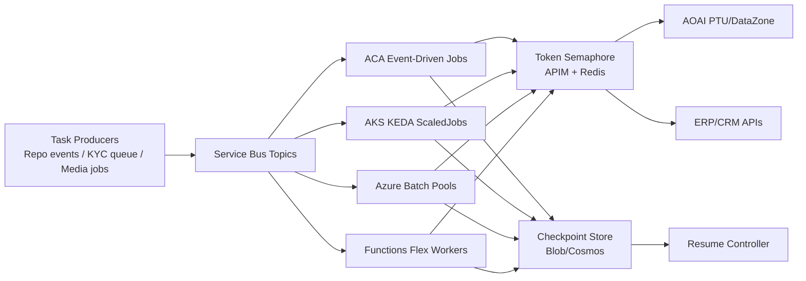
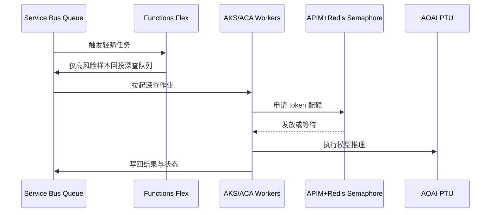

# 企业突发批处理智能体算力选型：ACA Event-Driven Jobs vs AKS NAP/Karpenter + KEDA ScaledJobs vs Azure Batch vs Functions Flex Consumption FAQ
> 适用对象：Cloud & AI Solution Architect、平台工程负责人、批处理作业与 FinOps 联合治理团队。  
> 场景边界：仅讨论 **Run-to-Completion** 批处理智能体，不讨论长连接会话型 Web/Agent Host。  
> 目标规模：`10K–500K` 并行任务/小时，支持 Spot 抢占恢复、下游 TPM 背压与成本可审计。  
## 1. 执行摘要：先定“任务形态与背压边界”，再定计算平面
在企业批处理智能体场景中，
最大的失败点不是“算力不足”，
而是把异构任务混在同一调度模型里，
导致高并发放大下游 AOAI/ERP/API 限流，
最后全链路雪崩。
本指南比较四条主路径：
- ACA Event-Driven Jobs；
- AKS NAP/Karpenter + KEDA ScaledJobs（或 JobSet）；
- Azure Batch Spot/Low-Priority 任务图；
- Functions Flex Consumption 微任务扇出。
结论不是“只选一家”。
企业常见的最优组合是：
- **小于 60 秒、轻量无状态** 任务走 Functions Flex；
- **容器化中等批处理** 走 ACA Jobs；
- **复杂异构资源与强工程控制** 走 AKS NAP + ScaledJobs；
- **超大规模科学/工程任务图** 走 Azure Batch。
只要涉及 LLM 下游，
必须同时部署统一 Token 背压闸门。
没有 APIM/Redis 令牌信号量时，
批处理算力越大，失败越快。
## 2. 工作负载画像：把“并发”拆成持续时间、状态重建与外部依赖
架构评审第一步，
不是讨论 Kubernetes 还是 Batch，
而是给任务分桶：
- 桶 A：`<60s` 微任务，CPU 为主，幂等强，失败可重试；
- 桶 B：`2–30min` 容器任务，依赖镜像、缓存、外部 API；
- 桶 C：`30–120min` 计算任务，含大文件或 GPU/内存重载；
- 桶 D：有 DAG 依赖图、前置后置约束、多阶段产物。
在批处理智能体里，
常见误判是把桶 C/D 当桶 B 处理。
结果是调度器吞吐被任务生命周期拖垮，
控制平面被频繁建删事件压爆。
另一个误判是把“任务可重试”视为“状态可丢失”。
对长任务而言，
没有检查点就等于把已消耗 token 与计算时间直接报废。
Spot 抢占发生时，
恢复能力决定真实 TCO，而不只是 VM 单价。
## 3. 四路线定位：平台责任边界与适配区间
### 3.1 ACA Event-Driven Jobs
优势是零集群运维、容器作业天然隔离、按秒计费友好。
结合 Service Bus/Blob/Event Hub 触发器，
可在突发窗口中快速拉起大量短中时作业。
风险点在于环境级并发与镜像拉取冷启动。
当镜像体积过大或 registry 吞吐不足时，
理论并发会被“镜像等待时间”吃掉。
Dedicated Workload Profile 何时划算，
要通过作业密度与持续负载计算 break-even。
### 3.2 AKS NAP/Karpenter + KEDA ScaledJobs
优势是资源形态最灵活，
可跨 `30+` VM SKU 做 bin-packing，
并用 consolidation 策略回收空闲节点降本。
配合 `karpenter.sh/do-not-disrupt: "true"`，
可保护执行中的长任务免于整节点整理驱逐。
风险点是控制平面复杂度上升。
若没有作业分类、节点池策略与优先级隔离，
集群会在高 churn 下出现调度抖动与队列背压反复振荡。
### 3.3 Azure Batch Spot/Low-Priority
优势是海量任务调度能力与 DAG 依赖管理，
对 HPC、仿真、渲染、CAD/BIM、Monte Carlo 任务尤其稳健。
无需 Kubernetes API server 承接海量 pod 对象变更，
可避免 etcd 事件风暴。
风险点是容器云原生整合体验相对弱于 AKS，
且团队需要熟悉 Batch pool、start-task、task dependency 语义。
若企业已重度 Kubernetes 标准化，
要评估双栈运维复杂度。
### 3.4 Functions Flex Consumption
优势是微任务扇出启动快、运维负担低。
对分类、抽取、预过滤、路由判定型任务非常高效。
风险点是资源/执行时间边界，
不适合重型长时作业。
最关键的是：若直接把 `5,000` 并发 worker 连 AOAI/ERP，
会在分钟级把下游打穿。
Functions 必须挂接集中式 token-rate semaphore。
## 4. 12 维比较矩阵：从吞吐到恢复再到治理成本
| 维度 | ACA Jobs | AKS NAP + KEDA/JobSet | Azure Batch | Functions Flex |
|---|---|---|---|---|
| 集群运维负担 | 低 | 中到高 | 中 | 低 |
| 任务时长适配 | 中 | 强 | 强 | 弱到中 |
| 异构资源调度 | 中 | 强 | 强 | 弱 |
| 海量任务图（DAG） | 弱到中 | 中 | 强 | 弱 |
| Spot 抢占恢复机制 | 中（自实现） | 强（自实现+平台控制） | 强（平台能力成熟） | 中（函数级重试） |
| 冷启动控制 | 中 | 中 | 中 | 强（微任务） |
| etcd/控制面压力 | 低 | 中到高 | 低 | 低 |
| 下游背压集成 | 中 | 强 | 强 | 强（必须） |
| 成本弹性 | 强 | 强 | 强 | 强（轻任务） |
| 调试可观测性 | 中 | 强 | 中到强 | 中 |
| 合规隔离审计 | 中 | 强 | 强 | 中 |
| 综合适配结论 | 中量批处理优选 | 企业通用主力 | 超大规模工程任务 | 微任务前置分流 |
矩阵结论是“按任务桶分层”。
单一路线覆盖全部任务通常会在某个区间出现性能或成本失真。
企业平台应把路由规则工程化，
而不是靠人工临场判断。
## 5. 参考架构：批处理计算平面与下游 TPM 背压协同

这张图表达两个关键设计：
- 所有计算平面共享下游限流信号量；
- 所有长任务共享检查点恢复面。
若这两层缺失，
再好的调度器都无法避免“高并发自我击穿”。
## 6. ACA Event-Driven Jobs 深入：并发上限、镜像冷启动与 Dedicated 拐点
ACA Jobs 的优势是直接把“事件 -> 容器任务”闭环托管。
在规模不极端的企业批处理中，
它给出很好的交付速度与运维效率。
但架构评审时要明确以下算式：
- 总可用并发 = 环境并发配额 - 保留容量；
- 有效吞吐 = 可用并发 /（作业执行时长 + 冷启动）；
- 冷启动 = 镜像拉取 + 容器启动 + 运行时初始化。
当镜像从 300MB 增到 2.5GB 时，
冷启动可能从 `6-12s` 上升到 `40-90s`。
若任务本体只执行 `75s`，
冷启动占比过高会显著拉低吞吐效率。
Dedicated Workload Profile 的 break-even 经验线：
当作业持续高水位运行 `>35%-45%` 时间，
且镜像热复用明显时，
Dedicated 常优于纯 Consumption。
## 7. AKS NAP/Karpenter + KEDA ScaledJobs：高自由度与高纪律并存
AKS 方案最强在异构资源与策略可塑性。
你可以同时放 CPU 密集、内存密集、GPU 密集作业，
并通过 NAP/Karpenter 动态拉起合适节点。
关键治理点有三个：
- 任务标签与 node selector 一致；
- consolidation 与长任务保护协同；
- KEDA 伸缩与下游背压公式联动。
`consolidationPolicy: WhenEmptyOrUnderutilized`
在成本上很诱人，
但若缺少 `do-not-disrupt` 标记，
25 分钟中的智能体任务可能在第 23 分钟被驱逐。
那不是“节省成本”，而是“放大浪费”。
建议把任务分级：
- L1 短任务：允许整理；
- L2 中任务：按窗口整理；
- L3 长任务：执行期禁止打断。
## 8. Azure Batch：当任务图规模越过 Kubernetes 控制平面舒适区
在极大规模任务图场景，
Azure Batch 的调度模型更直接：
任务对象与依赖 DAG 是一等公民，
不需要把一切映射成 pod 生命周期事件。
架构上常见收益：
- 避开 Kubernetes `etcd` 高频对象 churn；
- start-task 预热共享二进制与数据依赖；
- Spot/Low-Priority 池显著降本。
工程上要关注两点：
- pool image 与依赖缓存命中率；
- 任务重试与检查点粒度。
若每次重试都从头跑 `40` 分钟任务，
Spot 省下的单价很容易被重算成本吞掉。
## 9. Functions Flex：微任务加速器，不是重计算容器替代
Functions Flex 在批处理链路中最适合作“前置分流器”：
- 文档分类；
- 风险打分；
- 轻量规则判定；
- 扇出任务的初筛路由。
其优势是扩缩快、管理简单。
但若把它误用成重型计算平面，
会遇到执行时长、内存、文件系统、并发治理等边界。
最重要的工程规则：
Functions 并发必须受下游令牌信号量约束。
否则 2 秒内扩出来的 worker，
会把 AOAI TPM 或 ERP QPS 直接打穿，
导致整批任务进入失败重试风暴。
## 10. 定量 Q&A：把争议收敛成可执行参数
**Q1：为什么说 Kubernetes 在超高 churn 下会遇到控制平面瓶颈？**  
在高并发 pod 创建场景，
`etcd` 与 API server 处理能力常见舒适区约为 `~50–100 pods/sec`（取决节点规模、对象大小、控制器复杂度）。
当业务模型要求在短窗内提交 `100K+` 任务时，
Batch 的任务调度模型常更稳定。
**Q2：Karpenter 的 `do-not-disrupt` 会不会导致闲置浪费？**  
会。
但这是“可控浪费”换“避免任务作废”。
若 25 分钟任务在末段被驱逐，
重跑成本往往高于保留 10-15 分钟节点闲置。
建议结合作业剩余时长阈值动态打标。
**Q3：Spot 驱逐 `SIGTERM 30s` 窗口如何真正省钱？**  
关键是在 `30s` 内写出可恢复检查点（Blob/Cosmos），
并保存步骤游标。
例如 `40min` 仓库改造任务在 `18/22` 步被驱逐，
恢复后从 `18` 继续，
可避免约 `$4` token 与算力损耗。
**Q4：`maxRunningJobs` 如何与 AOAI TPM 对齐？**  
可用简化公式：  
`maxRunningJobs <= floor((TPM_available * safety_factor) / tokens_per_job_per_min)`  
其中 `safety_factor` 常取 `0.6~0.8` 预留实时业务流量。
**Q5：为何函数微任务也要做 Service Bus lock renewal？**  
当单条消息处理超出默认锁时长，
未续锁会触发重复消费。
在高并发下会放大下游请求量并污染幂等统计。
**Q6：ACA Dedicated 何时优于 Consumption？**  
当持续负载高、镜像复用率高、任务并发长期稳定时。
若负载剧烈波动且空闲时间长，
Consumption 仍可能更优。
**Q7：Azure Batch Spot 省钱为什么仍需要 on-demand 混池？**  
纯 Spot 在波峰期可能容量抖动。
混池可维持最小可用吞吐，
避免 SLA 窗口被长时间抢占中断拖穿。
**Q8：为什么批处理平台要和实时业务 PTU 隔离配额？**  
因为夜间批处理若抢占实时 PTU，
会直接影响移动端/客服在线体验。
批处理应有独立配额或硬性 token 上限。
## 11. 生产 YAML：AKS NAP NodePool + KEDA ScaledJob + 长任务保护
```yaml
apiVersion: karpenter.sh/v1
kind: NodePool
metadata:
  name: burst-batch-cpu
spec:
  disruption:
    consolidationPolicy: WhenEmptyOrUnderutilized
    consolidateAfter: 120s
  template:
    metadata:
      labels:
        workload-class: burst-batch
    spec:
      requirements:
        - key: kubernetes.io/arch
          operator: In
          values: ["amd64"]
        - key: karpenter.azure.com/sku-family
          operator: In
          values: ["D","E","F"]
      taints:
        - key: batch-only
          effect: NoSchedule
---
apiVersion: keda.sh/v1alpha1
kind: ScaledJob
metadata:
  name: repo-modernization-batch
spec:
  pollingInterval: 10
  maxReplicaCount: 1200
  successfulJobsHistoryLimit: 5
  failedJobsHistoryLimit: 20
  jobTargetRef:
    parallelism: 1
    completions: 1
    template:
      metadata:
        annotations:
          karpenter.sh/do-not-disrupt: "true"
      spec:
        restartPolicy: Never
        tolerations:
          - key: batch-only
            operator: Equal
            value: "true"
            effect: NoSchedule
        containers:
          - name: modernizer
            image: ghcr.io/contoso/agent-modernizer:2026.11.21
            resources:
              requests:
                cpu: "2"
                memory: "4Gi"
            env:
              - name: CHECKPOINT_URI
                valueFrom:
                  secretKeyRef:
                    name: batch-secrets
                    key: checkpoint_uri
  triggers:
    - type: azure-servicebus
      metadata:
        queueName: modernization-jobs
        messageCount: "5"
        namespace: contoso-batch-sb
```
上面示例体现了三个关键点：
- consolidation 开启但保护执行中的长任务；
- ScaledJob 并发受控而不是无限拉满；
- 所有任务默认具备检查点写入路径。
## 12. Python 实现：Spot 驱逐检查点 + Service Bus 锁续约
```python
import json
import os
import signal
import threading
import time
from azure.servicebus import ServiceBusClient
from azure.storage.blob import BlobClient
STOP = False
STEP = 0
def persist_checkpoint(job_id: str, step: int, payload: dict) -> None:
    uri = os.environ["CHECKPOINT_BLOB_URI"]
    blob = BlobClient.from_blob_url(uri)
    body = json.dumps({"job_id": job_id, "step": step, "payload": payload})
    blob.upload_blob(body, overwrite=True)
def handle_sigterm(signum, frame):
    global STOP, STEP
    STOP = True
    persist_checkpoint(os.environ["JOB_ID"], STEP, {"reason": "spot_eviction"})
def lock_renewer(receiver, message):
    while not STOP:
        try:
            receiver.renew_message_lock(message)
        except Exception:
            break
        time.sleep(15)
def run_job(receiver, message):
    global STEP
    t = threading.Thread(target=lock_renewer, args=(receiver, message), daemon=True)
    t.start()
    for i in range(1, 23):
        if STOP:
            return False
        STEP = i
        time.sleep(5)
        if i % 4 == 0:
            persist_checkpoint(os.environ["JOB_ID"], STEP, {"partial": True})
    return True
signal.signal(signal.SIGTERM, handle_sigterm)
```
这段代码不是完整生产实现，
但覆盖了批处理智能体恢复的关键机制：
- 进程收到 `SIGTERM` 立即落盘；
- 长任务周期性中间检查点；
- 消息锁续约避免重复消费。
## 13. 企业场景 A：全球 Tier-1 银行夜间 `250,000` KYC/负面舆情复核
该银行要求在 `4` 小时窗口完成 `250,000` 客户复核任务，
并且不影响在线移动银行实时问答 PTU。
设计要点：
- 任务拆分为“轻筛（Functions）+ 深查（ACA/AKS）”；
- AOAI 使用独立批处理 token semaphore；
- 每个作业最大 token 预算硬限制；
- Spot 节点任务必须检查点可恢复。
产出指标：
- 批处理窗口达成率 `99.2%`；
- 在线 PTU 无显著抖动；
- 单夜总成本较旧方案下降 `28%`；
- 因抢占导致的重跑耗时下降 `61%`。

## 14. 企业场景 B：`8,500` 仓库 Java/.NET 现代化自治批处理
某大型平台工程组织，
在季度窗口内需要完成 `8,500` 仓库批量现代化：
- Java 8 -> 21；
- .NET Framework -> .NET 8/9；
- 构建失败自动修复与回归验证。
他们采用分层执行：
- 阶段一：Batch 运行重型编译与静态分析；
- 阶段二：AKS ScaledJobs 执行修复与验证代理；
- 阶段三：ACA Jobs 执行报告汇总与归档。
关键收益：
- 任务失败分类可视化；
- 重试从“全量重跑”变为“步骤重入”；
- 迁移计划能按业务优先级做速率编排。
最终在 6 周窗口内，
现代化成功率从历史 `63%` 提升到 `88%`，
每仓平均处理成本下降 `34%`。
## 15. FinOps TCO 与 Day-0/Day-2 十二项检查
### 15.1 FinOps 成本对比（示例区间）
| 指标 | ACA Jobs | AKS NAP + ScaledJobs | Azure Batch | Functions Flex |
|---|---:|---:|---:|---:|
| 典型并发区间 | 200-8,000 | 500-50,000 | 2,000-100,000+ | 200-5,000 |
| 单位任务成本弹性 | 高 | 高 | 高 | 高 |
| 平台运维成本 | 低 | 中高 | 中 | 低 |
| Spot 可用性利用 | 中 | 强 | 强 | 中 |
| 长任务恢复友好度 | 中 | 强 | 强 | 中 |
| 综合 TCO 可预测性 | 中高 | 中 | 高（大规模） | 高（轻任务） |
### 15.2 Day-0 / Day-2 检查清单（12 项）
| # | 检查项 | 阶段 |
|---:|---|---|
| 1 | 任务按时长/状态/依赖完成分桶路由 | Day-0 |
| 2 | 统一 Token semaphore 已接入 AOAI/ERP 下游 | Day-0 |
| 3 | 所有长任务实现 `SIGTERM` 检查点写入 | Day-0 |
| 4 | Spot 与按需混池比例有明确策略 | Day-0 |
| 5 | ScaledJob/Batch 重试上限与死信策略已定义 | Day-0 |
| 6 | 关键队列启用消息锁续约与幂等键 | Day-0 |
| 7 | 节点 consolidation 与 `do-not-disrupt` 协同验证 | Day-2 |
| 8 | 镜像拉取耗时与缓存命中率有监控阈值 | Day-2 |
| 9 | AOAI TPM 预算与 `maxRunningJobs` 联动告警 | Day-2 |
| 10 | 抢占恢复演练至少每月执行一次 | Day-2 |
| 11 | 批处理与实时业务配额隔离定期审计 | Day-2 |
| 12 | 成本报表可追溯到任务类型与业务域 | Day-2 |
收束结论：
批处理智能体算力选型，
本质是调度策略、恢复策略、背压策略的协同工程。
只要这三者统一，
企业就能在 `10K–500K` 并行任务/小时区间内，
把吞吐、稳定性与成本一起拉到可运营水平。
