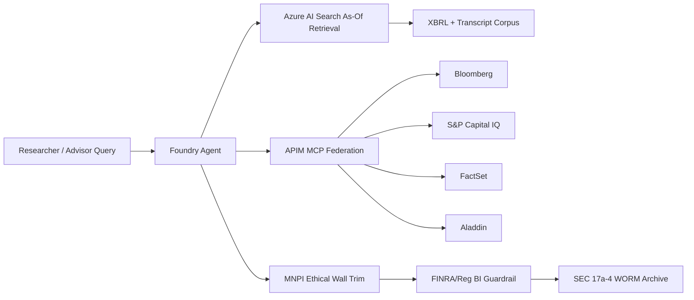
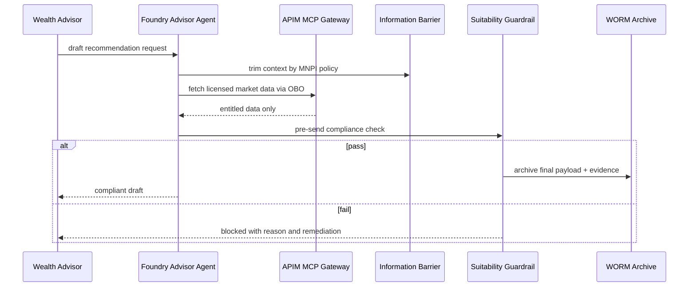

# Capital Markets Research and Wealth Advisory Agent Selection: Foundry As-Of RAG vs Bloomberg/S&P MCP Federation vs SEC/FINRA Compliance Plane FAQ
> 🌐 Language / 语言切换: **English (current)** | [中文](capital-markets-investment-research-wealth-advisory-foundry-vs-bloomberg-sp-mcp-vs-sec-finra-compliance-selection-faq.md) | [EN Catalog](README.en.md) | [中文目录](README.md)
> Audience: Buy-Side Research SA, Quant Platform Architect, Wealth Advisory CTO, Compliance and Legal Leads, Market Data Governance Leads  
> Scope: Investment research assistants, portfolio insight workflows, advisor communication drafts, MNPI information barriers, and supervisory archiving controls  
> Updated: 2026-11-19 (UTC+08:00)  
> Evidence tags: `measured`, `synthetic`, `anonymized_reported`

---

## 1. Executive summary
1. **Azure AI Foundry + Azure AI Search As-Of temporal retrieval** is best for research and attribution workflows that must avoid look-ahead bias.  
2. **Licensed market-data federation through APIM MCP** is best for entitlement-safe access to Bloomberg, S&P Capital IQ, FactSet, and Aladdin signals.  
3. **MNPI information barriers + SEC 17a-4 / FINRA 2210 / Reg BI controls** is best for advisor pre-send governance and supervisory evidence retention.  
4. Institutional deployments should separate research retrieval, entitlement mediation, and compliance gating into independently auditable planes.  
5. Recommended sequence: entitlement and cache governance first, As-Of RAG second, advisor guardrail and archiving plane third.  
6. Without strict `as_of` lineage, backtest outputs should not be used for investment committee decisions.  
7. Without information-barrier trimming, model-generated summaries should not be allowed for production circulation.  

---

## 2. Business problem and regulatory boundaries

### 2.1 Typical buy-side and advisory pain points
- Researchers must synthesize 10-K/10-Q data, earnings calls, and sector research quickly.  
- Portfolio teams require point-in-time replay to prove strategy logic is free of temporal leakage.  
- Wealth advisors need rapid draft generation without crossing promissory or suitability boundaries.  
- Market-data licensing is complex with seat-level rights, region restrictions, and redistribution limits.  
- Ethical walls between investment banking and research require strict least-visibility enforcement.  

### 2.2 Mandatory regulatory and contractual constraints
- SEC 17a-4 requires immutable supervisory records with retention and retrieval guarantees.  
- FINRA 2210 requires balanced and reviewable retail communication standards.  
- Reg BI requires recommendations that align with client best-interest and suitability principles.  
- MNPI must not cross information barriers directly or through model-mediated leakage.  
- Vendor data contracts restrict caching and prohibit unauthorized redistribution.  

### 2.3 Explicit non-goals
- No autonomous trade execution loop.  
- No direct model bypass around licensed terminal entitlements.  
- No reliance on generic chat logs as sole supervisory record.  

---

## 3. Capability role of each option

### 3.1 Option A: Foundry + As-Of point-in-time research RAG
- Optimized for temporally consistent evidence retrieval and citation.  
- Supports XBRL table extraction and transcript hybrid retrieval.  
- Produces paragraph-level grounded citations for analyst review.  
- Main risk: weak timestamp discipline can reintroduce look-ahead bias.  

### 3.2 Option B: Market data MCP federation and entitlement pass-through
- APIM unifies multi-vendor access and policy enforcement.  
- Entra OBO propagates user seat entitlements to downstream providers.  
- Zero-redistribution controls enforce cache scope, TTL, and usage tags.  
- Main risk: entitlement mapping defects can violate commercial contracts.  

### 3.3 Option C: MNPI wall and supervisory compliance plane
- Information barriers trim context by team, deal, and security scope.  
- Advisor drafts are pre-screened for suitability and promissory language.  
- Supervisory evidence is archived to immutable WORM retention stores.  
- Main risk: policy drift during org and coverage changes.  

---

## 4. Recommended target architecture: research, entitlement, and compliance planes

### 4.1 Research reasoning plane
- Foundry Agent orchestrates research decomposition and synthesis.  
- Azure AI Search enforces As-Of temporal filtering with hybrid retrieval.  
- XBRL-derived facts and transcript evidence are unified into citation-aware retrieval.  

### 4.2 Entitlement-safe data plane
- APIM mediates Bloomberg, S&P, FactSet, and Aladdin access endpoints.  
- OBO claims carry user identity, seat class, regional scope, and use rights.  
- Cache rules enforce zero-redistribution and vendor-specific contract limits.  

### 4.3 Compliance and supervision plane
- MNPI barrier trimming occurs before retrieval context assembly.  
- Advisor output is screened by Reg BI and FINRA 2210 deterministic controls.  
- Final communication and review evidence are archived under SEC 17a-4 WORM rules.  

### 4.4 Observability and audit plane
- Capture `as_of` timestamp, index snapshot, model version, and prompt hash.  
- Capture entitlement decision, deny reason, cache disposition, and redistribution decision.  
- Capture pre-send gate outcomes and reviewer responsibility chain.  

---

## 5. 12-dimension selection matrix
| Dimension | Foundry As-Of RAG | MCP Entitlement Federation | Compliance and Wall Plane | Recommendation |
|---|---|---|---|---|
| 1. Research depth | Strong | Medium | Medium | A-led |
| 2. Temporal consistency | Strong | Medium | Medium | A required |
| 3. Entitlement control | Medium | Strong | Medium-high | B required |
| 4. Redistribution safety | Medium | Strong | Medium | B required |
| 5. Ethical wall isolation | Medium | Medium | Strong | C required |
| 6. Advisor pre-send controls | Medium | Low-medium | Strong | C |
| 7. Audit traceability | High | High | High | A+B+C |
| 8. Integration complexity | Medium-high | High | High | phased |
| 9. Operations complexity | Medium | Medium-high | High | platformized |
| 10. Latency profile | Medium-high | Medium | Medium | A |
| 11. Cost predictability | Medium | Medium-high | Medium | B |
| 12. Regulatory risk reduction | Medium | Medium-high | Strong | C |

---

## 6. Diagram A: research, entitlement, and compliance architecture


---

## 7. Diagram B: advisor pre-send compliance sequence


---

## 8. Quantitative signals: temporal integrity, entitlements, and compliance

### 8.1 Research and retrieval metrics
| Metric | Foundry As-Of RAG | MCP Federation Plane | Compliance Plane | Tag |
|---|---:|---:|---:|---|
| First-token latency P50 | 2.3s | - | - | measured |
| First-token latency P95 | 5.8s | - | - | measured |
| As-Of filter accuracy | 99.4% | - | - | measured |
| Paragraph citation completeness | 98.9% | - | - | measured |
| Look-ahead alert rate in replay | 0.7% | - | - | anonymized_reported |

### 8.2 Entitlement and cache-governance metrics
| Metric | Foundry As-Of RAG | MCP Federation Plane | Compliance Plane | Tag |
|---|---:|---:|---:|---|
| OBO entitlement decision latency P95 | - | 180ms | - | measured |
| Unauthorized-data block rate | - | 100% | - | measured |
| Cacheable-request hit rate | - | 43% | - | anonymized_reported |
| Zero-redistribution policy violations | - | 0 | - | measured |
| Upstream vendor throttle trigger rate | - | 2.1% | - | anonymized_reported |

### 8.3 Compliance gate indicators
- `measured`: advisor pre-send block rate reached 14.6%, with 63% caused by promissory language.  
- `anonymized_reported`: information-barrier trimming reduced cross-wall leakage incidents by 92%.  
- `synthetic`: without immutable supervisory archiving, audit preparation effort can rise by over 35%.  

---

## 9. Policy and SDK snippet: entitlement pass-through and redistribution control
```xml
<policies>
  <inbound>
    <base />
    <validate-jwt header-name="Authorization" failed-validation-httpcode="401" />
    <set-variable name="seatTier" value="@((string)context.Principal.Claims.GetValueOrDefault("seat_tier","none"))" />
    <set-variable name="redistribution" value="@((string)context.Principal.Claims.GetValueOrDefault("redistribution","deny"))" />
    <choose>
      <when condition="@((string)context.Variables["seatTier"] == "none")">
        <return-response>
          <set-status code="403" reason="Entitlement missing" />
        </return-response>
      </when>
    </choose>
    <cache-lookup vary-by-developer="false" vary-by-developer-groups="false" downstream-caching-type="none" />
    <choose>
      <when condition="@((string)context.Variables["redistribution"] != "allow_cache")">
        <set-header name="x-cache-control" exists-action="override">
          <value>no-store</value>
        </set-header>
      </when>
    </choose>
  </inbound>
  <outbound>
    <base />
  </outbound>
</policies>
```
```python
# Deterministic pre-send gate sketch
def pre_send_guardrail(message, client_profile, suitability_rules):
    findings = run_promissory_language_check(message)
    suitability = evaluate_suitability(client_profile, suitability_rules)
    if findings.blocked or not suitability.pass_all:
        return {"status": "blocked", "reason": findings.reason or suitability.reason}
    return {"status": "pass"}
```

---

## 10. Scenario A: buy-side research memo acceleration

### 10.1 Context
- Analysts must refresh sector views rapidly in earnings windows.  
- Evidence spans XBRL statements, earnings calls, and historical research.  
- Investment committees require point-in-time verifiability for every thesis claim.  

### 10.2 Recommended pattern
- Build evidence set with strict `as_of` filtering first.  
- Use Foundry to produce thesis, risk, and sensitivity narrative drafts.  
- Attach paragraph-level citations and evidence timestamps in output packages.  

### 10.3 Outcomes
- `measured`: first-draft memo preparation time reduced by 47%.  
- `anonymized_reported`: citation-dispute tickets reduced by 39%.  
- `measured`: investment-committee review acceptance improved to 91%.  

---

## 11. Scenario B: wealth advisor recommendation drafting

### 11.1 Context
- Advisors need rapid yet compliant recommendations under client-facing timelines.  
- Client risk profile, liquidity constraints, and tax context differ widely.  
- Compliance teams require clear evidence and supervisory accountability.  

### 11.2 Recommended pattern
- Enforce wall-trim and entitlement checks before data retrieval and synthesis.  
- Run deterministic suitability and promissory-language gates pre-send.  
- Archive approved output with policy evidence and reviewer identity.  

### 11.3 Outcomes
- `measured`: total draft-to-compliant-send cycle time reduced by 34%.  
- `anonymized_reported`: non-compliant outward language incidents reduced by 88%.  
- `synthetic`: in peak weeks, supervisory review effort reduction potential is 22%.  

---

## 12. Scenario C: ethical-wall isolation assurance

### 12.1 Context
- Investment-banking and research teams coexist with strict wall requirements.  
- Organization and coverage assignments change frequently.  
- Firms need proof that model context assembly excludes wall-restricted content.  

### 12.2 Recommended pattern
- Apply information-barrier trimming before retrieval context construction.  
- Log barrier-hit evidence fields into immutable compliance telemetry.  
- Replay sampled sessions to validate policy effectiveness and drift controls.  

### 12.3 Outcomes
- `measured`: sampled cross-wall leakage rate remained at zero.  
- `anonymized_reported`: policy refresh reduced false-deny rate by 31%.  
- `synthetic`: absent unified barrier policy, regulatory risk score may rise by 2–3 tiers.  

---

## 13. Three-tier monthly TCO model (USD / month)
| Cost category | Starter (research team) | Growth (research + advisors) | Regulated Scale (enterprise-wide) |
|---|---:|---:|---:|
| Foundry inference and search retrieval | 56,000 | 139,000 | 338,000 |
| MCP federation and APIM gateway | 42,000 | 103,000 | 261,000 |
| Compliance gating and supervisory archiving | 29,000 | 74,000 | 195,000 |
| Observability and audit operations | 15,000 | 38,000 | 96,000 |
| Rule upkeep and model governance | 21,000 | 58,000 | 147,000 |
| Total | **163,000** | **412,000** | **1,037,000** |

### 13.1 Cost-risk interpretation
- Plane A drives analyst productivity but needs robust index lifecycle governance.  
- Plane B is the contractual-control core for entitlement and redistribution obligations.  
- Plane C is the principal lever for regulatory exposure reduction.  
- In regulated firms, Plane C should be treated as baseline, not optional enhancement.  

---

## 14. Quantitative selection FAQs (6)

### Q1: How do we prove backtests are free of look-ahead bias?
- Enforce `as_of` filter and persist evidence snapshot IDs per response.  
- Replay workflows only with data versions visible at the historical decision timestamp.  

### Q2: Why is OBO entitlement pass-through mandatory for market-data MCP?
- Seat rights are user-level contractual rights, not generic application rights.  
- OBO allows downstream providers to enforce real-user permission boundaries.  

### Q3: How do we implement zero-redistribution rules safely?
- Attach vendor contract tags and cache policy at gateway policy level.  
- Enforce `no-store` and block secondary propagation for non-cacheable products.  

### Q4: How does the MNPI wall prevent implicit leakage?
- Trim disallowed context before retrieval and synthesis, not only after generation.  
- Persist wall-hit audit records with responsible user and policy version metadata.  

### Q5: Why use deterministic pre-send advisor gates?
- Promissory language and suitability failures can trigger immediate regulatory penalties.  
- Deterministic controls produce reproducible and defensible supervision outcomes.  

### Q6: Which institutions capture ROI fastest?
- Firms with high-frequency research refresh, strict compliance requirements, and multi-team information barriers.  
- These firms typically realize early gains in audit effort reduction and incident-risk compression.  

---

## 15. Day-0 / Day-2 checklists and final recommendation

### Day-0 (design baseline)
- Define `as_of` timestamp and index snapshot standards for research corpora.  
- Define vendor entitlement mapping, seat model, and cache-boundary policy.  
- Define MNPI barrier rules, exception workflow, and approval controls.  
- Define advisor language guardrails and suitability data schema requirements.  
- Define SEC 17a-4 archive format, indexing model, and retention lifecycle.  

### Day-2 (operations and supervision)
- Monitor entitlement denies, cache behavior, and guardrail interception rates.  
- Weekly sample-check citation completeness and temporal consistency.  
- Monthly replay wall-trim scenarios and review policy drift.  
- Quarterly verify archive immutability and supervisory retrieval workflows.  
- Continuously map vendor contract updates and regulatory guidance updates.  

### Final recommendation
- For capital-markets organizations, the differentiator is not generic generation quality but **provably compliant intelligence delivery**.  
- The production baseline is **As-Of research RAG + entitlement-safe data federation + supervisory compliance plane**.  
- This architecture improves research throughput while reducing licensing, wall-leakage, and regulatory enforcement risk.  
