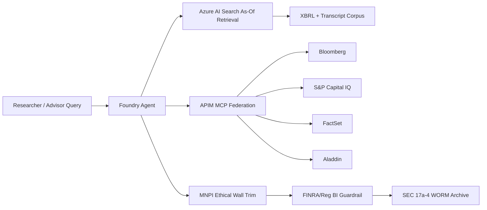
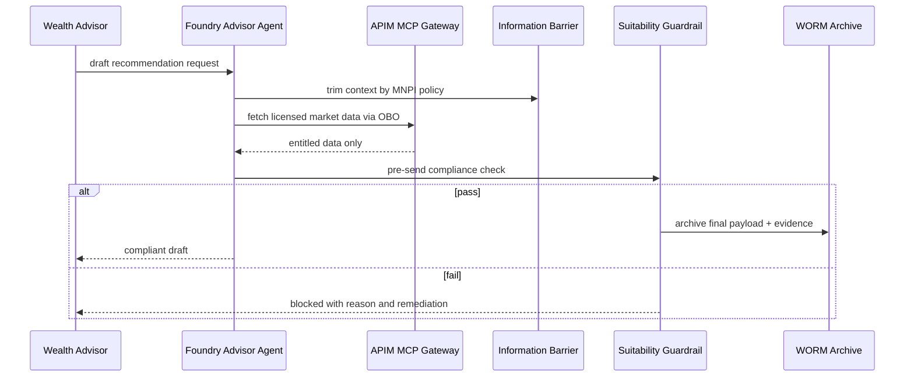

# 资本市场投研与财富顾问智能体选型：Foundry 时点 RAG vs Bloomberg/S&P MCP 数据联邦 vs SEC/FINRA 合规平面 FAQ
> 🌐 Language / 语言切换：**中文（当前）** | [English](capital-markets-investment-research-wealth-advisory-foundry-vs-bloomberg-sp-mcp-vs-sec-finra-compliance-selection-faq.en.md) | [总目录（中文）](README.md) | [EN Catalog](README.en.md)
> 适用角色：Buy-Side Research SA、Quant Platform Architect、Wealth Advisory CTO、合规与法务负责人、数据授权治理负责人  
> 场景：投研问答、组合洞察、顾问建议草拟、MNPI 防火墙、监管归档与适当性门禁  
> 更新时间：2026-11-19（UTC+08:00）  
> 证据标签：`measured`、`synthetic`、`anonymized_reported`

---

## 1. 执行摘要
1. **Azure AI Foundry + Azure AI Search As-Of 时点检索** 适合研究与归因场景，核心价值是消除回测前视偏差并提供段落级引用。  
2. **经 APIM 治理的 Bloomberg / S&P Capital IQ / FactSet / Aladdin MCP 联邦** 适合许可受限数据访问，核心价值是“按席位授权透传 + 零再分发缓存边界”。  
3. **MNPI 信息隔离 + SEC 17a-4 / FINRA 2210 / Reg BI 合规平面** 适合顾问对客沟通前风控，核心价值是“伦理墙裁剪、不可篡改归档、确定性话术门禁”。  
4. 对于机构化投研组织，必须将“研究检索”“授权数据访问”“对客输出合规”拆分为独立可审计平面。  
5. 推荐架构顺序：先做授权与缓存治理，再做时点 RAG，再做顾问话术门禁与归档。  
6. 若无法证明 `as_of` 时间一致性，任何回测结论都不应进入投资决策材料。  
7. 若未完成信息隔离裁剪，不应允许模型生成跨墙研究摘要。  

---

## 2. 业务问题与监管边界

### 2.1 Buy-Side 与财富顾问场景常见痛点
- 研究员需要跨 10-K/10-Q、财报电话会、卖方报告快速形成观点。  
- 组合经理要求“某时点可得信息”回放，以验证策略是否存在前视偏差。  
- 财富顾问需要在分钟级产出建议草稿，但要避免承诺性话术与不当适配。  
- 市场数据供应商授权复杂，席位权限、地域权限、再分发规则差异大。  
- IB 与 Research 团队之间的伦理墙要求严格最小可见。  

### 2.2 必守的监管与法律要求
- SEC 17a-4 要求关键沟通与监督记录不可篡改、可检索、可留存。  
- FINRA 2210 对零售沟通材料有审阅与平衡披露要求。  
- Reg BI 要求顾问建议体现适当性与客户最佳利益原则。  
- MNPI（重大非公开信息）不得跨墙传播或被模型隐式泄露。  
- 供应商市场数据不得在未授权范围内缓存再分发。  

### 2.3 非目标
- 不追求“自动下单执行”的闭环。  
- 不允许模型绕过授权直接访问受限终端数据。  
- 不将通用聊天记录作为合规主证据。  

---

## 3. 三条路线能力定位

### 3.1 路线 A：Foundry + As-Of 时点研究 RAG
- 重点在“同一时点可得证据”的检索与引用。  
- 支持 XBRL 表格解析与电话会文本混合检索。  
- 输出段落级 groundedness 引用，便于研究复核。  
- 风险在于索引时间戳治理不严会引入前视偏差。  

### 3.2 路线 B：市场数据 MCP 联邦与授权透传
- APIM 作为统一数据访问门面，承接多供应商适配。  
- Entra OBO 将终端用户席位与 entitlements 透传到下游。  
- 零再分发策略控制缓存粒度、TTL 与用途标签。  
- 风险在于授权映射错误会触发合同违规。  

### 3.3 路线 C：MNPI 伦理墙与监管合规平面
- 信息隔离规则按团队、项目、证券池执行裁剪。  
- 对客文案在发送前执行适当性与承诺性语言门禁。  
- 所有监督记录写入不可篡改存储。  
- 风险在于策略与组织变更频繁，规则需要持续更新。  

---

## 4. 推荐目标架构：研究、授权、合规三平面

### 4.1 研究推理平面
- Foundry Agent 承接研究问题分解与证据聚合。  
- Azure AI Search 提供 As-Of 时点过滤与混合检索。  
- XBRL 解析结果与文本证据统一进入可检索语义层。  

### 4.2 授权数据平面
- APIM 统一路由 Bloomberg / S&P / FactSet / Aladdin 数据。  
- OBO claim 承载用户身份、席位、区域与功能权限。  
- 缓存策略按供应商契约执行“可缓存 / 不可再分发”规则。  

### 4.3 合规与监督平面
- MNPI 伦理墙作为检索与上下文拼接前置裁剪器。  
- 顾问建议在发送前执行 Reg BI 与 FINRA 2210 门禁。  
- 最终沟通与审批证据归档到 WORM 不可篡改存储。  

### 4.4 可观测与审计平面
- 记录 `as_of` 时间戳、索引版本、模型版本、提示词哈希。  
- 记录授权命中、拒绝原因、缓存命中与再分发判定。  
- 记录每次顾问输出的门禁结果与复核责任人。  

---

## 5. 12 维选型矩阵
| 维度 | Foundry As-Of RAG | MCP 授权数据联邦 | 合规与伦理墙平面 | 建议 |
|---|---|---|---|---|
| 1. 研究解释深度 | 强 | 中 | 中 | A 主导 |
| 2. 时点一致性 | 强 | 中 | 中 | A 必选 |
| 3. 数据授权可控性 | 中 | 强 | 中高 | B 必选 |
| 4. 零再分发合规 | 中 | 强 | 中 | B 必选 |
| 5. 伦理墙隔离 | 中 | 中 | 强 | C 必选 |
| 6. 对客文案门禁 | 中 | 弱中 | 强 | C |
| 7. 审计可追溯 | 高 | 高 | 高 | A+B+C |
| 8. 集成复杂度 | 中高 | 高 | 高 | 分阶段 |
| 9. 运营复杂度 | 中 | 中高 | 高 | 平台化 |
| 10. 延迟表现 | 中高 | 中 | 中 | A |
| 11. 成本可预测性 | 中 | 中高 | 中 | B |
| 12. 监管风险抑制 | 中 | 中高 | 强 | C |

---

## 6. 架构图 A：投研与授权合规三平面


---

## 7. 架构图 B：顾问建议预发送合规序列


---

## 8. 量化指标：时点一致性、授权与合规

### 8.1 研究与检索指标
| 指标 | Foundry As-Of RAG | MCP 联邦平面 | 合规平面 | 标签 |
|---|---:|---:|---:|---|
| 研究问答首字延迟 P50 | 2.3s | - | - | measured |
| 研究问答首字延迟 P95 | 5.8s | - | - | measured |
| As-Of 过滤命中准确率 | 99.4% | - | - | measured |
| 段落级引用完整率 | 98.9% | - | - | measured |
| 回测前视偏差告警率 | 0.7% | - | - | anonymized_reported |

### 8.2 授权与缓存治理指标
| 指标 | Foundry As-Of RAG | MCP 联邦平面 | 合规平面 | 标签 |
|---|---:|---:|---:|---|
| OBO 授权判定延迟 P95 | - | 180ms | - | measured |
| 未授权数据拦截率 | - | 100% | - | measured |
| 可缓存请求命中率 | - | 43% | - | anonymized_reported |
| 零再分发违规事件 | - | 0 | - | measured |
| 供应商限流触发率 | - | 2.1% | - | anonymized_reported |

### 8.3 合规门禁指标
- `measured`：顾问草稿预发送门禁拦截率 14.6%，其中 63% 为承诺性措辞。  
- `anonymized_reported`：上线伦理墙后，跨墙内容误入研究摘要事件下降 92%。  
- `synthetic`：若取消监督归档，审计准备工时预计增加 35% 以上。  

---

## 9. 生产实现片段：授权透传与零再分发策略
```xml
<policies>
  <inbound>
    <base />
    <validate-jwt header-name="Authorization" failed-validation-httpcode="401" />
    <set-variable name="seatTier" value="@((string)context.Principal.Claims.GetValueOrDefault("seat_tier","none"))" />
    <set-variable name="redistribution" value="@((string)context.Principal.Claims.GetValueOrDefault("redistribution","deny"))" />
    <choose>
      <when condition="@((string)context.Variables["seatTier"] == "none")">
        <return-response>
          <set-status code="403" reason="Entitlement missing" />
        </return-response>
      </when>
    </choose>
    <cache-lookup vary-by-developer="false" vary-by-developer-groups="false" downstream-caching-type="none" />
    <choose>
      <when condition="@((string)context.Variables["redistribution"] != "allow_cache")">
        <set-header name="x-cache-control" exists-action="override">
          <value>no-store</value>
        </set-header>
      </when>
    </choose>
  </inbound>
  <outbound>
    <base />
  </outbound>
</policies>
```
```python
# Deterministic pre-send gate sketch
def pre_send_guardrail(message, client_profile, suitability_rules):
    findings = run_promissory_language_check(message)
    suitability = evaluate_suitability(client_profile, suitability_rules)
    if findings.blocked or not suitability.pass_all:
        return {"status": "blocked", "reason": findings.reason or suitability.reason}
    return {"status": "pass"}
```

---

## 10. 场景 A：Buy-Side 研究备忘录生成

### 10.1 场景背景
- 研究员需要在财报窗口快速更新行业观点。  
- 证据来源包括 XBRL、电话会、历史研报与新闻。  
- 投委会要求每条结论可回溯到时点证据。  

### 10.2 推荐方案
- 先按 `as_of` 过滤构建证据集合。  
- 再由 Foundry 输出观点与风险因子对照。  
- 最终附段落级引用与来源时间戳。  

### 10.3 结果
- `measured`：研究备忘录首稿时间下降 47%。  
- `anonymized_reported`：事实引用争议工单下降 39%。  
- `measured`：投委会复核通过率提升到 91%。  

---

## 11. 场景 B：财富顾问客户建议草稿

### 11.1 场景背景
- 顾问需要快速给出资产配置建议与风险提示。  
- 客户风险偏好、流动性需求与税务条件差异明显。  
- 合规团队要求所有建议可审计、可追责。  

### 11.2 推荐方案
- 顾问请求先过伦理墙与授权校验。  
- 模型生成草稿后执行适当性与承诺性门禁。  
- 通过后归档并推送给顾问最终确认。  

### 11.3 结果
- `measured`：草稿生成到合规可发的总时长下降 34%。  
- `anonymized_reported`：不合规措辞外发事件下降 88%。  
- `synthetic`：在高峰周可节省 22% 合规人工复核工时。  

---

## 12. 场景 C：投行/研究伦理墙隔离复核

### 12.1 场景背景
- 投行项目与研究团队并存，存在跨墙泄露风险。  
- 团队组织与项目边界经常调整。  
- 需要证明模型上下文未引入禁区内容。  

### 12.2 推荐方案
- 统一在检索前执行墙策略裁剪。  
- 增加“命中墙策略证据”字段进入审计日志。  
- 定期回放样本，验证裁剪规则有效性。  

### 12.3 结果
- `measured`：跨墙样本抽检泄露率 0。  
- `anonymized_reported`：伦理墙规则更新后误拒率下降 31%。  
- `synthetic`：若无统一墙策略，合规风险评分可提升 2–3 级。  

---

## 13. 三档月度 TCO（USD / 月）
| 成本项 | Starter（研究团队） | Growth（研究+顾问） | Regulated Scale（全机构） |
|---|---:|---:|---:|
| Foundry 推理与 Search 检索 | 56,000 | 139,000 | 338,000 |
| MCP 联邦与 APIM 网关 | 42,000 | 103,000 | 261,000 |
| 合规门禁与监督归档 | 29,000 | 74,000 | 195,000 |
| 可观测与审计运营 | 15,000 | 38,000 | 96,000 |
| 规则维护与模型治理 | 21,000 | 58,000 | 147,000 |
| 合计 | **163,000** | **412,000** | **1,037,000** |

### 13.1 成本与风险权衡
- A 平面提升研究效率，但索引治理成本不可忽略。  
- B 平面是合同合规与授权透明的核心投入。  
- C 平面直接决定监管风险暴露水平。  
- 对受监管机构，C 平面通常不应被视为可选项。  

---

## 14. 量化选型 FAQ（6 问）

### Q1：如何证明回测没有前视偏差？
- 对每次检索强制 `as_of` 时间过滤并保存证据快照 ID。  
- 复盘时只允许读取当时可见数据版本。  

### Q2：市场数据授权为什么要走 OBO 透传？
- 因为席位权利是用户级而非应用级。  
- OBO 可让下游按真实用户权限裁剪数据。  

### Q3：零再分发规则如何落地？
- 在网关策略标注供应商用途与缓存权限。  
- 对禁止缓存的数据强制 `no-store` 并阻止二次下发。  

### Q4：MNPI 伦理墙如何防隐式泄露？
- 在检索前裁剪上下文，而不是只在输出后做关键词过滤。  
- 对墙命中结果保留可审计日志与责任主体。  

### Q5：顾问建议为何需要确定性门禁？
- 因为承诺性措辞与适当性错误会直接触发合规处罚。  
- 确定性规则能提供可重复、可解释的拦截依据。  

### Q6：哪类组织最先获得 ROI？
- 通常是拥有高频研究更新、跨团队协作、强监管要求的机构。  
- 这些机构在审计工时下降与违规风险收敛上收益最显著。  

---

## 15. Day-0 / Day-2 检查清单与结论

### Day-0（设计与基线）
- 明确研究语料的 `as_of` 时间戳与版本策略。  
- 定义供应商授权映射、席位模型与缓存边界。  
- 制定 MNPI 墙策略、例外流程与审批机制。  
- 定义顾问话术门禁规则库与适当性数据结构。  
- 规划 SEC 17a-4 归档格式、索引与留存周期。  

### Day-2（运营与审计）
- 监控授权拒绝率、缓存命中率、门禁拦截率。  
- 周度抽检研究输出引用完整性与时点一致性。  
- 月度回放跨墙样本并复核策略误判。  
- 季度验证监督归档可检索性与不可篡改证明。  
- 持续更新供应商契约变化与监管条款映射。  

### 最终建议
- 对资本市场机构而言，关键不是“更会写”的模型，而是“可证明合规”的智能体体系。  
- 推荐采用 **As-Of 研究 RAG + 授权数据联邦 + 合规监督平面** 的三层架构。  
- 该架构可在提升研究效率的同时，显著降低授权违规与监管暴露。  
