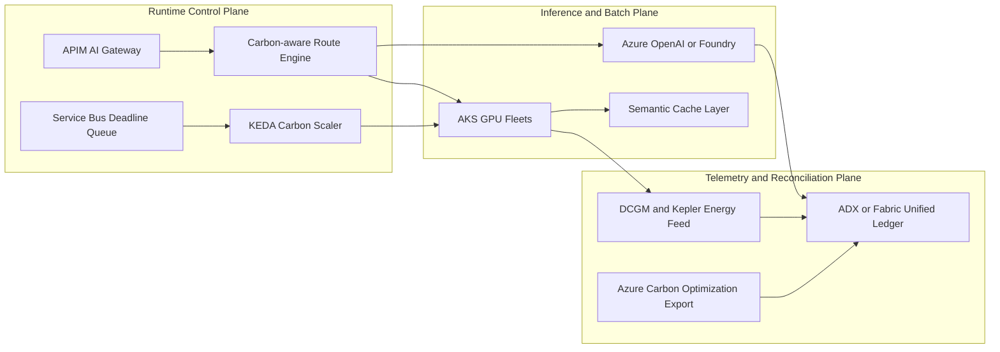
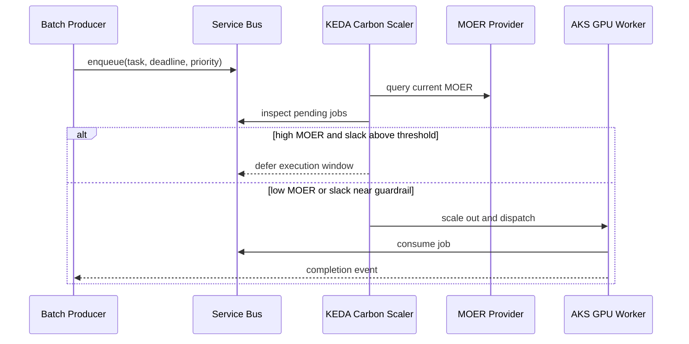

# Enterprise Carbon-Aware AI GreenOps FAQ: SCI Attribution, APIM Grid-Aware Routing, KEDA Carbon Deferral, and Azure Emissions Reconciliation
> 🌐 **Language Switch**: [中文](carbon-aware-ai-greenops-sci-apim-grid-routing-vs-keda-carbon-scaler-vs-azure-emissions-selection-faq.md) | **English (current)**  
> Audience: Principal Cloud & AI Solution Architects, joint FinOps/GreenOps owners, platform SRE, ESG reporting teams, and assurance auditors.  
> Scope: Carbon-aware AI infrastructure scheduling and SCI accounting, not domain-level ESG business workflows.  
> Objective: Reduce both `gCO2eq / task` and `$ / task` under residency, latency, and deadline constraints with audit-ready traceability.  

## 1. Executive outcome: GreenOps only works when it is computable, schedulable, and auditable
Many AI platforms already run mature FinOps programs.  
GreenOps efforts often remain dashboard-only initiatives.  
The failure pattern is usually architectural, not organizational intent.  
A working GreenOps stack needs three hard capabilities.  
First, computable carbon intensity per functional unit.  
Second, schedulable runtime control for where and when jobs run.  
Third, auditable reconciliation against official emissions reporting ledgers.  
Without compute, there is no measurable optimization target.  
Without scheduling, there is no operational control loop.  
Without auditable reconciliation, there is no external assurance confidence.  
This guide frames four composable implementation paths.  
Path A enables spatial carbon-aware routing via API gateways.  
Path B enables temporal carbon shifting with deadline-aware scaling.  
Path C enables architectural Pareto gains via model right-sizing and caching.  
Path D enables SCI telemetry and monthly emissions ledger reconciliation.  
When combined, these paths commonly produce dual KPI improvement.  
Cost intensity falls and carbon intensity falls together.  

## 2. Constraint model: low-carbon optimization must never violate sovereign or SLA boundaries
Carbon optimization is not unconstrained workload migration.  
Enterprises operate under mandatory hard boundaries.  
Boundary one is residency and sovereignty policy.  
Boundary two is interactive latency budget ceilings.  
Boundary three is deadline integrity for deferred workloads.  
Therefore a “route to lowest carbon region” policy is insufficient.  
Scheduling must solve a constrained optimization problem.  
Practical design starts by codifying non-negotiable constraints.  
Allowed-region sets, p95 RTT ceilings, and deadline slack become policy primitives.  
Only then should carbon intensity be optimized inside that feasible set.  
This approach prevents “carbon wins with business failure” outcomes.  
It also creates clearer governance between architecture and compliance teams.  
Constraint-first design is the foundation for trustworthy GreenOps automation.  

## 3. Four-path architecture position: from reporting to runtime control system
Path A targets online inference routing decisions.  
Path B targets flexible batch and asynchronous agent workloads.  
Path C targets intrinsic compute efficiency per task.  
Path D targets external-grade accounting and assurance requirements.  
Path A answers where to run now.  
Path B answers when to run safely.  
Path C answers how much model capacity is truly needed.  
Path D answers how to prove outcomes credibly.  
Using A alone misses model-level efficiency opportunities.  
Using B alone cannot optimize latency-critical online traffic.  
Using C alone ignores real-time grid carbon variance.  
Using D alone measures but does not control.  
Enterprises should operate all four as one feedback system.  
That is the practical path from pilot reports to sustained GreenOps value.  

## 4. Twelve-dimension comparison matrix for joint FinOps and GreenOps governance
| Dimension | A: APIM Spatial Carbon Routing | B: KEDA Temporal Carbon Deferral | C: Model Pareto Levers | D: SCI Audit Ledger |
|---|---|---|---|---|
| Online-traffic relevance | Very high | Medium | High | Medium |
| Batch-traffic relevance | Medium | Very high | High | High |
| SLA exposure risk | Medium | Medium-high | Low-medium | Low |
| Residency compatibility | High | High | High | High |
| Cost reduction potential | Medium-high | High | Very high | Medium |
| Carbon reduction potential | High | Very high | Very high | Medium |
| Operational explainability | High | Medium-high | Medium-high | Very high |
| Implementation complexity | Medium | Medium-high | Medium | Medium |
| Runtime coupling depth | Medium | Medium | High | Medium |
| Automation maturity | High | High | Medium-high | High |
| External assurance fitness | Medium | Medium | Medium | Very high |
| Three-year cost-carbon convergence | High | High | Very high | High |
Scoring should be weighted by line-of-business priorities.  
Financial institutions often weigh assurance and predictability heavily.  
Digital growth businesses often weigh elasticity and unit economics heavily.  
A shared matrix template reduces subjective architecture debate.  

## 5. Path A deep dive: spatial routing with APIM and real-time MOER signals
Path A optimizes online route selection at request time.  
Inputs include current carbon intensity and estimated network latency.  
MOER feeds can come from providers such as WattTime or Electricity Maps.  
Route logic should first enforce compliance and residency filters.  
Then enforce p95 RTT ceilings by traffic class.  
Only after those filters should carbon minimization select targets.  
This preserves policy correctness while still reducing emissions.  
Path A works best for stateless or weakly stateful workloads.  
Strongly stateful sessions may require stickiness controls.  
DataZone-restricted traffic can still benefit within-zone region allowlists.  
Weight updates should be policy-driven and refreshable at minute cadence.  
That allows the system to respond to grid dynamics without manual intervention.  

## 6. Path B deep dive: KEDA carbon-aware scaling with deadline-slack safeguards
Path B focuses on workloads with bounded flexibility windows.  
Typical candidates include re-embedding pipelines and synthetic evaluations.  
Each queued job must carry deadline metadata explicitly.  
Schedulers compute slack as deadline minus current time minus execution estimate.  
If MOER is high and slack is safe, jobs are deferred.  
If slack approaches guard threshold, execution is forced immediately.  
This avoids prolonged high-carbon-weather SLA breaches.  
Path B should also consolidate underutilized GPU nodes aggressively.  
Idle GPUs often draw `70–120W` even at zero SM utilization.  
Leaving those nodes online creates hidden carbon and cost leakage.  
Path B is most effective when paired with strict priority classes.  
Non-deferrable jobs must be exempt by policy to protect business continuity.  

## 7. Path C deep dive: SLM cascades, FP8, and semantic cache as Pareto levers
Path C reduces carbon independently of grid conditions.  
The principle is lowering compute intensity per completed task.  
Most enterprise agent flows contain many low-complexity substeps.  
Those steps can be handled by compact models safely.  
Only ambiguous or high-complexity steps escalate to frontier tiers.  
FP8 inference and semantic caching amplify those gains further.  
Many programs can downshift around `70%` of total steps.  
That often yields `65%–85%` reductions in both cost and emissions intensity.  
The advantage is stability across regions and time windows.  
The risk is quality drift if guardrails are weak.  
Therefore Path C must be linked to strict evaluation gates and rollback controls.  
Optimization without quality governance is false efficiency.  

## 8. Path D deep dive: SCI telemetry and monthly emissions reconciliation ledger
Path D solves the proof and assurance problem.  
Real-time telemetry alone is not sufficient for external reporting.  
SCI is typically represented as `SCI=((E*I)+M)/R`.  
`E` is energy, `I` is carbon intensity, `M` is embodied emissions, and `R` is functional output units.  
Real-time proxies can come from DCGM and Kepler telemetry streams.  
Official monthly emissions exports can come from Azure Carbon Optimization data.  
Both streams should be reconciled in a unified ESG-FinOps ledger.  
The ledger should preserve market-based and location-based views separately.  
Tenant and business-unit allocation keys must be first-class dimensions.  
This is essential for CSRD ESRS E1 external assurance and internal chargeback.  
Path D makes GreenOps defensible in board, audit, and regulator contexts.  

## 9. Reference architecture topology for carbon-aware scheduling and SCI reconciliation

This topology separates runtime optimization from reporting reconciliation.  
It still links both through a common ledger backbone.  
That enables continuous optimization with defensible monthly accounting.  

## 10. Sequence model: deadline-slack carbon deferral decision logic

The control objective is bounded deferral, not endless waiting.  
Slack guardrails are the key safety mechanism for SLA integrity.  
Priority tiers should map to distinct slack policies.  

## 11. Quantitative Q&A for architecture and assurance reviews
**Q1: How is SCI computed for one agent task with embodied emissions included?**  
A1: Using `SCI=((E*I)+M)/R`; if `E=0.08kWh`, `I=120g/kWh`, `M=4g`, and `R=1`, SCI equals `13.6 gCO2eq/task`.  
**Q2: What is the emissions delta between low-carbon and fossil-heavy grids?**  
A2: With `~20 gCO2eq/kWh` versus `~420 gCO2eq/kWh`, equal energy workloads can differ by about `21x`, constrained by latency and residency limits.  
**Q3: Why are idle reserved GPU nodes a hidden carbon trap?**  
A3: At `70–120W` idle draw, long idle windows accumulate substantial emissions and cost despite near-zero useful work.  
**Q4: How does deadline-slack override prevent carbon deferral from breaking SLA?**  
A4: When slack falls below guard threshold, scheduler forces immediate execution regardless of MOER conditions.  
**Q5: Is regional carbon routing alone enough for enterprise GreenOps?**  
A5: No, because model tiering and idle-capacity control often dominate total emissions intensity at scale.  
**Q6: Why does model right-sizing reduce both dollars and carbon together?**  
A6: Smaller models and FP8 execution reduce compute seconds and token usage, lowering both power consumption and billing units.  
**Q7: Why do real-time carbon proxies differ from monthly cloud emissions exports?**  
A7: Real-time proxies use telemetry estimates, while monthly exports reflect accounting methodology and procurement basis; reconciliation is required.  
**Q8: How can EU-residency workloads still leverage carbon-aware routing?**  
A8: Restrict candidate regions to EU allowlists first, then optimize for MOER and latency only within that compliant subset.  
These Q&As should be embedded in architecture decision records.  
Joint sign-off from FinOps and ESG assurance is recommended.  

## 12. Production code sample: SCI calculator and APIM region-weight resolver
```python
from dataclasses import dataclass
from typing import Dict


@dataclass
class SciInput:
    energy_kwh: float
    grid_intensity_g_per_kwh: float
    embodied_g: float
    functional_units: float


def calc_sci(inp: SciInput) -> float:
    if inp.functional_units <= 0:
        raise ValueError("functional_units must be > 0")
    return ((inp.energy_kwh * inp.grid_intensity_g_per_kwh) + inp.embodied_g) / inp.functional_units


def compute_region_weights(
    moer: Dict[str, float],
    rtt_ms: Dict[str, int],
    allowlist: set,
    max_rtt_ms: int,
) -> Dict[str, float]:
    candidates = [r for r in moer if r in allowlist and rtt_ms.get(r, 10**9) <= max_rtt_ms]
    if not candidates:
        return {}
    inverse = {r: 1.0 / max(moer[r], 1e-6) for r in candidates}
    total = sum(inverse.values())
    return {r: round(inverse[r] / total, 4) for r in candidates}
```
The key behavior is constraint-first filtering before optimization.  
Production variants should add capacity and fault-domain constraints.  
Policy decisions should be versioned for post-incident explainability.  

## 13. Production IaC sample: KEDA carbon-deferral and deadline-slack scaling
```yaml
apiVersion: keda.sh/v1alpha1
kind: ScaledObject
metadata:
  name: carbon-aware-batch
  namespace: ai-greenops
spec:
  scaleTargetRef:
    name: batch-worker
  minReplicaCount: 0
  maxReplicaCount: 40
  pollingInterval: 30
  cooldownPeriod: 180
  triggers:
    - type: azure-servicebus
      metadata:
        namespace: aiopsbus
        queueName: carbon-batch
        messageCount: "10"
    - type: prometheus
      metadata:
        serverAddress: http://prometheus.monitoring.svc.cluster.local:9090
        metricName: carbon_deadline_slack_seconds
        threshold: "900"
        query: min(carbon_deadline_slack_seconds{queue="carbon-batch"})
---
apiVersion: apps/v1
kind: Deployment
metadata:
  name: batch-worker
  namespace: ai-greenops
spec:
  replicas: 0
  selector:
    matchLabels:
      app: batch-worker
  template:
    metadata:
      labels:
        app: batch-worker
    spec:
      containers:
        - name: worker
          image: ghcr.io/example/greenops-worker:latest
          env:
            - name: MOER_PROVIDER
              value: electricitymaps
            - name: DEADLINE_GUARD_SECONDS
              value: "900"
```
This configuration demonstrates queue pressure and slack guard dual triggers.  
It avoids pure queue-length scaling blind spots under carbon deferral mode.  
It also prevents prolonged waiting from violating deadlines silently.  

## 14. Enterprise scenarios and integrated FinOps plus GreenOps outcomes
### Scenario A: European tier-1 universal bank under EU boundary constraints
The bank processes around `120M` monthly agent-assisted interactions.  
All regulated workloads must stay inside EU residency boundaries.  
Path A routes traffic only across approved EU low-carbon regions.  
Path B shifts flexible compliance jobs into lower-MOER windows.  
Path C cascades routine tasks to compact models with FP8.  
Path D reconciles real-time telemetry with monthly emissions exports.  
The bank reduced emissions intensity while preserving customer SLA.  
External assurance quality improved through ledger traceability.  
### Scenario B: global CPG and retail group with 18 business units
The group needed one operating model for CFO and CSO metrics.  
Historically only financial chargeback was mature.  
Path D introduced BU-level SCI allocation with shared methodology.  
Paths A, B, and C became actionable levers for each BU owner.  
Optimization accountability shifted from central team to business units.  
The organization achieved clearer tradeoff decisions between growth and sustainability.  
### Combined FinOps and GreenOps outcome table
| Metric | Baseline | Optimized Combined Stack | Delta |
|---|---:|---:|---:|
| Cost per 1k tasks | $4.80 | $1.95 | -59% |
| Emissions per 1k tasks | 1.42 kgCO2eq | 0.46 kgCO2eq | -68% |
| Low-MOER window execution share | 18% | 63% | +45pp |
| Idle GPU hours per month | 21,000 | 6,800 | -68% |
| Online p95 latency | 710ms | 735ms | +25ms |
| Deadline breach rate | 1.8% | 0.4% | -1.4pp |
| Audit trace completeness | 64% | 97% | +33pp |
| Business acceptability | Variable | Stable | Improved |
Small latency tradeoffs must be agreed upfront by service owners.  
Dual KPI reduction usually offsets implementation costs quickly.  
Results should be reviewed monthly against policy and quality gates.  

## 15. Day-0 and Day-2 twelve-item execution checklist
- Define residency allowlists and p95 RTT limits by workload class.  
- Implement carbon-aware APIM route weighting with policy versioning.  
- Require deadline metadata on all deferrable batch tasks.  
- Deploy KEDA slack-aware carbon deferral with safety guardrails.  
- Maintain non-deferrable workload exemptions explicitly.  
- Consolidate idle GPU pools and monitor static power leakage.  
- Introduce model cascades and FP8 where quality permits.  
- Enable semantic caching and track quality-aware hit metrics.  
- Stream DCGM and Kepler telemetry into unified ledger storage.  
- Reconcile against Azure Carbon Optimization monthly exports.  
- Preserve market-based and location-based accounting views separately.  
- Run monthly FinOps plus GreenOps joint governance reviews.  
This checklist captures both launch and sustained-operations requirements.  
Execution discipline determines whether GreenOps outcomes persist over time.  
Map each checklist item to an accountable owner and evidence artifact.  
Tie routing-policy changes to formal CAB approvals.  
Tie KEDA threshold updates to repeatable performance reports.  
Tie SCI monthly reconciliation to finance close calendars.  
Tie anomaly alerts to standardized post-incident review templates.  
This turns GreenOps from campaign mode into steady operations.  
It also reduces execution variance when staffing changes over time.  
