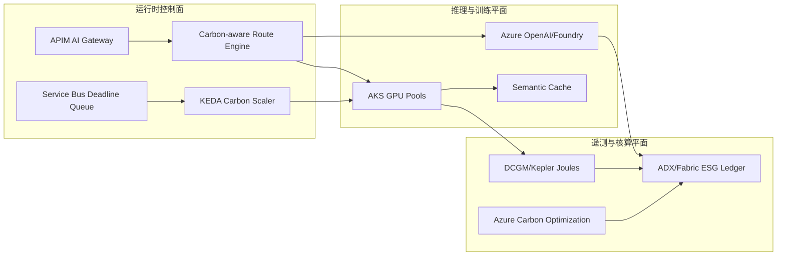
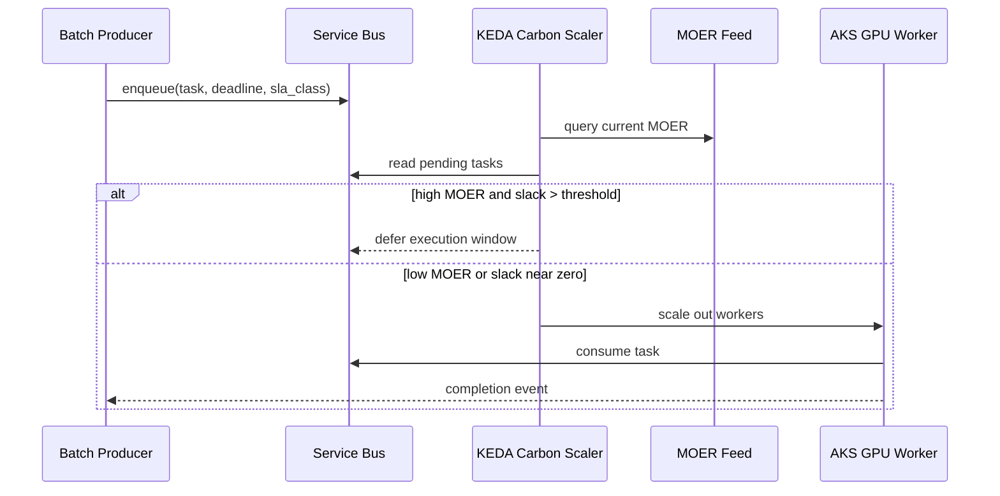

# 企业碳感知 AI GreenOps 选型 FAQ：SCI 计量、APIM 低碳路由、KEDA 碳时移与 Azure 排放账本统一
> 🌐 **Language Switch**: **中文（当前）** | [English](carbon-aware-ai-greenops-sci-apim-grid-routing-vs-keda-carbon-scaler-vs-azure-emissions-selection-faq.en.md)  
> 读者对象：Cloud & AI 首席架构师、FinOps/GreenOps 联合团队、平台 SRE、数据治理与 ESG 审计负责人。  
> 范围：企业 AI 基础设施绿色调度与 SCI 核算，不讨论工业 ESG 业务应用场景实现细节。  
> 目标：在不破坏 SLA 与数据驻留约束前提下，降低 `gCO2eq / task` 与 `$ / task`，形成审计级可追溯账本。  

## 1. 执行摘要：GreenOps 成败取决于“可计算 + 可调度 + 可审计”
多数 AI 平台已做 FinOps。  
但 GreenOps 常停留在口号层。  
根因是缺少统一技术闭环。  
闭环必须包含三个能力。  
第一是可计算。  
即每个任务都能形成 SCI 估算。  
第二是可调度。  
即路由与时移能够落地执行。  
第三是可审计。  
即账本可对齐财务与碳披露口径。  
没有可计算，降碳无法量化。  
没有可调度，指标无法持续改善。  
没有可审计，外部保证无法通过。  
本指南给出四条组合路径。  
路径 A：APIM 空间低碳路由。  
路径 B：KEDA 时域碳时移与闲置 GPU 收敛。  
路径 C：模型级 Pareto 杠杆与缓存协同。  
路径 D：SCI 审计级遥测与月度排放对账。  
四路径联动可在多数企业实现双降。  
即成本和碳排同步下降。  

## 2. 约束条件：低碳不能破坏主权、时延与业务时限
绿色优化不是自由迁移任务。  
企业通常受三类硬约束。  
第一类是数据驻留。  
例如 EU Data Boundary 与 DataZone 范围。  
第二类是服务时延。  
跨区 RTT 不能破坏 `P95` 体验。  
第三类是业务截止时间。  
批处理延迟不能越过法务或财务窗口。  
因此 GreenOps 不能只看最低碳区域。  
必须做多目标约束优化。  
可行策略是先设硬边界。  
再在边界内做碳强度最优。  
边界应以策略代码化表达。  
包括 allowed regions、deadline slack 与 SLO。  
调度器只在可行域内择优。  
这可避免“降碳成功但业务失败”。  

## 3. 四路径定位：把 GreenOps 从报表变成运行时控制
路径 A 面向在线推理流量。  
路径 B 面向可延迟批任务。  
路径 C 面向模型与架构内生效率。  
路径 D 面向核算与合规。  
路径 A 负责“去哪跑”。  
路径 B 负责“何时跑”。  
路径 C 负责“用多大模型跑”。  
路径 D 负责“怎么证明真的降了”。  
单独做 A 会受模型规模掣肘。  
单独做 B 会受在线 SLA 限制。  
单独做 C 会忽略电网碳强度差异。  
单独做 D 只能看到结果，无法干预。  
企业应把四路径视为一个控制系统。  
从路由、时移、模型分层到核算闭环。  
才能形成持续改善飞轮。  

## 4. 十二维对比矩阵：GreenOps 与 FinOps 一体化评审
| 维度 | A APIM 空间低碳路由 | B KEDA 时域碳时移 | C 模型级 Pareto 杠杆 | D SCI 审计账本 |
|---|---|---|---|---|
| 对在线流量价值 | 极高 | 中 | 高 | 中 |
| 对批任务价值 | 中 | 极高 | 高 | 高 |
| SLA 风险 | 中 | 中高 | 低中 | 低 |
| 数据驻留适配性 | 高 | 高 | 高 | 高 |
| 成本下降潜力 | 中高 | 高 | 极高 | 中 |
| 降碳潜力 | 高 | 极高 | 极高 | 中 |
| 可解释性 | 高 | 中高 | 中高 | 极高 |
| 实施复杂度 | 中 | 中高 | 中 | 中 |
| 与现网耦合度 | 中 | 中 | 高 | 中 |
| 运营自动化程度 | 高 | 高 | 中高 | 高 |
| 外部审计友好性 | 中 | 中 | 中 | 极高 |
| 三年 TCO 与碳效收敛 | 高 | 高 | 极高 | 高 |
矩阵应由架构、财务、可持续三方共评。  
避免单一目标主导导致偏差。  
同时保留业务线差异化权重。  

## 5. 路线 A 详解：APIM + Carbon Aware SDK 的空间路由
路线 A 针对在线请求即时决策。  
输入包括区域碳强度与时延估算。  
碳强度可接入 MOER 数据源。  
如 WattTime 或 Electricity Maps。  
路由先过滤不合规区域。  
再过滤超出延迟上限区域。  
最终在可行集合中选最低碳。  
这种策略适用于无状态或弱状态请求。  
对有状态会话需保持会话黏性。  
否则上下文一致性会受损。  
在 DataZone 受限场景中也可生效。  
前提是候选区域在同一主权边界。  
建议把路由权重写入 APIM 策略变量。  
并支持分钟级刷新。  
这样可响应电网实时变化。  

## 6. 路线 B 详解：KEDA 碳时移 + Deadline Slack 控制
路线 B 针对可延迟任务池。  
典型任务包括重嵌入、合规扫描、离线评测。  
任务入队时必须携带截止时间。  
调度器根据 slack 决定是否延后。  
当 MOER 高且 slack 充足时延后执行。  
当 slack 接近耗尽时强制放行。  
这避免长期高碳天气导致 SLA 违约。  
同时可配合闲置节点收敛。  
低负载时合并工作负载并缩容 GPU 池。  
避免 `0%` SM 利用率下静态功耗持续燃烧。  
许多 GPU 在空闲时仍有 `70–120W`。  
持续一夜会形成显著浪费。  
路线 B 的价值在批处理场景尤其明显。  
但要有明确“不可延迟任务白名单”。  

## 7. 路线 C 详解：SLM 级联、FP8 与语义缓存的 Pareto 杠杆
路线 C 不依赖电网波动也能降碳。  
本质是减少每任务算力强度。  
先用 SLM 承接大部分低复杂度步骤。  
仅把复杂步骤升级到 frontier 模型。  
再叠加 FP8 推理和语义缓存命中。  
可显著降低 token 与 GPU 秒。  
在许多企业流程中，`70%` 步骤可下沉。  
这可带来 `65%–85%` 的成本与碳效下降。  
路线 C 的优势是可跨区域稳定收益。  
缺点是需要更强评测治理。  
否则可能引入质量回退。  
建议与路线 D 的评测账本联动。  
将质量损失纳入优化目标。  
避免只看碳而牺牲任务完成率。  

## 8. 路线 D 详解：SCI 审计账本与 Azure 月度排放对账
路线 D 解决“证明问题”。  
实时调度日志只能给出代理指标。  
外部审计需要可追溯主账。  
SCI 公式通常写作 `SCI=((E*I)+M)/R`。  
E 为能耗，I 为碳强度。  
M 为硬件折旧相关体化碳。  
R 为功能单位，例如任务数。  
实时侧可从 DCGM/Kepler 估算能耗。  
月度侧可用 Azure Carbon Optimization 导出。  
两者需在 ADX/Fabric 统一对账。  
同时保留 market-based 与 location-based 口径。  
并按租户与业务单元分摊。  
这能满足 CSRD ESRS E1 的外部保证要求。  
也能支持内部 GreenOps chargeback。  

## 9. 参考架构图：GreenOps 运行时调度与 SCI 账本一体化

该图展示了运行时与核算面的分离。  
两者通过统一账本汇合。  
可实现“边调度边核算”。  

## 10. 时序图：碳时移任务的 deadline-slack 决策过程

核心在于 slack 阈值动态计算。  
它决定降碳与守约的平衡。  
阈值应按任务等级分层配置。  

## 11. 定量问答：架构评审必须回答的八个问题
**Q1：SCI 如何做单任务计算？**  
A1：按 `SCI=((E*I)+M)/R`，例如任务能耗 `0.08kWh`、电网强度 `120g/kWh`、体化碳摊销 `4g`、`R=1`，则 SCI 为 `13.6gCO2eq/task`。  
**Q2：低碳区域与高碳区域差异有多大？**  
A2：若区域 A 约 `20g/kWh`、区域 B 约 `420g/kWh`，同等能耗下理论排放可相差约 `21x`，但需同时校验跨区 RTT 与驻留约束。  
**Q3：为什么闲置 GPU 会成为隐形排放陷阱？**  
A3：节点即使 `0%` 计算利用率也可能持续 `70–120W` 静态功耗，长期保留会累计高碳高成本。  
**Q4：KEDA 碳时移如何避免 SLA 违约？**  
A4：用 `deadline - now` 计算 slack，当 slack 低于保底阈值就强制执行，不再等待低碳窗口。  
**Q5：仅做空间路由是否足够？**  
A5：不够，在线流量可获益，但批任务与模型级效率仍可能主导总排放，需要 A+B+C 联动。  
**Q6：为什么模型分层能同时降碳降本？**  
A6：低复杂步骤下沉到 SLM 与 FP8 后，单位任务 GPU 秒和 token 显著下降，碳强度与成本通常同步下降。  
**Q7：实时排放代理指标和月度账单口径为何会偏差？**  
A7：实时指标基于遥测估算，月度账单包含采购与核算规则差异，需通过统一账本做校正与追溯。  
**Q8：如何在 EU 驻留约束下做碳路由？**  
A8：先限定 EU allowlist 区域，再在列表内按 MOER 与 RTT 计算最优，不允许越界跨主权路由。  
这些问答应写入架构决策记录。  
并由 FinOps 与 ESG 团队共同签字。  

## 12. 生产代码：SCI 计算器与 APIM 区域权重更新器
```python
from dataclasses import dataclass
from typing import Dict


@dataclass
class SciInput:
    energy_kwh: float
    grid_intensity_g_per_kwh: float
    embodied_g: float
    functional_units: float


def calc_sci(inp: SciInput) -> float:
    if inp.functional_units <= 0:
        raise ValueError("functional_units must be > 0")
    return ((inp.energy_kwh * inp.grid_intensity_g_per_kwh) + inp.embodied_g) / inp.functional_units


def compute_region_weights(
    moer: Dict[str, float],
    rtt_ms: Dict[str, int],
    allowlist: set,
    max_rtt_ms: int,
) -> Dict[str, float]:
    candidates = [r for r in moer if r in allowlist and rtt_ms.get(r, 10**9) <= max_rtt_ms]
    if not candidates:
        return {}
    inv = {r: 1.0 / max(moer[r], 1e-6) for r in candidates}
    total = sum(inv.values())
    return {r: round(inv[r] / total, 4) for r in candidates}
```
代码强调先过滤合规和时延约束。  
再基于碳强度生成权重。  
真实生产还需加入故障域与容量约束。  

## 13. 生产 IaC：KEDA 碳时移与 deadline-slack ScaledObject 示例
```yaml
apiVersion: keda.sh/v1alpha1
kind: ScaledObject
metadata:
  name: carbon-aware-batch
  namespace: ai-greenops
spec:
  scaleTargetRef:
    name: batch-worker
  minReplicaCount: 0
  maxReplicaCount: 40
  pollingInterval: 30
  cooldownPeriod: 180
  triggers:
    - type: azure-servicebus
      metadata:
        namespace: aiopsbus
        queueName: carbon-batch
        messageCount: "10"
    - type: prometheus
      metadata:
        serverAddress: http://prometheus.monitoring.svc.cluster.local:9090
        metricName: carbon_deadline_slack_seconds
        threshold: "900"
        query: min(carbon_deadline_slack_seconds{queue="carbon-batch"})
---
apiVersion: apps/v1
kind: Deployment
metadata:
  name: batch-worker
  namespace: ai-greenops
spec:
  replicas: 0
  selector:
    matchLabels:
      app: batch-worker
  template:
    metadata:
      labels:
        app: batch-worker
    spec:
      containers:
        - name: worker
          image: ghcr.io/example/greenops-worker:latest
          env:
            - name: MOER_PROVIDER
              value: electricitymaps
            - name: DEADLINE_GUARD_SECONDS
              value: "900"
```
此配置展示了消息队列与 slack 双触发。  
避免只按队列长度扩容。  
也避免长期等待低碳窗口导致超时。  

## 14. 企业场景与双账本收益：FinOps + GreenOps 一体经营
### 场景 A：欧洲 Tier-1 全能银行的 EU 边界内降碳
该银行月度智能体调用约 `120M` 次。  
必须在 EU 边界内运行。  
银行采用 A 路线在 EU 区域内路由。  
采用 B 路线对离线合规批任务时移。  
采用 C 路线下沉低复杂度步骤。  
采用 D 路线构建审计级 SCI 账本。  
结果是在不越界前提下实现显著降碳。  
且保持客服和交易相关 SLA。  
### 场景 B：全球 CPG 零售企业的 18 BU 联合分摊
该企业希望统一 CFO 与 CSO 口径。  
过去仅有成本分摊没有碳分摊。  
通过 D 路线建立 BU 维度 SCI 账本后。  
可把每千任务成本与碳强度同屏展示。  
并把优化责任下沉到业务单元。  
A/B/C 路线作为运营改进抓手。  
实现“预算与碳预算”双约束运营。  
### FinOps + GreenOps 合并收益表
| 指标 | 基线 | 组合优化后 | 变化 |
|---|---:|---:|---:|
| 每千任务成本 | \$4.80 | \$1.95 | -59% |
| 每千任务排放 | 1.42 kgCO2eq | 0.46 kgCO2eq | -68% |
| 低碳窗口任务占比 | 18% | 63% | +45pp |
| 空闲 GPU 小时/月 | 21,000 | 6,800 | -68% |
| 在线 `P95` 延迟 | 710ms | 735ms | +25ms |
| 截止时间违约率 | 1.8% | 0.4% | -1.4pp |
| 审计追溯完整率 | 64% | 97% | +33pp |
| 业务可接受性 | 波动 | 稳定 | 提升 |
表中延迟轻微上升需提前约定。  
但在 SLA 范围内可接受。  
双降收益通常可覆盖优化投入。  

## 15. Day-0 / Day-2 十二项清单：把 GreenOps 变成可持续运营能力
- 定义数据驻留 allowlist 与跨区 RTT 上限。  
- 在 APIM 策略中落地碳感知权重路由。  
- 为批任务统一注入 deadline 与 SLA 等级。  
- 部署 KEDA slack 感知时移触发器。  
- 设置不可延迟任务白名单与豁免策略。  
- 收敛闲置 GPU 节点并监控静态功耗。  
- 推行 SLM 分层与 FP8 推理策略。  
- 启用语义缓存并观测命中率与质量影响。  
- 建立 DCGM/Kepler 到 ADX 的能耗流水。  
- 对接 Azure Carbon Optimization 月度导出。  
- 维护 market/location 双口径对账流程。  
- 每月召开 FinOps+GreenOps 联合评审会。  
清单覆盖上线与持续运营关键动作。  
执行纪律决定 GreenOps 是否可持续见效。  
建议把每项清单映射到责任人和证据工单。  
例如把路由策略变更与 CAB 审批关联。  
把 KEDA 阈值变更与压测报告关联。  
把 SCI 月度对账与财务结账周期关联。  
把异常偏差告警与复盘模板关联。  
这样可把 GreenOps 从专项活动转为常态运营。  
也能降低人员变化带来的执行波动。  
在组织层面形成“成本-碳排-质量”三维协同机制。  
另外建议建立季度基准重测机制。  
当模型版本、硬件代际或电网结构发生变化时。  
既有碳强度假设可能不再成立。  
应自动触发路由权重与阈值重算。  
并回写到策略仓库形成可审计差异。  
这能防止优化策略在半年后静默失效。  
也能让 GreenOps 与平台演进保持同频。  
对关键模型建议保留“保守档”与“激进档”双策略。  
在突发业务高峰时自动切换保守档保障 SLA。  
在低峰与低碳窗口切回激进档追求最优碳效。  
这类双档策略尤其适合多业务单元共享平台。  
可在不牺牲稳定性的前提下持续推进降碳。  
并让运营团队在同一控制面完成成本与碳排协同优化。  
这也是企业级 GreenOps 可规模复制的关键条件。  
