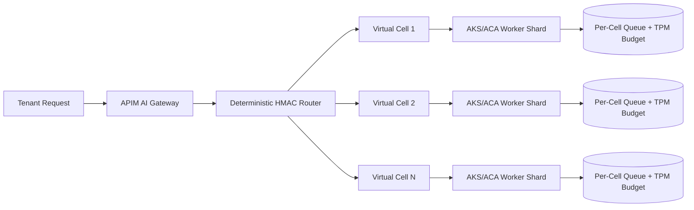
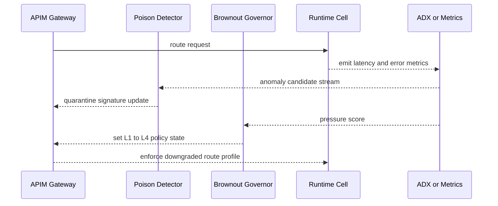

# Enterprise Agent Resilience Selection FAQ: Cell-Based Architecture, Shuffle Sharding, Poison-Pill Containment, and Tiered Graceful Brownout

> **Audience**: Cloud & AI Solution Architects, platform reliability engineers, AI gateway operators, SRE/DevOps leads, and FinOps governance teams.
> **Primary decision**: How to prevent mission-critical multi-tenant AI agent platforms from turning one pathological prompt or MCP payload into a cross-region full outage.

---

## 1. Executive summary (optimize blast-radius control before failover speed)

Naive multi-region failover patterns are dangerous for agentic systems:

- They replicate poison-pill requests across regions.
- They amplify retries through shared queues and homogeneous pools.
- They spread configuration defects globally when release rings are missing.

Recommended architecture options:

- **Route A**: Combinatorial shuffle sharding (`N choose K`) with deterministic APIM tenant routing.
- **Route B**: Shared-nothing deployment stamps with hard control-plane and data-plane boundaries.
- **Route C**: Adaptive multi-stage graceful brownout to preserve Tier-0 SLAs during PTU/GPU stress.
- **Route D**: Homogeneous shared pool with naive health-probe failover (anti-pattern baseline).

Key takeaways:

- With `N=16, K=2`, you get `120` virtual cells and dramatically reduce collateral spread from single-tenant poison events.
- Region failover without shard/stamp isolation can synchronize failure states between regions.
- Brownout should be treated as a **service survivability contract**, not as a generic quality downgrade.

---

## 2. Problem statement and why AI agent platforms are different

Compared with conventional stateless APIs, enterprise agent platforms have stronger amplification factors:

1. **Long-running token-heavy interactions** increase queue and retry pressure.
2. **Tool fan-out orchestration** multiplies downstream failure paths.
3. **Stateful session continuity** allows error signatures to persist and propagate.

Therefore, resilience must be designed at **cell granularity**, not only region granularity.

---

## 3. Route definitions (A/B/C/D)

### Route A — Combinatorial Shuffle Sharding

Core mechanics:

- Deterministic tenant-to-cell routing via HMAC.
- Virtual cell model based on `C(N, K)`.
- Per-cell independent queue, TPM, concurrency, and retry budgets.
- Isolated worker shards on ACA/AKS.

Strengths:

- Strong blast-radius reduction without idle waste of one-dedicated-stamp-per-tenant.

Trade-offs:

- Requires careful shard-capacity and rebalancing strategy.

### Route B — Shared-Nothing Deployment Stamps

Core mechanics:

- Dedicated subscription/RG-scoped stacks per cell.
- APIM + runtime + data stores + model quota scoped per stamp.
- Front Door or global ingress maintains stamp map and ringed rollout.

Strengths:

- Maximum fault-domain and governance clarity.

Trade-offs:

- Higher fixed cost and higher operational surface area.

### Route C — Adaptive Graceful Brownout

Core mechanics:

- Pressure-aware staged degradation:
  - disable deep reflection,
  - route low-priority classes to SLM/async,
  - preserve deterministic Tier-0 transaction path.
- Closed-loop governor via App Configuration + APIM + telemetry signals.

Strengths:

- Preserves core business outcomes during regional model-capacity shortages.

Trade-offs:

- Requires pre-defined UX degradation contracts and policy tuning.

### Route D — Homogeneous Shared Pool + Naive Failover

Characteristics:

- Shared queues and broad retry behavior.
- Region health probe triggers broad reroute.

Outcome:

- High probability of synchronized cross-region incidents under poison-pill and retry storms.

---

## 4. Twelve-dimension architecture comparison

| Dimension | Route A: Shuffle shards | Route B: Stamps | Route C: Brownout | Route D: Naive pool |
|---|---|---|---|---|
| Blast-radius containment | High | Very high | Medium-high | Low |
| Control-plane isolation | Medium | High | Medium | Low |
| Capacity efficiency | High | Medium | High | Medium |
| Poison-pill containment | High | High | Medium | Low |
| Retry-storm suppression | High | High | Medium-high | Low |
| Latency stability | Medium-high | High | Medium | Low |
| Tenant migration complexity | Medium-high | High | Medium | Low |
| Unit-cost flexibility | High | Medium | High | Medium |
| Safe rollout capability | Medium-high | High | Medium-high | Low |
| Audit explainability | High | High | Medium | Low |
| Operations overhead | Medium-high | High | Medium-high | Low-medium |
| Recommendation | default backbone | strict sovereignty or top-tier isolation | mandatory resilience overlay | anti-pattern baseline |

---

## 5. Quantitative model foundations

### 5.1 Virtual cell cardinality

`Cells = C(N, K) = N! / (K! * (N-K)!)`

### 5.2 Same-cell collision approximation

`P_collision ≈ 1 / C(N, K)`

### 5.3 Retry amplification factor

`A_retry = Π_i(1 + p_fail_i * r_i)`

### 5.4 Brownout savings proxy

`Saving_token = (T_base - T_brownout) / T_base`

### 5.5 Ringed deployment risk exposure

`R_ring = Σ_j (Exposure_j * FailureProb_j * Duration_j)`

---

## 6. Q1 — `N choose K` collision math and minimum shard planning for 500–5000 tenants

Example:

- `N=16, K=2`
- `C(16,2)=120`
- `P_collision≈0.83%`

If target is `5000` tenants and you want average occupancy `<=50` tenants per virtual cell:

`Cells_required >= 5000 / 50 = 100`

Then `120` cells provide baseline headroom.

Practical planning ranges:

- `500–1000` tenants: start at `N=12, K=2`
- `1000–3000` tenants: `N=16, K=2`
- `3000–5000` tenants with stricter isolation objective: consider `N=20, K=2` or controlled `K` increase

Capacity caveat:

- Raising `K` increases combinations but can also increase placement complexity and fragmented utilization.

---

## 7. Q2 — Detecting and quarantining poison-pill payloads before cross-region retry cascades

Detection signal patterns:

- High-frequency repeated failure signatures within one tenant or shard.
- Error-cluster separation from baseline traffic success profile.
- Payload-derived feature fingerprints repeatedly correlating with timeout/OOM/parser crashes.

Containment workflow:

1. Generate request signature hash (payload class + tool chain + policy version).
2. Push signature to quarantine set with short TTL and review metadata.
3. Enforce APIM/routing deny-or-degrade policy before global retry fan-out.
4. Route impacted requests to sandbox replay lane for forensic validation.

Expected impact:

- Converts global retry spread into local, controlled rejection/degradation in affected cells.

---

## 8. Q3 — Cell sizing vs stranded PTU/GPU overhead floor

Risk trade-off:

- Cells too small -> strong isolation but poor packing efficiency.
- Cells too large -> better utilization but larger blast radius.

Approximation:

`Overhead_stranded ≈ Σ(max(0, Cap_cell - Load_cell)) / Σ(Cap_cell)`

Mitigation patterns:

- Baseline guaranteed quota + elastic spill pool.
- Priority tenant dual-home strategy with bounded over-provisioning.
- Time-windowed rebalancing using observed per-cell variance.

---

## 9. Q4 — Tenant migration and rebalancing without breaking in-flight stateful sessions

Session-safe migration pattern:

1. Create destination cell mapping and open dual-write session index window.
2. Keep reads sticky to current authoritative session version.
3. Promote new mapping after session checkpoint confirmation.
4. Drain old mapping after inactivity timeout and final checkpoint hash verification.

Invariants:

- Monotonic `session_version`
- Idempotent merge on duplicate writes
- Replay-safe checkpoint lineage with deterministic conflict resolution

---

## 10. Q5 — Four-level graceful brownout savings and UX preservation math

Illustrative levels:

- **L1**: disable expensive reflection/citation expansion.
- **L2**: route low-priority classes to smaller models or constrained context.
- **L3**: defer non-critical paths to async batch.
- **L4**: deterministic rules/cache fallback for Tier-0 transaction path.

Typical effects (example ranges):

- `L1`: token reduction `12–18%`, P95 latency improvement `8–12%`
- `L2`: token reduction `25–35%`, P95 improvement `15–25%`
- `L3`: foreground latency improves `30–45%`, async tail increases
- `L4`: strongest Tier-0 protection; broad UX contraction for non-critical intents

Recommendation:

- Publish explicit brownout UX contracts to customer-facing teams.

---

## 11. Q6 — Ringed deployment bake-time and automated rollback gates

Ring strategy:

- Ring0 internal
- Ring1 low-risk tenants
- Ring2 majority
- Ring3 full fleet

Gates:

- Error-budget burn-rate threshold
- Per-cell repeated failure signature threshold
- p95 latency drift threshold by intent class
- rollback-triggering policy mismatch anomalies

Bake-time guidance:

- High-risk routing/policy changes: `30–60 min` minimum bake in lower ring
- State migration or quota-policy changes: `2–4 h` recommended stabilization window

---

## 12. Mermaid topology — Shuffle-sharded virtual cells



---

## 13. Mermaid sequence — poison-pill quarantine and brownout closed loop



---

## 14. Production code block 1 — deterministic HMAC shuffle-shard router (Python)

```python
import hmac
import hashlib
from itertools import combinations


def virtual_cells(n: int, k: int):
    if k <= 0 or k > n:
        raise ValueError("invalid shard combination")
    return list(combinations(range(n), k))


def tenant_cell(tenant_id: str, secret: str, n: int = 16, k: int = 2):
    cells = virtual_cells(n, k)
    digest = hmac.new(
        secret.encode("utf-8"),
        tenant_id.encode("utf-8"),
        hashlib.sha256,
    ).digest()
    idx = int.from_bytes(digest[:8], "big") % len(cells)
    return cells[idx]


def route_partition_key(tenant_id: str, request_id: str, secret: str):
    c = tenant_cell(tenant_id, secret)
    return f"cell-{c[0]}-{c[1]}::{request_id}"
```

---

## 15. Production code block 2 — closed-loop brownout policy controller (YAML)

```yaml
brownout_controller:
  levels:
    L1:
      disable_reflection: true
      max_response_tokens: 900
    L2:
      route_low_priority_to_slm: true
      max_response_tokens: 600
    L3:
      async_non_critical_work: true
      queue_delay_budget_ms: 5000
    L4:
      deterministic_fallback_only: true
      block_non_tier0_traffic: true
  triggers:
    p95_latency_ms: [2200, 3000, 4200, 6000]
    error_rate_pct: [2.0, 4.0, 7.0, 12.0]
    ptu_saturation_pct: [75, 85, 92, 97]
  rollback_gates:
    repeated_cell_failure_signatures: 3
    error_budget_burn_multiple: 2.0
    policy_version_mismatch_detected: true
```

---

## 16. Enterprise scenario A — multi-tenant B2B customer-service SaaS survives a poison-pill PDF storm

Situation:

- One tenant submits malformed PDF payloads that trigger parser and regex pathological behavior.
- Retries increase rapidly and begin saturating shared pools.

Without cell-based isolation:

- Shared queues propagate failures broadly.
- Cross-region failover duplicates poison requests and accelerates collapse.

With Route A + Route C:

- Poison signatures are quarantined at cell boundary.
- Low-priority intents degrade first; critical ticket and transaction intents are preserved.

Expected outcome:

- Localized tenant impact with globally preserved service continuity.

---

## 17. Enterprise scenario B — retail banking payday peak under 40% regional PTU brownout

Situation:

- Payday traffic surge plus regional PTU degradation.
- Tier-0 operations (balance dispute, payment confirmation) cannot fail.

With Route B + Route C:

- Dedicated stamps isolate critical tenant cohorts and control-plane changes.
- Brownout protects Tier-0 by aggressively reducing high-cost non-critical intent processing.

Expected outcome:

- Zero Tier-0 transaction failures while customer-assist non-critical features degrade gracefully.

---

## 18. Three-year TCO comparison (illustrative)

| Cost category (3 years) | Route A | Route B | Route C | Route D |
|---|---:|---:|---:|---:|
| Runtime and gateway infrastructure | $2.1M | $2.8M | $1.9M | $1.5M |
| Isolation and reserved-capacity overhead | $0.9M | $1.4M | $0.6M | $0.3M |
| Incident response and on-call operations | $0.7M | $0.6M | $0.5M | $1.2M |
| SLA breach and business impact reserve | $0.4M | $0.3M | $0.5M | $1.8M |
| **Total 3-year TCO** | **$4.1M** | **$5.1M** | **$3.5M** | **$4.8M** |

Interpretation:

- Route C often provides the best resilience-per-dollar overlay.
- Route B has the strongest hard-boundary story and often highest baseline cost.
- Route D appears cheap in quiet periods but tends to create higher systemic incident losses.

---

## 19. Day-0 / Day-1 / Day-2 implementation checklist

### Day-0 (design)

- Define Tier-0/Tier-1/Tier-2 business criticality classes.
- Choose `N/K` and acceptable collision threshold.
- Define retry budget, quarantine thresholds, and brownout level gates.

### Day-1 (controlled rollout)

- Enable deterministic tenant routing and per-cell quotas.
- Activate poison-signature quarantine path and replay lane.
- Enforce ringed deployment gates and automatic rollback criteria.

### Day-2 (scale operations)

- Run periodic tenant rebalancing and stranded-capacity optimization.
- Regression-test brownout policy against peak-load and failure drills.
- Publish per-cell reliability and cost scorecards.

---

## 20. Five-step selection method (Good fit vs Not for)

1. **Classify business criticality before architecture**.
2. **Contain blast radius before adding global failover**.
3. **Govern retry amplification with strict budgets**.
4. **Preserve Tier-0 outcomes through explicit brownout levels**.
5. **Require replayable evidence for every major resilience decision**.

**Good fit**:

- Multi-tenant SaaS agent platforms, regulated customer operations, and high-throughput cross-region systems.

**Not for**:

- Low-throughput, single-tenant internal tools with no strict continuity requirements.

---

## 21. Final recommendation

- Use **Route A + Route C** as a default architecture backbone for most enterprise multi-tenant agent platforms.
- Add **Route B** where strict tenant or regulatory isolation demands hard stamp boundaries.
- Keep **Route D** as anti-pattern baseline only, to quantify the risk of doing nothing.

---

## 22. Anti-pattern checklist (must be removed pre-production)

1. Global shared retry queue with no per-cell retry budget.
2. Region-level health probing without payload-pattern quarantine.
3. Full-fleet rollout without ringed bake windows.
4. No criticality-aware brownout policy.
5. No evidence replay path for quarantine and rollback decisions.

---

## 23. Source and data-label note

This document is an architecture-selection guide. Quantitative values are for engineering estimation and route comparison and must be recalibrated with internal measurements.

- Azure APIM, Front Door, deployment stamp guidance, AKS/ACA runtime docs, App Configuration, and ADX/monitoring references: retrieved `2026-11-15`.
- Public engineering materials on multi-tenant cell isolation and shuffle-sharding patterns: retrieved `2026-11-15`.
- Example cost/probability values in this FAQ are tagged as `anonymized_reported`.

---

## 24. Operational evidence pack recommendations

For each incident drill or real event, archive:

- route decision context and policy versions,
- cell map and tenant placement snapshot,
- poison-signature quarantine actions and release criteria,
- brownout level transitions with timestamps,
- rollback actions and ring promotion state,
- business KPI impact by criticality class.

This evidence pack should be exportable in one workflow so post-incident arbitration is deterministic and fast.
