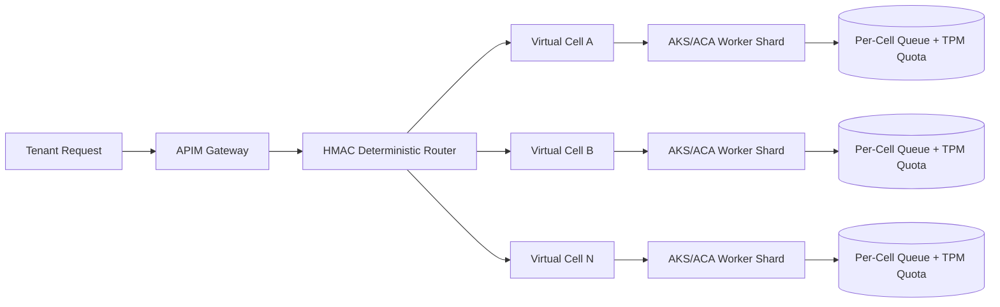
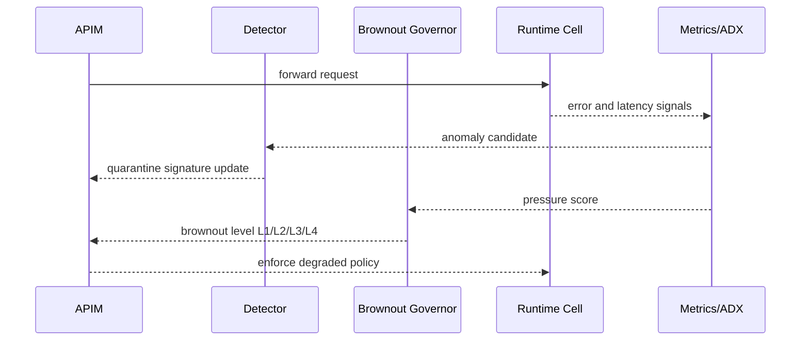

# 企业级 Agent 韧性选型 FAQ：Cell-Based + Shuffle Sharding + 渐进式 Brownout（APIM 分片路由、Deployment Stamps 与重试风暴遏制）

> **适用对象**：Cloud & AI Solution Architect、平台稳定性负责人、SRE/DevOps、AI Gateway 运营与 FinOps 团队。
> **核心问题**：当多租户 Agent 平台遇到毒丸请求（Poison-Pill Prompt/MCP Payload）与跨区域重试放大时，如何避免“全区域同时雪崩”并保住 Tier-0 业务 SLA。

---

## 1. 执行摘要（从“故障可控性”而不是“可用区数量”开始）

传统“多区域健康探针+全量切流”在 AI Agent 平台中常失效：

- 毒丸请求会被健康重试策略复制到所有区域。
- 上游统一队列导致重试风暴跨区域放大。
- 控制平面变更若无分环发布，会把错误配置同时扩散到全局。

推荐路线：

- **Route A：Combinatorial Shuffle Sharding**（`N choose K` 虚拟 Cell）
- **Route B：Shared-Nothing Deployment Stamps**（订阅/资源组级硬隔离）
- **Route C：Adaptive Graceful Brownout**（四级降级保护 Tier-0）
- **Route D：共享池+朴素跨区故障转移反模式**（用于边界分析）

关键结论：

- `N=16, K=2` 可形成 `120` 虚拟 Cell，单租户毒丸请求的碰撞外溢面可由“全局”压缩至近似 `0.83%` 量级。
- 仅做跨区域健康切流而不做 shard/stamp 隔离时，双区同时退化概率会被重试自激显著放大。
- Brownout 不是降体验，而是“分层保命”：优先保护交易与核心提交路径。

---

## 2. 问题定义：为什么 AI Agent 平台更容易出现级联故障

与传统 API 平台相比，Agent 平台具备三种放大器：

1. **高 token/高延迟调用链**：单请求占用时间长，排队与重试更易堆积。
2. **工具编排 fan-out**：一次对话可能触发多个 MCP/HTTP 下游。
3. **多轮状态关联**：会话状态跨请求复用，错误会“带状态传播”。

因此，韧性设计要从“区域级可用”升级到“Cell 级故障封装”。

---

## 3. 四条架构路线定义

### Route A：Combinatorial Shuffle Sharding（APIM 确定性租户 HMAC 路由）

核心机制：

- 用租户标识做 HMAC，确定性映射到 `K` 个 shard 组合。
- 每组合对应独立限额（队列、TPM、并发、重试预算）。
- 在 ACA/AKS Worker 侧实现隔离执行池。

优点：

- 在不必为每租户准备专属 stamp 的前提下，大幅缩小爆炸半径。

约束：

- 需要严谨的 shard 容量建模与迁移策略。

### Route B：Shared-Nothing Deployment Stamps

核心机制：

- 每个 Cell 拥有独立订阅/资源组级资源：APIM、AKS/ACA、Cosmos、PTU。
- 通过 Front Door/全局入口维护 cell map 与 ringed 部署控制。

优点：

- 控制平面与数据平面边界最清晰，故障域最容易解释。

约束：

- 资源冗余与运维复杂度较高。

### Route C：Adaptive Graceful Brownout

核心机制：

- 依据实时压力信号自动降级（关闭深反思、降级 SLM、异步化低优先级）。
- 用 App Configuration + APIM + Prometheus/ADX 闭环调节。

优点：

- 在区域 PTU/GPU 短缺时保持关键交易成功率。

约束：

- 需提前定义分层服务目标与降级 UX 策略。

### Route D：共享区域池 + 朴素健康探针切流

特征：

- 单一共享队列，无 shard 隔离。
- 失败即全量跨区重试。

结论：

- 容易形成“毒丸复制 + 重试风暴 + 双区同步失效”的反模式。

---

## 4. 12 维度路线对比矩阵

| 维度 | Route A Shuffle | Route B Stamps | Route C Brownout | Route D Naive Failover |
|---|---|---|---|---|
| 爆炸半径控制 | 高 | 极高 | 中高 | 低 |
| 控制平面隔离 | 中 | 高 | 中 | 低 |
| 资源利用率 | 高 | 中 | 高 | 中 |
| 毒丸隔离能力 | 高 | 高 | 中 | 低 |
| 重试风暴抑制 | 高 | 高 | 中高 | 低 |
| 延迟稳定性 | 中高 | 高 | 中 | 低 |
| 迁移复杂度 | 中高 | 高 | 中 | 低 |
| 成本可控性 | 高 | 中 | 高 | 中 |
| 部署安全性 | 中高 | 高 | 中高 | 低 |
| 审计可解释性 | 高 | 高 | 中 | 低 |
| 运维复杂度 | 中高 | 高 | 中高 | 低中 |
| 推荐结论 | 默认首选 | 超高隔离组织 | 压力保护必备叠加 | 仅限反模式基线 |

---

## 5. 数学基线与容量定义

### 5.1 虚拟 Cell 数量

`Cells = C(N, K) = N! / (K! * (N-K)!)`

### 5.2 碰撞概率近似

当某租户落入特定组合后，另一个随机租户与其完全同组合的近似概率：

`P_collision ≈ 1 / C(N, K)`

### 5.3 重试放大系数

`A_retry = Π_i(1 + p_fail_i * r_i)`

### 5.4 Brownout 成本收益

`Saving_token = (T_base - T_brownout) / T_base`

---

## 6. Q1：`N choose K` 冲突概率与 500~5000 租户最小分片建议

示例：

- `N=16, K=2`，`C(16,2)=120`
- `P_collision≈0.83%`

若目标是 `5000` 租户，且每虚拟 Cell 希望平均承载 `<=50` 租户：

`Cells_required >= 5000 / 50 = 100`

则 `N=16,K=2` 的 `120` Cell 可满足基础密度目标。

建议：

- 小规模（500~1000）可从 `N=12,K=2` 起步；
- 中大规模（2000~5000）优先 `N=16,K=2` 或 `N=20,K=2`；
- 若追求更强隔离，可提升 `K`，但要同步评估容量碎片化。

---

## 7. Q2：毒丸检测与自动隔离如何先于跨区重试放大

关键目标：在触发跨区重试前，判定“是否应隔离而非重试”。

判定信号：

- 同租户/同请求签名在短窗口内重复触发异常；
- 错误簇集中在同类 payload 模式；
- 正常流量成功率与该簇请求成功率显著分离。

隔离策略：

- 把疑似毒丸签名放入 quarantine keyset；
- 同步下发 APIM 策略阻断/降级；
- 仅允许人工审批或沙箱再验证后恢复。

收益：

- 使 `A_retry` 从“跨区放大”变为“单 Cell 局部吸收”。

---

## 8. Q3：Cell 容量与 PTU/GPU 资源搁浅下限

当 Cell 太细时，容量碎片化增大；太粗时，爆炸半径变大。

可用近似：

`Overhead_stranded ≈ Σ(max(0, Cap_cell - Load_cell)) / Σ(Cap_cell)`

经验做法：

- 通过“基础保底 + 弹性共享池”降低搁浅；
- 关键租户固定双活 Cell，一般租户走 shuffle；
- 用夜间离线重平衡降低长尾空置率。

---

## 9. Q4：不中断会话的租户迁移与重平衡

挑战：

- 多轮对话含状态，直接切 shard 会导致上下文断裂。

方案：

1. 新旧 Cell 双写会话索引（短窗口）。
2. 只读查询优先新 Cell，写入带版本戳。
3. 会话自然结束后逐步回收旧映射。

一致性约束：

- `session_version` 单调递增；
- 冲突写入以高版本为准并记录审计差异。

---

## 10. Q5：四级 Brownout 的 token/延迟节省与体验保护

四级策略示例：

- **L1**：关闭深反思与冗余引用整理；
- **L2**：低优先级改走 SLM/短上下文；
- **L3**：非关键请求异步化；
- **L4**：规则/缓存兜底，仅保交易主路径。

量化：

- `L1`：token 下降 12%~18%，P95 改善 8%~12%
- `L2`：token 下降 25%~35%，P95 改善 15%~25%
- `L3`：前台延迟下降 30%~45%，但异步尾部增长
- `L4`：Tier-0 成功率保护优先，体验功能明显收缩

---

## 11. Q6：分环发布 bake-time 与自动回滚门禁

分环策略：

- Ring0（内部/灰度）-> Ring1（低风险租户）-> Ring2（主流）-> Ring3（全量）

门禁建议：

- 错误预算消耗速率超阈值即暂停推进；
- 某 Cell 出现重复失败签名即局部回滚；
- 仅在连续稳定窗口后再晋级下一环。

Bake-time 建议：

- 高风险变更最短 `30~60 min`；
- 涉及路由/鉴权/状态迁移策略变更建议 `2~4 h`。

---

## 12. Mermaid：Cell + Shuffle 路由拓扑



---

## 13. Mermaid：毒丸隔离与 Brownout 闭环



---

## 14. 生产代码片段 1：确定性 HMAC Shuffle Router（Python）

```python
import hmac
import hashlib
from itertools import combinations


def pick_virtual_cell(tenant_id: str, secret: str, n: int = 16, k: int = 2):
    shards = list(range(n))
    cells = list(combinations(shards, k))
    digest = hmac.new(secret.encode("utf-8"), tenant_id.encode("utf-8"), hashlib.sha256).digest()
    idx = int.from_bytes(digest[:8], "big") % len(cells)
    return cells[idx]  # e.g., (3, 11)


def route_key(tenant_id: str, request_id: str, secret: str):
    cell = pick_virtual_cell(tenant_id, secret)
    return f"cell-{cell[0]}-{cell[1]}::{request_id}"
```

---

## 15. 生产代码片段 2：Brownout 策略控制器（YAML）

```yaml
brownoutPolicy:
  levels:
    L1:
      disableDeepReflection: true
      maxResponseTokens: 900
    L2:
      routeLowPriorityToSlm: true
      maxResponseTokens: 600
    L3:
      asyncNonCriticalTasks: true
      queueDelayBudgetMs: 5000
    L4:
      deterministicFallbackOnly: true
      blockNonTier0Traffic: true
  triggers:
    p95LatencyMs: [2200, 3000, 4200, 6000]
    errorRatePct: [2.0, 4.0, 7.0, 12.0]
    ptuSaturationPct: [75, 85, 92, 97]
```

---

## 16. 企业场景 A：多租户 B2B 客服 SaaS 抗毒丸风暴

场景：

- 某租户上传异常 PDF，触发解析器正则灾难回溯，随后请求重试爆发。

若无隔离：

- 共享池重试会把异常复制到跨区，导致整体吞吐崩溃。

采用 Route A + C：

- 异常被限制在对应虚拟 Cell。
- Brownout 自动把非关键请求降级，保护核心工单提交链路。

结果目标：

- 全局可用性保持，受影响租户局部降级可控。

---

## 17. 企业场景 B：零售银行发薪日高峰 + 区域 PTU 40% Brownout

场景：

- 月末发薪日，交易咨询与争议处理同时激增；
- 单区域 PTU 可用容量瞬时下降 40%。

采用 Route B + C：

- 关键租户落在独立 Stamp，控制平面分环发布。
- Brownout 先压缩高 token 非关键问答，再保障 Tier-0 交易确认路径。

目标：

- Tier-0 交易失败率不升高，低优先级功能可见降级但服务不断。

---

## 18. 三年 TCO 对比（示例）

| 成本项（3y） | Route A | Route B | Route C | Route D |
|---|---:|---:|---:|---:|
| 运行时与网关基础设施 | $2.1M | $2.8M | $1.9M | $1.5M |
| 容量冗余与隔离开销 | $0.9M | $1.4M | $0.6M | $0.3M |
| 事故与值班运营 | $0.7M | $0.6M | $0.5M | $1.2M |
| SLO 违约与业务损失 | $0.4M | $0.3M | $0.5M | $1.8M |
| **总计（3y）** | **$4.1M** | **$5.1M** | **$3.5M** | **$4.8M** |

解读：

- Route C 常作为“弹性收益最高”的保护层，建议与 A/B 叠加。
- Route B 成本较高但隔离解释最直接。
- Route D 在规模增长后事故成本上升明显。

---

## 19. Day-0 / Day-1 / Day-2 落地清单

### Day-0（设计与约束）

- 明确定义 Tier-0/Tier-1/Tier-2 业务分级。
- 选定 `N/K` 组合与目标碰撞概率。
- 设定重试预算、隔离阈值与 Brownout 触发条件。

### Day-1（灰度上线）

- 开启 APIM 确定性路由与 per-cell 配额。
- 建立毒丸签名隔离通道与审计回放。
- 启用 ringed 部署与自动回滚门禁。

### Day-2（规模化）

- 周期性租户重平衡与容量碎片治理。
- Brownout 策略按场景压测回归。
- 建立按 Cell 的成本/可靠性双维度看板。

---

## 20. 五步选型与 Good fit / Not for

1. **先分级再路由**：先定义业务关键性，再定义隔离与降级路径。
2. **先控制爆炸半径**：没有 Cell 隔离，不要谈全局故障转移。
3. **先抑制重试放大**：重试必须受预算与隔离控制。
4. **先保 Tier-0**：Brownout 目标是“保交易主链路”。
5. **先证据后扩容**：每次事故演练都要可回放可审计。

**Good fit**：

- 多租户 SaaS Agent 平台、金融/客服核心链路、跨区域高并发系统。

**Not for**：

- 单租户、低并发、无跨区域容灾需求的简单内部工具。

---

## 21. 最终建议

- 默认建议 **Route A + Route C** 组合：既有隔离又有压力保护。
- 超高监管或超大客户可叠加 **Route B** 做硬边界 stamp。
- **Route D** 仅作为反模式基线，用于解释“为什么必须做 Cell 化与 Brownout”。

---

## 22. 反模式清单（必须提前清除）

1. **全局共享重试队列**：任何单租户异常都可扩散为全局拥塞。
2. **只看区域健康不看请求模式**：把毒丸当瞬时故障处理会触发跨区传播。
3. **发布不分环**：错误策略会在分钟级扩散到全部租户。
4. **无等级降级策略**：压力上来只能“全功能一起慢”。
5. **无证据回放链路**：事故后无法解释“为何误放行/误隔离”。

---

## 23. 来源与数据标签说明

> 本文为企业架构选型方法文档，定量公式与成本值用于工程估算与路线比较，需以组织压测和账单数据复算。

- Azure APIM、Azure Front Door、Deployment Stamps、AKS/ACA、App Configuration、Monitor/ADX 官方文档：访问日期 `2026-11-15`。
- 多租户隔离与 Shuffle Sharding 通用工程模式：公开工程实践资料，访问日期 `2026-11-15`。
- 本文示例成本与概率演算标签：`anonymized_reported`。
- 建议在组织内把每次压测参数、故障注入脚本与回滚证据统一归档到同一治理仓，确保审计可复现。

