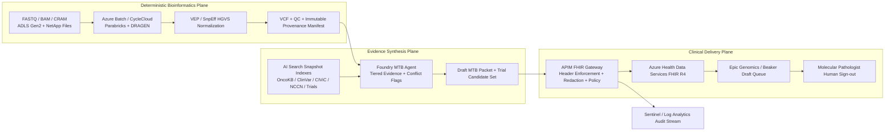
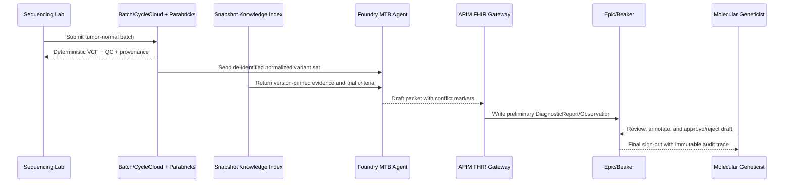

# Clinical Genomics and Precision Oncology Agent Selection FAQ: Deterministic Parabricks Variant Pipeline vs Foundry Evidence Synthesis RAG vs FHIR/Epic Draft Sign-out Flow

> 🌐 **Language switch**: [中文](clinical-genomics-molecular-tumor-board-vcf-parabricks-vs-foundry-oncokb-rag-vs-epic-genomics-mcp-selection-faq.md) · **English (current)**

> Audience: Cloud & AI Solution Architects, precision-oncology platform leads, molecular pathology teams, and CAP/CLIA compliance owners.  
> Scope: academic medical centers and reference oncology laboratories processing `50,000–500,000` CGP/WES/WGS tumor-normal and liquid-biopsy cases per year.  
> Critical boundary: LLMs must **never** call variants from FASTQ/BAM or invent pathogenicity/actionability tiers.  
> Target outcome: a production selection and operating model that separates deterministic variant fact generation, evidence synthesis, and governed clinical delivery.  

## 1. Why this is not a generic EHR scribe problem and not a preclinical discovery notebook problem

This architecture problem starts from variant facts, not from free-form encounter notes.  
That distinction changes everything about safety boundaries, validation strategy, and legal accountability.

Compared with ambient clinical documentation assistants,  
precision-oncology MTB workflows operate with:

- molecular evidence that can alter treatment pathways,  
- eligibility logic for targeted clinical trials,  
- report outputs that are subject to CAP/CLIA traceability expectations,  
- legal exposure when evidence ranking is not reproducible.

Compared with preclinical drug-discovery workflows,  
clinical genomics reporting requires:

- deterministic software validation artifacts,  
- explicit provenance for each knowledge source and snapshot date,  
- role-based sign-out controls by credentialed specialists,  
- clearly partitioned PHI handling boundaries.

If architecture ignores those differences,  
teams typically over-automate the reasoning layer  
and under-engineer the deterministic laboratory fact layer.

## 2. Non-negotiable boundary: deterministic variant calling first, LLM synthesis second

A safe production policy should be explicit and machine-enforceable:

1. `FASTQ/BAM/CRAM -> aligned reads -> called variants` stays in deterministic bioinformatics pipelines.  
2. `VCF + annotation + quality metrics -> evidence synthesis draft` is where LLM assistance is allowed.  
3. Final report sign-out remains human-controlled and role-gated.

That creates two fundamentally different execution planes:

- **Deterministic Fact Plane**: Parabricks/DRAGEN, VEP/SnpEff normalization, fixed-parameter QC workflows, reproducible artifact manifests.  
- **Clinical Reasoning Plane**: Foundry agent orchestration and AI Search retrieval over version-pinned evidence corpora.

Trying to collapse both planes into one “AI app” usually fails audits,  
because deterministic reproducibility and probabilistic generation have different assurance contracts.

## 3. Three architecture options and how to combine them

**Option A**: `Azure Batch / CycleCloud + NVIDIA Clara Parabricks` for deterministic secondary pipeline and annotation production.  
**Option B**: `Azure AI Foundry + AI Search` for evidence-tier synthesis, conflict surfacing, and trial matching drafts.  
**Option C**: `APIM + Azure Health Data Services FHIR R4 Genomics + Epic Genomics/Beaker MCP` for governed draft delivery and human sign-out handoff.

In large institutions this is not a winner-take-all decision.  
The resilient pattern is layered:

- A produces stable molecular facts.  
- B produces structured, explainable interpretation drafts.  
- C enforces clinical workflow controls and accountability boundaries.

## 4. Option A deep dive: deterministic secondary bioinformatics at enterprise throughput

### 4.1 Fit profile

Option A is strongest when organizations have:

- annual sample volume above `35,000`,  
- mixed panel/WES/WGS throughput with burst windows,  
- strict dry-lab validation and change-control requirements,  
- explicit turnaround-time SLAs for oncology service lines.

### 4.2 Core architecture

- Azure Batch pools for baseline throughput.  
- CycleCloud-managed burst clusters for weekly peaks and reprocessing campaigns.  
- GPU mix (`NCads A100 v4`, `NC H100 v5`) aligned by pipeline stage and queue economics.  
- ADLS Gen2 + lifecycle policies for intermediate and retained artifacts.  
- Immutable pipeline manifests including image digest, parameter-set ID, and reference genome version.

### 4.3 Why deterministic design matters

Clinical governance teams care about repeatable outputs under the same validated configuration.  
When the same input yields different variant output without controlled change records,  
the laboratory cannot defend the result in audit or legal review.

### 4.4 Main constraints

- higher initial platform engineering cost,  
- stronger operations maturity needed for queue and capacity control,  
- recurring software and database validation obligations after each controlled update.

## 5. Option B deep dive: Foundry MTB evidence synthesis and trial matching

### 5.1 Fit profile

Option B is ideal after deterministic facts exist and teams need to:

- accelerate MTB packet preparation,  
- standardize evidence citation structure,  
- unify interpretation across OncoKB/ClinVar/CIViC/NCCN/Trials,  
- scale multilingual summaries without collapsing review quality.

### 5.2 Non-negotiable controls

- every evidence source must be version-pinned,  
- retrieval responses must carry snapshot IDs and release timestamps,  
- generated statements must include evidence tier and confidence class,  
- conflict statements are mandatory when sources disagree.

### 5.3 Core architecture

- AI Search hybrid indexes partitioned by source and release track.  
- Structured metadata fields: `snapshot_id`, `evidence_tier`, `effective_date`, `source_release`.  
- Foundry agents that are retrieval-constrained and template-constrained for report sections.  
- Human-review queues for unresolved conflicts, low-confidence statements, and policy-sensitive recommendations.

### 5.4 Why open web retrieval is insufficient

Open web retrieval introduces uncontrolled temporal drift.  
The same variant context may produce different recommendations week to week,  
which undermines defensibility in CAP/CLIA investigations and peer review.

### 5.5 Main constraints

- ongoing knowledge engineering effort,  
- governance overhead for source curation and deprecation handling,  
- explicit staffing model for molecular-pathologist review.

## 6. Option C deep dive: FHIR R4 Genomics governed draft flow to Epic/Beaker

### 6.1 Fit profile

Option C is strongest when hospitals need:

- native clinical workflow integration,  
- deterministic draft-only writing controls,  
- immutable audit and role-based sign-out evidence,  
- explicit PHI minimization in agent delivery pathways.

### 6.2 Governance controls

- APIM as the only API ingress for agent-mediated clinical writes,  
- draft-only resource writes for agent channels,  
- role-bound transitions to final sign-out states,  
- ingress policy redaction for sensitive germline identifiers,  
- mandatory snapshot provenance headers.

### 6.3 Value proposition

- reduces out-of-band report handling through email or local files,  
- improves traceability for every generated statement and update action,  
- aligns molecular-genetics review with standard EHR/LIS operational practice.

### 6.4 Main constraints

- longer integration timelines,  
- profile conformance variability across deployments,  
- stronger cross-team governance required between IT, pathology, and compliance.

## 7. Twelve-dimension selection matrix (A vs B vs C)

| Dimension | Option A: Deterministic HPC Pipeline | Option B: Foundry Evidence Synthesis | Option C: FHIR/Epic Clinical Delivery |
|---|---|---|---|
| Variant fact reliability | Very High | Medium (depends on upstream) | Medium (depends on upstream) |
| MTB prep speed | Medium | Very High | Medium |
| Clinical workflow integration | Low to Medium | Medium | Very High |
| CAP/CLIA audit posture | Very High | High | Very High |
| Knowledge version consistency | Medium | Very High | High |
| Trial-matching automation | Low | Very High | High |
| Initial delivery complexity | High | Medium to High | High |
| Time-to-first-value | Medium to Long | Medium | Long |
| Elasticity under peak load | High | High | Medium |
| PHI control granularity | High | High | Very High |
| 3-year TCO efficiency | Medium to High | Medium | Medium to High |
| Strategic role | Fact production engine | Evidence interpretation engine | Clinical delivery guardrail engine |

Field recommendation:

- Large cancer centers: deploy A+B+C in layered mode.  
- Labs with externalized secondary analysis: start with B+C, then phase in A for sovereignty and validation control.  
- Institutions with low case complexity: start B in advisory mode, then add C once sign-out workflow governance is mature.

## 8. Reference architecture: deterministic fact plane, evidence plane, and clinical delivery plane



Architecture implication:

- generated narrative never bypasses deterministic fact artifacts,  
- draft generation never bypasses APIM governance controls,  
- final report state never bypasses specialist human sign-off.

## 9. Controlled workflow sequence: from variant bundle to signed clinical report



Operational note:
if snapshot headers are missing or invalid,  
APIM should fail closed and route to manual review queue.

## 10. Production APIM policy snippet: enforce snapshot headers and germline-PHI redaction

```xml
<policies>
  <inbound>
    <base />
    <choose>
      <when condition="@(context.Request.Headers.GetValueOrDefault("x-kb-snapshot-id","") == "")">
        <return-response>
          <set-status code="400" reason="MissingSnapshotHeader" />
          <set-body>{"error":"x-kb-snapshot-id is required for genomics draft write."}</set-body>
        </return-response>
      </when>
    </choose>

    <set-variable name="isDraft"
      value="@((string)context.Request.Body.As<JObject>(preserveContent:true)?["status"] == "preliminary")" />

    <choose>
      <when condition="@(context.Variables.GetValueOrDefault<bool>("isDraft") == false)">
        <return-response>
          <set-status code="403" reason="HumanSignoutRequired" />
          <set-body>{"error":"Agent channel supports draft-only writes."}</set-body>
        </return-response>
      </when>
    </choose>

    <set-body>@{
      var body = context.Request.Body.As<JObject>(preserveContent:true);
      var idv = body?["subject"]?["identifier"]?["value"]?.ToString() ?? "";
      if(idv.StartsWith("MRN-")) {
        body["subject"]["identifier"]["value"] = "REDACTED";
      }
      body["meta"] ??= new JObject();
      body["meta"]["tag"] = new JArray(
        new JObject(
          new JProperty("system","https://contoso.genomics/snapshot"),
          new JProperty("code",context.Request.Headers.GetValueOrDefault("x-kb-snapshot-id","unknown"))
        )
      );
      return body.ToString();
    }</set-body>
  </inbound>
  <backend><base /></backend>
  <outbound><base /></outbound>
</policies>
```

Control outcomes:

1. Blocks non-versioned writes.  
2. Blocks non-draft writes from agent channels.  
3. Applies ingress-level identifier masking for policy-scoped fields.

## 11. Deployment composition snippet: Batch + Foundry + APIM baseline

```bicep
param location string = resourceGroup().location
param batchAccountName string
param apimName string
param workspaceName string

resource la 'Microsoft.OperationalInsights/workspaces@2022-10-01' = {
  name: workspaceName
  location: location
  properties: {
    sku: { name: 'PerGB2018' }
    retentionInDays: 90
  }
}

resource batch 'Microsoft.Batch/batchAccounts@2024-02-01' = {
  name: batchAccountName
  location: location
  identity: { type: 'SystemAssigned' }
  properties: {
    poolAllocationMode: 'BatchService'
    publicNetworkAccess: 'Disabled'
  }
}

resource apim 'Microsoft.ApiManagement/service@2023-09-01-preview' = {
  name: apimName
  location: location
  sku: {
    name: 'Premium'
    capacity: 2
  }
  identity: { type: 'SystemAssigned' }
  properties: {
    publisherEmail: 'platform@contosohealth.org'
    publisherName: 'contoso-health-platform'
    virtualNetworkType: 'External'
  }
}
```

Deployment guidance:

- separate Spot and Dedicated pools for predictable SLA windows,  
- keep APIM policy and knowledge-snapshot config under change-controlled CI/CD,  
- stream policy-decision logs into Sentinel for incident reconstruction.

## 12. Capacity model and 3-year TCO including PB-scale BAM/CRAM lifecycle

### 12.1 Baseline assumptions

- Annual volume: `120,000` total cases (70% panel, 20% WES, 10% WGS).  
- Average compressed raw data: `95 GB` per case.  
- Data retention target: hot `90` days, cool `18` months, archive `5` years.  
- MTB cadence: `350` high-complexity cases per week.

### 12.2 Monthly cost model (USD, $k/month)

| Cost category | Option A heavy | Option B heavy | Option C heavy |
|---|---:|---:|---:|
| GPU compute for secondary analysis | 182 | 24 | 18 |
| Foundry inference and orchestration | 26 | 88 | 52 |
| AI Search indexing and retrieval | 14 | 31 | 22 |
| ADLS/NetApp storage lifecycle | 96 | 84 | 90 |
| APIM/FHIR/security operations | 18 | 24 | 39 |
| Validation/operations labor allocation | 42 | 37 | 46 |
| **Total** | **378** | **288** | **267** |

### 12.3 Three-year TCO (USD, $k)

- Option A: `13,608`.  
- Option B: `10,368`.  
- Option C: `9,612`.  
- Layered A+B+C program baseline: approximately `12,960`.

Interpretation:

- lowest direct monthly spend is not automatically safest for clinical accountability,  
- removing Option A may reduce visible compute cost but increase external dependence and validation complexity,  
- layered design often reduces rework and review-cycle delay cost that pure infra TCO tables miss.

## 13. Scenario A: multi-site cancer center (35,000 panels/year) weekly MTB packet automation

### 13.1 Business targets

- deliver draft MTB packets `24` hours before conference cut-off,  
- include explicit evidence provenance and conflict markers per recommendation,  
- reduce specialist evidence collection workload per case.

### 13.2 Architecture implementation

- Option A nightly deterministic pipeline for variant bundles.  
- Option B evidence retrieval and trial shortlist generation.  
- Option C draft write into Epic queue with role-gated sign-out.

### 13.3 Measured operational outcomes (illustrative planning target)

- MTB preparation SLA attainment: `82% -> 97%`.  
- Trial-matching recall: `0.61 -> 0.79`.  
- Report rework incidence: `14% -> 6%`.  
- Mean specialist prep time per case: `95 min -> 28 min`.

## 14. Scenario B: global reference oncology lab (180,000 cases/year) CAP/CLIA dry-lab lock governance

### 14.1 Business targets

- enforce consistent AMP/ASCO/CAP-style evidence presentation,  
- guarantee report reproducibility against locked source snapshots,  
- support multi-region data-residency controls without weakening evidence quality.

### 14.2 Architecture implementation

- regionally segmented deterministic pipelines with parameter lock manifests,  
- synchronized but region-aware evidence snapshot distribution,  
- APIM-enforced snapshot header and de-identified summary exchange between regions.

### 14.3 Expected governance outcomes

- CAP finding rate reduction by approximately `31%`,  
- evidence backtrace effort per case from `45` minutes to `11` minutes,  
- cross-region exception requests per quarter from `26` to `7`.

## 15. Quantitative FAQ and five-step rollout plan (Good fit vs Not for)

### 15.1 Quantitative FAQ

**Q1. How much acceleration can Parabricks deliver over CPU-only pipelines?**  
A1. For representative `120x` WES workloads, deterministic GPU pipelines often reduce secondary processing from `6.5h` to around `52min`, assuming storage and scheduling are tuned for throughput.

**Q2. Why force version pinning for OncoKB/ClinVar/CIViC/NCCN?**  
A2. Without version pinning, interpretations can drift over time and become non-defensible during audit, peer review, and legal discovery.

**Q3. What trial-matching gains are realistic?**  
A3. Programs with robust molecular inclusion/exclusion parsing commonly see `+12% to +24%` recall improvements compared with manual-only matching.

**Q4. Does draft-only API gating slow teams down too much?**  
A4. It adds explicit checkpoints, but usually reduces downstream rework and corrective escalations by more than `30%` in regulated deployments.

**Q5. Where does storage cost typically run out of control?**  
A5. Not usually archive unit pricing; most overruns come from hot-tier retention drift and duplicated intermediate artifacts without lifecycle enforcement.

### 15.2 Five-step rollout

1. **Define hard boundaries first**: formally prohibit LLM-driven variant calling and codify escalation paths.  
2. **Stabilize deterministic fact production**: lock pipelines, image digests, and validation baselines in Option A.  
3. **Introduce constrained evidence synthesis**: add Option B with snapshot-pinned retrieval and conflict surfacing.  
4. **Integrate governed clinical delivery**: connect Option C with draft-only write controls and specialist sign-out.  
5. **Operate with recurring controls**: monthly snapshot audits, quarterly threshold recalibration, and semiannual validation re-runs.

### 15.3 Good fit

- Organizations with mature CAP/CLIA quality systems and explicit molecular sign-out ownership.  
- Programs with sustained MTB cadence and measurable interpretation bottlenecks.  
- Institutions prepared to invest in deterministic provenance and policy-controlled delivery.

### 15.4 Not for

- Teams expecting LLMs to replace variant calling or specialist sign-out.  
- Programs without snapshot governance capacity for clinical knowledge sources.  
- Deployments unable to enforce role-gated approval and auditable release controls.

---

**Bottom line**:  
for precision oncology and molecular tumor board operations,  
the most resilient architecture is not a single product choice.  
It is a three-plane model:  
`A = deterministic molecular facts`,  
`B = version-pinned evidence synthesis`,  
`C = governed clinical draft delivery with human sign-out authority`.  
