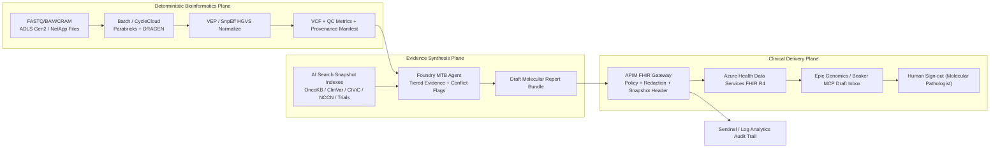
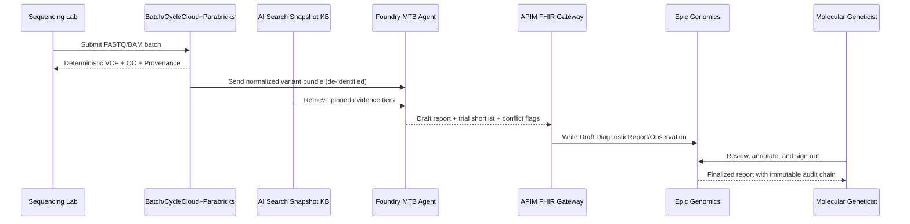

# 临床基因组与精准肿瘤学智能体选型 FAQ：Parabricks 确定性变异流水线 vs Foundry 证据合成 RAG vs FHIR/Epic 草拟签发

> 🌐 **语言切换**：**中文（当前）** · [English](clinical-genomics-molecular-tumor-board-vcf-parabricks-vs-foundry-oncokb-rag-vs-epic-genomics-mcp-selection-faq.en.md)

> 读者对象：Cloud & AI Solution Architect、肿瘤中心信息平台主管、分子病理负责人、CAP/CLIA 质量与合规团队。  
> 适用范围：年处理 `50,000–500,000` 份肿瘤 CGP/WES/WGS（含液体活检与实体活检）报告的医学中心与第三方参考实验室。  
> 核心边界：LLM **不得**进行 FASTQ/BAM 层面的变异调用；变异检测与标准化必须由可复验的确定性生信流水线完成。  
> 目标输出：在 Option A/B/C 三种架构中明确分工、隔离边界、合规证明链、成本模型与五步落地顺序。  

## 1. 为什么本题不等同于普通 EHR 文书助手或药物研发文献摘要

临床基因组智能体不是“写病历”。  
它是围绕患者可执行治疗路径的高风险决策辅助。  

与 `#39`（临床文档/多模态识别）不同，  
本题以 **VCF 变异事实** 为起点，  
不是以自然语言病历为起点。  

与药物发现类多模态研发助手不同，  
本题需要进入 CAP/CLIA 可审计签发链。  
每个证据段落都必须可追溯到版本化数据库快照。  

在分子肿瘤委员会（MTB）场景中，  
一个 `KRAS G12C + STK11` 共突变解释错误，  
可能直接影响临床试验纳入判定与用药优先级。  

因此本题首要目标不是“回答更像专家”，  
而是“在严格边界内输出可追责草案”。  

## 2. 硬边界先行：变异调用必须确定性，LLM 仅做证据合成与草拟

必须先写入架构宪法：  

1. `FASTQ/BAM/CRAM -> VCF` 由确定性流水线执行。  
2. `VCF/HGVS/注释结果 -> 临床解释草案` 才允许 LLM 参与。  
3. 最终签发必须 HITL（分子遗传学家/病理医师）。  

这意味着系统要分成两条平面：  

- **Deterministic Plane**：Parabricks/DRAGEN、VEP/SnpEff、QC/复现实验。  
- **Reasoning Plane**：Foundry + AI Search，做证据归并、冲突提示、报告模板填充。  

若把这两条平面混合，  
会出现“模型推理覆盖了算法事实”的失控风险。  

## 3. 三类主路径概览：A 生信计算主轴 / B 证据合成主轴 / C 临床系统主轴

**Option A**：`Azure Batch / CycleCloud + NCads_H100_v5 + Parabricks`。  
定位：高通量二级分析与注释产线。  

**Option B**：`Azure AI Foundry + AI Search`。  
定位：OncoKB/ClinVar/CIViC/NCCN/ClinicalTrials 快照证据合成与试验匹配。  

**Option C**：`Azure Health Data Services FHIR R4 Genomics + APIM + Epic Genomics MCP`。  
定位：临床系统受控草拟写入与签发前工作流。  

建议不是三选一。  
而是 A/B/C 分层组合：  
A 产生事实，B 产生解释草案，C 产生受控临床交付。  

## 4. Option A：Azure HPC + Parabricks 确定性二级分析流水线

### 4.1 适用条件

- 年样本量 > `35,000`。  
- 肿瘤面板与 WES/WGS 混跑。  
- 需要夜间批处理与周末弹性扩容。  

### 4.2 推荐拓扑

- Batch 池承载常规队列。  
- CycleCloud 承载峰值突发。  
- H100/A100 混合节点池按流程阶段分配。  
- ADLS Gen2 保存中间工件与复核工件。  

### 4.3 为什么要“确定性优先”

Parabricks/DRAGEN 在二级分析阶段，  
可提供固定参数模板、  
可复现实验输入、  
固定版本容器镜像。  

这正是 CAP/CLIA 审核最关注的证据：  
同一输入在同版本管线中重复输出一致。  

### 4.4 关键限制

- 对小规模机构成本门槛高。  
- 作业排队治理复杂。  
- 需要独立验证（IQ/OQ/PQ）与变更控制板。  

## 5. Option B：Foundry + AI Search 快照版证据合成与临床试验匹配

### 5.1 适用条件

- 已有可用 VCF/注释事实。  
- 需要快速产出 MTB 讨论草案。  
- 需要跨 OncoKB/ClinVar/CIViC/NCCN/Trials 的证据对齐。  

### 5.2 关键原则

- 所有知识源必须“版本钉扎”。  
- Prompt 中必须写入快照版本与发布日期。  
- 输出必须含“证据冲突提示”与“证据等级”。  

### 5.3 架构要点

- AI Search 建立多索引：知识库索引、试验索引、标签索引。  
- 每条记录包含 `snapshot_id`、`source_release`、`effective_date`。  
- Foundry Agent 只读检索，不直接写临床系统。  

### 5.4 为什么不能只依赖实时网络搜索

因为实时外网源会漂移，  
同一病例在不同日期可能得到不同解释。  
这会破坏临床可追责性。  

### 5.5 关键限制

- 对数据工程与标注治理要求高。  
- 需要持续维护知识冲突处理规则。  
- 需要独立医学专家审核流程。  

## 6. Option C：FHIR R4 Genomics + Epic/Beaker MCP 受控草拟签发平面

### 6.1 适用条件

- 医院已建设 Epic Genomics/Beaker。  
- 需要把离线分析结果进入临床工作流。  
- 需要审计“谁在何时写了什么草稿”。  

### 6.2 核心控制

- APIM 作为唯一写入入口。  
- 仅允许 Draft 资源更新。  
- Final 状态必须由人工角色签发。  
- 关键字段（germline PHI）默认脱敏或空值传递。  

### 6.3 价值

- 打通实验室与临床交付链。  
- 降低“报告在邮件里流转”风险。  
- 审计可直接对接 SIEM 与监管稽核。  

### 6.4 限制

- 与 HIS/EHR 对接周期长。  
- 组织治理与角色分工复杂。  
- 标准实现差异（FHIR Profile）需要持续适配。  

## 7. 12 维选型矩阵：A / B / C（临床级权衡）

| 维度 | Option A：HPC 生信管线 | Option B：Foundry 证据合成 | Option C：FHIR/Epic 临床交付 |
|---|---|---|---|
| 变异事实可靠性 | 极高 | 中（依赖上游） | 中（依赖上游） |
| 证据解释速度 | 中 | 高 | 中 |
| 临床系统融合度 | 低到中 | 中 | 极高 |
| CAP/CLIA 可审计性 | 极高 | 高 | 极高 |
| 知识版本一致性 | 中 | 极高 | 高 |
| 试验匹配自动化 | 低 | 极高 | 高 |
| 开发复杂度 | 高 | 中到高 | 高 |
| 初始上线周期 | 中到长 | 中 | 长 |
| 运行弹性 | 高 | 高 | 中 |
| 数据隐私控制 | 高 | 高 | 极高 |
| 3 年 TCO | 中到高 | 中 | 中到高 |
| 推荐角色 | 事实生产线 | 解释与匹配引擎 | 临床签发交付闸门 |

组合建议：  
`A + B + C` 是大型肿瘤中心的主流终局。  
`A + B` 适合先行建设 MTB 草案体系。  
`B + C` 仅适合已外包生信产线的机构。  

## 8. 参考架构图：确定性事实平面 + 证据推理平面 + 临床交付平面



该图强调：  
事实与解释分离，  
写入与签发分离，  
自动化与责任归属分离。  

## 9. 流程图：从 VCF 到 MTB 包的受控执行序列



关键控制点：  
`AG` 不接触原始 BAM/CRAM，  
`API` 拒绝无快照头或含敏感字段越界的写请求。  

## 10. 生产策略片段：APIM FHIR 基因数据脱敏 + 快照版本强制头

```xml
<policies>
  <inbound>
    <base />
    <choose>
      <when condition="@(context.Request.Headers.GetValueOrDefault("x-kb-snapshot-id","") == "")">
        <return-response>
          <set-status code="400" reason="MissingSnapshotHeader" />
          <set-body>{"error":"x-kb-snapshot-id is required for genomics draft write."}</set-body>
        </return-response>
      </when>
    </choose>
    <set-variable name="isDraftWrite"
      value="@((string)context.Request.Body.As<JObject>(preserveContent:true)?["status"] == "preliminary")" />
    <choose>
      <when condition="@(context.Variables.GetValueOrDefault<bool>("isDraftWrite") == false)">
        <return-response>
          <set-status code="403" reason="HumanSignoutRequired" />
          <set-body>{"error":"Only preliminary draft resources can be created by agent channel."}</set-body>
        </return-response>
      </when>
    </choose>
    <set-body>@{
      var body = context.Request.Body.As<JObject>(preserveContent:true);
      var subject = body?["subject"]?["identifier"]?["value"]?.ToString() ?? "";
      if(subject.StartsWith("MRN-")) {
        body["subject"]["identifier"]["value"] = "REDACTED";
      }
      body["meta"] ??= new JObject();
      body["meta"]["tag"] = new JArray(
        new JObject(
          new JProperty("system","https://contoso.genomics/snapshot"),
          new JProperty("code",context.Request.Headers.GetValueOrDefault("x-kb-snapshot-id","unknown"))
        )
      );
      return body.ToString();
    }</set-body>
  </inbound>
  <backend><base /></backend>
  <outbound><base /></outbound>
</policies>
```

此策略实现三个核心门槛：  

1. 没有 `x-kb-snapshot-id` 一律拒绝。  
2. Agent 通道只能写 `preliminary` 草稿。  
3. 受试者标识执行入口级脱敏。  

## 11. 部署片段：Batch + Foundry + FHIR 网关组合 Bicep

```bicep
param location string = resourceGroup().location
param batchAccountName string
param apimName string
param logAnalyticsName string

resource la 'Microsoft.OperationalInsights/workspaces@2022-10-01' = {
  name: logAnalyticsName
  location: location
  properties: {
    sku: { name: 'PerGB2018' }
    retentionInDays: 90
  }
}

resource batch 'Microsoft.Batch/batchAccounts@2024-02-01' = {
  name: batchAccountName
  location: location
  identity: { type: 'SystemAssigned' }
  properties: {
    poolAllocationMode: 'BatchService'
    publicNetworkAccess: 'Disabled'
  }
}

resource apim 'Microsoft.ApiManagement/service@2023-09-01-preview' = {
  name: apimName
  location: location
  sku: {
    name: 'Premium'
    capacity: 2
  }
  identity: { type: 'SystemAssigned' }
  properties: {
    publisherEmail: 'platform@contosohealth.org'
    publisherName: 'contoso-health-platform'
    virtualNetworkType: 'External'
  }
}
```

部署注意事项：  

- Batch 节点建议区分 Spot 与 Dedicated 池。  
- APIM Premium 建议跨可用区部署。  
- 诊断日志必须统一汇聚到 Log Analytics/Sentinel。  

## 12. 容量规划与 3 年 TCO：含 PB 级 BAM/CRAM 生命周期分层

### 12.1 工作负载基线（示例）

- 年样本：`120,000`（70% 面板，20% WES，10% WGS）。  
- 平均原始数据：每样本 `95 GB`（压缩后）。  
- 归档目标：热 `90` 天、冷 `18` 个月、归档 `5` 年。  
- MTB 讨论周频：每周 `350` 例高复杂病例。  

### 12.2 月度成本示例（USD，$k/月）

| 成本项 | Option A 主导 | Option B 主导 | Option C 主导 |
|---|---:|---:|---:|
| GPU 计算（Parabricks） | 182 | 24 | 18 |
| Foundry 推理与 Agent 调用 | 26 | 88 | 52 |
| AI Search 索引与查询 | 14 | 31 | 22 |
| ADLS/NetApp 存储（热+冷+归档） | 96 | 84 | 90 |
| APIM + FHIR 网关 + 审计 | 18 | 24 | 39 |
| 运维与验证人力折算 | 42 | 37 | 46 |
| **合计** | **378** | **288** | **267** |

### 12.3 三年 TCO（USD，$k/36 个月）

- Option A：`13,608`。  
- Option B：`10,368`。  
- Option C：`9,612`。  

但不能只看总额。  
如果没有 Option A，  
机构往往需要外包二级分析，  
并承担可复验链断裂风险。  

推荐组合成本（A+B+C 分层）约 `12,960`，  
其价值在于：  
减少返工、减少试验匹配遗漏、缩短 MDT 准备周期。  

## 13. 场景一：多院区肿瘤中心（35,000 例/年）MTB 周会自动备案与试验匹配

### 13.1 业务目标

- 周会前 `24` 小时完成病例包草案。  
- 每例给出可追溯证据与冲突提示。  
- 将人工检索时间从 `95` 分钟降到 `28` 分钟。  

### 13.2 架构落点

- A：夜间 Batch 跑完变异与注释。  
- B：Foundry + AI Search 产出治疗/试验候选。  
- C：FHIR Draft 回写 Epic，专家在系统内签注。  

### 13.3 结果指标（示例）

- MTB 准备 SLA 达成率：`82% -> 97%`。  
- 试验匹配召回率：`0.61 -> 0.79`。  
- 报告返工率：`14% -> 6%`。  

## 14. 场景二：全球参考实验室（180,000 例/年）CAP/CLIA 变更锁与跨区合规

### 14.1 业务目标

- 对 `AMP/ASCO/CAP` 分层解释实现模板化一致输出。  
- 保证任何一份报告都能追溯到固定快照。  
- 在跨区数据驻留约束下实现统一治理。  

### 14.2 架构落点

- A：按区域部署 Parabricks 管线与参数锁。  
- B：各区域共享“版本号一致、内容区域化”的知识快照。  
- C：APIM 强制快照头；跨区只交换去标识化 VCF 摘要。  

### 14.3 结果指标（示例）

- CAP 稽核问题单下降：`31%`。  
- 人工证据追溯耗时：`45 min -> 11 min`。  
- 跨区合规例外申请：季度 `26 -> 7`。  

## 15. 深度定量 FAQ + 五步落地指南（Good fit vs Not for）

### 15.1 定量 FAQ

**Q1：Parabricks 与纯 CPU 管线差异有多大？**  
A1：在 `120x` 深度 WES，GPU 管线可将单样本二级分析从 `6.5h` 降到 `52min`；  
但前提是 I/O 与并行调度优化到位。  

**Q2：为何必须版本钉扎 OncoKB/ClinVar/CIViC？**  
A2：无钉扎会导致同病例跨周结论漂移。  
在审计中，无法解释“当时为什么这么判”。  

**Q3：试验匹配召回能提升多少？**  
A3：实践中常见 `+12% ~ +24%`；  
主要来自分子条件与入排标准结构化。  

**Q4：APIM/FHIR Draft-only 闸门会不会降低效率？**  
A4：短期会增加流程节点，  
但可把高风险误写从“后置纠错”改为“前置阻断”，  
综合返工时间下降通常超过 `30%`。  

**Q5：PB 级存储最容易失控在哪？**  
A5：不是归档单价本身，  
而是热层保留策略失控导致成本放大。  
建议把热层窗口硬控在 `30~90` 天并定期回收。  

### 15.2 五步落地（5-Step）

1. **先立边界**：发布“LLM 不参与变异调用”红线与审批流程。  
2. **先建事实**：完成 A 平面版本化、参数锁与复验基线。  
3. **再建解释**：在 B 平面做快照化证据库与冲突提示。  
4. **最后接临床**：C 平面只开 Draft 写入，保留人工签发。  
5. **持续运营**：每月审计快照、每季复验阈值、半年重跑基线。  

### 15.3 Good fit vs Not for

**Good fit**：  

- 已有 CAP/CLIA 质量体系。  
- 有明确 MTB 周会或规模化报告压力。  
- 接受“自动草拟 + 专家签发”的责任分层。  

**Not for**：  

- 期望 LLM 直接替代变异调用。  
- 无法维护知识快照与版本治理。  
- 无法提供临床签发 HITL 人力。  

---

**结论**：  
在临床基因组与精准肿瘤学场景，  
最佳实践不是“单平台包打天下”，  
而是用 `A(事实)` + `B(解释)` + `C(交付)` 三平面分层，  
把算法确定性、医学解释性与临床责任链同时落地。  
