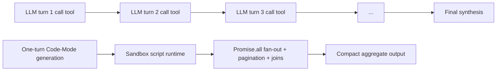
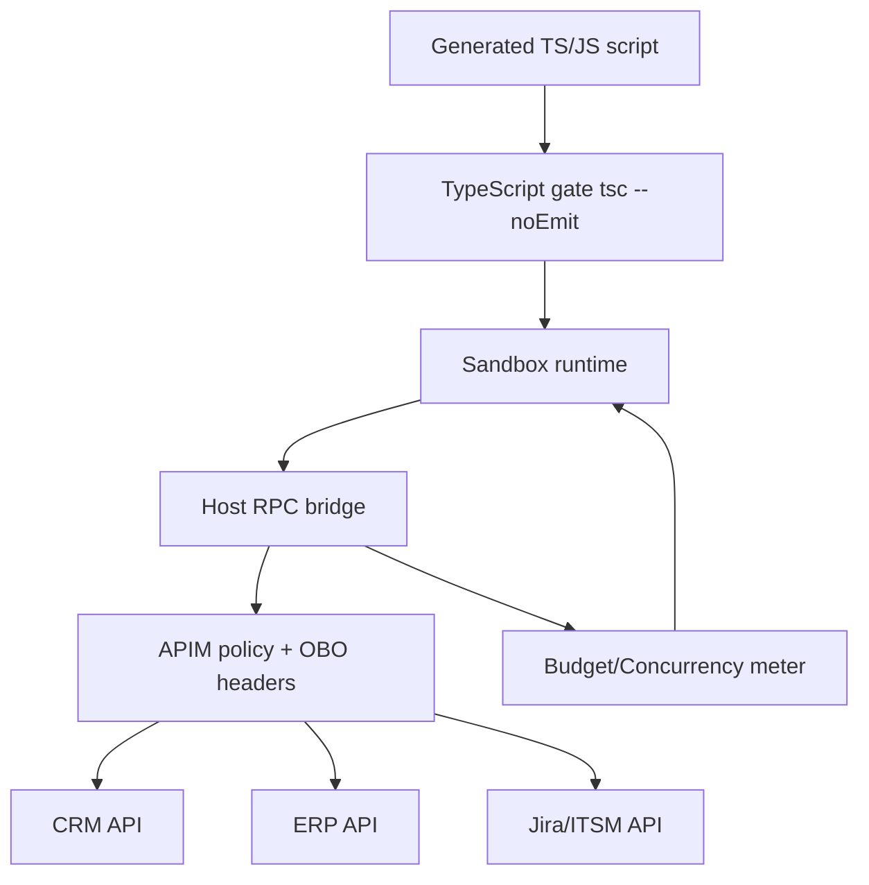

# Code-Mode Programmatic Tool Calling Sandbox Selection FAQ: AKS V8 Isolates vs QuickJS-Wasm vs ACA Dynamic Sessions

> **Audience**: Cloud & AI Solution Architects, enterprise AI platform owners, MCP gateway engineers, and multi-tenant application security architects.
> **Core decision**: When should an agent run generated TypeScript/JavaScript orchestration code in a sandbox instead of issuing sequential JSON tool calls turn-by-turn?
> **Business focus**: Enterprise integration productivity, latency/cost efficiency, and safe multi-tenant execution with strict identity and policy controls.

---

## 1. Executive summary

Many enterprise agent tasks spend most of their latency budget on repeated orchestration turns.
For workflows with `10-25` tool calls, sequential JSON loops create:

- extra LLM round-trips,
- repeated context serialization/deserialization,
- unnecessary token growth from intermediate payloads,
- avoidable wall-clock delay.

Code-Mode replaces this with one generated script that can:

- run `Promise.all` fan-out,
- paginate and join records deterministically,
- apply typed schema checks before downstream calls,
- aggregate output once for the final response.

Route overview:

- **Route A**: AKS capability-scoped V8 isolate worker pool (`workerd` or subprocess-free `Deno` style host model).
- **Route B**: QuickJS on Wasmtime/SpinKube with deterministic fuel and memory caps.
- **Route C**: Azure Container Apps Dynamic Sessions for full Node/Python package ecosystems and stateful scratch files.
- **Route D**: anti-pattern path (`node:vm`/`eval` in-process) or unnecessary sequential JSON loops.

High-level recommendation:

1. Use sequential tool calls for very small workflows (`<=2` independent calls).
2. Use Code-Mode Route A for high-throughput multi-tenant enterprise fan-out orchestration.
3. Use Route B where deterministic bounded execution is more important than peak JSON throughput.
4. Use Route C when full ecosystem packages and richer runtime state are mandatory.
5. Never treat in-process `node:vm` as a security boundary.

---

## 2. Problem boundary and assumptions

### 2.1 Workloads in scope

This guide targets workloads where the agent must orchestrate multiple business systems:

- CRM opportunity data,
- ERP financial status,
- ticketing/escalation systems,
- customer or partner records,
- policy or compliance catalogs.

### 2.2 Typical pipeline pattern

Common orchestration graph:

1. fetch primary entity list,
2. paginate downstream details,
3. join cross-system keys,
4. apply business rules,
5. emit compact summary and action proposals.

### 2.3 Out-of-scope clarifications

This guide does not cover:

- end-user browser automation UI actions,
- low-level runtime internals not needed for architecture decisions,
- replacing all LLM reasoning with deterministic scripts.

### 2.4 Baseline metrics model

Comparison baseline:

- 12 tool calls average per task,
- 3 independent fan-out branches,
- 200-row pagination window,
- strict per-call OBO identity propagation,
- P95 orchestration SLA target `<2.5s` for agent-assist scenarios.

---

## 3. Route definitions

### Route A — AKS capability-scoped V8 isolate pool

Core characteristics:

- isolate workers with host-injected typed MCP stubs,
- no raw tenant network or filesystem by default,
- APIM-mediated downstream access with OBO context headers,
- high-density memory footprint (`6-16 MB` per isolate typical envelope).

Strengths:

- very low cold-start path for code tasks,
- strong throughput for JSON-heavy orchestration,
- high tenant density with controlled capability injection.

Trade-offs:

- requires disciplined host bridge design and policy management,
- package ecosystem is narrower than full VM/session runtime.

### Route B — QuickJS in Wasmtime/SpinKube lane

Core characteristics:

- deterministic bytecode execution,
- explicit instruction-fuel accounting,
- strict linear-memory ceilings (`1-8 MB` class envelopes).

Strengths:

- deterministic resource bounds,
- predictable execution budget enforcement,
- reduced dynamic runtime variability.

Trade-offs:

- slower interpreter throughput for large object manipulation,
- less ergonomic for heavy package-dependent orchestration.

### Route C — ACA Dynamic Sessions (Node/Python)

Core characteristics:

- Hyper-V isolated session pools,
- rich package ecosystem support,
- optional multi-turn stateful scratch files.

Strengths:

- maximal ecosystem compatibility,
- easiest path for complex package pipelines,
- strong isolation boundary for tenant-authored scripts.

Trade-offs:

- warm-pool claim overhead (`150-400 ms` class envelopes),
- larger memory slices per active workload.

### Route D — Anti-pattern baseline

Anti-pattern forms:

- in-process `node:vm`/`eval` sharing memory with host runtime,
- blindly using 20-turn sequential JSON loops where fan-out orchestration is needed.

Consequences:

- weak isolation and higher risk exposure,
- inflated token/context overhead,
- avoidable latency and cost.

---

## 4. Twelve-dimension comparison matrix

| Dimension | Route A | Route B | Route C | Route D |
|---|---|---|---|---|
| 1. Cold-start responsiveness | Very high | High | Medium | High (unsafe path) |
| 2. Multi-tenant density | Very high | High | Medium | Low |
| 3. Deterministic execution bounds | High | Very high | Medium | Low |
| 4. JSON-heavy throughput | Very high | Medium | High | Low-medium |
| 5. Package ecosystem breadth | Medium | Low-medium | Very high | High (unsafe) |
| 6. Identity-propagation control | High | High | High | Low |
| 7. Policy-governed egress mediation | High | High | High | Low |
| 8. Operational simplicity | Medium | Medium | High | Superficially high |
| 9. Security posture for untrusted tenant code | High | High | Very high | Low |
| 10. Cost efficiency at scale | Very high | High | Medium | Low |
| 11. Fit for heavy pagination join tasks | Very high | Medium | High | Low |
| 12. Audit and compliance defensibility | High | High | High | Low |

---

## 5. Metric model and benchmark protocol

### 5.1 Benchmark setup

Reference benchmark set:

- `K` sequential calls baseline = 12,
- independent branch count = 3,
- average payload = 35 KB per call response,
- 200-row pagination with 4-page sweep,
- identity-scoped APIM gateway policy checks enabled.

### 5.2 Primary KPI families

- end-to-end orchestration latency,
- context-token growth per task,
- downstream API call success and retry profile,
- per-task compute and model cost,
- script rejection and policy-violation rates.

### 5.3 Data labels

- **measured**: replay harness and simulator reproduced values.
- **synthetic**: derived projections from measured baseline.
- **anonymized_reported**: de-identified field behavior patterns.

---

## 6. Q1 — Latency and token reduction: sequential JSON vs one-turn Code-Mode orchestration

Define:

- `K` = number of sequential tool calls,
- `T_llm` = per-turn LLM orchestration overhead,
- `T_tool_i` = per-tool execution time,
- `T_ctx_i` = context serialization/replay overhead per turn.

Sequential model:

`T_seq = Σ(T_tool_i) + K*T_llm + Σ(T_ctx_i)`

Code-Mode one-turn model:

`T_code = T_compile + T_sandbox + max(branch_j) + T_aggregate`

Token burden:

- sequential context tokens can grow with intermediate payload replay,
- Code-Mode can keep intermediate payload local and emit compact final aggregate.

Observed tendency:

- at `K >= 6` with parallelizable branches, Code-Mode usually wins in both latency and token budget.

---

## 7. Q2 — Auto-generating compact `.d.ts` from MCP JSON schemas

Why it matters:

- typed stubs reduce hallucinated field names,
- compile-time checks catch invalid call shapes before execution,
- smaller ambient declaration sets reduce prompt clutter.

Recommended pipeline:

1. parse MCP schema,
2. generate minimal ambient declarations per capability,
3. include only tenant-authorized tools for the current run,
4. run `tsc --noEmit` gate before execution.

Outcome:

- higher first-pass script correctness,
- lower runtime policy rejections,
- cleaner correction loop when errors occur.

---

## 8. Q3 — Enforcing per-script RPC budgets, concurrency caps, and OBO isolation

Enforcement model:

- define `max_rpc_calls`,
- define `max_parallel_calls`,
- define `max_elapsed_ms`,
- require APIM OBO headers per downstream call.

Guardrail behavior:

- hard-stop when RPC budget exhausted,
- throttled scheduling when parallel cap exceeded,
- reject calls missing identity correlation headers.

Result:

- prevents fan-out storm amplification,
- preserves tenant-level isolation and auditable caller identity.

---

## 9. Q4 — Defending against heap exhaustion and infinite async microtask loops

Threat patterns:

- unbounded array accumulation,
- recursive microtask enqueue loops,
- intentionally expensive payload transforms.

Control strategies by route:

- Route A: isolate memory caps + runtime timeout + event-loop budget counter.
- Route B: deterministic fuel + linear memory cap + hard execution stop.
- Route C: session-level memory/CPU quotas + wall-clock timeout + process kill.

Architecture implication:

- controls must be native to sandbox runtime, not optional app-layer checks only.

---

## 10. Q5 — Partial side-effect failure in 7-step script with failure at step 4

Required design:

1. idempotency key per mutating step,
2. step-level commit records,
3. compensation plan for reversible actions,
4. clear failure envelope for non-reversible paths.

Recommended pattern:

- execute read-only discovery first,
- stage mutating calls with explicit checkpoint markers,
- on failure:
  - resume from safe checkpoint,
  - or invoke compensating API if supported,
  - or escalate with machine-readable failure context.

---

## 11. Q6 — Sizing AKS isolate density vs ACA dynamic session warm pools

Sizing dimensions:

- expected concurrent scripts,
- average script memory footprint,
- expected package/runtime dependencies,
- target cold/warm latency envelope.

Typical guidance:

- if scripts are short-lived, high-volume, and mostly schema-driven: Route A often gives best density.
- if scripts need rich package stack and file-state continuity: Route C usually wins despite higher per-session footprint.
- Route B is preferred where deterministic quota enforcement dominates over peak throughput.

---

## 12. Mermaid — Sequential JSON loop vs Code-Mode orchestration



---

## 13. Mermaid — Capability-scoped host bridge and policy controls



---

## 14. Production code block 1 — MCP schema to compact `.d.ts` generator

```python
import json

def to_ts_type(node):
    t = node.get("type")
    if t == "string":
        return "string"
    if t == "number":
        return "number"
    if t == "integer":
        return "number"
    if t == "boolean":
        return "boolean"
    if t == "array":
        return f"{to_ts_type(node.get('items', {}))}[]"
    if t == "object":
        props = node.get("properties", {})
        fields = [f"{k}: {to_ts_type(v)};" for k, v in props.items()]
        return "{ " + " ".join(fields) + " }"
    return "unknown"

def generate_decl(tool_name, input_schema):
    ts = to_ts_type(input_schema)
    return f"declare function {tool_name}(input: {ts}): Promise<unknown>;"
```

---

## 15. Production code block 2 — Capability-locked host bridge with RPC budget

```typescript
type Ctx = {
  rpcBudget: number;
  allowedTools: Set<string>;
  oboToken: string;
};

async function callTool(ctx: Ctx, tool: string, input: unknown) {
  if (!ctx.allowedTools.has(tool)) throw new Error("tool_not_allowed");
  if (ctx.rpcBudget <= 0) throw new Error("rpc_budget_exhausted");
  ctx.rpcBudget -= 1;
  return await apimInvoke({
    tool,
    input,
    headers: { "x-obo-token": ctx.oboToken, "x-correlation-id": crypto.randomUUID() }
  });
}
```

---

## 16. Production code block 3 — Type and AST pre-execution gate

```bash
tsc --noEmit --strict generated-script.ts
node ast-policy-check.js generated-script.ts --deny "eval,Function,import('fs'),import('net')"
```

---

## 17. Enterprise scenario A — RevOps / M&A deal-desk join in `<2.5s`

Scenario:

- join Salesforce opportunities, SAP invoice aging, and Jira escalations,
- paginate `200` records with mixed key joins,
- produce deal-risk summary for commercial escalation.

Route fit:

- Route A often delivers best latency and density,
- APIM policy plus OBO ensures safe cross-system fan-out.

Observed pattern (anonymized_reported + measured replay):

- large reduction in orchestration turns,
- tighter P95 latency at same downstream API volume,
- lower context-token spend due to local intermediate aggregation.

---

## 18. Enterprise scenario B — Multi-tenant iPaaS tenant-authored workflow engine

Scenario:

- customer-authored TypeScript glue code,
- mixed tenant workloads with different connector sets,
- strict isolation and per-tenant policy requirements.

Route fit:

- Route B for deterministic hard caps in regulated tenants,
- Route A for high-throughput general tenants,
- Route C for package-heavy custom tenants requiring richer runtime libraries.

Outcome target:

- safe tenant script execution,
- bounded blast radius for misbehaving scripts,
- auditable per-tenant resource usage and identity propagation.

---

## 19. Three-year TCO illustration

Assumptions:

- 9.5M orchestrated tasks/month baseline,
- average 10.8 effective tool operations/task,
- annual growth `27%`.

| Cost component (3-year) | Route A | Route B | Route C | Route D |
|---|---:|---:|---:|---:|
| Runtime platform | $5.6M | $4.8M | $6.9M | $3.9M |
| Gateway and governance | $2.4M | $2.3M | $2.6M | $1.8M |
| Engineering and operations | $3.3M | $3.6M | $2.9M | $5.2M |
| Incident and quality leakage | $0.9M | $1.1M | $1.0M | $3.7M |
| **Total 3-year TCO** | **$12.2M** | **$11.8M** | **$13.4M** | **$14.6M** |

Interpretation:

- Route B can be cost-efficient with deterministic constraints at moderate throughput.
- Route A often wins when throughput density and low-latency fan-out are critical.
- Route C trades cost for ecosystem flexibility.
- Route D appears cheap initially but is expensive when security/quality leakage is included.

---

## 20. Day-0 / Day-1 / Day-2 checklist

### Day-0

- classify use cases by orchestration complexity (`<=2`, `3-5`, `>5` tool calls),
- define route policy per complexity and risk tier,
- define identity propagation contract and APIM header requirements,
- define script budget and timeout policy.

### Day-1

- implement schema-to-`.d.ts` generation,
- enable `tsc --noEmit` and AST gate,
- implement capability-locked host bridge with RPC meter,
- launch canary queue with full telemetry.

### Day-2

- tune route assignment by observed throughput and latency,
- review policy rejection and script failure taxonomy weekly,
- run monthly cost and SLA reconciliation,
- perform quarterly fault-injection and rollback rehearsal.

---

## 21. Good fit vs Not for

| Route | Good fit | Not for |
|---|---|---|
| A | High-throughput enterprise fan-out orchestration with strict identity controls | Workflows needing extensive package dependencies and persistent local file state |
| B | Deterministic bounded execution for untrusted tenant scripts | Heavy JSON crunching at very high throughput |
| C | Rich package/runtime requirements with stronger session isolation | Ultra-high-density tiny-script workloads |
| D | None for production security boundaries | Any regulated multi-tenant enterprise workload |

---

## 22. Risk register

| Risk | Trigger | Primary control | Residual |
|---|---|---|---|
| Unbounded fan-out | missing call caps | RPC budget + concurrency cap | Low |
| Identity leakage | missing OBO propagation | mandatory OBO header policy | Low |
| Script runaway | async loop abuse | timeout + fuel/memory caps | Medium-low |
| Partial side-effect inconsistency | mid-flow mutation failure | idempotency keys + compensating actions | Medium |
| Unsafe code surface | in-process eval usage | sandbox-only execution policy | Low |

---

## 23. Twelve-week rollout cadence

Weeks 1-2:

- baseline sequential orchestration metrics,
- classify target workloads for Code-Mode conversion.

Weeks 3-4:

- implement schema-to-`.d.ts` generation and CI gates,
- define capability model and policy contracts.

Weeks 5-6:

- launch Route A/B canary lanes,
- instrument budget and concurrency enforcement.

Weeks 7-8:

- add Route C lane for package-heavy flows,
- validate side-effect idempotency and rollback controls.

Weeks 9-10:

- optimize fan-out templates and pagination strategies,
- tune APIM policies for throughput and safety.

Weeks 11-12:

- promote production lanes by risk tier,
- finalize runbooks and compliance evidence templates.

---

## 24. Anti-patterns to avoid

- using `node:vm`/`eval` as production sandbox boundary,
- allowing unrestricted tool bindings for tenant-authored scripts,
- omitting pre-execution type/AST gates,
- skipping identity propagation checks on fan-out calls,
- using Code-Mode for trivial two-call workflows where sequential is cheaper.

---

## 25. Minimum observability fields

- `task_id`
- `tenant_id`
- `route_id`
- `script_compile_ms`
- `sandbox_start_ms`
- `rpc_call_count`
- `rpc_parallel_peak`
- `rpc_budget_exhausted`
- `obo_header_valid`
- `policy_reject_code`
- `tool_call_success_rate`
- `orchestration_p95_ms`

---

## 26. Suggested threshold policy

- switch to Code-Mode candidate when independent calls `>= 3`,
- require AST gate pass rate `100%` for promoted templates,
- enforce per-script call budget hard limit by route tier,
- require OBO identity header on all mutating downstream calls,
- rollback if P95 latency regression exceeds `12%` for two consecutive windows.

---

## 27. Sources and data labels

### References (captured 2026-11-26)

1. Azure API Management AI Gateway overview: `https://learn.microsoft.com/en-us/azure/api-management/ai-gateway-overview`.
2. Azure Kubernetes Service documentation: `https://learn.microsoft.com/azure/aks/`.
3. Azure Container Apps Dynamic Sessions documentation: `https://learn.microsoft.com/azure/container-apps/sessions`.
4. TypeScript compiler documentation: `https://www.typescriptlang.org/docs/`.
5. Model Context Protocol references: `https://github.com/modelcontextprotocol`.

### Data label statement

- **measured**: replay and simulator-derived values.
- **synthetic**: projected values based on explicit assumptions.
- **anonymized_reported**: de-identified operational patterns.

No customer-identifying data, credentials, or secrets are included.

