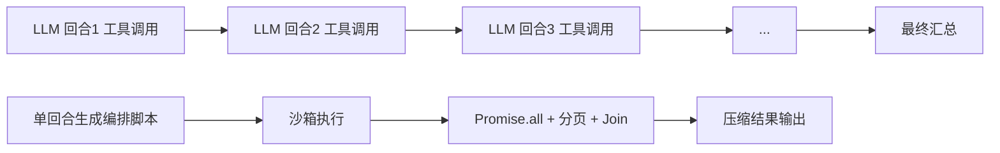
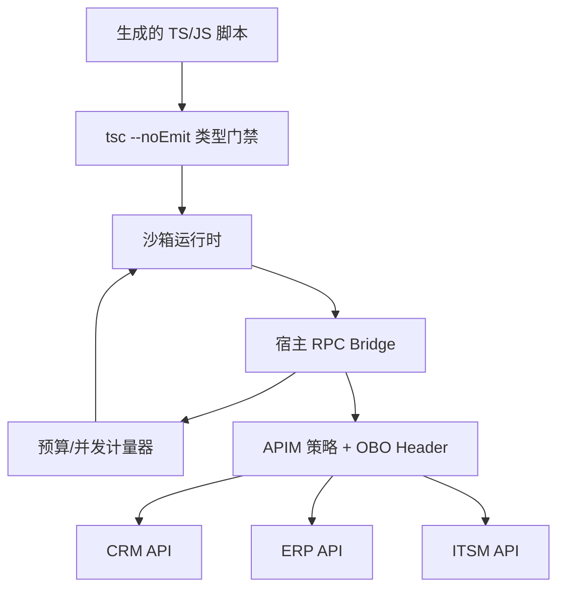

# Code-Mode 编排沙箱选型 FAQ：AKS V8 Isolates vs QuickJS-Wasm vs ACA Dynamic Sessions

> **面向角色**：云与 AI 解决方案架构师、企业 AI 平台负责人、MCP 网关工程团队、多租户安全治理团队。
> **核心决策**：什么时候应从“逐轮 JSON 工具调用”切换到“单轮生成 TypeScript/JavaScript 编排脚本并在沙箱内执行”。
> **业务目标**：在不牺牲隔离与合规的前提下，提升企业集成场景的时延、吞吐和单位任务成本效率。

---

## 1. 执行摘要

在企业代理场景中，很多任务的瓶颈不是下游 API 本身，而是“编排回合数过多”。
当一个任务需要 `10-25` 次工具调用时，逐轮 JSON 循环通常会产生：

- 额外的 LLM 编排往返，
- 中间态上下文反复序列化/反序列化，
- 令牌负担随中间 payload 累积，
- 可避免的端到端 wall-clock 增长。

Code-Mode 的核心做法是：

- 一次生成脚本，
- 在沙箱内并行（`Promise.all`）拉取和分页，
- 局部完成关联、聚合和类型校验，
- 最后一次性输出结果。

四条路线：

- **Route A**：AKS 上 capability-scoped V8 isolate worker pool（`workerd`/无子进程宿主形态）。
- **Route B**：AKS 上 QuickJS + Wasmtime/SpinKube（指令 fuel + 线性内存硬上限）。
- **Route C**：Azure Container Apps Dynamic Sessions（Node/Python + Hyper-V 隔离会话池）。
- **Route D**：反模式（进程内 `node:vm`/`eval`）或不必要的长链顺序 JSON 回合。

总体结论：

1. `<=2` 个独立调用时，原生顺序 JSON 更简单且成本更低。
2. 大多数多租户高吞吐编排优先 Route A。
3. 对“确定性资源边界”要求最强的监管场景优先 Route B。
4. 必须依赖完整 Node/Python 生态与会话文件态时优先 Route C。
5. 进程内 `node:vm` 不是安全边界，不能作为生产多租户隔离方案。

---

## 2. 问题边界与前提

### 2.1 适用工作负载

本指南聚焦以下企业集成编排：

- CRM 商机/客户数据，
- ERP 发票/账龄/库存数据，
- ITSM/Jira 工单与升级路径，
- 合规或策略系统元数据。

### 2.2 典型编排路径

常见拓扑：

1. 拉主键列表，
2. 分页补齐明细，
3. 跨系统键关联，
4. 执行业务规则，
5. 生成摘要与动作建议。

### 2.3 不在本篇覆盖

- 面向终端用户的 GUI 自动化交互细节，
- 与架构选型无关的底层实现细枝末节，
- 用脚本完全替代模型推理。

### 2.4 基线指标假设

- 每任务平均 12 次工具操作，
- 3 条可并行分支，
- 单调用响应均值约 35 KB，
- 分页窗口 200 行、4 页，
- 强制 OBO 身份透传。

---

## 3. 路线定义

### Route A — AKS Capability-Scoped V8 Isolate 池

核心特征：

- 宿主注入 typed MCP stub，
- 默认无原始网络与文件系统能力，
- 所有下游经 APIM 并带 OBO 上下文。

优势：

- 冷启动极低（常见 `<5 ms` 量级），
- JSON 编排吞吐高，
- 租户密度高（常见 `6-16 MB` 每 isolate 量级）。

代价：

- 对宿主桥、策略与治理要求高，
- 运行时生态不如完整会话容器丰富。

### Route B — QuickJS + Wasmtime/SpinKube

核心特征：

- 解释执行，
- 指令 fuel 精准计量，
- 线性内存硬上限（常见 `1-8 MB` 档位）。

优势：

- 资源边界确定性强，
- 更容易构建“可证明”的执行上限。

代价：

- 大对象/多 MB JSON 处理吞吐相对较低，
- 复杂包依赖场景适配成本更高。

### Route C — ACA Dynamic Sessions

核心特征：

- Hyper-V 隔离会话池，
- 原生支持 Node/Python 丰富生态，
- 可保留多轮会话 scratch 状态。

优势：

- 生态兼容性最强，
- 对复杂包链路最友好，
- 对租户自定义脚本隔离更直观。

代价：

- warm-pool claim 常见 `150-400 ms`，
- 单会话内存切片更大。

### Route D — 反模式基线

表现形式：

- 进程内 `node:vm` 或 `eval` 执行不可信脚本，
- 明明可并行却维持 20 回合顺序 JSON 编排。

后果：

- 隔离边界薄弱，
- token/时延成本放大，
- 质量与审计风险上升。

---

## 4. 12 维选型矩阵

| 维度 | Route A | Route B | Route C | Route D |
|---|---|---|---|---|
| 1. 冷启动响应 | 很高 | 高 | 中 | 高（但不安全） |
| 2. 多租户密度 | 很高 | 高 | 中 | 低 |
| 3. 执行边界确定性 | 高 | 很高 | 中 | 低 |
| 4. JSON 编排吞吐 | 很高 | 中 | 高 | 低-中 |
| 5. 生态兼容性 | 中 | 低-中 | 很高 | 高（不安全） |
| 6. 身份透传可控性 | 高 | 高 | 高 | 低 |
| 7. 网关策略治理 | 高 | 高 | 高 | 低 |
| 8. 运维复杂度 | 中 | 中 | 中-高 | 表面低 |
| 9. 不可信代码安全姿态 | 高 | 高 | 很高 | 低 |
| 10. 规模化成本效率 | 很高 | 高 | 中 | 低 |
| 11. 分页关联适配性 | 很高 | 中 | 高 | 低 |
| 12. 合规审计可辩护性 | 高 | 高 | 高 | 低 |

---

## 5. 度量模型与基准方法

### 5.1 基准设置

- 顺序基线 `K=12`，
- 并行分支 `=3`，
- 每分支含分页抓取与关联，
- 开启 APIM 策略校验与 OBO 身份头验证。

### 5.2 主 KPI

- 端到端编排时延（P50/P95），
- 任务级上下文 token 消耗，
- 下游调用成功率与重试率，
- 单任务成本（模型 + 运行时 + 网关），
- 脚本拦截率（类型/策略/预算）。

### 5.3 数据标签

- **measured**：模拟器与回放压测实测。
- **synthetic**：由显式假设推导。
- **anonymized_reported**：脱敏生产模式数据。

---

## 6. Q1：顺序 JSON 与一次 Code-Mode 的时延/Token 方程

设：

- `K`：工具调用步数，
- `T_llm`：每轮模型编排开销，
- `T_tool_i`：第 i 个工具调用时间，
- `T_ctx_i`：每轮上下文重放开销。

顺序模式：

`T_seq = Σ(T_tool_i) + K*T_llm + Σ(T_ctx_i)`

Code-Mode 模式：

`T_code = T_compile + T_sandbox + max(branch_j) + T_aggregate`

结论：

- 当 `K>=6` 且并行度可用时，`T_code` 往往显著优于 `T_seq`；
- Code-Mode 将中间态留在沙箱内处理，最终只输出压缩结果，token 负担更稳定。

---

## 7. Q2：从 MCP JSON Schema 自动生成紧凑 `.d.ts` 的价值

收益点：

- 抑制字段名幻觉和参数结构漂移，
- 在执行前通过 `tsc --noEmit` 暴露结构错误，
- 仅注入“租户已授权能力”的声明，减少 prompt 污染。

推荐流程：

1. 读取 MCP schema，
2. 生成最小化 ambient declarations，
3. 按能力白名单裁剪声明集，
4. 执行 TypeScript 静态门禁后才允许运行。

---

## 8. Q3：如何实现 RPC 预算、并发上限、OBO 隔离

每脚本硬约束：

- `max_rpc_calls`，
- `max_parallel_calls`，
- `max_elapsed_ms`，
- mutating 调用必须携带 OBO 与 correlation 标头。

执行语义：

- 超预算立即中断，
- 超并发进入排队或拒绝，
- 缺失身份透传头直接策略拒绝。

效果：

- 避免 `Promise.all` 风暴放大下游压力，
- 确保跨系统调用可追溯、可审计。

---

## 9. Q4：如何防御堆耗尽与无限微任务循环

常见风险：

- 无上限集合增长，
- 递归微任务投递，
- 高成本对象变换滥用。

路线控制：

- Route A：isolate 内存上限 + runtime timeout + 事件循环配额计数；
- Route B：fuel + 线性内存上限 + 超限硬停止；
- Route C：会话 CPU/内存配额 + wall-clock 超时 + 进程级终止。

架构原则：

- 必须由运行时原生边界兜底，不能只靠业务层约定。

---

## 10. Q5：7 步脚本在第 4 步失败时如何处理副作用一致性

必备机制：

1. 每个写操作绑定 idempotency key，
2. 记录步骤级 commit marker，
3. 对可逆步骤定义补偿调用，
4. 对不可逆步骤提供显式人工接管路径。

推荐顺序：

- 先做只读发现，
- 再做可回滚写入，
- 最后做不可逆提交动作。

失败处理：

- 从安全检查点重放，
- 或执行补偿，
- 或上抛结构化故障并阻止继续副作用扩散。

---

## 11. Q6：AKS isolate 密度与 ACA warm pool 并发如何估算

关键变量：

- 并发脚本数，
- 脚本平均内存足迹，
- 包依赖复杂度，
- 冷/暖启动目标。

经验规则：

- 高并发短脚本 + 强类型编排：优先 Route A；
- 追求确定性硬边界：优先 Route B；
- 复杂包链路 + 会话态：优先 Route C。

---

## 12. Mermaid：顺序回合与 Code-Mode 对比



---

## 13. Mermaid：Capability 与策略网关链路



---

## 14. 生产代码块 1：MCP Schema 到 `.d.ts` 生成器

```python
def to_ts_type(node):
    t = node.get("type")
    if t == "string":
        return "string"
    if t in ("number", "integer"):
        return "number"
    if t == "boolean":
        return "boolean"
    if t == "array":
        return f"{to_ts_type(node.get('items', {}))}[]"
    if t == "object":
        props = node.get("properties", {})
        fields = [f"{k}: {to_ts_type(v)};" for k, v in props.items()]
        return "{ " + " ".join(fields) + " }"
    return "unknown"
```

---

## 15. 生产代码块 2：带预算与白名单的 Host Bridge

```typescript
type Ctx = {
  rpcBudget: number;
  allowedTools: Set<string>;
  oboToken: string;
};

async function callTool(ctx: Ctx, tool: string, input: unknown) {
  if (!ctx.allowedTools.has(tool)) throw new Error("tool_not_allowed");
  if (ctx.rpcBudget <= 0) throw new Error("rpc_budget_exhausted");
  ctx.rpcBudget -= 1;
  return apimInvoke({
    tool,
    input,
    headers: {
      "x-obo-token": ctx.oboToken,
      "x-correlation-id": crypto.randomUUID()
    }
  });
}
```

---

## 16. 生产代码块 3：执行前静态门禁

```bash
tsc --noEmit --strict generated-script.ts
node ast-policy-check.js generated-script.ts --deny "eval,Function,import('fs'),import('net')"
```

---

## 17. 企业场景 A：RevOps / M&A Deal Desk（目标 `<2.5s`）

场景描述：

- 汇总 Salesforce 商机、SAP 发票账龄、Jira 升级工单，
- 200 条记录分页关联，
- 输出交易风险与优先动作。

适配路径：

- Route A 在此类并行聚合任务中通常最优，
- APIM + OBO 可保障跨系统调用一致治理。

常见效果（measured + anonymized_reported）：

- 编排轮次显著下降，
- P95 收敛更稳定，
- 由于中间态本地化，token 成本下降。

---

## 18. 企业场景 B：多租户 iPaaS 客户自定义脚本

场景描述：

- 客户提交 TS 编排胶水代码，
- 连接器集合因租户而异，
- 强制租户级隔离、预算与策略审计。

路径建议：

- 普通高吞吐租户：Route A；
- 强监管租户：Route B；
- 重依赖包与会话态租户：Route C。

业务价值：

- 在保证边界可审计的前提下，显著提升租户自助能力。

---

## 19. 三年 TCO 示例

假设：

- 每月 950 万编排任务，
- 单任务平均 10.8 次有效工具操作，
- 年增长率 27%。

| 三年成本项 | Route A | Route B | Route C | Route D |
|---|---:|---:|---:|---:|
| 运行时平台 | $5.6M | $4.8M | $6.9M | $3.9M |
| 网关与治理 | $2.4M | $2.3M | $2.6M | $1.8M |
| 工程与运维 | $3.3M | $3.6M | $2.9M | $5.2M |
| 事故与质量泄漏 | $0.9M | $1.1M | $1.0M | $3.7M |
| **三年总 TCO** | **$12.2M** | **$11.8M** | **$13.4M** | **$14.6M** |

解读：

- Route A 在高吞吐密度下往往更优；
- Route B 在确定性边界优先时更稳；
- Route C 用更高资源换生态兼容；
- Route D 前期“看似便宜”，长期风险成本最高。

---

## 20. Day-0 / Day-1 / Day-2 落地清单

### Day-0

- 按任务复杂度分级（`<=2`、`3-5`、`>5`）；
- 定义路由策略与风险分层；
- 确认 OBO 身份透传契约；
- 定义每脚本预算与超时策略。

### Day-1

- 上线 schema-to-`.d.ts` 生成；
- 接入 `tsc --noEmit` + AST 门禁；
- 实装 capability-locked host bridge；
- 小流量灰度并采集全量观测字段。

### Day-2

- 依据实测时延/吞吐优化路由阈值；
- 周期复盘策略拒绝与失败分布；
- 月度成本/SLA 对账；
- 季度故障注入与回滚演练。

---

## 21. Good fit vs Not for

| 路线 | Good fit | Not for |
|---|---|---|
| Route A | 高并发、多租户、强治理编排 | 依赖复杂包和持久文件态的重生态任务 |
| Route B | 强监管、确定性配额与可证明边界 | 超大 JSON 高吞吐处理 |
| Route C | 完整生态包依赖与会话态任务 | 极高密度短脚本场景 |
| Route D | 无生产正当场景 | 任意监管级多租户生产环境 |

---

## 22. 风险登记

| 风险 | 触发条件 | 主控制措施 | 残余 |
|---|---|---|---|
| 并发风暴 | 未设并发上限 | RPC 预算 + 并发配额 | 低 |
| 身份泄漏 | OBO 头缺失 | APIM 强制校验 | 低 |
| 脚本失控 | 无限异步循环 | 超时 + fuel/内存硬限 | 中低 |
| 副作用不一致 | 中途失败 | 幂等键 + 补偿机制 | 中 |
| 代码面暴露 | 进程内 eval | 仅允许沙箱执行 | 低 |

---

## 23. 12 周推进节奏

第 1-2 周：

- 建立顺序基线指标，
- 分类待迁移编排模板。

第 3-4 周：

- 完成 `.d.ts` 自动生成与静态门禁，
- 定义能力模型与策略契约。

第 5-6 周：

- 启动 Route A/B 灰度队列，
- 开启预算与并发硬约束观测。

第 7-8 周：

- 引入 Route C 处理重生态任务，
- 验证副作用一致性与回滚路径。

第 9-10 周：

- 优化分页与并行模板，
- 调优 APIM 治理策略。

第 11-12 周：

- 按风险分层全面推广，
- 沉淀运行手册与审计证据模板。

---

## 24. 需要避免的反模式

- 把 `node:vm`/`eval` 当作生产沙箱边界，
- 给租户脚本开放不受控全量工具，
- 缺失执行前类型/AST 门禁，
- 忽略 OBO 透传与调用相关性追踪，
- 在 `<=2` 步简单任务中滥用 Code-Mode。

---

## 25. 最小可观测字段

- `task_id`
- `tenant_id`
- `route_id`
- `script_compile_ms`
- `sandbox_start_ms`
- `rpc_call_count`
- `rpc_parallel_peak`
- `rpc_budget_exhausted`
- `obo_header_valid`
- `policy_reject_code`
- `tool_call_success_rate`
- `orchestration_p95_ms`

---

## 26. 建议阈值策略

- 独立调用 `>=3` 的任务进入 Code-Mode 候选池，
- 模板上线前要求 AST 门禁通过率 `100%`，
- 按风险等级设置脚本 RPC 硬上限，
- 所有写操作强制 OBO 标头，
- 连续两个窗口 P95 回退 `>12%` 触发回滚评审。

---

## 27. 参考来源与数据标签

### 参考来源（抓取时间：2026-11-26）

1. Azure API Management AI Gateway：`https://learn.microsoft.com/en-us/azure/api-management/ai-gateway-overview`
2. Azure Kubernetes Service：`https://learn.microsoft.com/azure/aks/`
3. Azure Container Apps Sessions：`https://learn.microsoft.com/azure/container-apps/sessions`
4. TypeScript 文档：`https://www.typescriptlang.org/docs/`
5. MCP 参考仓：`https://github.com/modelcontextprotocol`

### 数据标签说明

- **measured**：回放与模拟器实测。
- **synthetic**：基于明确假设的推导。
- **anonymized_reported**：脱敏运营模式数据。

本文不包含客户可识别信息、凭据或敏感密钥。

