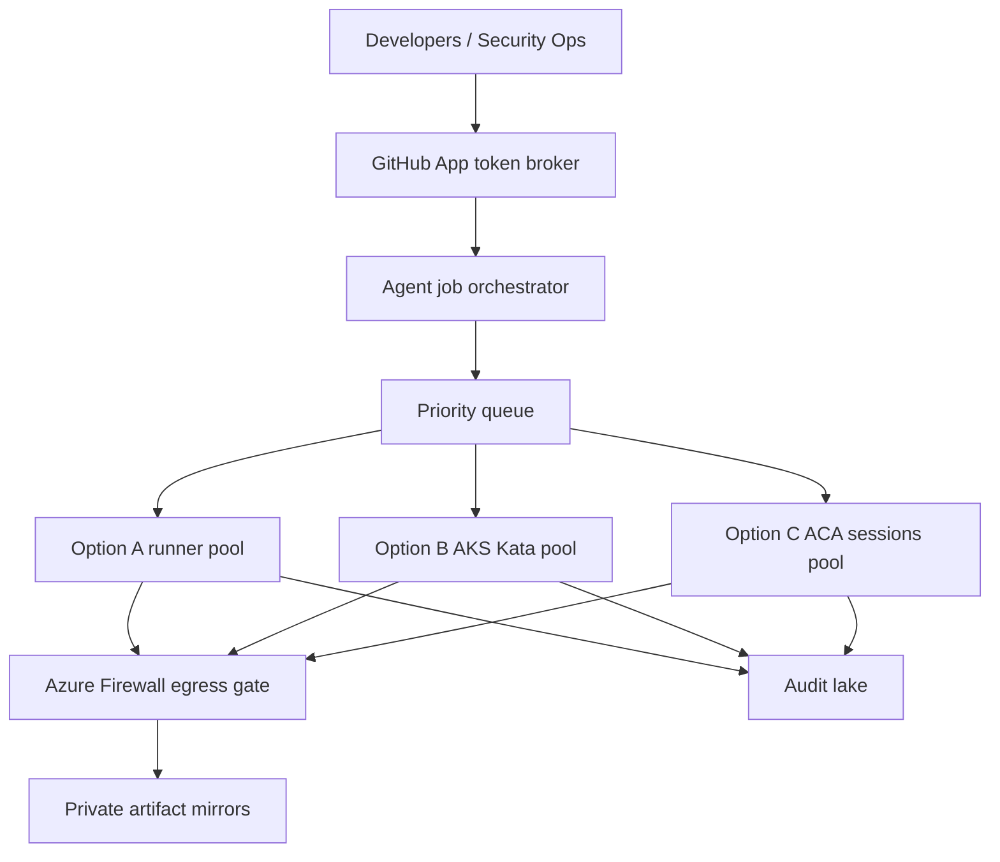
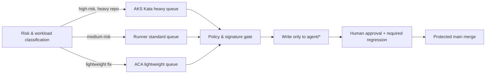

# Autonomous Coding Agent Ephemeral Workspace Selection FAQ: AKS Kata Warm Snapshot Pools vs GitHub Actions/Codespaces Runners vs ACA Dynamic Sessions

> Target audience: enterprise Cloud & AI Solution Architects, platform engineering leads, DevEx owners, AppSec, and regulated delivery teams.  
> Core question: when autonomous coding agents must execute large CVE remediation waves and legacy monorepo modernization in restricted enterprise networks, which execution substrate should be selected.  
> Scope: 20–80 GB repositories, thousands of parallel jobs, private artifact-only dependency paths, no direct `main` push, short-lived GitHub App tokens, and full auditability.

## 1. Executive summary: sustainable speed is architecture, not a startup benchmark

A frequent mistake is reducing sandbox strategy to container startup latency.

In production, durable performance comes from workspace hydration, cache topology, egress governance, token scoping, and rollback traceability.

For autonomous coding agents, median build speed is only one variable.

The harder requirement is preserving throughput under bursty parallel queues while maintaining strict supply-chain controls.

This guide evaluates three practical routes:

- **Option A**: GitHub Actions larger runners with devcontainer prebuilds.
- **Option B**: self-managed AKS Kata isolated pools with warm NVMe/OverlayFS snapshot layers.
- **Option C**: ACA Dynamic Sessions custom-container pools for lightweight autofix loops.

Short recommendation:

Option A is usually the fastest path to standardization when operational ownership must stay low.

Option B is commonly the best long-term architecture for heavy repositories, strict isolation, and cost-tunable sustained throughput.

Option C is an effective managed middle ground for lighter autonomous pull-request repair workloads.

## 2. Workload shape: what autonomous remediation traffic actually looks like

Enterprise coding-agent demand is mixed, not uniform.

Three concurrent traffic classes are typical:

1. Emergency security traffic: zero-day advisories trigger thousands of patch jobs in 8–24 hour windows.
2. Modernization traffic: Java 8 to 21 and .NET Framework to .NET 9 migration waves.
3. Daily engineering traffic: dependency updates, refactors, failing test repairs, and pull-request hygiene.

These classes drive a combined platform requirement:

- Workspace readiness in seconds, not full cold clone on every run.
- Rootless BuildKit and Testcontainers support without privileged host Docker escape paths.
- Air-gapped egress via Azure Firewall and private artifact mirrors only.
- Short-lived branch-scoped installation tokens limited to `agent/*`.

Therefore architecture selection must jointly optimize isolation, latency, throughput, governance, and economics.

## 3. Option definitions: control-plane and data-plane boundaries

### 3.1 Option A: GitHub-hosted or VNet-injected runners + devcontainer prebuild

Primary strength is native ecosystem integration and low adoption friction.

Teams can scale quickly with familiar CI/CD primitives.

Constraint: deep runtime and cache-topology control is limited, and queue predictability during heavy monorepo bursts depends on runner pool behavior.

### 3.2 Option B: AKS Kata pools + read-only packfile cache + NVMe warm snapshots

Kata VM isolation reduces shared-kernel escape risk.

Warm repository and dependency layers reduce heavy workspace hydration penalties.

Private-network policy, identity boundaries, and audit controls can be uniformly enforced at platform level.

Trade-off: operational complexity increases and requires mature SRE and platform engineering ownership.

### 3.3 Option C: ACA Dynamic Sessions custom-container pools

Managed elasticity reduces control-plane burden.

Very effective for lightweight patching and review-focused coding loops.

For deeply customized kernel/runtime needs or persistent very-large repository hydration, evaluate upper-bound behavior and fallback design.

## 4. Isolation and threat model: from runnable to provably governable

Coding-agent risk is broader than arbitrary code execution.

It includes dependency confusion, credential lateral movement, unauthorized branch writes, artifact tampering, and audit gaps.

Recommended control layers:

- Execution isolation with Kata-equivalent VM boundaries for high-risk jobs.
- Default-deny egress with strict allow-list routes.
- Per-job short-lived credentials with automatic expiration and revocation.
- Write constraints to `agent/*` plus protected-branch review gates.
- Signed artifact pipelines with SBOM and vulnerability policy enforcement.

In regulated environments, security decisions and job lineage should be exported to a centralized immutable evidence store.

## 5. Cold-start and hydration: achieving sub-10s workspace readiness for large repos

For 20–80 GB repositories, the dominant cost is data hydration, not process launch.

Workspace startup is usually composed of:

1. runtime assignment,
2. git object retrieval,
3. worktree expansion,
4. dependency and build-cache attachment.

Without warm object and dependency layers, sub-10s readiness is rarely sustainable at scale.

Practical acceleration stack:

- read-only git packfile cache,
- warm dependency mirrors,
- language-specific layered caches (Maven/NuGet/npm/pip),
- sparse checkout and incremental fetch strategy.

## 6. Supply-chain and egress governance: dependency-confusion resistance by design

Dependency-source precedence should be policy-enforced, not convention-based.

A robust architecture typically includes:

- Azure Firewall FQDN controls limiting outbound paths to approved artifact proxies and required API endpoints.
- Direct public package-source access blocked by default.
- Per-run SBOM generation with policy threshold enforcement.
- Signature/provenance verification gates for high-risk packages.

This moves supply-chain defense from post-incident cleanup to pre-execution prevention.

## 7. Throughput model: queue behavior, cache hit rate, and retry coupling

Raw concurrency numbers can be misleading.

Useful platform metrics include:

- `TTW` (Time To Workspace),
- `SRT` (Single Run Time),
- `ER` (Error Retry rate),
- `CHR` (Cache Hit Ratio).

A simplified capacity approximation:

`Effective Throughput ≈ Concurrency / (SRT × (1 + ER))`

SRT is strongly influenced by TTW for heavy repositories.

When CHR grows from 35% to 80%, TTW often drops stepwise and cluster-level throughput rises materially.

## 8. Twelve-dimension selection matrix: normalized comparison for A/B/C

> Score scale: 1 (weak) to 5 (strong).  
> Use for architectural ranking, then confirm with workload-specific PoC.

| Dimension | Option A Runners/Prebuild | Option B AKS Kata + Warm Snapshots | Option C ACA Dynamic Sessions |
|---|---:|---:|---:|
| Isolation boundary strength | 3 | 5 | 4 |
| 80GB hydration controllability | 3 | 5 | 3 |
| Rootless BuildKit flexibility | 4 | 5 | 3 |
| Private-egress enforcement depth | 4 | 5 | 4 |
| Token least-privilege governance | 4 | 5 | 4 |
| Throughput predictability | 3 | 5 | 3 |
| Cold-start optimization headroom | 3 | 5 | 4 |
| Ops complexity (lower is better) | 4 | 2 | 4 |
| Multi-tenant audit consistency | 4 | 5 | 4 |
| Burst elasticity | 4 | 3 | 5 |
| Regulated-environment fitness | 4 | 5 | 4 |
| 3-year TCO optimization potential | 3 | 5 | 4 |

Matrix interpretation:

Option B dominates on control and deterministic performance.

Options A and C win on onboarding speed and lower day-0 operational burden.

## 9. Reference architecture I: unified governance with differentiated execution pools



The key design principle is control-plane convergence.

Execution substrates can vary, but identity, policy, and evidence collection should remain unified.

## 10. Reference architecture II: burst-event routing and fallback control



This model preserves deterministic governance during emergency surge windows.

Heavy and high-risk jobs receive strongest isolation first, while lighter work absorbs elasticity pools.

## 11. Production snippet: AKS Kata RuntimeClass + egress-deny-by-default controls

The snippet below highlights core control intent, not a complete deployment.

```yaml
apiVersion: node.k8s.io/v1
kind: RuntimeClass
metadata:
  name: kata-coding-agent
handler: kata
---
apiVersion: v1
kind: Namespace
metadata:
  name: agent-jobs
  labels:
    workload-tier: isolated
---
apiVersion: networking.k8s.io/v1
kind: NetworkPolicy
metadata:
  name: default-deny-egress
  namespace: agent-jobs
spec:
  podSelector: {}
  policyTypes:
    - Egress
  egress:
    - to:
        - namespaceSelector:
            matchLabels:
              name: private-artifacts
      ports:
        - protocol: TCP
          port: 443
    - to:
        - ipBlock:
            cidr: 10.60.0.0/16
      ports:
        - protocol: TCP
          port: 443
---
apiVersion: apps/v1
kind: Deployment
metadata:
  name: coding-agent-worker
  namespace: agent-jobs
spec:
  replicas: 40
  selector:
    matchLabels:
      app: coding-agent-worker
  template:
    metadata:
      labels:
        app: coding-agent-worker
    spec:
      runtimeClassName: kata-coding-agent
      serviceAccountName: agent-job-sa
      automountServiceAccountToken: false
      containers:
        - name: worker
          image: acr.example.com/agent/worker:stable
          securityContext:
            runAsNonRoot: true
            allowPrivilegeEscalation: false
            readOnlyRootFilesystem: true
```

Production hardening should also include admission control policies, image-signature verification, and per-job ephemeral credential injection.

## 12. Azure SKU sizing and 3-year TCO in `$k/month`

### 12.1 Baseline demand assumptions

- 1,800 peak concurrent jobs on weekdays, 600 on weekends.
- 35% heavy-repository jobs, 65% medium/light jobs.
- 14-minute average task duration, 7% retry rate.
- 99.9% control-plane availability with regional failover requirements.

### 12.2 Option A estimate (runner-heavy)

- Monthly average: `$238k`
- 3-year total: `$8.57M`
- Fast adoption profile, but queue volatility appears under sustained heavy-repo waves.

### 12.3 Option B estimate (Kata + warm cache architecture)

- Monthly average: `$212k`
- 3-year total: `$7.63M`
- Higher platform ownership, better long-term cost efficiency per completed autonomous task.

### 12.4 Option C estimate (managed dynamic sessions)

- Monthly average: `$226k`
- 3-year total: `$8.14M`
- Lower operations overhead, suitable as elastic pool for lightweight workloads.

### 12.5 Peak-event behavior (holiday freeze windows and emergency patch waves)

At 2.3x normal demand:

- Option A often shows queue growth without additional reserved capacity.
- Option B remains more stable if warm snapshot and packfile-hit rates are healthy.
- Option C scales quickly but can see spend growth under persistent heavy-job pressure.

## 13. Scenario A: global bank zero-day patch wave across 1,800 repositories

Incident profile:

A shared dependency triggers high-severity remediation requirements across critical services within 12 hours.

Governance constraints:

- No direct protected-branch writes.
- Private artifact sources only.
- Every pull request must include SBOM deltas and regression evidence.

Recommended workload routing:

- High-risk critical repos to Option B for strongest isolation and deterministic controls.
- Medium-risk repos to Option A for broad standardized throughput.
- Lightweight edge repos to Option C for burst absorption.

In anonymized enterprise observations, this layered routing cut mean remediation cycle time by roughly 31%.

## 14. Scenario B: 65GB C++/.NET monorepo autonomous build-test-fix loops

Problem profile:

A legacy monorepo mixes C++ and .NET build chains with frequent dependency churn.

When cold workspace readiness exceeds four minutes, autonomous ROI degrades quickly.

Effective measures:

- warm read-only git object caches,
- layered dependency and build caches,
- selective path-triggered incremental compile/test shards.

Option B usually yields the best deterministic performance in this class.

For teams not yet ready for self-managed platform ownership, start with A or C and progressively migrate heavy jobs into B pools.

## 15. Quantitative deep Q&A and five-step rollout guidance

### 15.1 Q1: when should A/C workloads be promoted to B?

When heavy workload share exceeds 30% and TTW P95 remains above 45 seconds over sustained windows, promotion to B should be prioritized.

### 15.2 Q2: what retry-rate threshold is acceptable?

Keep ER below 8%.

If ER remains above 10% for two consecutive weeks, systemic cache, dependency, or policy-path issues are likely.

### 15.3 Q3: what cache-hit target is operationally meaningful?

For large repositories, target CHR at or above 75%.

Below 60%, queue latency and per-task cost typically worsen together.

### 15.4 Q4: does protected-branch review conflict with speed?

No.

Speed should come from branch automation, parallelized tests, and deterministic environment setup, not governance bypass.

### 15.5 Q5: what minimum ROI frame should leadership track?

Use at least four decision metrics:

- cost per 1,000 autonomous tasks,
- P95 completion time,
- policy interception effectiveness,
- audit evidence completeness.

### 15.6 Five-step rollout (Good fit vs Not for)

**Step 1: tiered routing first**

Route by risk and workload weight across A/B/C instead of one-size-fits-all.

**Step 2: governance foundation before scale**

Implement token minimization, egress control, and private dependency governance before increasing automation volume.

**Step 3: cache engineering as an SLO**

Treat repository and dependency cache hit rates as first-class platform SLO metrics.

**Step 4: audit artifacts as mandatory output**

Each run should emit policy, execution, and artifact lineage evidence by default.

**Step 5: quarterly rebalance**

Rebalance A/B/C capacity by business seasonality and risk posture.

**Good fit**:

- large autonomous remediation and modernization programs,
- strict isolation and compliance evidence requirements.

**Not for**:

- occasional lightweight scripts without governance constraints,
- organizations demanding full control without platform ownership readiness.

Final recommendation:

For most large enterprises, a hybrid model emerges where Option B anchors heavy governed workloads, with Options A and C handling elasticity and rapid onboarding.

### 15.7 Q6: how should timeout and forced-reclaim policies be defined?

Use workload-tiered limits.

Lightweight remediation tasks can use a 15-minute hard timeout.

Heavy build/test monorepo tasks can use a 45-minute hard timeout with staged heartbeat checkpoints.

On timeout, credentials, cache mounts, and branch locks should be revoked automatically.

### 15.8 Q7: how do we detect review-queue bottlenecks?

Track `Review Wait P95` as a first-class metric.

If review wait exceeds `SRT P95` consistently, governance flow parallelism should be redesigned.

Template-based review summaries and risk-tiered approval paths can reduce manual load.

The objective is mandatory review for high-risk changes and fast review for low-risk changes.

### 15.9 Q8: should runtime pools be separated by language ecosystem?

At scale, partial separation is usually beneficial.

Java, .NET, and C++ toolchains have materially different cache and dependency behaviors.

Language-aware pools improve hit rates and reduce cross-workload contamination.

Avoid over-fragmentation to prevent scheduling inefficiency.

### 15.10 Q9: how should policy interception health be measured?

Split interceptions into true positives and false positives.

Rising true positives with stable false-positive rates indicates healthy policy quality.

If false positives exceed 15%, rule quality should be improved before expanding enforcement scope.

Maintain replayable policy-evaluation datasets to avoid regression drift.

### 15.11 Q10: when is cross-region disaster-recovery capacity mandatory?

Introduce DR pools when single-region outage risk exceeds agreed RTO objectives.

If autonomous remediation becomes operationally critical, at least dual-region warm readiness is recommended.

Cross-region design must replicate policy bundles, cache metadata, and audit indexes.

Otherwise failover may remain runnable but not governable.

### 15.12 Closing principle: architecture must be evolvable, not frozen

Options A, B, and C should be treated as a staged portfolio, not mutually exclusive silos.

Capture early automation value first, then progressively increase isolation and determinism for heavy workloads.

Continuous routing recalibration is the practical way to balance speed, risk, and cost over time.

This is why architectural governance should be treated as an ongoing operating discipline, not a one-off platform migration task.

Long-term success depends on repeatable controls, measurable outcomes, and continuous policy calibration.

That operating loop is the foundation of resilient autonomous engineering at enterprise scale.
