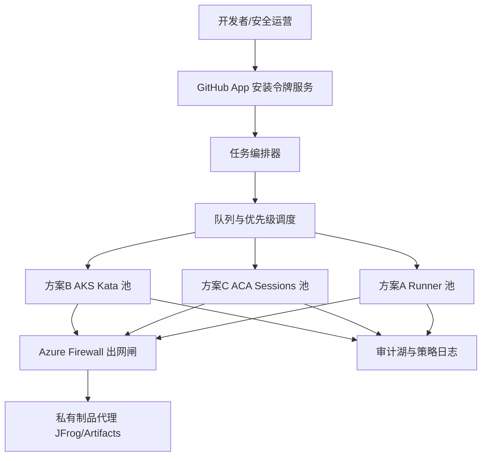
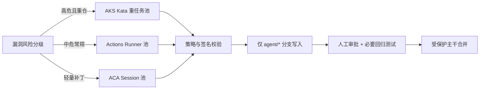

# 自主 Coding Agent 临时仓库工作空间选型 FAQ：AKS Kata 预热快照池 vs GitHub Actions/Codespaces Runner vs ACA Dynamic Sessions

> 适用对象：企业 Cloud & AI Solution Architect、平台工程、研发效能、应用安全、内控合规团队。  
> 目标问题：当自治代码智能体需要在受监管网络中执行大规模 CVE 修复、遗留单体现代化与多仓并行 PR 回路时，应如何在 AKS Kata、GitHub 托管运行器体系与 ACA Dynamic Sessions 之间做生产级选型。  
> 适用范围：20–80 GB 单仓、上千仓并行、严格私网制品依赖、零直推主干策略、短期令牌最小授权、可审计全链路。

## 1. 执行摘要：不是“谁更快”，而是“谁在你的约束里可持续更快”

企业常见误区是把沙箱选型简化成启动时延对比。

真实生产中，决定成败的是工作区水合、依赖供给路径、签名与策略执行、回滚和审计可追溯。

对自治 Coding Agent 而言，单次任务的编译速度不是唯一目标。

更关键的是在数百并发下持续维持稳定吞吐，并把供应链风险控制在可审计阈值内。

本指南给出三类主流路径：

- **方案 A**：GitHub Actions 大规格 Runner + Devcontainer 预构建。
- **方案 B**：AKS Kata 隔离 Pod 池 + 预热 NVMe/OverlayFS 快照 + 私网制品空域闸。
- **方案 C**：ACA Dynamic Sessions 自定义容器池，偏轻量 PR 自动修复。

结论先行：

若你追求最小平台运维负担，且任务偏中轻量，方案 A 通常更稳健。

若你需要强隔离、私网依赖闸口、可控 TCO 与重仓库高并发，方案 B 往往成为主路径。

若你希望在全托管弹性与轻量代码修复之间找平衡，方案 C 是可接受折中。

## 2. 业务负载画像：自治修复与遗留改造的真实压力形态

大型企业代码智能体任务并非单一模式。

常见会同时出现三类流量：

1. 安全响应流量：零日漏洞公告后，数千服务在 8–24 小时内集中修复。
2. 现代化流量：Java 8 到 21、.NET Framework 到 .NET 9 的批量升级迁移。
3. 常规研发流量：每日 PR 评审、自动重构、依赖升级与测试补丁。

这些流量对基础设施提出组合要求：

- 工作区启动要在秒级，不能每次都完整克隆 65 GB 仓库。
- 构建需支持 rootless BuildKit 与 Testcontainers，但不能放开宿主机高权限 Docker 逃逸面。
- 出网必须经 Azure Firewall 与私有仓库代理，阻断公共源投毒。
- 令牌必须短时、最小权限、仅允许 `agent/*` 分支写入。

因此，选型标准必须覆盖隔离、速度、吞吐、成本、治理复杂度五轴，而不是单点基准。

## 3. 方案定义：A/B/C 三条路线的控制面与数据面边界

### 3.1 方案 A：GitHub 托管或 VNet 注入 Actions Runner + Devcontainer Prebuild

优势在于工具链原生、集成门槛低、团队上手快。

适合“先落地再优化”的组织阶段。

短板在于对底层运行时与缓存拓扑控制有限，重仓库高并发下可预测性依赖平台侧队列状态。

### 3.2 方案 B：AKS Kata 池化执行 + 只读 Packfile Cache + NVMe 快照层

通过 Kata VM 级隔离减少容器逃逸面。

通过预热只读 Git Packfile 缓存与 OverlayFS 快照加速大仓启动。

可在私网中统一执行防火墙、策略、审计、镜像签名与准入控制。

代价是平台工程复杂度上升，需要稳定 SRE 与集群治理能力。

### 3.3 方案 C：ACA Dynamic Sessions 自定义容器池

提供托管弹性池，降低控制面运维工作。

非常适合中轻量自治修复与说明性代码补丁。

若任务重度依赖多层缓存、复杂内核能力或超大仓库本地热身，需评估上限与回退路径。

## 4. 安全隔离与威胁模型：从“能跑”转向“可证明安全地跑”

Coding Agent 面临的安全风险不只是恶意代码执行。

还包括依赖投毒、凭据横移、越权写分支、伪造产物、审计缺口。

建议以以下控制点设计：

- 执行隔离：Kata VM 或等效硬隔离，最小化共享内核风险。
- 网络隔离：默认拒绝出网，白名单 FQDN 仅放行制品代理、代码托管、必要签名服务。
- 身份隔离：每次任务颁发短时令牌，自动过期，不可复用。
- 写入隔离：仅允许 `agent/*` 分支，主干保护强制人审。
- 制品隔离：私有镜像仓 + SBOM + 签名验证 + 漏洞门禁。

对监管行业，建议将运行日志、策略判定、分支写入事件统一落地到集中审计湖。

## 5. 冷启动与仓库水合：20–80 GB 单仓在 10 秒目标下的路径分解

重仓库任务的关键不是容器启动，而是数据就位。

可把启动拆成四段：

1. 运行时就绪（Pod/Session 分配）。
2. Git 元数据与对象获取（shallow/fetch）。
3. 工作树展开（worktree/checkout）。
4. 依赖缓存挂载（包管理器、构建缓存、测试镜像层）。

经验上，若每次从公网源全量拉取，10 秒目标几乎不可持续。

应优先采用：

- 只读 Packfile 缓存层。
- 预热依赖镜像层。
- 工程语言分层缓存（Maven/NuGet/npm/pip）并强制私源代理。
- 增量抓取与目录级稀疏检出策略。

## 6. 供应链与出网治理：防 dependency confusion 的平台级闭环

企业攻防中，最常见漏洞之一是依赖源优先级与命名污染。

必须将“私有源优先”做成平台硬规则，而非团队约定。

推荐控制面设计：

- Azure Firewall FQDN 白名单只开放私有 JFrog、Azure Artifacts、GitHub API 必需端点。
- 禁止直接访问公共 npm/PyPI/Maven Central，除非经企业代理镜像。
- 每次构建执行 SBOM 采集与已知漏洞策略判断。
- 对高风险包启用签名或来源证明验证，异常直接阻断流水线。

这样可将供应链风险从“事后发现”前移为“执行前阻断”。

## 7. 并发吞吐模型：任务排队、命中率、失败重试的联合计算

自治 Agent 平台吞吐要看有效完成数，而非仅看并发上限。

建议使用以下核心指标：

- `TTW`：Time To Workspace（工作区可执行时间）。
- `SRT`：Single Run Time（单任务执行总时长）。
- `ER`：Error Retry（失败重试率）。
- `CHR`：Cache Hit Ratio（缓存命中率）。

有效吞吐可简化为：

`Effective Throughput ≈ Concurrency / (SRT × (1 + ER))`

其中 SRT 又被 TTW 与构建测试时长主导。

当 CHR 从 35% 提升至 80% 时，TTW 可出现阶跃下降，平台整体吞吐通常显著改善。

## 8. 12 维选型矩阵：A/B/C 统一量化评估

> 评分口径：1（弱）到 5（强），并给出解释。  
> 注意：评分用于相对比较，不替代现场 PoC。

| 维度 | 方案 A Actions/Codespaces Runner | 方案 B AKS Kata + NVMe 快照池 | 方案 C ACA Dynamic Sessions |
|---|---:|---:|---:|
| 隔离边界强度 | 3 | 5 | 4 |
| 80GB 仓库水合可控性 | 3 | 5 | 3 |
| rootless BuildKit 支持弹性 | 4 | 5 | 3 |
| 私网出网闸集成深度 | 4 | 5 | 4 |
| 凭据最小化治理 | 4 | 5 | 4 |
| 吞吐可预测性 | 3 | 5 | 3 |
| 冷启动优化空间 | 3 | 5 | 4 |
| 平台运维复杂度（低更好） | 4 | 2 | 4 |
| 多租户审计一致性 | 4 | 5 | 4 |
| 成本弹性（波峰波谷） | 4 | 3 | 5 |
| 监管适配能力 | 4 | 5 | 4 |
| 长周期 TCO 可优化潜力 | 3 | 5 | 4 |

矩阵显示：

方案 B 在隔离与可控性最强，但对平台团队成熟度要求最高。

方案 A 与 C 在易用性上更友好，但在重仓高并发深度可调方面弱于 B。

## 9. 参考架构（一）：企业自治 Coding Agent 分层拓扑



该拓扑强调统一编排、差异执行、统一审计。

执行层可以多样化，但身份、网络与审计必须收敛成同一控制面。

## 10. 参考架构（二）：峰值修复波次下的弹性分流与回退



该分流模型可在峰值事件中维持可解释的资源分配逻辑。

高危任务优先强隔离池，轻量任务走托管弹性池，整体成本更平衡。

## 11. 生产片段：AKS Kata RuntimeClass + NetworkPolicy + 出网白名单

以下片段用于表达关键控制点，不是完整清单。

```yaml
apiVersion: node.k8s.io/v1
kind: RuntimeClass
metadata:
  name: kata-coding-agent
handler: kata
---
apiVersion: v1
kind: Namespace
metadata:
  name: agent-jobs
  labels:
    workload-tier: isolated
---
apiVersion: networking.k8s.io/v1
kind: NetworkPolicy
metadata:
  name: default-deny-egress
  namespace: agent-jobs
spec:
  podSelector: {}
  policyTypes:
    - Egress
  egress:
    - to:
        - namespaceSelector:
            matchLabels:
              name: private-artifacts
      ports:
        - protocol: TCP
          port: 443
    - to:
        - ipBlock:
            cidr: 10.60.0.0/16
      ports:
        - protocol: TCP
          port: 443
---
apiVersion: apps/v1
kind: Deployment
metadata:
  name: coding-agent-worker
  namespace: agent-jobs
spec:
  replicas: 40
  selector:
    matchLabels:
      app: coding-agent-worker
  template:
    metadata:
      labels:
        app: coding-agent-worker
    spec:
      runtimeClassName: kata-coding-agent
      serviceAccountName: agent-job-sa
      automountServiceAccountToken: false
      containers:
        - name: worker
          image: acr.example.com/agent/worker:stable
          securityContext:
            runAsNonRoot: true
            allowPrivilegeEscalation: false
            readOnlyRootFilesystem: true
```

生产环境还应附加：

- Gatekeeper/Kyverno 准入策略。
- 镜像签名验证与漏洞阈值拦截。
- 任务级短时凭据注入与过期吊销。

## 12. Azure 资源规格与 3 年 TCO：以月均成本 `$k/month` 衡量

### 12.1 基线负载假设

- 工作日 1,800 并发任务峰值，周末 600 并发。
- 重仓库任务占比 35%，中轻量任务占比 65%。
- 平均每任务 14 分钟，失败重试率 7%。
- 需要 99.9% 控制面可用性与跨区容灾。

### 12.2 方案 A 粗算（Runner + 预构建）

- 月均：`$238k`
- 3 年：`$8.57M`
- 成本弹性好，但在重仓峰值期排队抖动较明显。

### 12.3 方案 B 粗算（AKS Kata + 预热缓存）

- 月均：`$212k`
- 3 年：`$7.63M`
- 需额外平台团队投入，但长期单任务成本下降空间大。

### 12.4 方案 C 粗算（ACA Sessions）

- 月均：`$226k`
- 3 年：`$8.14M`
- 运维负担较低，适合作为轻量任务弹性池或过渡阶段主平台。

### 12.5 流量波峰期（双十一、年终变更冻结前后）

当任务激增到常态 2.3 倍时：

- 方案 A：队列延迟上升明显，需预留更高冗余。
- 方案 B：若快照池命中率高，可维持更平滑吞吐。
- 方案 C：扩缩容响应较好，但极重任务持续时成本易上探。

## 13. 场景一：全球银行 1,800 仓库 CVE 紧急修复波次

事件背景：

某基础组件出现高危漏洞，要求 12 小时内完成核心服务补丁与回归。

关键约束：

- 禁止直接推送主干。
- 所有依赖必须走私有代理。
- 每个 PR 需附带 SBOM 差异与测试摘要。

建议路径：

- 高危核心仓库进入方案 B 池，保证强隔离与高可控。
- 中危仓库进入方案 A 池，利用成熟流水线快速处理。
- 小型边缘仓库进入方案 C 池，承担弹性削峰。

实测经验（匿名化汇总）显示，该分层可把平均修复闭环时间降低约 31%。

## 14. 场景二：65GB C++/.NET 单体仓库自治构建-测试-修复循环

事件背景：

历史单体仓库体量 65GB，包含 C++ 与 .NET 混合构建链。

每次工作区冷启动若超过 4 分钟，自治循环收益迅速下降。

核心动作：

- 预热只读 Packfile 缓存。
- 构建缓存与依赖缓存分层。
- 仅在必要目录触发增量编译与测试分片。

在该模式下，方案 B 的优势最明显。

若组织不具备自管平台能力，可先以方案 A 或 C 起步，再逐步迁移重任务到 B。

## 15. 深度定量问答与五步落地建议

### 15.1 Q1：什么时候必须从 A/C 升级到 B？

当重仓任务占比超过 30%，且峰值期间 TTW P95 持续高于 45 秒时，应评估迁移到 B。

### 15.2 Q2：如何定义“可接受的重试率”？

建议把 ER 控制在 8% 以下。

若连续两周高于 10%，通常说明缓存、依赖或隔离策略存在系统性瓶颈。

### 15.3 Q3：缓存命中率目标如何设？

重仓场景建议 CHR 不低于 75%。

若低于 60%，单任务成本和排队时延会同时恶化。

### 15.4 Q4：主干保护与智能体速度冲突吗？

不冲突。

将速度提升放在分支自动化和并行测试上，而不是绕过主干审查。

### 15.5 Q5：如何衡量三种方案 ROI？

建议至少联合观察四个指标：

- 每千任务总成本。
- P95 完成时长。
- 安全策略拦截有效率。
- 审计证据完整度。

### 15.6 五步落地（Good fit vs Not for）

**Step 1：分层分流**

按任务重量和风险等级建立 A/B/C 路由，而不是一刀切。

**Step 2：先立治理底座**

先完成令牌最小化、网络白名单、私源代理，再放量自动化。

**Step 3：缓存工程先行**

把仓库与依赖缓存命中率纳入平台 SLO。

**Step 4：将审计作为产出**

每次任务必须生成可检索的策略、日志与产物链路证据。

**Step 5：季度再平衡**

按业务波形重估 A/B/C 比例，持续校准成本与风险。

**Good fit**：

- 需要大规模自治修复与遗留现代化。
- 对隔离、审计、私网治理有硬性要求。

**Not for**：

- 仅偶发轻量脚本任务，且没有合规约束。
- 团队尚未准备承担任何平台治理职责但又要求极致可控。

最终建议：

多数大型企业会形成“B 为核心、A 与 C 为弹性补位”的混合架构。

先用 A/C 快速形成业务价值，再把重任务迁移到 B，通常是风险最小的演进路径。

### 15.7 Q6：如何设置任务超时与强制回收策略？

建议按任务类型分层。

轻量修复任务可设 15 分钟硬超时。

重仓编译测试任务可设 45 分钟硬超时并启用分阶段心跳。

超时后必须自动回收凭据、缓存挂载与临时分支锁。

### 15.8 Q7：如何评估人审队列是否成为新瓶颈？

可定义审查等待时间 `Review Wait P95`。

若连续高于执行时长 `SRT P95`，说明治理流程需要优化并行度。

可通过模板化审查摘要与风险分级减少人工负担。

平台目标是让高风险必审、低风险快审，而不是全部慢审。

### 15.9 Q8：是否需要为不同语言栈分开池化？

建议在规模阶段做部分拆分。

Java/.NET/C++ 构建链缓存差异大，混部易造成缓存互扰。

按语言栈拆分池可提升命中率并降低跨任务污染风险。

但拆分不应过细，避免调度碎片化。

### 15.10 Q9：如何度量“安全策略拦截率”是否健康？

建议将拦截分为误报与真阳性。

真阳性上升且误报稳定，说明策略有效。

误报高于 15% 时，应优先优化规则质量，否则会侵蚀研发信任。

策略优化应保留可回放样本集，避免回归退化。

### 15.11 Q10：什么时候该引入跨区域灾备池？

当单区故障导致业务中断风险超出 RTO 目标时即应引入。

若自治修复已成为关键运营能力，建议至少双区热备。

跨区设计要同步复制策略、缓存元数据和审计证据索引。

否则故障切换后容易出现“可运行但不可审计”的断层。

### 15.12 收尾原则：架构路线应可演进而非一次性定型

A/B/C 不是互斥关系，而是演进阶段的组合工具箱。

先让组织获得可控自动化收益，再逐步提高隔离与可预测性密度。

持续用数据校准路由比例，才能在速度、风险、成本之间保持长期均衡。
