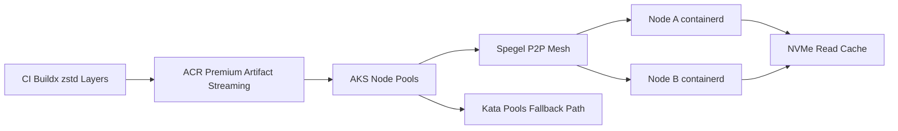
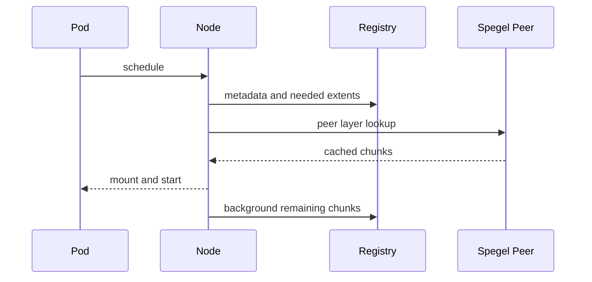

# Enterprise AI agent large image cold-start elimination selection FAQ
> Topic ID: #475
> Section: 3.1 runtime hosting, sandbox, and execution isolation
> Audience: enterprise platform engineering, container SRE, and AI runtime teams
> Goal: reduce `15` to `35 GB` class image cold start to seconds during AKS burst scale events

## 1 Production problem and cold-start bottleneck fundamentals
Enterprise CodeAct sandboxes, document-browser agents, and CUDA inference runtimes often bundle `Chromium`, `LibreOffice`, `Tesseract`, `PyTorch`, and `vLLM/Triton`, which creates double digit GB images.
When `KEDA` and `NAP/Karpenter` trigger `30` to `80` fresh nodes together, the traditional pull and unpack path becomes the dominant startup wall.
Standard `tar.gz` OCI behavior requires full layer download and full extraction before container runtime can start process execution.
However only a small fraction of bytes is usually touched before readiness, so most transferred bytes do not contribute to startup completion.
The second bottleneck is registry egress saturation, because `60` nodes pulling `24 GB` each can burst to `1.44 TB` and trigger `ACR` throttling.
The third bottleneck is node local IO and CPU contention during decompression, which amplifies `PodScheduled -> Ready` tail latency.
The root issue is therefore not only image size, but mismatch across distribution path, working set utilization, topology, and registry throughput.

## 2 Why traditional pull strategies fail under burst autoscaling
Legacy strategies assume gradual node ramp and tolerance for minute scale cold start, which is not acceptable for real-time AI business windows.
When scaling is cluster-wide and concurrent, registry, network, and node disks peak at the same time and any single limit propagates as queueing delay.
Coarse layer partitioning means tiny app changes can invalidate large layers and force expensive redownload cycles.
For `Kata` pools, some host-side lazy mechanisms can also conflict with guest VM storage paths and increase operational friction.
Modern optimization must minimize bytes required for immediate startup and shift upstream bandwidth pressure toward intra-cluster sharing.

## 3 Four architecture patterns
Pattern A combines `ACR Artifact Streaming` with `AKS Spegel`, using block-level lazy fetch plus node-to-node P2P layer sharing.
Pattern B combines `Dragonfly + Nydus/eStargz`, emphasizing chunk-level deduplication and self-managed high-performance distribution.
Pattern C uses pre-pull DaemonSet plus custom Node VHD, emphasizing deterministic local hit ratio and low runtime jitter.
Pattern D anti pattern keeps monolithic `gzip` images on single-region registry without streaming and without P2P.

## 4 Twelve dimension quantified comparison matrix
| Dimension | Pattern A Azure native streaming plus P2P | Pattern B Dragonfly plus Nydus | Pattern C pre-pull plus VHD | Pattern D anti pattern |
|---|---|---|---|---|
| `20 GB` cold start `P95` | `4.5` to `8.5 s` | below `6 s` | `9` to `25 s` | `120` to `240 s` |
| `60` node ACR upstream reduction | `82%` to `91%` | `85%` to `94%` | `40%` to `70%` | `0%` |
| Runtime page-fault jitter | low to medium | low | lowest | high |
| `Kata` compatibility | needs fallback path | medium | high | low |
| CI conversion overhead | low to medium | medium high | medium | low |
| Control-plane complexity | medium | high | medium | low |
| Build pipeline invasiveness | low | medium high | medium | low |
| Local disk footprint | medium | medium | high | high |
| Throttling resilience | high | high | medium | low |
| Rollback complexity | medium | medium high | medium | low |
| Three year blended TCO | `4M` to `12M` | `5M` to `14M` | `3.8M` to `11M` | `6M` to `18M` |
| Recommendation | primary for most AKS fleets | optional for strong platform teams | supplement for `Kata` and warm pools | disallow and migrate |

## 5 Pattern A primary path ACR streaming with Spegel P2P
Pattern A splits startup into immediate runnable working set fetch and background remainder completion.
`Artifact Streaming` allows fast rootfs mount after metadata readiness and only fetches extents touched during boot.
For a `20 GB` image with `1.3 GB` startup working set, transfer path drops from minutes to seconds.
`Spegel` then introduces intra-zone reuse so only seed nodes fetch larger chunks from `ACR` while peers hydrate from cluster-local mesh.
This hybrid design cuts upstream registry pressure and reduces `429` events during burst autoscaling windows.
For `Kata` pools, fallback profiles keep `zstd` layering and P2P benefits without forcing incompatible lazy block paths.
Because pipeline changes are moderate, Pattern A is usually the default enterprise modernization route on AKS.

## 6 Pattern B primary path Dragonfly and Nydus
Pattern B uses chunk-granular fetch and deduplication via `Nydus RAFS` or `eStargz`, then distributes chunks through Dragonfly scheduling.
This path excels where image churn is frequent and dependency overlap is high across releases.
Operational cost is higher because teams must manage seed peers, schedulers, snapshotter lifecycle, and upgrade compatibility.
For organizations with mature platform engineering and extreme startup objectives, Pattern B can deliver very aggressive metrics.
For most teams, long-term operability and troubleshooting burden become the main decision constraints.

## 7 Pattern C path pre-pull DaemonSet and custom VHD
Pattern C shifts byte transfer to off-peak windows so business-time startup relies on local cache.
For deterministic latency requirements, this approach minimizes runtime lazy-fault variability.
With `kube-fledged` or equivalent image warmers, warm pools can achieve near local-hit startup behavior.
Custom Node VHD can further embed baseline dependencies and reduce first-cycle pull overhead.
The tradeoff is prep time for truly fresh nodes and higher disk waste under heterogeneous workload mix.

## 8 Pattern D anti pattern risks
The first anti pattern is a monolithic `28 GB` single-layer `gzip` image where tiny changes force giant repull.
The second anti pattern is single-region `ACR Standard` serving all burst scaling, which increases throttling risk.
The third anti pattern skips layering and compression optimization, causing CPU and IO spikes during extraction.
The fourth anti pattern ignores ephemeral disk governance and eventually triggers `ImagePullBackOff` plus storage exhaustion.
These configurations make scaling events unpredictable and unstable during critical business windows.

## 9 Mermaid AKS cold-start acceleration topology


## 10 Mermaid traditional pull versus streaming startup sequence


## 11 Quantitative Q1 to Q6 worked examples
Q1 legacy startup duration.
`T_legacy = Size_comp / BW_eff + Size_uncomp / Rate_gunzip`.
With `20 GB / 350 MBps + 46 GB / 480 MBps`, duration is about `153 s`.
Q2 streaming startup duration.
`T_stream = Metadata_boot + WorkingSet_boot / BW_range`.
With metadata `1.4 s`, working set `1.3 GB`, and range bandwidth `320 MBps`, duration is about `5.5 s`.
Q3 ACR upstream traffic model.
Without P2P, `E_acr = N * S`.
With P2P, `E_p2p = k_seeds * S + (N-k_seeds)*Miss_rate*S`.
For `N=60`, `S=20 GB`, `k=6`, and `Miss=0.05`, upstream drops to about `108 GB`.
Q4 page-fault jitter estimate.
`J_pf ~= Faults_boot * Avg_fault_penalty`.
Startup trace prefetch can sharply reduce critical-stage fault count.
Q5 disk capacity budget.
`Disk_need = Sum(HotImages_local) + Buffer_gc`.
Pre-pull strategy must be coupled with GC thresholds to avoid capacity oscillation.
Q6 autoscaling SLO.
Use `PodScheduled -> Ready P95` as top-level KPI and split by `ImagePull` and `CreateContainer` stages for diagnosis.

## 12 Code block one ACR streaming and AKS pool configuration
```bicep
resource acr 'Microsoft.ContainerRegistry/registries@2023-07-01' = {
  name: acrName
  location: location
  sku: { name: 'Premium' }
  properties: { adminUserEnabled: false }
}

resource aks 'Microsoft.ContainerService/managedClusters@2024-02-01' = {
  name: aksName
  location: location
  properties: {
    agentPoolProfiles: [
      {
        name: 'syspool'
        count: 3
        vmSize: 'Standard_D8ds_v5'
        osDiskType: 'Ephemeral'
        mode: 'System'
      }
    ]
    securityProfile: { imageCleaner: { enabled: true, intervalHours: 24 } }
    storageProfile: { blobCSIDriver: { enabled: true } }
  }
}
```

## 13 Code block two Spegel Helm values
```yaml
spegel:
  enabled: true
  resolveLatestTag: false
  topologyAwareRouting: true
  mirrorResolveTimeout: 25ms
  containerdRegistryConfigPath: /etc/containerd/certs.d
  peerDiscovery:
    mode: kubernetes
    sameZoneOnly: true
  cache:
    maxSizeGiB: 120
    gcThresholdPercent: 80
  serviceMonitor:
    enabled: true
  resources:
    requests:
      cpu: 100m
      memory: 128Mi
    limits:
      cpu: 500m
      memory: 512Mi
```

## 14 Code block three startup working-set auditor
```python
import time
from pathlib import Path

def read_diskstats(dev: str) -> int:
    for line in Path("/proc/diskstats").read_text().splitlines():
        cols = line.split()
        if cols[2] == dev:
            return int(cols[5]) * 512
    return 0

def measure_ready_window(dev: str, ready_fn, timeout: int = 120):
    start = time.time()
    b0 = read_diskstats(dev)
    while time.time() - start < timeout:
        if ready_fn():
            break
        time.sleep(0.2)
    b1 = read_diskstats(dev)
    elapsed = time.time() - start
    mb = (b1 - b0) / 1024 / 1024
    return {"seconds_to_ready": round(elapsed, 2), "mb_read_before_ready": round(mb, 1)}

def slo_ok(result: dict) -> bool:
    return result["seconds_to_ready"] < 10.0
```

## 15 Enterprise scenarios and three year TCO
### 15.1 Scenario A quantitative hedge-fund research platform
This platform bursts `64` nodes around earnings windows at `08:30 EST` with a `23 GB` runtime image.
Before redesign, cold start `P95` was commonly above `160 s` and registry throttling created startup jitter.
After moving to Pattern A, startup consumed only boot working set plus P2P peer hydration and `P95` dropped to `6.4 s`.
Observed ACR upstream burst traffic dropped by roughly `88%` and `429` alerts were significantly reduced.
### 15.2 Scenario B multi-tenant `Kata` browser and document agent
This workload required strict isolation and stable latency, so the team used Pattern C warm baseline with Spegel and `zstd` layering.
Because of guest path compatibility constraints, host-side lazy block dependency was limited on `Kata` pools.
The resulting design improved `NAP` fresh-node pull time by about `3.8x` while keeping isolation guarantees.
### 15.3 Three tier three year blended TCO
| Tier | Peak node scale | Recommended mix | Three year blended TCO |
|---|---:|---|---:|
| Tier 1 | `20` nodes | Pattern C plus A | `4.1M` USD |
| Tier 2 | `60` nodes | Pattern A primary | `8.3M` USD |
| Tier 3 | `120` nodes | Pattern A plus B | `12.9M` USD |
### 15.4 D0 D1 D2 runbook with 18 actions
- **D0-1** Inventory image size, working-set ratio, and burst autoscale profile.
- **D0-2** Upgrade to `ACR Premium` and scope streaming repositories.
- **D0-3** Define `zstd` layer split standards and CI guardrails.
- **D0-4** Design Spegel topology and same-zone preference policy.
- **D0-5** Define `Kata` compatibility fallback and validation matrix.
- **D0-6** Define cold-start SLO and evidence collection schema.
- **D1-1** Enable streaming rules and roll out node-pool canary.
- **D1-2** Deploy Spegel and verify cross-node hit ratio.
- **D1-3** Build startup trace prefetch list and refresh cadence.
- **D1-4** Run `60` node burst test and registry stress checks.
- **D1-5** Tune cache GC threshold and disk headroom policy.
- **D1-6** Publish rollback playbook and execute drill.
- **D2-1** Review weekly `PodScheduled -> Ready` percentiles.
- **D2-2** Review weekly ACR egress and throttling events.
- **D2-3** Review monthly Spegel hit ratio and topology skew.
- **D2-4** Review monthly layer growth and build efficiency.
- **D2-5** Review quarterly `Kata` compatibility exceptions.
- **D2-6** Review quarterly strategy mix and budget profile.
Cold-start decomposition metrics should be release gates so startup regressions are caught before business windows.
For high-frequency release teams, integrate working-set analysis into CI to flag risky layer changes in pull requests.
When ACR throttling rises, verify seed-node sizing and P2P hit ratio before expanding autoscale limits.
Multi-region operation should validate replication lag and ensure target regions are hydrated before peak windows.
Cache benefit depends on node lifespan, so very short-lived nodes can reduce effective P2P reuse.
Latency-sensitive premium tenants may use fixed warm pools with constrained cross-pool scheduling.
Disk governance must align with layering strategy to avoid GC behavior destroying cache stability.
Regulated workloads should retain pull-source and cache-hit audit trails for incident reconstruction.
If cold start rises sharply, inspect working-set drift and layer reorder before defaulting to larger node counts.
The objective is to transform scaling from bandwidth gambling into working-set-driven byte delivery.
Over time this improves response speed, utilization efficiency, and resilience during peak events.
Strategic value comes from sustainable startup predictability under strict security and isolation requirements.

Sources fetched on 2026 11 27
Azure Container Registry artifact streaming
https://learn.microsoft.com/azure/container-registry/artifact-streaming-overview
AKS image and node optimization guidance
https://learn.microsoft.com/azure/aks/best-practices-performance-scale
Spegel project
https://github.com/spegel-org/spegel
Nydus RAFS format
https://github.com/dragonflyoss/image-service
Karpenter and NAP concepts
https://learn.microsoft.com/azure/aks/node-autoprovision
