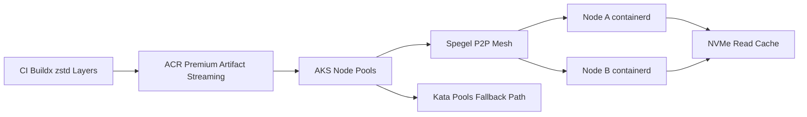
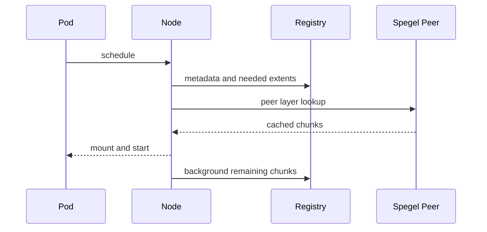

# 企业 AI 智能体超大容器冷启动消除选型 FAQ
> Topic ID: #475
> Section: 3.1 计算宿主、沙箱与运行时隔离
> Audience: 企业平台工程、容器平台 SRE 与 AI Runtime 团队
> Goal: 将 `15` 到 `35 GB` 级镜像在 AKS 爆发扩容场景下冷启动降到秒级

## 1 生产问题与冷启动瓶颈本质
企业级 CodeAct 沙箱、文档浏览器智能体与 CUDA 推理容器往往包含 `Chromium`、`LibreOffice`、`Tesseract`、`PyTorch` 与 `vLLM/Triton`，镜像体积通常在双位数 GB。
当 `KEDA` 与 `NAP/Karpenter` 在开盘或大促窗口同时拉起 `30` 到 `80` 新节点时，传统拉取解压链路会成为绝对瓶颈。
标准 `tar.gz` 路径要求先下载全部层，再解压全部文件，随后容器才能真正进入可启动阶段。
但启动窗口中实际被读取的文件通常只占总字节的少数比例，未被访问的大量字节仍然被同步下载与解压，形成纯冷启动浪费。
第二个瓶颈是注册中心出口带宽，`60` 节点同时拉取 `24 GB` 级镜像可瞬时打出 `1.44 TB` 流量，极易触发 `ACR` 限流与跨可用区链路拥堵。
第三个瓶颈是节点本地磁盘压测，集中解压阶段会对 IO 与 CPU 形成叠加压力，放大 `PodScheduled -> Ready` 尾延迟。
因此问题不是“镜像太大”一句话，而是分发路径、工作集利用率、节点拓扑和注册中心吞吐同时失配。

## 2 传统镜像拉取策略为何在高并发扩容失灵
传统方案假设单节点渐进扩容与可容忍分钟级冷启动，这在 AI 实时业务窗口并不成立。
当扩容是集群级并发触发时，注册中心、网络、节点磁盘会同步进入冲顶，任何单点限速都可能扩散为全局排队。
镜像层划分粗糙时，一次微小业务变更会迫使节点重复拉取大层，缓存命中与增量复用几乎失效。
对于 `Kata` 隔离池，某些宿主机级懒加载机制还会与来宾虚机块设备路径出现兼容摩擦，进一步增加复杂性。
因此现代治理重点应从“加机器”转到“减少必须即时传输字节”与“把上游带宽压力转移到节点内网协同”。

## 3 四种架构路径总览
Pattern A 采用 `ACR Artifact Streaming` 与 `AKS Spegel` 组合，前者做按需块级拉取，后者做节点间 P2P 层共享。
Pattern B 采用 `Dragonfly + Nydus/eStargz`，强调跨版本块级去重与自管高性能分发网络。
Pattern C 采用预拉取 DaemonSet 与自定义 Node VHD，强调确定性本地命中与低运行时抖动。
Pattern D 反模式是单层超大 `gzip` 镜像直连单区域注册中心，无流式与无 P2P。

## 4 十二维量化对比矩阵
| 维度 | Pattern A Azure 原生流式加 P2P | Pattern B Dragonfly 加 Nydus | Pattern C 预拉取加 VHD | Pattern D 反模式 |
|---|---|---|---|---|
| `20 GB` 镜像冷启动 `P95` | `4.5` 到 `8.5 s` | `< 6 s` | `9` 到 `25 s` | `120` 到 `240 s` |
| `60` 节点 ACR 上游流量削减 | `82%` 到 `91%` | `85%` 到 `94%` | `40%` 到 `70%` | `0%` |
| 页面缺页抖动 | 低到中 | 低 | 最低 | 高 |
| `Kata` 兼容性 | 需回退策略 | 中 | 高 | 低 |
| CI 转换开销 | 低到中 | 中高 | 中 | 低 |
| 控制面运维复杂度 | 中 | 高 | 中 | 低 |
| 构建链路侵入性 | 低 | 中高 | 中 | 低 |
| 节点本地磁盘占用 | 中 | 中 | 高 | 高 |
| 限流抗性 | 高 | 高 | 中 | 低 |
| 回滚复杂度 | 中 | 中高 | 中 | 低 |
| 三年综合 TCO | `4M` 到 `12M` | `5M` 到 `14M` | `3.8M` 到 `11M` | `6M` 到 `18M` |
| 推荐结论 | 大多数 AKS 主路径 | 自研能力强可选 | `Kata` 及稳态池补充 | 禁用并迁移 |

## 5 Pattern A 主路径 ACR 流式与 Spegel P2P
Pattern A 将冷启动拆成两个阶段，即立即可运行所需的最小工作集拉取和后台剩余块补齐。
`Artifact Streaming` 通过块级范围读取让容器在元数据完成后快速挂载根文件系统，启动阶段只拉取被真实访问的块。
在 `20 GB` 镜像下，若启动前工作集仅 `1.3 GB`，理论传输时间可从分钟级降到秒级。
`Spegel` 再把节点间复用能力引入同可用区内网，只有少量种子节点从 `ACR` 拉取完整块，其他节点优先走 P2P 命中。
这种“上游减压 + 内网扩散”组合可显著降低注册中心出口峰值并减少 `429`。
对 `Kata` 池可启用兼容回退，保留 `zstd` 分层与 P2P 分发收益，避免来宾块设备路径冲突。
该模式对现有构建流水线改造相对可控，通常是企业 AKS 的首选现代化方案。

## 6 Pattern B 主路径 Dragonfly 与 Nydus
Pattern B 通过 `Nydus RAFS` 或 `eStargz` 将镜像访问粒度细化到 chunk，配合 Dragonfly 在集群内做高效块级分发。
该路径在高频镜像迭代与跨版本共享场景中表现突出，重复依赖可获得极高去重率。
代价是自管组件较多，含 seed peer、scheduler 与 snapshotter 生命周期管理，升级窗口与故障定位成本更高。
若团队具备成熟平台工程能力并追求极致性能，Pattern B 可取得非常激进的冷启动指标。
但对多数企业而言，长期维护复杂度和可运维性是主要决策约束。

## 7 Pattern C 路径 预拉取 DaemonSet 与自定义 VHD
Pattern C 的思想是把字节传输前置到业务窗口之外，在节点闲时完成预拉取并固化基础环境。
对于低抖动刚性场景，这一路径可避免运行时懒加载缺页带来的尾延迟波动。
配合 `kube-fledged` 或镜像预热 DaemonSet，可让常用镜像在温池内接近本地命中。
自定义 Node VHD 还能把常见依赖前置到镜像层面，减少首轮拉取压力。
不足在于对突发新节点仍有准备时间，且多工作负载并存时本地磁盘浪费会增加。

## 8 Pattern D 反模式风险
反模式第一类是把 `28 GB` 单层 `gzip` 镜像直接投产，导致任意微小改动都触发巨量重拉取。
反模式第二类是单区域 `ACR Standard` 承载全区域爆发扩容，注册中心易进入限流抖动。
反模式第三类是不做层拆分与压缩优化，解压阶段 CPU 与 IO 双高，节点就绪时间不可预测。
反模式第四类是忽视磁盘容量治理，最终演变成 `ImagePullBackOff` 与 `ephemeral-storage` 告警风暴。
这类配置会把扩容变成不可控事件，严重影响开盘与峰值业务窗口稳定性。

## 9 Mermaid AKS 冷启动加速拓扑


## 10 Mermaid 传统拉取与流式启动对照时序


## 11 量化推导 Q1 到 Q6
Q1 传统冷启动时长。
`T_legacy = Size_comp / BW_eff + Size_uncomp / Rate_gunzip`。
若 `20 GB / 350 MBps + 46 GB / 480 MBps`，可得约 `153 s`。
Q2 流式启动时长。
`T_stream = Metadata_boot + WorkingSet_boot / BW_range`。
若元数据 `1.4 s`、工作集 `1.3 GB`、带宽 `320 MBps`，可得约 `5.5 s`。
Q3 ACR 上游流量。
无 P2P 时 `E_acr = N * S`。
有 P2P 时 `E_p2p = k_seeds * S + (N-k_seeds)*Miss_rate*S`。
以 `N=60`、`S=20 GB`、`k=6`、`Miss=0.05` 估算，上游可降到约 `108 GB`。
Q4 缺页抖动评估。
`J_pf ~= Faults_boot * Avg_fault_penalty`。
通过启动轨迹预取可显著压缩关键阶段缺页数量。
Q5 磁盘占用预算。
`Disk_need = Sum(HotImages_local) + Buffer_gc`。
预拉取策略需与垃圾回收阈值联动，否则会引发容量抖动。
Q6 扩容 SLO 判定。
建议将 `PodScheduled -> Ready P95` 设为一级指标，并与 `ImagePull`、`CreateContainer` 子阶段拆分观测。

## 12 代码块一 ACR 流式与 AKS 节点池配置
```bicep
resource acr 'Microsoft.ContainerRegistry/registries@2023-07-01' = {
  name: acrName
  location: location
  sku: { name: 'Premium' }
  properties: { adminUserEnabled: false }
}

resource aks 'Microsoft.ContainerService/managedClusters@2024-02-01' = {
  name: aksName
  location: location
  properties: {
    agentPoolProfiles: [
      {
        name: 'syspool'
        count: 3
        vmSize: 'Standard_D8ds_v5'
        osDiskType: 'Ephemeral'
        mode: 'System'
      }
    ]
    securityProfile: { imageCleaner: { enabled: true, intervalHours: 24 } }
    storageProfile: { blobCSIDriver: { enabled: true } }
  }
}
```

## 13 代码块二 Spegel Helm 配置示例
```yaml
spegel:
  enabled: true
  resolveLatestTag: false
  topologyAwareRouting: true
  mirrorResolveTimeout: 25ms
  containerdRegistryConfigPath: /etc/containerd/certs.d
  peerDiscovery:
    mode: kubernetes
    sameZoneOnly: true
  cache:
    maxSizeGiB: 120
    gcThresholdPercent: 80
  serviceMonitor:
    enabled: true
  resources:
    requests:
      cpu: 100m
      memory: 128Mi
    limits:
      cpu: 500m
      memory: 512Mi
```

## 14 代码块三 启动工作集审计器
```python
import time
from pathlib import Path

def read_diskstats(dev: str) -> int:
    for line in Path("/proc/diskstats").read_text().splitlines():
        cols = line.split()
        if cols[2] == dev:
            return int(cols[5]) * 512
    return 0

def measure_ready_window(dev: str, ready_fn, timeout: int = 120):
    start = time.time()
    b0 = read_diskstats(dev)
    while time.time() - start < timeout:
        if ready_fn():
            break
        time.sleep(0.2)
    b1 = read_diskstats(dev)
    elapsed = time.time() - start
    mb = (b1 - b0) / 1024 / 1024
    return {"seconds_to_ready": round(elapsed, 2), "mb_read_before_ready": round(mb, 1)}

def slo_ok(result: dict) -> bool:
    return result["seconds_to_ready"] < 10.0
```

## 15 企业落地场景与三年 TCO
### 15.1 场景 A 对冲基金量化研究平台
该平台在财报窗口 `08:30 EST` 触发 `64` 节点扩容，单镜像约 `23 GB`，历史上冷启动 `P95` 常超过 `160 s`。
切换 Pattern A 后，启动阶段只拉取工作集块并由 Spegel 在同区扩散，`P95` 冷启动降至 `6.4 s`。
同窗 ACR 上游突发流量下降约 `88%`，`429` 限流告警显著减少，峰值策略执行稳定性明显提升。
### 15.2 场景 B 多租户 `Kata` 文档与浏览器智能体
该业务要求强隔离与低抖动，最终采用 Pattern C 预热基线并叠加 Spegel 与 `zstd` 分层分发。
由于 `Kata` 来宾路径兼容约束，团队避免在该池强依赖宿主块级懒加载，转而强化温池命中策略。
改造后 `NAP` 新节点拉取时间约提升 `3.8x`，同时保持会话隔离与启动稳定性。
### 15.3 三档三年综合 TCO
| 档位 | 峰值节点规模 | 推荐组合 | 三年综合 TCO |
|---|---:|---|---:|
| Tier 1 | `20` 节点 | Pattern C 加 A | `4.1M` 美元 |
| Tier 2 | `60` 节点 | Pattern A 主路径 | `8.3M` 美元 |
| Tier 3 | `120` 节点 | Pattern A 加 B | `12.9M` 美元 |
### 15.4 D0 D1 D2 运行手册共 18 项
- **D0-1** 盘点镜像体积、工作集比例与峰值扩容模型。
- **D0-2** 升级 `ACR Premium` 并定义流式仓库范围。
- **D0-3** 建立 `zstd` 分层构建规范与层拆分门禁。
- **D0-4** 规划 Spegel 拓扑与同区优先策略。
- **D0-5** 定义 `Kata` 兼容回退策略与验证项。
- **D0-6** 设定冷启动 SLO 与证据采集口径。
- **D1-1** 发布流式规则并灰度启用节点池。
- **D1-2** 部署 Spegel 并验证跨节点命中率。
- **D1-3** 建立启动轨迹预取列表并定期更新。
- **D1-4** 压测 `60` 节点并发扩容与注册中心负载。
- **D1-5** 校准磁盘回收阈值与缓存上限。
- **D1-6** 发布回滚剧本并完成演练记录。
- **D2-1** 每周复核 `PodScheduled -> Ready` 百分位。
- **D2-2** 每周复核 ACR 出口流量与限流告警。
- **D2-3** 每月复核 Spegel 命中率与拓扑偏斜。
- **D2-4** 每月复核镜像层增长与构建效率。
- **D2-5** 每季度复核 `Kata` 池兼容性与例外清单。
- **D2-6** 每季度优化策略组合与预算模型。
运行后应把冷启动拆解指标纳入发布门禁，避免镜像回归在业务窗口才暴露。
对高频更新团队，建议将工作集分析接入 CI，在 PR 阶段提示高风险层变更。
当 `ACR` 限流上升时，应先检查种子节点数与 P2P 命中率，而非直接放宽扩容阈值。
多区域部署需考虑跨区复制时延，确保高峰前镜像已完成目标区域同步。
缓存系统要与节点生命周期协同，短命节点过多会削弱 P2P 网络整体收益。
如需严格确定性延迟，可为关键租户提供固定温池并限制跨池调度。
磁盘容量治理建议结合镜像分层策略，否则清理策略会反向影响命中率。
对于合规要求高的工作负载，应保留拉取来源与命中路径审计，以支持事后追踪。
当检测到冷启动显著抬升，应优先排查工作集变化与构建层重排，而非盲目扩容。
平台治理目标是把扩容从“带宽赌博”转为“按需字节交付”，使峰值窗口可预测。
通过持续优化，企业可在不牺牲隔离与安全前提下实现秒级启动体验与可控成本结构。
最终收益体现在业务响应速度、资源利用率与故障韧性三方面的长期稳定提升。
若企业同时运行研究沙箱与生产推理混合集群，建议把镜像冷热分层目录纳入平台资产台账，按业务关键度制定不同的预热与回收优先级，避免关键服务与实验服务在同一高峰窗口争抢缓存空间。
在组织协同层面，应要求算法团队在提交镜像时附带启动工作集清单和层变更说明，平台团队据此自动评估冷启动风险分并反馈到合并检查流程，使性能治理前置到开发阶段而非上线后补救。
针对跨可用区拓扑，推荐将 Spegel 对等节点选择策略与拓扑感知调度联合配置，优先同区同节点组命中，再回退跨区拉取，以降低私有链路拥塞概率并稳定高峰窗口内网络尾延迟表现。
当业务存在突发监管审计或市场黑天鹅事件时，可临时提升种子节点比率并预热关键镜像版本，同时冻结非必要镜像发布，确保应急扩容链路保持高命中与低抖动状态，避免并发变更叠加放大风险。
对于需要长期保存多版本运行环境的团队，建议将基础依赖层与业务代码层完全解耦，基础层按季度滚动，业务层按周迭代，配合内容寻址校验可显著提高版本间复用效率并降低重复传输字节总量。
为保障回滚确定性，平台应保留最近两个稳定镜像族的预热索引与缓存配额，不仅要保证新版本可快启，也要保证回退版本同样可在秒级恢复，从而避免故障期间出现“回滚比发布更慢”的反直觉现象。
在金融与医疗等高合规行业，建议把镜像来源、转换链路、分发命中路径、节点就绪时间统一写入不可变审计仓，既支撑性能复盘，也为合规检查提供可验证证据，减少跨团队口径不一致带来的审计摩擦。
为了抑制镜像体积无序增长，应建立镜像预算制度并按工作负载类型设定硬阈值，超过阈值自动触发构建失败或强制审阅，推动依赖瘦身、分层重构与基础镜像治理成为日常工程习惯而非专项运动。
当观测发现 `ImagePull` 时间下降但总体 Ready 仍慢时，需同步排查 `initContainer`、模型加载脚本与启动探针阈值，避免把所有问题都归因于分发路径，确保优化动作聚焦真正瓶颈并避免资源误投。
建议在容量规划中引入“单位秒级启动成本”指标，将网络费用、缓存占用、构建复杂度与值班成本纳入同一财务模型，帮助管理层在性能与成本之间做量化决策，而不是仅依据单点压测数据拍板。
对于多租户平台，可按租户等级分配差异化预热策略，高优先级租户绑定专属温池与更高缓存保留阈值，普通租户走共享池与动态回收策略，在保障核心体验的同时控制整体基础设施开销。
平台治理委员会应每月复盘一次冷启动异常样本，按“镜像构建问题、分发链路问题、节点环境问题、业务初始化问题”四类归档，并沉淀标准化排障脚本，持续提升一线值班人员处理效率与准确性。
当引入新代 GPU 节点规格时，必须重新标定解压吞吐、磁盘带宽与默认缓存策略，避免沿用旧代参数导致误判；新硬件上线后的首个季度应提高观测采样密度，尽快收敛最优配置区间。
通过持续执行这些工程治理动作，企业可以把大镜像冷启动从偶发性能事故转变为可规划、可预测、可审计的常规能力建设，确保 AI 智能体平台在高峰时段仍维持稳定响应与弹性扩展质量。

来源抓取日期 2026 11 27
Azure Container Registry artifact streaming
https://learn.microsoft.com/azure/container-registry/artifact-streaming-overview
AKS image and node optimization guidance
https://learn.microsoft.com/azure/aks/best-practices-performance-scale
Spegel project
https://github.com/spegel-org/spegel
Nydus RAFS format
https://github.com/dragonflyoss/image-service
Karpenter and NAP concepts
https://learn.microsoft.com/azure/aks/node-autoprovision
