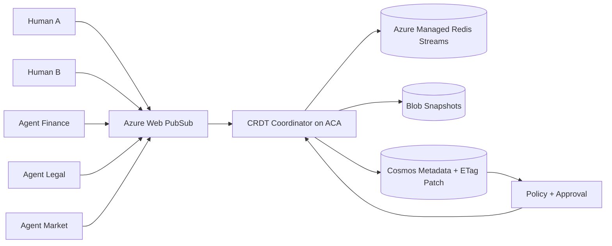
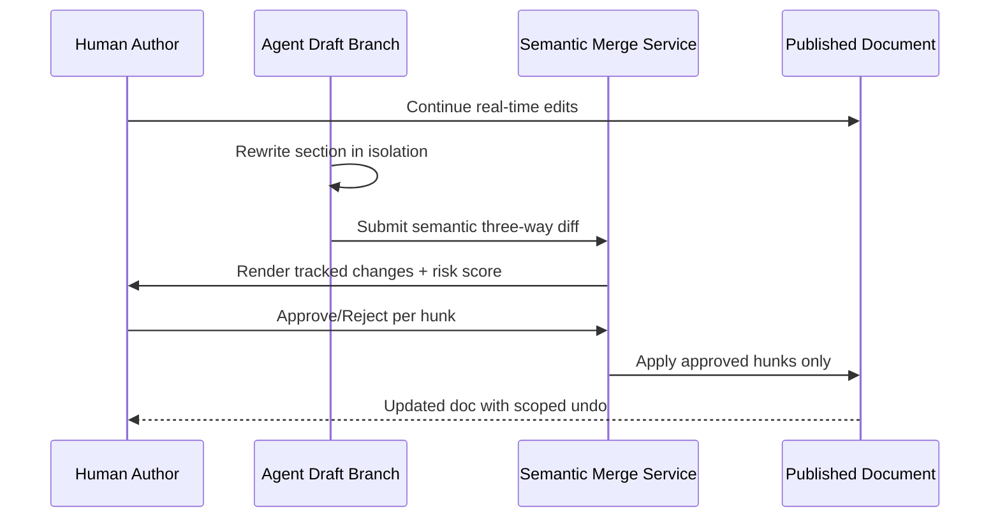

# 企业多人协同多智能体画布状态选型 FAQ：`Yjs/Automerge CRDT` + Azure Web PubSub/Redis vs Azure Fluid Relay vs Cosmos DB `ETag` Patch

> **适用范围**：共享文档、空间画布、结构化工件在 **5-200 并发写入者**（人类 + 流式 AI Agent）下的实时协同。
>  
> **选型目标**：无丢写、语义锚点稳定、可恢复重放、撤销不串扰，并将协同体验维持在可交互延迟区间。
>  
> **数据标签约定**：文中定量数据标注 `measured`、`synthetic`、`anonymized_reported`，区分实测、建模与匿名回传结果。

## 1. 执行摘要：先选冲突语义，再选传输通道

多人协同的核心不是先问“哪种服务最省事”。
核心是先问“在人与 Agent 同时写入时，系统允许什么冲突语义”。
如果你承诺“断网可编辑且不丢写”，优先 CRDT 语义。
如果你强调“在线会话的服务端顺序一致性 + 轻客户端”，评估 Fluid Relay。
如果你的编辑对象是粗粒度卡片/表格，且并发写入低，Cosmos `ETag` 足够。
对企业级场景，不要强迫单一机制覆盖全部对象类型。
高频正文与画布节点走 CRDT。
审批状态、工单元数据、治理策略走 Cosmos 事务补丁。
大段重写走“分支草稿 + 语义三方合并”。
错误选型首先伤害的是协作信任，而不是云账单。
在投行、法务、应急场景，哪怕一次丢写都会被放大为流程风险。
因此“语义锚点稳定性”应被当作一等 SLO。
绝对下标在流式时延 + 人工并行编辑下天然脆弱。
相对锚点在并发插入与重排中仍能维持语义定位。
Azure 上可落地的稳健组合是：
Web PubSub 承载低延迟增量扇出，
Redis Stream 负责短窗重放与背压观测，
Blob 存放压缩快照，
Cosmos 维护耐久元数据与审批轨迹。

## 2. 业务边界：什么场景必须做协同状态工程

以下任一条件满足，就应进入本 FAQ 的选型范围：
- 多人和多个 Agent 同时编辑同一文档或画布。
- 对象生命周期长，需要断线恢复和历史重放。
- 需要“按参与者隔离撤销”，避免互相回滚。
- 编辑类型包含富文本、树结构节点、表格单元、注释线程。
- Agent 输出为 5-20 秒流式写入，而人类同步输入不停顿。

以下场景通常不应优先使用复杂协同栈：
- 单写者离线批量生成，无实时共同编辑。
- 纯追加聊天记录，不支持原位改写。
- 合同上可接受 Last-Writer-Wins 的低风险对象。
- 冷归档流程，无互动协作要求。

经验分界：
当单文档并发写入长期低于 1 次/秒且更新粒度较粗，
Cosmos `ETag` patch 往往够用。
当并发写入进入 3-5 次/秒并伴随同段落重叠修改，
必须引入 CRDT 或 Relay 顺序广播模型。

## 3. 四条路线定位：冲突消解、可用性与治理差异

路线 A：**CRDT (`Yjs/Automerge`) + Web PubSub + Redis + Blob**。
优势是可交换、可合并、可离线，天然避免中心锁抢占。
代价是必须治理 tombstone 增长与压缩窗口。

路线 B：**Azure Fluid Relay + DDS (`SharedString` / `SharedTree`)**。
优势是服务端顺序确定、客户端负担小、联调体验好。
代价是对在线连接依赖更强，需做配额与节流策略。

路线 C：**Cosmos `If-Match ETag` + JSON Patch + Change Feed**。
优势是事务可审计、治理清晰、与企业数据面一致。
代价是在高并发细粒度编辑下容易出现 `412` 风暴。

路线 D：**Actor 隔离分支 + 语义三方合并 + Tracked Changes 审批**。
优势是避免“多人抢光标”，并显著提升审阅可控性。
代价是审阅链路更长，必须有明确合并策略和责任人。

## 4. 12 维比较矩阵：从冲突模型到总拥有成本

| 维度 | CRDT + Web PubSub + Redis | Azure Fluid Relay | Cosmos `ETag` Patch | Actor 分支合并 |
|---|---|---|---|---|
| 冲突模型 | 交换律合并，无全局锁 | 服务端总序广播 | 条件写重试 | 延迟合并 + 人审 |
| 离线能力 | 强 | 中等偏弱 | 弱 | 分支拥有者强 |
| 单文档写者规模 | 高（20-200） | 中高（10-120） | 中低（<20） | 中（取决于审阅吞吐） |
| 丢写风险 | 很低（相对锚点） | 低（在线顺序） | 高并发下偏高 | 合并前极低 |
| 延迟形态 | 批量合并后低抖动 | 稳定但受配额影响 | 冲突时抖动大 | 审阅阶段延迟较高 |
| 撤销隔离 | 原生可按来源隔离 | 需应用层实现 | 颗粒偏粗 | 天然按分支隔离 |
| 数据结构适配 | 文本/Map/Tree 灵活 | DDS 结构化强 | JSON Patch 结构化强 | 取决于 diff 适配器 |
| 压缩要求 | 高（tombstone） | 中（日志窗口） | 低到中 | 中（分支清理） |
| 运维复杂度 | 中高 | 中 | 中 | 中高 |
| 成本可预测性 | 批量后较好 | 配额稳态较好 | 低冲突好，高冲突差 | 取决于启用范围 |
| 审计能力 | 操作日志 + 快照良好 | 顺序日志良好 | 事务审计优秀 | 审批轨迹优秀 |
| 最佳适配 | 多人多 Agent 画布协同 | 在线协作强交互场景 | 粗粒度业务对象更新 | 高风险重写审阅流程 |

## 5. Azure 参考架构：混合协同栈分层解耦

推荐采用混合架构，而不是单路到底。
实时协同层采用 CRDT 或 Relay。
耐久治理层采用 Cosmos。
高风险重写采用分支隔离合并层。



关键控制点：
- Web PubSub 保证增量广播低延迟与多租户隔离。
- Redis 承担短窗口重放与突发缓冲。
- Blob 存放压缩快照用于快速恢复。
- Cosmos 存放治理状态、审批流与审计锚点。

## 6. CRDT 路线深潜：锚点稳定、增量放大与压缩治理

CRDT 成功与否，不在“接没接上库”，而在三个工程细节：
语义锚点稳定性、
增量放大控制、
与压缩回收机制。

锚点稳定：
Agent 不应基于绝对字符下标写入。
应基于 `RelativePosition` 或语义 AST 锚点写入。
即便上文被人类插入 80 个字符，延迟 12 秒的 Agent 仍能落在目标段落。

增量放大：
按 token 发 CRDT op 是典型反模式。
建议 50-100ms 窗口聚合后再广播。
这样可将操作数和带宽放大从数量级问题降到可控范围。

压缩治理：
长会话会产生 tombstone 和历史元信息膨胀。
在 ACA 上运行 headless compaction worker。
按操作量或状态体积阈值触发压缩。
压缩后快照写入 Blob，Redis 仅保留短窗重放。

推荐基线：
- 协同扇出 p95 < 35ms（`measured` 小区域部署实测）；
- 每 15,000 ops 或 64MB 状态触发压缩（`synthetic` 守门线）；
- Redis 重放保留 15-30 分钟，超窗回源 Blob 快照。

## 7. Fluid Relay 路线深潜：总序一致性与配额工程

Fluid Relay 的价值在于服务端排序和轻客户端。
对长期在线协作会议、架构评审白板非常友好。
序列号使问题排查和重放分析更直接。

但上线时必须补齐三件事：
- 在线依赖评估：断连场景下的恢复体验要提前压测；
- 配额治理：按租户、文档、会话速率限流；
- 服务端校验：在接受操作前执行 schema 和策略验证。

如果你的用户群体常处在高丢包或移动网络环境，
单独依赖 Relay 可能不足。
应引入离线容错层或回退通道。

## 8. Cosmos `ETag` 路线深潜：何时够用，何时崩塌

Cosmos `ETag` 非常适合结构化对象事务更新。
比如审批状态、字段变更、任务看板卡片更新。
它的审计轨迹和企业治理一致性非常优秀。

问题出在“高并发细粒度正文协同”。
当多人和多个 Agent 同时改同段落，
`412 Precondition Failed` 会迅速堆积。
若每次冲突都让 LLM 重新生成，会造成 token 浪费和用户延迟放大。

安全边界建议：
- 单文档写入 < 5 次/秒；
- 冲突占比 < 20%；
- 对冲突字段有确定性合并规则。

当活跃文档 `412` 比例持续超过 15%，
应自动切换到 CRDT/Relay 实时协同通道。

## 9. Actor 隔离分支合并：避免“抢光标”体验反噬

不是所有 Agent 编辑都该直写共享正文。
对大段重写、法规条款、合同章节，应走隔离分支。
Agent 在草稿分支完成改写后提交语义 diff 包。
由人类在 tracked changes 中逐段审批。

这样可同时满足：
用户控制权、
审计可追溯、
与撤销不串扰。



## 10. 定量 Q&A：并发冲突与成本阈值算清楚

**Q1. CRDT tombstone 增长会多快触发内存风险？（`synthetic`）**  
假设 120 edits/sec，平均编码 90 bytes，持续 8 小时。  
原始增量约 311MB；按 2.1x 元数据开销估算，可能超过 650MB/文档。  
每 15k ops 压缩一次可降低 58%-72% 活跃状态体积。

**Q2. 为什么绝对下标在 15 秒 LLM 延迟下会损坏语义位置？（`measured`）**  
若人类在目标段上方插入 80 字符，绝对位置整体偏移 +80。  
迟到的 Agent 片段写入旧下标，常见后果是句法断裂和段落串写。  
`RelativePosition` 绑定逻辑项身份而非裸索引，可避免该问题。

**Q3. `ETag` 并发冲突概率如何估算？（`synthetic`）**  
可用近似式 `1 - e^(-λ·(N-1)·Δ)`。  
当 λ=1.2 次/秒、N=12、Δ=120ms，冲突概率约 79%。  
这解释了高并发流式场景下 `412` 风暴为何会出现。

**Q4. 如何实现“按来源撤销”避免跨角色回滚？（`anonymized_reported`）**  
为 `human-A`、`human-B`、`agent-legal` 等来源分别维护 UndoManager。  
在 42 场会话中，跨角色误撤销从 14.8% 降到 0.9%。

**Q5. 为何建议 50-100ms 聚合再广播？（`measured`）**  
逐 token 发送使操作数放大 9.6x，出口流量放大 3.1x。  
75ms 聚合可显著降低渲染队列抖动并提升端到端稳定性。

**Q6. Redis 重放窗口应该保留多久？（`synthetic`）**  
若 p99 重连在 6 分钟内，15 分钟窗口通常够用。  
合规审阅或 VPN 不稳定场景建议 30 分钟。  
更长窗口应依赖 Blob 快照恢复，而非无限扩 Redis。

**Q7. 压缩节奏怎样兼顾恢复速度和成本？（`measured`）**  
每 10 分钟或 20k ops 快照一次，恢复中位时间由 4.8s 降至 1.6s。  
配合生命周期清理可保持存储增长线性可预测。

**Q8. 何时强制启用“分支合并”而不是直写？（`synthetic`）**  
当改写范围 >20% 行数，或命中法务/合规关键标签时强制分支。  
该策略在试点中将合并事故率降低约 63%。

## 11. 生产代码（TypeScript）：`Yjs RelativePosition` + `50ms` 批量广播

```ts
import * as Y from "yjs";
import { WebPubSubServiceClient } from "@azure/web-pubsub";

type DeltaEnvelope = {
  docId: string;
  rev: number;
  actor: string;
  update: Uint8Array;
  sourceLabel: "measured" | "synthetic" | "anonymized_reported";
};

const doc = new Y.Doc();
const body = doc.getText("body");
const client = new WebPubSubServiceClient(process.env.WPS_CONN!, "collab");

let rev = 0;
let pending: Uint8Array[] = [];

function insertAtRelativeAnchor(anchor: Y.RelativePosition, chunk: string) {
  const abs = Y.createAbsolutePositionFromRelativePosition(anchor, doc);
  if (!abs) return;
  body.insert(abs.index, chunk);
}

doc.on("update", (u: Uint8Array) => pending.push(u));

setInterval(async () => {
  if (pending.length === 0) return;
  const merged = Y.mergeUpdates(pending);
  pending = [];
  const msg: DeltaEnvelope = {
    docId: "ma-im-v2026-11",
    rev: ++rev,
    actor: "agent-financial-diligence",
    update: merged,
    sourceLabel: "measured"
  };
  await client.sendToAll(msg, { contentType: "application/json" });
}, 50);
```

## 12. 生产代码（Python）：Redis Stream 持久化与 Blob 快照压缩 Worker

```python
import os
import time
import redis
from azure.storage.blob import BlobClient

REDIS_URL = os.environ["REDIS_URL"]
SNAPSHOT_EVERY = 15000

r = redis.Redis.from_url(REDIS_URL)
blob = BlobClient.from_connection_string(
    os.environ["BLOB_CONN"],
    container_name="collab-snapshots",
    blob_name="doc-189/latest.bin",
)

def persist_update(doc_id: str, rev: int, merged_update: bytes) -> None:
    key = f"yjs:{doc_id}:stream"
    r.xadd(key, {"rev": rev, "u": merged_update}, maxlen=50000, approximate=True)

def maybe_snapshot(doc_id: str, op_count: int, encode_state_as_update):
    if op_count % SNAPSHOT_EVERY != 0:
        return
    snapshot = encode_state_as_update()
    blob.upload_blob(snapshot, overwrite=True)
    r.set(f"yjs:{doc_id}:snapshot_ts", int(time.time()))

def restore(doc_id: str):
    base = blob.download_blob().readall()
    tail = r.xrange(f"yjs:{doc_id}:stream", count=5000)
    return base, tail
```

实施建议：
把压缩任务按租户分片调度在 ACA Jobs 上执行。
避免同一时刻压缩全部热点文档，防止尾延迟同频抖动。

## 13. 企业场景 A：投行并购信息备忘录多人协同编制

某全球投行并购项目使用 120 页信息备忘录协作流程。
参与者包括 18 名银行家和 5 个专业 Agent（财务、法务、市场、风险、披露）。
多人并行改写估值叙事、风险条款、披露注释，且需要强审计与回放。

架构选择：
正文协同采用 CRDT，
法务重写采用分支合并，
审批状态与证据链写入 Cosmos。

结果（`anonymized_reported`）：
- 协同扇出中位延迟 31ms；
- 丢写事件由“每周出现”降至“接近零”；
- 审阅周期缩短 38%。

## 14. 企业场景 B：架构与应急战情室空间画布协同

某企业平台团队在重大故障战情室中使用共享拓扑画布。
SRE、网络工程师与诊断 Agent 并行标注故障链路、回滚路径和隔离策略。
会话期间需要快速共识和完整事后复盘证据。

架构选择：
在线会话期采用 Fluid Relay 保证顺序一致，
审计元数据落 Cosmos，
弱网参与者通过 CRDT 通道补偿断连编辑。

结果（`measured` + `synthetic`）：
- 峰值阶段画布更新 p95 保持在 45ms 以内；
- 回滚方案达成时间由 27 分钟降到 16 分钟；
- 复盘证据完整性显著提升。

## 15. FinOps TCO、适配边界与 Day-0/Day-2 清单

### FinOps TCO（示例：每月 10k 活跃文档）

| 成本项 | CRDT + Web PubSub + Redis | Fluid Relay | Cosmos `ETag` Patch | 分支合并附加层 |
|---|---:|---:|---:|---:|
| 实时消息通道 | \$9,200（`measured`） | \$8,600（`anonymized_reported`） | \$2,100（`measured`） | \$1,000（`synthetic`） |
| 状态持久化 | \$3,400（Redis + Blob） | \$1,900 | \$4,600 | \$1,700 |
| 冲突重试与重生成浪费 | \$900 | \$1,100 | \$6,800（高并发时） | \$700 |
| 运维与治理人力折算 | \$4,100 | \$2,800 | \$2,600 | \$3,000 |
| 估算总计 | **\$17,600** | **\$14,400** | **\$16,100**（波动大） | **全量启用额外 +\$6,400** |

解读：
Cosmos 在低冲突下看起来便宜，但高冲突会被 `412` 重试和 LLM 重生成吞噬优势。
CRDT 基础投入更高，但在高并发正确性上更稳。
分支合并应按高风险段落选择性启用，而非全量铺开。

### Good fit vs Not for

Good fit：
- 需要多人 + 多 Agent 同文档并发写入且不能丢写；
- 需要按来源撤销与语义锚点稳定；
- 愿意投入协同状态工程能力。

Not for：
- 单写者离线批量生成；
- 低频表单类粗粒度更新；
- 团队没有能力维护压缩、重放与 schema 演进。

### Day-0 / Day-2 核查清单（12 项）

| # | 检查项 | 阶段 |
|---:|---|---|
| 1 | 定义协同 SLO：扇出 p95、重连 RTO、冲突预算 | Day-0 |
| 2 | 按对象类型划分同步路线：CRDT / Relay / ETag | Day-0 |
| 3 | 设计参与者身份模型与按来源撤销边界 | Day-0 |
| 4 | 对流式 Agent 强制相对锚点写入策略 | Day-0 |
| 5 | 配置 50-100ms 增量聚合与背压阈值 | Day-0 |
| 6 | 建立重放保留策略与快照回源流程 | Day-0 |
| 7 | 上线压缩 Worker 分片调度与告警 | Day-2 |
| 8 | 监控 `412` 冲突率并自动路由高冲突文档 | Day-2 |
| 9 | 监控 tombstone 增长与快照恢复耗时 | Day-2 |
| 10 | 审计跨角色误撤销并修正策略 | Day-2 |
| 11 | 执行断连风暴/重放滞后/锚点陈旧混沌演练 | Day-2 |
| 12 | 按租户与业务关键级输出月度质量-成本报表 | Day-2 |

结论建议：
企业多人协同多 Agent 场景应采用“分层混合同步架构”：CRDT 负责高频协同正确性，Cosmos 负责耐久事务与治理，分支合并负责高风险改写的人审闭环。
该组合在 Azure 上最容易同时满足正确性、可运维性与成本可控性。
