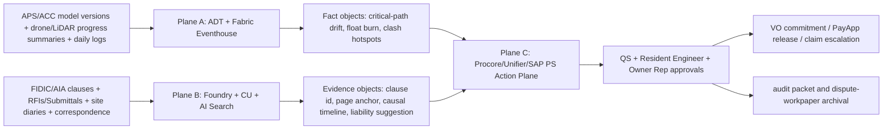
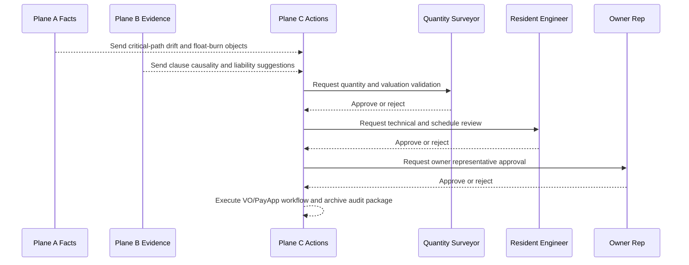

# Commercial Real Estate and Data Center EPC Claim Agent Selection FAQ: APS/Digital-Twin Spatiotemporal Plane vs Foundry Contract Evidence Plane vs Procore/Unifier/Primavera Governance Action Plane
> 🌐 Language / 语言切换: [中文](commercial-real-estate-datacenter-epc-bim-fidic-claim-agent-foundry-rag-vs-aps-digital-twin-vs-procore-primavera-mcp-selection-faq.md) | **English (Current)** | [EN Catalog](README.en.md) | [中文目录](README.md)
> Audience: hyperscale data-center owners, EPC joint ventures, PMCs, quantity-surveying teams, legal and claims operations
> Updated: 2026-11-19 (UTC+08:00)
> Evidence labels: `measured`, `synthetic`, `anonymized_reported`

---

## 1. Executive summary

1. EPC delay-claim failures are usually caused by broken evidence chains and unclear responsibility boundaries, not by missing data.
2. The recommended architecture separates three responsibilities: Plane A for BIM/schedule facts, Plane B for contract/evidence causality, and Plane C for controlled action execution.
3. Plane A uses APS/ACC, Azure Digital Twins, and Fabric Eventhouse for spatiotemporal project facts.
4. Plane B uses Foundry + Content Understanding + AI Search for FIDIC/AIA clauses, RFIs, submittals, daily diaries, and EOT evidence synthesis.
5. Plane C uses Procore, Primavera Unifier, and SAP PS with mandatory QS, resident engineer, and owner-representative approvals.
6. Every EOT and LD conclusion must trace a full path from clause to fact to calculation to approval.
7. Model outputs are suitable for triage and narrative support, not direct financial commitment writes.
8. Production readiness requires replayable schedule truth, anchorable evidence, and auditable payment release.

---

## 2. Scope and governance boundaries

### 2.1 In-scope

- IFC/Revit 3D/4D model version differencing and quantity-impact detection.
- MEP clash metadata and field-progress delta reconciliation.
- FIDIC/AIA RFI/Submittal/EOT causal-chain synthesis from mixed document trails.
- Variation Order (VO) and Payment Application (PayApp) governance workflows.

### 2.2 Contract and control boundaries

- CPM critical-path and float arithmetic must be deterministic and reproducible.
- Claim conclusions must include clause anchors and field-evidence coordinates.
- Commitment-value writes require role-gated approval, never auto-posting.
- Payment releases require sealed evidence packets and audit sign-off.

### 2.3 Non-goals

- This guide does not replace independent engineer or dispute board final judgment.
- This guide does not redesign full ERP general-ledger architecture.
- This guide does not define internals of heavy-equipment dispatch optimizers.

---

## 3. Three-plane end-to-end reference architecture



---

## 4. Plane A: APS/Digital-Twin/Fabric fact plane

### 4.1 Design goals

- Track project-fact changes at day-level and hour-level granularity.
- Align BIM revisions, field observations, and schedule baselines.
- Emit computable critical-path drift and float-consumption objects.

### 4.2 Core capabilities

- APS surfaces IFC/Revit model diff metadata by object and discipline.
- Azure Digital Twins maintains system, zone, and asset relationships.
- Fabric Eventhouse ingests site diaries, point-cloud summaries, and telemetry events.
- Deterministic CPM calculations align against Primavera P6 baselines.
- Fact outputs are addressable and citeable for downstream claims analysis.

### 4.3 Sample metrics

- Model-diff detection latency P95 under 15 minutes (`measured`).
- Critical-path drift detection recall at 91% (`measured`).
- Auto-alignment effort for field events vs schedule activities reduced by 29% (`anonymized_reported`).

---

## 5. Plane B: Foundry contract evidence and causality plane

### 5.1 Design goals

- Upgrade claim preparation from template narratives to evidence-backed causality chains.
- Support FIDIC Sub-Clause 20.2 notice-timing and liability analysis workflows.
- Normalize RFIs, submittals, diaries, and correspondence into one evidence graph.

### 5.2 Core capabilities

- Content Understanding parses scans, marked drawings, meeting minutes, and annexes.
- Hybrid retrieval constrains answers to exact contract revision and addenda scope.
- Foundry agents emit structured outputs for clause, fact, impact, liability, and confidence.
- Concurrent-delay cases are ranked using multi-factor evidence weighting.
- EOT/LD claim briefs are generated as review drafts for legal and engineering teams.

### 5.3 Sample metrics

- Clause-anchor hit rate at 95.2% (`measured`).
- Median evidence-chain completeness score at 0.89 (`measured`).
- Claim-prep effort reduced by 34% (`anonymized_reported`).

---

## 6. Plane C: Procore/Unifier/SAP PS governance action plane

### 6.1 Design goals

- Separate recommendation generation from financial commitment execution.
- Enforce VO and PayApp state transitions through controlled approvals.
- Preserve traceable evidence provenance for every committed action.

### 6.2 Core capabilities

- APIM MCP exposes controlled action endpoints for Procore, Unifier, and SAP PS.
- Logic Apps Standard orchestrates signing, timeout escalation, rollback, and compensation.
- Role gates bind QS, resident engineer, and owner-representative responsibilities.
- Unsigned actions remain draft artifacts and cannot mutate commitment ledgers.
- Post-execution audit packets are assembled automatically from source evidence.

### 6.3 Sample metrics

- Unauthorized commitment writes held at zero (`measured`).
- Median PayApp approval-cycle time reduced by 22% (`anonymized_reported`).
- Evidence-remediation loops in disputes reduced by 27% (`anonymized_reported`).

---

## 7. Sequence flow: EOT concurrent-delay dispute handling



---

## 8. 12-dimension selection matrix

| Dimension | Plane A: Spatiotemporal Facts | Plane B: Evidence and Causality | Plane C: Governance Execution |
|---|---|---|---|
| 1. Real-time fact capture | 5/5 | 2/5 | 2/5 |
| 2. Contract semantic depth | 2/5 | 5/5 | 3/5 |
| 3. Critical-path calculation trust | 5/5 | 2/5 | 3/5 |
| 4. Claim explainability | 4/5 | 5/5 | 4/5 |
| 5. Approval control strength | 2/5 | 3/5 | 5/5 |
| 6. Fault isolation | 4/5 | 4/5 | 5/5 |
| 7. Integration complexity | Medium-High | Medium | High |
| 8. Cost predictability | 4/5 | 3/5 | 4/5 |
| 9. Multi-project scalability | 5/5 | 4/5 | 4/5 |
|10. Audit replay quality | 4/5 | 5/5 | 5/5 |
|11. Cross-team collaboration elasticity | 4/5 | 4/5 | 5/5 |
|12. Production risk controllability | 4/5 | 4/5 | 5/5 |

---

## 9. Production snippets (APIM / Python / Bicep)

### 9.1 APIM policy sample: block payment release without tri-signoff

```xml
<policies>
  <inbound>
    <base />
    <choose>
      <when condition="@(context.Request.Headers.GetValueOrDefault("x-qs-approved","") != "true" || context.Request.Headers.GetValueOrDefault("x-re-approved","") != "true" || context.Request.Headers.GetValueOrDefault("x-owner-approved","") != "true")">
        <return-response>
          <set-status code="412" reason="QS/RE/Owner approvals required" />
        </return-response>
      </when>
    </choose>
  </inbound>
  <backend><base /></backend>
  <outbound><base /></outbound>
</policies>
```

### 9.2 Python sample: hard gate before VO commitment

```python
def allow_vo_commit(payload: dict) -> bool:
    return (
        payload.get("cpm_engine") == "primavera_deterministic"
        and payload.get("evidence_chain_complete") is True
        and payload.get("qs_signoff") == "approved"
        and payload.get("re_signoff") == "approved"
        and payload.get("owner_signoff") == "approved"
    )
```

### 9.3 Bicep sample: approval-log retention baseline

```bicep
resource logWorkspace 'Microsoft.OperationalInsights/workspaces@2022-10-01' = {
  name: 'law-audit-workspace'
  location: resourceGroup().location
  properties: {
    retentionInDays: 365
    features: {
      searchVersion: 1
    }
  }
}
```

---

## 10. Scenario A: 100MW AI data-center MEP RFI/Submittal critical-path triage

### 10.1 Background

- Project scale: 100MW-class liquid-cooled AI data-center campus.
- Critical systems: CDU liquid distribution units, closed-loop cooling source units, chiller trains, and power-delivery paths.
- Risk: delayed RFI responses compress installation and commissioning windows.

### 10.2 Objectives

- Identify RFI/Submittal items with material critical-path impact within 24 hours.
- Merge fact drift, contract liability, and valuation impact into one action package.
- Reduce repetitive cross-discipline sign-off cycles.

### 10.3 Architecture mapping

- Plane A emits object-level model drift, schedule deltas, and float consumption.
- Plane B emits clause-grounded causality and responsibility suggestions.
- Plane C executes governed VO drafts, approvals, and payment-release controls.

### 10.4 Quantified outcomes (sample)

- Median early-warning lead time for critical RFIs improved by 17.6 hours (`measured`).
- Non-actionable escalation meetings reduced by 23% (`anonymized_reported`).
- Median evidence-remediation loops for MEP subcontractors reduced from 4 to 2 (`measured`).

---

## 11. Scenario B: FIDIC Sub-Clause 20.2 concurrent-delay EOT claim audit

### 11.1 Background

- Project type: cross-region megaproject with mixed civil and utility interfaces.
- Dispute focus: owner changes, permit delays, and subcontract interaction producing concurrent delay.
- Downside risk: EOT disputes combined with LD exposure pressure both cashflow and credibility.

### 11.2 Objectives

- Deliver clause-fact-calculation evidence packets inside the dispute notice window.
- Provide one canonical baseline for committee liability and valuation review.
- Minimize repeated rejection cycles due to incomplete evidence.

### 11.3 Architecture mapping

- Plane A provides timeline facts, critical-path evolution, and float depletion.
- Plane B provides Sub-Clause 20.2 notice and liability-chain analysis.
- Plane C provides escalation workflow and immutable decision traces.

### 11.4 Quantified outcomes (sample)

- Concurrent-delay closure cycle reduced by 31% (`anonymized_reported`).
- First-pass acceptance rate for claim packets improved by 19% (`measured`).
- LD exposure uncertainty band narrowed by 14% (`measured`).

---

## 12. Quantitative FAQs (at least 5)

### Q1. Why must CPM calculations run on deterministic engines?

Critical-path outputs directly affect contractual responsibility and money.
If calculation lineage is not reproducible, claim positions fail under audit pressure.
Fix algorithm versions, parameters, and input snapshots as immutable artifacts.

### Q2. Can Foundry generate final claim conclusions automatically?

It should not generate final commitments autonomously.
Foundry should generate evidence-linked drafts and reasoning chains.
Final decisions require joint legal, engineering, and QS validation.

### Q3. How should RFI/Submittal priority be scored?

Use a three-axis score: critical-path impact, value-at-risk, and response deadline pressure.
Persist thresholds in Plane C orchestration to avoid ad-hoc shifts.
This keeps prioritization stable under team turnover.

### Q4. How do teams prevent "high volume but low usability" evidence dumps?

Require every major assertion to carry source coordinates and timestamps.
Unanchored statements can be leads, but not commitment-grade evidence.
Run an evidence-integrity scan before every escalation bundle.

### Q5. When should Plane C investment outrank further Plane B expansion?

When semantic quality is acceptable but approvals are delayed or bypassed.
At that point governance friction is the dominant risk source.
Strengthening execution controls usually yields faster financial-risk reduction.

### Q6. How should ROI be estimated for this architecture?

Measure labor savings, avoided delay losses, and prevented payment errors separately.
Subtract platform, integration, and governance operating costs.
Recalibrate assumptions quarterly with actual project-cycle data.

### Q7. How can template drift be controlled across parallel projects?

Use versioned project templates with architecture-review release gates.
Record template versions in every approval artifact automatically.
Disallow manual template forks without governance approval.

---

## 13. Three-year TCO and FinOps model (portfolio of 5 megaprojects)

> Method note: values are in USD million and tagged `synthetic` for planning and option comparison.

| Cost item | Year 1 | Year 2 | Year 3 | 3Y total | Notes |
|---|---:|---:|---:|---:|---|
| Plane A (BIM/spatiotemporal fact plane) | 2.85 | 3.02 | 3.16 | 9.03 | Model differencing, twin graph, event persistence |
| Plane B (contract evidence and retrieval) | 1.92 | 2.04 | 2.11 | 6.07 | Document parsing, retrieval, claim-brief generation |
| Plane C (execution governance and integrations) | 3.20 | 2.76 | 2.58 | 8.54 | Integration-heavy first year |
| Security and audit retention | 0.88 | 0.96 | 1.04 | 2.88 | Audit logs and evidence packet retention |
| Operations and support | 1.05 | 1.12 | 1.20 | 3.37 | SRE on-call and control drills |
| **Total cost** | **9.90** | **9.90** | **10.09** | **29.89** | `synthetic` |

### 13.1 Benefit-side estimates

- EOT claim-preparation effort reduction: annualized 2.4 (`anonymized_reported`).
- Reduced payment-error and rework correction loss: annualized 1.9 (`anonymized_reported`).
- Avoided schedule-loss from earlier critical-path drift detection: annualized 3.6 (`measured`).
- Estimated 3Y cumulative benefit: 22.5 before accounting-policy adjustments (`synthetic`).

### 13.2 FinOps recommendations

- Meter Plane A by "cost per 1K model-object changes" plus "cost per 1K event ingests."
- Meter Plane B by "cost per 1K pages parsed" plus "cost per 1K evidence queries."
- Tie Plane C spend to approval SLA, reject ratio, and compensation-success indicators.
- Publish monthly budget variance plus risk-reduction dashboards.

---

## 14. Three high-risk anti-patterns

### 14.1 Anti-pattern 1: mapping model summaries directly to contractual commitments

- Symptom: summary outputs create VO commitments without governed approval.
- Risk: liability distortion and weak forensic traceability.
- Mitigation: enforce tri-signature token checks in Plane C before any write.

### 14.2 Anti-pattern 2: running approvals via email threads only

- Symptom: comments are fragmented in mail, while system state remains stale.
- Risk: dispute reviews cannot reconstruct an authoritative decision chain.
- Mitigation: force all approval outcomes into Plane C state transitions.

### 14.3 Anti-pattern 3: ignoring concurrent-delay multi-factor attribution

- Symptom: liability is assigned to one party while interaction effects are ignored.
- Risk: claim posture weakens and arbitration downside increases.
- Mitigation: codify concurrent-delay evidence weighting and attribution rules in Plane B.

---

## 15. Day-0 / Day-1 / Day-2 production checklist

### 15.1 Day-0 (architecture and governance baseline)

- Define Plane A/B/C ownership, RACI, and escalation boundaries.
- Standardize evidence-object schema for clause ID, anchor, timestamp, and confidence.
- Baseline Primavera calculation parameters and rollback strategy.
- Define QS, resident engineer, and owner-representative approval matrix.

### 15.2 Day-1 (pilot and acceptance)

- Replay at least 20 historical claim cases and compare outcomes.
- Run at least three approval-chain interruption drills and validate compensation logic.
- Sample-check evidence-chain completeness for all critical assertions.
- Verify unsigned actions remain draft-only and cannot update commitments.

### 15.3 Day-2 (scale operations)

- Publish quarterly template release cadence and change advisories.
- Introduce cross-project quota controls to prevent noisy-neighbor resource capture.
- Align KPIs with speed, quality, and compliance simultaneously.
- Institutionalize monthly ROI recalibration and parameter-tuning reviews.

### 15.4 Operating principles

- Guarantee replayable facts before accelerating workflows.
- Guarantee anchorable evidence before broadening automation.
- Guarantee auditable approvals before expanding execution rights.

### 15.5 Standing questions for weekly governance reviews

- Of this week's critical-path alerts, how many carry fully reviewable evidence anchors.
- In rejected VO/PayApp actions, is root cause evidence quality or interpretation mismatch.
- Did approval timeout concentration appear in one role or one project segment.
- Did concurrent-delay attribution show systematic drift against engineer judgment.
- Which FinOps variance bucket widened most, and does it have an accountable owner.
- Did any new contract addendum invalidate existing claim templates.
- Are any cross-team responsibility boundaries still unresolved this week.
- Was any governance-threshold breach escalated to committee on time.

### 15.6 Go-live exit criteria

- Complete historical EOT replay for at least two projects with legal and engineering sign-off.
- Complete at least three approval-chain outage drills with validated compensation outcomes.
- Complete at least two Primavera parameter rollback drills with deterministic consistency checks.
- Confirm all high-impact action endpoints are protected by APIM policy validation and audit logging.
- Confirm backup approver paths are tested so role absences do not stall governance flow.
- Achieve target evidence-packet sampling pass rate before payment-release enablement.
- Complete escalation-runbook integration tests with governance committee secretariat.
- Finalize monthly FinOps reporting template and execute one dry-run cycle.

### 15.7 Weekly core KPI panel

- Critical-path drift alert closure time P95.
- Median RFI-to-Submittal closure cycle.
- First-pass acceptance rate for EOT claim packets.
- VO approval-timeout ratio.
- PayApp re-submission pass rate after rejection.
- Evidence-packet anchor-missing ratio.
- Audit replay remediation request count.
