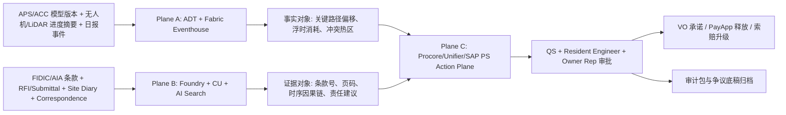
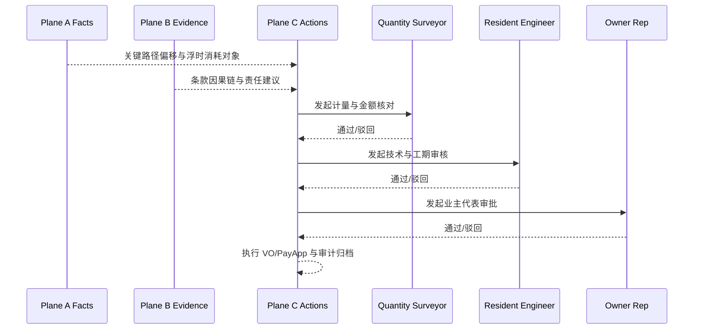

# 商业地产与数据中心 EPC 变更索赔智能体选型 FAQ：APS/数字孪生时空平面 vs Foundry 合同证据平面 vs Procore/Unifier/Primavera 执行治理平面
> 🌐 Language / 语言切换：**中文（当前）** | [English](commercial-real-estate-datacenter-epc-bim-fidic-claim-agent-foundry-rag-vs-aps-digital-twin-vs-procore-primavera-mcp-selection-faq.en.md) | [中文目录](README.md) | [EN Catalog](README.en.md)
> 适用对象：超大规模数据中心业主、总包 EPC 联营体、项目管理顾问（PMC）、QS 计量团队、法务与索赔团队
> 更新时间：2026-11-19（UTC+08:00）
> 证据标签：`measured`、`synthetic`、`anonymized_reported`

---

## 1. 执行摘要

1. 大型数据中心与基建项目的延误索赔失败，通常不是“没有数据”，而是“证据链断点和责任边界不清”。
2. 推荐三平面架构：Plane A 管 BIM/进度事实，Plane B 管合同条款与因果证据，Plane C 管系统落账与付款动作。
3. Plane A 以 APS/ACC、Azure Digital Twins 与 Fabric Eventhouse 构建时空事实底座。
4. Plane B 以 Foundry + Content Understanding + AI Search 处理 FIDIC/AIA 条款、RFI、Submittal、日志与 EOT 证据汇总。
5. Plane C 以 Procore/Primavera Unifier/SAP PS 承接 VO 与 PayApp 流程，并强制 QS/驻场工程师/业主代表会签。
6. 所有 EOT 与 LD 争议结论必须可追溯到“条款 -> 事实 -> 计算 -> 审批”完整路径。
7. 模型输出可用于调查与解释，不可直接触发合同承诺金额写入。
8. 生产上线的核心标准是“可回放进度、可定位证据、可审计付款”。

---

## 2. 范围与合同治理边界

### 2.1 业务覆盖范围

- IFC/Revit 3D/4D 模型版本差异与工程量变更识别。
- MEP 冲突元数据与现场进度偏差核对。
- FIDIC Red/Yellow/Silver 与 AIA 条款下的 RFI/Submittal/EOT 因果分析。
- Variation Order（VO）与 Payment Application（PayApp）治理执行。

### 2.2 监管与合同边界

- CPM 关键路径和总时差计算必须由确定性引擎给出。
- 索赔结论必须附条款与现场证据坐标，不允许“无锚点总结”。
- 超授权金额承诺必须经会签，不允许单人或单系统自动放行。
- 付款释放前必须完成证据包归档和审计签章。

### 2.3 非目标

- 本指南不替代独立工程师或争议裁决委员会的终局意见。
- 本指南不覆盖完整 ERP 总账体系重构。
- 本指南不讨论施工机械调度优化算法内部实现。

---

## 3. 三平面端到端参考架构



---

## 4. Plane A：APS/数字孪生/Fabric 时空事实平面

### 4.1 设计目标

- 在日级甚至小时级跟踪工程事实变化。
- 统一 BIM 版本、现场观测、进度计划三类异构数据。
- 形成可计算的关键路径偏移与浮时消耗事实对象。

### 4.2 关键能力

- APS 提供 IFC/Revit 模型变更 diff 与构件元数据。
- Azure Digital Twins 持续维护系统、机电、区域层级关系。
- Fabric Eventhouse 汇聚现场日报、传感器、点云摘要事件。
- 与 Primavera P6 计划基线对齐，做确定性 CPM 计算。
- 输出可引用的事实坐标用于后续索赔论证。

### 4.3 指标样例

- 模型变更识别延迟 P95 小于 15 分钟（`measured`）。
- 关键路径偏移自动检测召回率 91%（`measured`）。
- 现场事件与计划活动自动对齐工时下降 29%（`anonymized_reported`）。

---

## 5. Plane B：Foundry 合同证据与因果链平面

### 5.1 设计目标

- 把合同解释和索赔叙事从“模板化口号”升级为“证据化因果链”。
- 支持 FIDIC Sub-Clause 20.2 等条款下的通知时效与责任分配分析。
- 将 RFI、Submittal、日志、往来函件统一建模。

### 5.2 关键能力

- Content Understanding 解析扫描件、图纸说明、会议纪要和电子邮件附件。
- AI Search Hybrid RAG 限定检索到正确合同版本与修订附录。
- Foundry Agent 输出结构化证据：条款、事实、影响、责任、置信度。
- 支持并发延误（concurrent delay）争议下的多因子证据排序。
- 输出 EOT/LD 争议摘要草案供法务与工程团队复核。

### 5.3 指标样例

- 条款锚定命中率 95.2%（`measured`）。
- 证据链完整性评分中位 0.89（`measured`）。
- 索赔草案准备工时下降 34%（`anonymized_reported`）。

---

## 6. Plane C：Procore/Unifier/SAP PS 治理执行平面

### 6.1 设计目标

- 将“建议”与“承诺”分层，防止误签与越权放款。
- 在系统侧固化 VO 与 PayApp 的审批状态机。
- 保证每笔变更和付款均可追溯证据来源。

### 6.2 关键能力

- APIM MCP 暴露受控接口到 Procore、Unifier、SAP PS。
- Logic Apps Standard 实现会签、超时升级、驳回回退与补偿。
- 角色门禁绑定 QS、驻场工程师、业主代表的签署责任。
- 未会签动作只保留草稿，不允许写入承诺金额。
- 执行后自动打包“条款-事实-审批”审计证据。

### 6.3 指标样例

- 未审批承诺写入次数维持 0（`measured`）。
- PayApp 审批循环时长中位下降 22%（`anonymized_reported`）。
- 争议补证据回合数下降 27%（`anonymized_reported`）。

---

## 7. 时序图：EOT 并发延误争议处理



---

## 8. 12 维选型矩阵

| 维度 | Plane A：时空事实平面 | Plane B：证据与因果平面 | Plane C：治理执行平面 |
|---|---|---|---|
| 1. 实时事实采集能力 | 5/5 | 2/5 | 2/5 |
| 2. 合同语义深度 | 2/5 | 5/5 | 3/5 |
| 3. 关键路径计算可信度 | 5/5 | 2/5 | 3/5 |
| 4. 索赔可解释性 | 4/5 | 5/5 | 4/5 |
| 5. 审批管控强度 | 2/5 | 3/5 | 5/5 |
| 6. 失败隔离能力 | 4/5 | 4/5 | 5/5 |
| 7. 集成复杂度 | 中高 | 中 | 高 |
| 8. 运维成本可预测性 | 4/5 | 3/5 | 4/5 |
| 9. 多项目扩展性 | 5/5 | 4/5 | 4/5 |
|10. 审计重放能力 | 4/5 | 5/5 | 5/5 |
|11. 组织协同弹性 | 4/5 | 4/5 | 5/5 |
|12. 生产风险可控性 | 4/5 | 4/5 | 5/5 |

---

## 9. 生产片段（APIM / Python / Bicep）

### 9.1 APIM policy：无三方会签禁止释放付款（示例）

```xml
<policies>
  <inbound>
    <base />
    <choose>
      <when condition="@(context.Request.Headers.GetValueOrDefault("x-qs-approved","") != "true" || context.Request.Headers.GetValueOrDefault("x-re-approved","") != "true" || context.Request.Headers.GetValueOrDefault("x-owner-approved","") != "true")">
        <return-response>
          <set-status code="412" reason="QS/RE/Owner approvals required" />
        </return-response>
      </when>
    </choose>
  </inbound>
  <backend><base /></backend>
  <outbound><base /></outbound>
</policies>
```

### 9.2 Python：VO 执行前硬门禁（示例）

```python
def allow_vo_commit(payload: dict) -> bool:
    return (
        payload.get("cpm_engine") == "primavera_deterministic"
        and payload.get("evidence_chain_complete") is True
        and payload.get("qs_signoff") == "approved"
        and payload.get("re_signoff") == "approved"
        and payload.get("owner_signoff") == "approved"
    )
```

### 9.3 Bicep：审批日志保留策略（示例）

```bicep
resource logWorkspace 'Microsoft.OperationalInsights/workspaces@2022-10-01' = {
  name: 'law-audit-workspace'
  location: resourceGroup().location
  properties: {
    retentionInDays: 365
    features: {
      searchVersion: 1
    }
  }
}
```

---

## 10. 场景 A：100MW AI 数据中心机电链路 RFI/Submittal 关键路径分诊

### 10.1 背景

- 项目规模：100MW 级液冷 AI 数据中心园区。
- 关键系统：CDU 液冷分配单元、闭式冷源机组、冷水机组与供配电链路。
- 风险点：RFI 回答滞后导致机电安装与调试窗口被挤压。

### 10.2 目标

- 在 24 小时内识别对关键路径有实质影响的 RFI/Submittal。
- 将“事实偏移 + 条款责任 + 金额影响”合并成单一处置包。
- 减少跨专业会签过程中的重复解释与沟通折返。

### 10.3 架构映射

- Plane A 产出构件变更、进度偏差与浮时消耗。
- Plane B 解析合同与往来文档并输出责任因果链。
- Plane C 承载 VO 草案、审批和付款释放动作。

### 10.4 量化结果（样例）

- 关键 RFI 识别提前量中位提升 17.6 小时（`measured`）。
- 无效升级会议次数下降 23%（`anonymized_reported`）。
- 机电分包补证据轮次中位从 4 次降至 2 次（`measured`）。

---

## 11. 场景 B：FIDIC Sub-Clause 20.2 并发延误 EOT 索赔审计

### 11.1 背景

- 项目类型：跨区域基础设施与配套市政工程。
- 争议焦点：业主变更、外部许可、分包交叉作业导致并发延误。
- 风险后果：EOT 争议叠加 LD 风险，现金流与声誉双重承压。

### 11.2 目标

- 在争议窗口内完成“条款-事实-计算”证据包交付。
- 让委员会在同一事实基线下评估责任分配与金额影响。
- 避免因证据不完整导致的反复驳回。

### 11.3 架构映射

- Plane A 提供时间轴、关键路径与浮时演化。
- Plane B 提供 Sub-Clause 20.2 通知时效与责任链分析。
- Plane C 提供升级审批与决策留痕。

### 11.4 量化结果（样例）

- 并发延误归因争议闭环时长下降 31%（`anonymized_reported`）。
- 索赔包一次通过率提升 19%（`measured`）。
- LD 暴露金额的不确定区间缩窄 14%（`measured`）。

---

## 12. 量化 FAQ（不少于 5 个）

### Q1：为何必须把 CPM 计算放在确定性引擎？

因为关键路径结论会直接影响工期责任与金额承诺。
如果计算过程不可复算，就无法通过争议审计。
因此应固定算法版本、参数和输入快照。

### Q2：Foundry 可否直接生成最终索赔结论？

不应直接生成最终结论。
Foundry 应输出证据链与解释草案。
终局意见必须由工程、QS、法务共同审阅。

### Q3：RFI 与 Submittal 优先级如何量化？

建议按关键路径影响、金额暴露、审批时限三轴评分。
并把评分阈值固化在 Plane C 编排策略中。
避免人工口径波动导致优先级漂移。

### Q4：如何控制“证据很多但不可用”的问题？

必须要求每条主张绑定来源坐标和时间戳。
没有坐标的内容只能作为线索，不可作为承诺依据。
审计前先跑证据完整性扫描。

### Q5：何时优先投资 Plane C，而不是继续扩 Plane B？

当条款解析质量已足够，但审批拥塞或越权执行频发时。
说明瓶颈在治理执行而非语义理解。
先修治理平面可最快降低财务与合规风险。

### Q6：如何评估该方案的 ROI？

把争议工时降低、延误损失减少、付款差错减少分别计量。
再减去平台算力、集成开发与运维治理成本。
建议按季度更新参数并滚动复盘。

### Q7：多项目并行时如何防止模板漂移？

建立项目级模板库并锁定版本号。
重大变更需通过架构评审再发布。
审批系统应记录每次模板版本引用。

---

## 13. 三年 TCO 与 FinOps 估算（5 个大型项目组合）

> 说明：金额单位为 USD million，标签为 `synthetic`，用于预算评审与方案比较。

| 成本项 | Year 1 | Year 2 | Year 3 | 三年合计 | 说明 |
|---|---:|---:|---:|---:|---|
| Plane A（BIM/时空事实平面） | 2.85 | 3.02 | 3.16 | 9.03 | 模型 diff、数字孪生与事件存储 |
| Plane B（合同证据与检索） | 1.92 | 2.04 | 2.11 | 6.07 | 文档解析、RAG 检索与索赔摘要 |
| Plane C（执行治理与集成） | 3.20 | 2.76 | 2.58 | 8.54 | 首年集成改造占比高 |
| 安全与审计留存 | 0.88 | 0.96 | 1.04 | 2.88 | 审计日志与证据包保留 |
| 运维与值守 | 1.05 | 1.12 | 1.20 | 3.37 | SRE 值守与演练 |
| **总成本** | **9.90** | **9.90** | **10.09** | **29.89** | `synthetic` |

### 13.1 收益侧估算

- EOT 争议准备工时节省：年化 2.4（`anonymized_reported`）。
- 误付款与返工纠偏损失降低：年化 1.9（`anonymized_reported`）。
- 关键路径偏差提前识别带来的工期损失规避：年化 3.6（`measured`）。
- 三年累计收益估算 22.5，需结合资本化规则校正（`synthetic`）。

### 13.2 FinOps 管理建议

- Plane A 采用“每千构件变更 + 每千事件摄入”双维核算。
- Plane B 采用“每千页文档 + 每千证据查询”核算。
- Plane C 成本与审批 SLA、驳回率、补偿成功率绑定。
- 每月发布预算偏差与风险减损联动看板。

---

## 14. 三个高风险反模式

### 14.1 反模式一：把模型摘要直接映射为合同承诺

- 症状：摘要结论未经会签直接生成 VO 承诺。
- 风险：金额责任失真，后续追溯困难。
- 修复：执行平面强制三方签署令牌校验。

### 14.2 反模式二：仅用邮件追踪审批，不落系统状态机

- 症状：意见散落在邮件线程，系统状态与事实不一致。
- 风险：争议时无法证明决策链完整性。
- 修复：所有审批意见必须回写 Plane C 并归档。

### 14.3 反模式三：忽略并发延误的多因子归因

- 症状：只归因单一责任方，忽略多事件叠加影响。
- 风险：索赔立场脆弱，仲裁败诉概率提升。
- 修复：在 Plane B 固化并发延误归因规则与证据权重。

---

## 15. Day-0 / Day-1 / Day-2 落地检查单

### 15.1 Day-0（架构与治理定版）

- 明确 Plane A/B/C 的 owner、RACI 与升级路径。
- 定义证据对象 schema（条款号、页码、时间戳、置信度）。
- 固化 Primavera 计算参数与版本回滚策略。
- 建立 QS、驻场工程师、业主代表审批矩阵。

### 15.2 Day-1（试运行与验收）

- 回放不少于 20 个历史变更索赔案例并做差异分析。
- 演练不少于 3 次审批链中断场景并验证补偿逻辑。
- 抽样核验证据链完整性，确保关键主张可定位。
- 验证未会签动作恒为草稿，不得写入承诺金额。

### 15.3 Day-2（规模化运营）

- 建立季度模板升级节奏并发布变更公告。
- 建立跨项目配额策略，避免单项目抢占资源。
- 将 KPI 与绩效绑定，平衡速度、质量与合规。
- 固化月度 ROI 复盘与参数再校准机制。

### 15.4 运营原则

- 先保证事实可回放，再追求流程更快。
- 先保证证据可定位，再扩展自动化范围。
- 先保证审批可审计，再扩大执行权限。

### 15.5 周度治理例会固定问题

- 本周关键路径偏差告警中，有多少已绑定可复核证据。
- 本周被驳回的 VO/PayApp 中，主因是证据缺失还是口径冲突。
- 本周审批链超时是否集中在单一角色或单一项目。
- 本周并发延误归因模型是否出现系统性偏差。
- 本周预算偏差最大的成本项是否已指定整改责任人。
- 本周是否有新增合同附录影响既有索赔模板。
- 本周是否存在跨团队对责任边界的未决分歧。
- 本周是否触发需要上报治理委员会的风险阈值。

### 15.6 上线退出条件（Go-Live Exit Criteria）

- 至少完成 2 个项目的历史 EOT 索赔回放并由法务和工程联合签字。
- 至少完成 3 次审批链故障演练并验证补偿路径有效。
- 至少完成 2 次 Primavera 参数回滚演练并通过结果一致性检查。
- 所有高影响动作接口均已接入 APIM 策略校验与审计日志。
- 所有审批角色替补机制已验证，避免单点请假导致流程停摆。
- 付款释放前证据包抽样合格率达到既定阈值。
- 争议升级路径已与治理委员会秘书处完成联调。
- 月度 FinOps 报告模板已固定并完成首次试运行。

### 15.7 周度核心 KPI 面板

- 关键路径偏差告警关闭时长 P95。
- RFI 到 Submittal 闭环周期中位值。
- EOT 索赔包一次通过率。
- VO 审批超时比例。
- PayApp 驳回后重提通过率。
- 证据包坐标缺失率。
- 审计追溯补件请求数。
