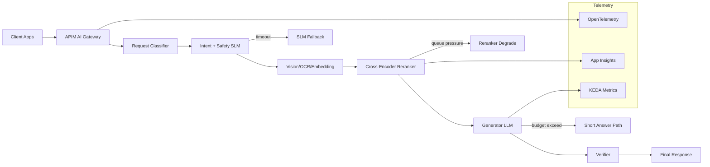
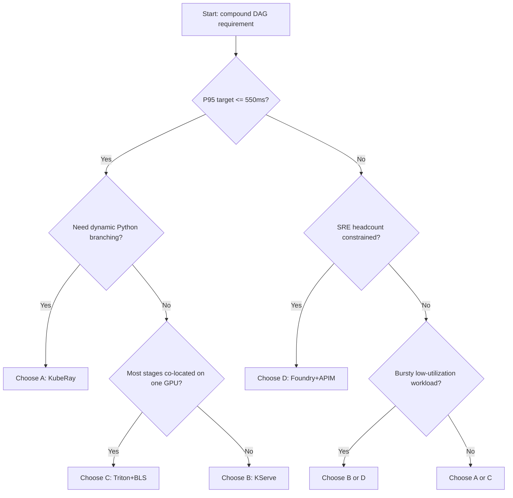

# Enterprise Compound Inference DAG Serving FAQ: AKS KubeRay Ray Serve vs KServe InferenceGraph vs Triton Ensemble/BLS vs Foundry+APIM

## 1. Problem statement and architectural boundary
This guide addresses enterprise multi-stage compound inference serving.  
The objective is to finish the full chain inside a synchronous request.  
The target latency envelope is `P95 < 500–800ms`.  
The representative DAG is.  
`Intent/Safety SLM -> Vision/OCR/Embedding -> Cross-Encoder Reranker -> Generator LLM -> Verifier`.  
This is not an offline batch scheduling comparison.  
This is not a training-platform benchmark.  
This is an online production inference orchestration decision.  
The scope is Azure deployment choices.  
The scope includes mixed CPU and GPU stages.  
The scope includes backpressure and timeout budgeting.  

## 2. Workload profile and SLO budget decomposition
The traffic shape is typically bimodal.  
Business hours produce sustained baseline load.  
Campaign windows introduce burst spikes.  
An example peak is `300 RPS`.  
Recommended P50 target is `220–320ms`.  
Recommended P95 target is `500–800ms`.  
Acceptable P99 ceiling is around `950ms`.  
Suggested per-stage budget split is.  
Intent and safety SLM `50–90ms`.  
Vision/OCR/Embedding `60–140ms`.  
Cross-encoder reranker `35–85ms`.  
Generator LLM `180–360ms`.  
Verifier `40–90ms`.  
Network and orchestration reserve `25–65ms`.  
Each stage needs independent timeout control.  
A single global timeout is insufficient.  
Per-stage fail-fast and fallback paths are mandatory.  
Degrade lanes should be tied to risk tiers.  

## 3. Four candidate architecture families
Option A.  
`AKS + KubeRay + Ray Serve DeploymentGraph`.  
Strong in Python-native DAG logic.  
Strong in stage-level independent autoscaling.  
Strong in dynamic batching and fan-out control.  

Option B.  
`AKS + KServe InferenceGraph`.  
Strong in declarative CRD routing.  
Strong in GitOps lifecycle and change auditability.  
Strong in Knative scale-to-zero economics.  

Option C.  
`NVIDIA Triton Ensemble + BLS`.  
Strong in same-GPU chain execution.  
Strong in shared-memory handoff with near-zero serialization.  
Strong in ultra-low stage-bridge overhead.  

Option D.  
`APIM AI Gateway + Azure AI Foundry + AI Content Safety + AI Search`.  
Strong in managed operations and low SRE burden.  
Strong in built-in regional failover.  
Strong in centralized policy and governance controls.  

## 4. End-to-end topology for synchronous DAG and backpressure


This logical topology is shared by all four options.  
What changes is the execution plane.  
What changes is stage-to-stage data transfer behavior.  
What changes is elasticity granularity and ops boundary.  
APIM can remain the common ingress plane.  
Routing labels should include.  
`x-pipeline-id`, `x-latency-tier`, and `x-risk-tier`.  
Without them, stage-level cost attribution becomes weak.  

## 5. Option A: AKS + KubeRay + Ray Serve DeploymentGraph
Ray Serve provides Python-native composition power.  
Conditional branching is straightforward.  
Parallel fan-out is straightforward.  
Per-stage timeout semantics are straightforward.  
DeploymentHandle chains are straightforward.  
Heterogeneous node pools are first-class in practice.  
CPU pools can host OCR and parsing stages.  
L4S/A10 pools can host embedding and reranker stages.  
H100/MI300X pools can host generator stages.  
This avoids idling H100 on CPU-heavy portions.  
Dynamic batching can be tuned per stage.  
A typical setting is reranker batch `32`.  
SLM batch `16`.  
LLM batch `4`.  
This aligns with scaling ratio `8:2:1`.  
Ray autoscaler can react to actor-level queue depth.  
It can also integrate model warmup from object stores.  
Option A fits teams with rapidly changing logic.  
Option A fits organizations optimized for Python velocity.  
The trade-off is higher control-plane complexity.  
Platform engineering maturity is required.  

## 6. Option B: AKS + KServe InferenceGraph
KServe InferenceGraph provides declarative composition.  
`Sequence` fits linear chains.  
`Switch` fits feature-driven routing.  
`Splitter` fits mirrored or A/B traffic.  
CRD design is naturally GitOps-friendly.  
Polyglot containers are easy to mix.  
Python is not required as orchestration language.  
Knative scale-to-zero helps long-tail economics.  
This is useful for bursty internal pipelines.  
The limitation is lower expressive power for complex branching.  
Many advanced rules must move into services.  
Cold-start planning must be explicit.  
Otherwise first-wave P95 can spike during bursts.  
When combined with mesh retries.  
Avoid stacked retry policies across layers.  
Retry multiplication amplifies tail latency and cost.  

## 7. Option C: Triton Ensemble and BLS
Triton Ensemble is excellent for co-located model chains.  
BLS is effective for in-plane business logic steps.  
CUDA shared memory reduces serialization overhead.  
System shared memory reduces copy overhead across processes.  
In vision + embedding + reranker sequences.  
Bridge cost can drop to sub-millisecond class.  
That matters for `P95 < 500ms` targets.  
This pattern runs on AKS GPU nodes.  
It also runs on AML managed online endpoints.  
The trade-off is DAG flexibility.  
Conditional business branching is less ergonomic than Ray.  
Cross-node scaling usually needs an external coordinator.  
When heavy Python control logic is embedded.  
Long-term maintainability can degrade.  
Option C fits stable compute-intensive subgraphs.  
Option C is weaker for frequently changing workflows.  

## 8. Option D: Managed chaining with Foundry and APIM
Managed chaining maximizes delivery speed.  
Teams avoid deep K8s and GPU operations.  
APIM offers a unified policy control plane.  
Foundry offers managed model hosting and routing.  
AI Content Safety adds policy interception layers.  
AI Search contributes semantic retrieval augmentation.  
Regional failover is easier to operationalize.  
The known cost is extra hop tax.  
Typical path adds `3–5` HTTP/TLS hops.  
Typical latency overhead is `+25–65ms`.  
For ultra-low latency targets.  
This tax must be budgeted explicitly.  
For low-average or highly variable demand.  
Managed chaining can still win on total TCO.  
For sustained high-QPS workloads.  
Dedicated GPU planes often cross a better cost threshold.  

## 9. Quantitative model: hop overhead vs GPU idle waste
Two losses dominate in practice.  
Loss type one is hop serialization overhead.  
Loss type two is GPU idle waiting.  
Baseline formula.  
`T_total = Σ T_stage + T_hop + T_queue + T_retry`.  
Approximate hop term.  
`T_hop ≈ N_hop * t_tls_http`.  
If `N_hop = 4` and `t_tls_http = 11ms`.  
Then `T_hop ≈ 44ms`.  
GPU idle waste estimate.  
`Cost_idle = GPU_hour_cost * Idle_ratio * Fleet_hours`.  
If H100 cost is `\$2.9/h`.  
Idle ratio is `38%`.  
Monthly fleet runtime is `10,800h`.  
Then monthly idle loss is about `\$11,901`.  
If heterogenous decomposition reduces idle to `17%`.  
Monthly idle loss becomes about `\$5,329`.  
Savings from this term alone is `\$6,572` per month.  
So at high utilization.  
Stage heterogeneity often beats hop reduction in value.  
At low utilization.  
Reducing fixed ownership cost dominates the equation.  

## 10. Config block A: KubeRay RayService and DeploymentHandle chain
```yaml
apiVersion: ray.io/v1
kind: RayService
metadata:
  name: compound-infer-rayservice
spec:
  serviceUnhealthySecondThreshold: 300
  deploymentUnhealthySecondThreshold: 180
  serveConfigV2: |
    applications:
      - name: compound-dag
        route_prefix: /infer
        import_path: app.graph:build_app
        deployments:
          - name: intent_safety
            num_replicas: 4
            ray_actor_options:
              num_cpus: 1
          - name: vision_embed
            autoscaling_config:
              min_replicas: 2
              max_replicas: 16
              target_num_ongoing_requests_per_replica: 8
            ray_actor_options:
              num_gpus: 0.25
          - name: reranker
            autoscaling_config:
              min_replicas: 4
              max_replicas: 24
            ray_actor_options:
              num_gpus: 0.25
          - name: generator
            autoscaling_config:
              min_replicas: 2
              max_replicas: 8
            ray_actor_options:
              num_gpus: 1
```

```python
from ray import serve
from ray.serve.handle import DeploymentHandle

@serve.deployment
class CompoundGraph:
    def __init__(
        self,
        intent: DeploymentHandle,
        vision: DeploymentHandle,
        reranker: DeploymentHandle,
        generator: DeploymentHandle,
        verifier: DeploymentHandle,
    ) -> None:
        self.intent = intent
        self.vision = vision
        self.reranker = reranker
        self.generator = generator
        self.verifier = verifier

    async def __call__(self, req: dict) -> dict:
        intent = await self.intent.remote(req)
        if intent["block"]:
            return {"status": "blocked", "reason": intent["reason"]}
        v = await self.vision.remote(req)
        r = await self.reranker.remote(v)
        g = await self.generator.remote(r)
        checked = await self.verifier.remote(g)
        return {"status": "ok", "result": checked}
```

## 11. Config block B: APIM policy for managed and low-latency split
```xml
<policies>
  <inbound>
    <base />
    <set-variable name="tier" value="@(context.Request.Headers.GetValueOrDefault("x-latency-tier","standard"))" />
    <choose>
      <when condition="@(context.Variables.GetValueOrDefault<string>("tier") == "premium-lowlatency")">
        <set-backend-service base-url="https://ray-aks.internal/compound" />
      </when>
      <otherwise>
        <set-backend-service base-url="https://foundry-managed.internal/compound" />
      </otherwise>
    </choose>
  </inbound>
  <backend>
    <forward-request timeout="40" />
  </backend>
  <outbound>
    <set-header name="x-pipeline-route" exists-action="override">
      <value>@(context.Variables.GetValueOrDefault<string>("tier"))</value>
    </set-header>
    <base />
  </outbound>
</policies>
```

This policy enables dual-lane execution.  
Premium cohorts can use low-latency route.  
Long-tail cohorts can use managed route.  
Ingress, governance, and audit remain centralized.  

## 12. 12-dimension matrix and selection tree
| Dimension | A KubeRay | B KServe | C Triton+BLS | D Foundry+APIM |
|---|---|---|---|---|
| 1. Synchronous low-latency ceiling | High | Medium-high | Very high | Medium |
| 2. DAG expressiveness | Very high | Medium | Medium-low | Medium |
| 3. Heterogeneous autoscaling | Very high | High | Medium | Medium |
| 4. Cold-start economics | Medium | High | Low-medium | High |
| 5. Python dev velocity | Very high | Medium | Medium | High |
| 6. GitOps auditability | Medium-high | Very high | Medium | High |
| 7. Peak GPU utilization | High | Medium-high | Very high | Medium |
| 8. Ops complexity | High | Medium-high | High | Low |
| 9. Regional resilience readiness | Medium | Medium | Medium | Very high |
| 10. Vendor lock profile | Medium | Medium-low | Medium-high | High |
| 11. Cost efficiency at 300 RPS | High | Medium-high | High | Medium |
| 12. Cost efficiency at low traffic | Medium | High | Low | Very high |



## 13. Scenario A: real-time e-commerce visual search copilot at 300 RPS
Business pattern.  
Sustained daytime traffic is high.  
Campaign windows produce sharp surges.  
User tolerance to latency is low.  
Multimodal request ratio is high.  
Recommended architecture.  
Primary lane uses Option A.  
Vision and reranker run on L4S/A10 pools.  
Generator runs on H100 pool.  
High-risk exceptions can spill to Option D for managed controls.  
Quantitative targets.  
P95 stays `<=620ms`.  
Safety intercept path stays `<=140ms`.  
GPU idle ratio stays `<=20%`.  
Monthly cost reduces `22%–31%` versus all-H100 monolithic pool.  

## 14. Scenario B: regulated claims triage document-to-decision pipeline
Business pattern.  
OCR and structure extraction ratio is high.  
Every request requires policy validation.  
Audit evidence retention is strict.  
Peak RPS is lower than e-commerce.  
Error cost is much higher.  
Recommended architecture.  
Default lane uses Option D.  
OCR+reranker hot path can embed Option C co-location.  
APIM owns policy gates and audit logging.  
Peak windows can add Option B scale-to-zero workers.  
Quantitative targets.  
Initial triage P95 `<=780ms`.  
Policy miss rate `<0.3%`.  
Audit-evidence missing rate is `0`.  
Ops FTE reduces `35%–45%` compared with fully self-managed stacks.  

## 15. Day-0/Day-2 checklist and quantitative FAQs
### Day-0 checklist
- Define per-stage timeout budgets and retry caps.  
- Define baseline scaling ratio targets such as `8:2:1`.  
- Create stage-level queue depth alert thresholds.  
- Deploy APIM routing by tenant and risk tiers.  
- Enforce end-to-end trace-id propagation with OTel.  
- Prepare replay dataset for failure samples.  
- Define GPU warm-pool windows by traffic pattern.  
- Validate rollback and one-click degrade runbooks.  

### Day-2 checklist
- Review stage-level P95 and timeout sources daily.  
- Review GPU utilization and idle-cost signals weekly.  
- Review slow-sample routing outcomes weekly.  
- Review safety false-positive and false-negative signals weekly.  
- Re-tune autoscaling and batching thresholds monthly.  
- Rehearse cross-region failover monthly.  
- Track unit-cost trend per request monthly.  
- Re-evaluate architecture blend quarterly.  

**Q1: Why does `3–5` hops often add `25–65ms` jitter?**  
A1: The range comes from connection reuse variance, policy execution depth, backend pool health, and queue contention, with `6–14ms` common per hop.  

**Q2: At 300 RPS, when does A usually beat D on cost?**  
A2: A common break-even starts around sustained generator load above `~130 RPS` with GPU utilization maintained above `58%`.  

**Q3: How should `8:2:1` scaling ratio be operationalized?**  
A3: Derive stage concurrency from stage service time and queue targets, then tune autoscaling thresholds so reranker replica counts are often near `4x` SLM lanes.  

**Q4: Where does C gain most of its latency advantage?**  
A4: It comes from same-GPU memory locality and reduced inter-service serialization, often saving `15–40ms` on vision-plus-reranker bridges.  

**Q5: When does B scale-to-zero become risky?**  
A5: It is risky for bursty traffic with strict first-request SLOs; without pre-warm controls, first-wave P95 can jump by `80–220ms`.  

**Q6: How does D cap managed-path spend in production?**  
A6: Use APIM quota and risk-tier routing, keep PTU as baseline, and apply explicit serverless overflow caps to avoid unbounded pay-as-you-go expansion.  
