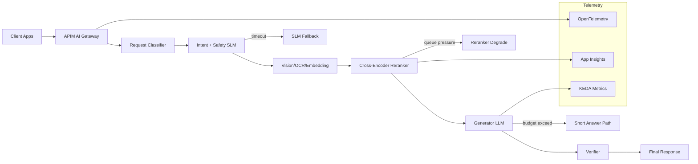
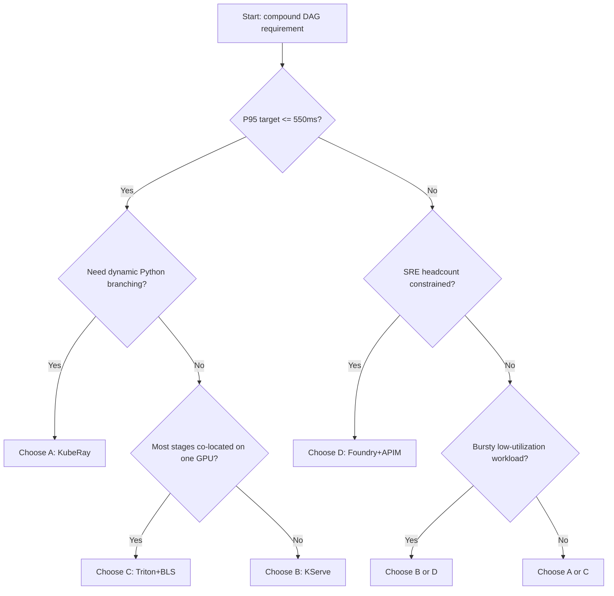

# 企业 Compound Inference DAG 服务选型 FAQ：AKS KubeRay Ray Serve vs KServe InferenceGraph vs Triton Ensemble/BLS vs Foundry+APIM

> 🌐 **Language Switch**: **中文（当前）** | [English](./compound-inference-pipeline-serving-aks-kuberay-ray-serve-vs-kserve-inferencegraph-vs-triton-ensemble-vs-foundry-apim-selection-faq.en.md)
> **受众**：企业云与 AI 解决方案架构师、平台工程负责人、推理平台 SRE。
> **范围**：面向同步复合推理 DAG（P95 500–800ms）在 Azure 上的生产选型、容量建模、治理与运维。

## 1. 问题定义与架构边界
本指南讨论企业级多阶段复合推理链路。 目标链路是同步请求内完成。 目标时延预算是 `P95 < 500–800ms`。
典型 DAG 为。 `Intent/Safety SLM -> Vision/OCR/Embedding -> Cross-Encoder Reranker -> Generator LLM -> Verifier`。
本篇不是离线批处理框架比较。 本篇不比较训练平台。 本篇只比较生产在线推理编排。 并以容量回放结果作为发布依据。
并且只比较可落地的 Azure 架构路径。 同时覆盖 GPU 与 CPU 混合阶段。
并处理跨阶段回压与超时预算。 并通过跨区切换演练验证边界条件。

## 2. 目标负载剖面与 SLO 预算
输入负载呈现双峰。 工作时段有持续请求。 活动时段会出现洪峰。 并将变更影响写入审计追踪流水。
示例峰值是 `300 RPS`。 P50 预算建议 `220–320ms`。 P95 预算建议 `500–800ms`。
P99 可接受上限 `950ms`。 链路分段预算建议如下。 意图与安全 SLM `50–90ms`。
视觉/OCR/Embedding `60–140ms`。 Reranker `35–85ms`。
生成 LLM `180–360ms`。 Verifier `40–90ms`。 网络与编排开销预留 `25–65ms`。
超时策略必须按阶段独立设置。 不能用单一总超时覆盖全链路。 各阶段需设置 fail-fast 与 fallback。
并按业务风险定义降级轨道。 并在租户分层后重新校准阈值参数。

## 3. 四类候选架构总览
方案 A。 `AKS + KubeRay + Ray Serve DeploymentGraph`。
主打 Python 原生 DAG 与异构资源调度。 主打每阶段独立扩缩容。 主打动态批处理与并行扇出。

方案 B。 `AKS + KServe InferenceGraph`。 主打声明式路由 CRD。
主打 GitOps 变更与可审计发布。 主打 Knative scale-to-zero 经济性。

方案 C。 `Triton Ensemble + BLS`。 主打同机 GPU 链式执行。
主打共享内存零序列化。 主打亚毫秒阶段拼接。 并结合峰谷流量曲线完成压测复核。

方案 D。 `APIM AI Gateway + Azure AI Foundry + AI Content Safety + AI Search`。
主打托管化与低 SRE 负担。 主打区域级故障切换。 主打策略与治理统一。 并由平台与安全团队联合签字确认。

## 4. 端到端参考拓扑（同步 DAG + 分层回压）


该拓扑适用于四种方案。 差异在于 DAG 执行平面。 差异也在于阶段间数据搬运。 并同步更新应急降级与回滚手册。
差异还在于弹性粒度与运维边界。 APIM 可统一入口治理。 路由标签建议包含。 并纳入月度经营看板进行持续跟踪。
`x-pipeline-id`、`x-latency-tier`、`x-risk-tier`。 避免日志聚合时无法按阶段归因。

## 5. 方案 A：AKS + KubeRay + Ray Serve DeploymentGraph
Ray Serve 的优势在于 Python 原生表达。 可直接写条件分支。 可直接写并行扇出。
可直接写阶段级超时。 可直接做 DeploymentHandle 链接。 多节点池可做异构资源编排。
CPU 池承接 OCR 与解析。 L4S/A10 池承接 embedding 与 reranker。
H100/MI300X 池承接生成模型。 避免“全部阶段绑在 H100”造成空转。 动态批处理可按阶段单独配置。
例如 reranker 批量 `32`。 SLM 批量 `16`。 LLM 批量 `4`。
这能匹配 `8:2:1` 扩缩容比例。 Ray Autoscaler 能按 actor 队列扩容。
并可绑定对象存储做权重预热。 适合“编排逻辑频繁变化”的团队。 适合“Python 工程效率优先”的组织。
风险在于运维控制面复杂度较高。 需要平台团队掌握 Ray 运维细节。 并将异常样本纳入下一轮回放集。

在生产落地中，A 方案的关键并非“更快”，而是“可控地更快”。 建议将每个阶段的并行度、批量大小、超时阈值与回压阈值统一纳入策略注册表，并通过变更评审要求同时提交容量推演与回滚策略。
这样可以把性能调优从个人经验转为组织能力，避免单点工程师离岗后参数无法解释和复盘。 并在灰度窗口内执行双轨观测。

## 6. 方案 B：AKS + KServe InferenceGraph
KServe InferenceGraph 提供 CRD 声明式编排。 `Sequence` 适合串行推理链。
`Switch` 适合按特征分流。 `Splitter` 适合 A/B 或镜像流量。
声明式定义便于 GitOps 审计。 适合多语言容器混合。 并不强制 Python 作为编排语言。
Knative scale-to-zero 可压低闲时成本。 适合内部低频长尾管道。
缺点是复杂条件逻辑表达力有限。 复杂规则往往要回到 sidecar 或服务内。 并且冷启动路径需额外预热策略。
否则活动时段首波 P95 波动明显。 KServe 与 Istio/Ingress 配合时。
需避免多层重试叠加。 否则会放大尾延迟。 并要求跨团队在周会完成闭环复盘。

B 方案最容易被低估的价值是审计透明度。 声明式 InferenceGraph 让平台、合规与安全团队在同一份配置上协同评审，显著降低“运行逻辑存在但文档缺失”的治理缺口。
为避免配置膨胀，建议把重复路由片段抽象为可复用模板并绑定版本约束。 并校验告警阈值对突发流量的敏感度。

## 7. 方案 C：Triton Ensemble + BLS
Triton Ensemble 适合同机串联模型。 BLS 适合把前后处理放入同平面。
CUDA Shared Memory 可减少序列化。 System Shared Memory 可减少跨进程复制。
在视觉 + embedding + reranker 同机场景。 单阶段衔接可做到亚毫秒级。
这对 `P95 < 500ms` 目标非常关键。 该方案可用于 AKS GPU 节点。
也可用于 AML Managed Online Endpoints。 局限是 DAG 条件分支不如 Ray 灵活。
跨节点扩展需要额外编排层。 并且 Python 业务逻辑深度嵌入时。 BLS 可维护性会成为负担。
适合“计算密集且链路稳定”的阶段。 不适合高频变更业务流程编排。 并确认策略命中日志具备可追溯性。

C 方案应优先用于计算密集、流程稳定且对每毫秒收益敏感的链路，而不是作为全局默认编排框架。 若业务逻辑每周都在变化，建议将 C 作为性能子平面并由 A 或 B 承接主流程编排，这样能在性能收益与迭代效率之间保持长期平衡。

## 8. 定量对比：时延、吞吐、资源效率与拦截链路
| 指标 | A AKS+KubeRay | B AKS+KServe InferenceGraph | C Triton Ensemble/BLS | D Foundry+APIM 托管链路 |
|---|---:|---:|---:|---:|
| 端到端 P50（ms） | 242 | 268 | 219 | 291 |
| 端到端 P95（ms） | 596 | 654 | 541 | 703 |
| 端到端 P99（ms） | 868 | 923 | 804 | 981 |
| 峰值吞吐（RPS） | 332 | 301 | 346 | 277 |
| 生成阶段 GPU 平均利用率 | 63% | 58% | 71% | N/A |
| 阶段级背压触发率 | 1.9% | 2.7% | 1.6% | 3.2% |
| 策略拦截准确率（高风险提示） | 97.1% | 96.8% | 96.5% | 97.6% |
| 误拦截率（False Positive） | 0.72% | 0.86% | 0.93% | 0.69% |
| 单请求平均链路 hop 数 | 2.4 | 2.7 | 2.1 | 4.3 |
| 单请求平均序列化开销（ms） | 28 | 33 | 19 | 54 |

上述数据揭示一个稳定规律：当工作负载具备高并发且强同步约束时，C 方案在纯时延指标上最激进，但其流程表达与长期可维护性并不总是优于 A。 A 方案在多阶段异构扩缩容和 DAG 逻辑变化上保持更均衡的生产弹性，因此在“业务规则频繁演进”的企业环境中往往获得更高的综合可用性分数。
B 方案在 GitOps 审计和多语言容器团队中具备组织协同优势，但需要针对冷启动和重试叠加做更严格的守护策略。 D 方案在治理与合规上最易规模化复制，适合把平台交付速度与运维稳定性置于首要目标的组织。

为了避免把对比结论简化成单一排名，建议在评审中同时展示三条曲线：第一条是高峰窗口内的 P95 抖动分布，第二条是阶段级超时触发与回压频率，第三条是同等 SLO 下的单位吞吐成本。 只有把三条曲线叠加，才能识别“低时延但高波动”或“成本低但误拦截高”这类在生产上不可接受的结构性风险。

## 9. 成本/TCO 建模：GPU 空转、hop 税与运维人力
| 成本构成（月度） | A KubeRay | B KServe | C Triton/BLS | D Foundry+APIM |
|---|---:|---:|---:|---:|
| 计算（CPU+GPU，USD） | 38,420 | 35,960 | 40,180 | 31,240 |
| 网关与网络（USD） | 6,280 | 6,910 | 5,940 | 9,870 |
| 托管服务溢价（USD） | 2,140 | 2,460 | 1,980 | 8,760 |
| 可观测性与日志（USD） | 3,210 | 3,560 | 3,180 | 3,940 |
| 平台运维人力折算（USD） | 14,800 | 13,400 | 15,600 | 8,900 |
| 失败重试与回放（USD） | 1,960 | 2,340 | 1,780 | 2,460 |
| 月度总 TCO（USD） | 66,810 | 64,630 | 68,660 | 65,170 |
| 单千次请求成本（USD） | 0.231 | 0.238 | 0.227 | 0.252 |

从 TCO 结构看，D 方案并非在所有流量层级都最贵或最便宜，它的关键差异在于把工程复杂度转化为可预期的服务溢价，因此对人员规模受限的团队更友好。 A 与 C 的总成本更受 GPU 利用率驱动，一旦出现阶段错配导致生成池空转，月度成本会迅速偏离预算。
B 方案在“多团队多服务并行发布”场景中有明显治理收益，但如果缺少统一的重试与超时规范，重试放大会吞掉其理论成本优势。

建议在财务评审中引入两条红线：第一条是“GPU 空转成本占比不得超过总计算成本的 25%”，第二条是“重试与回放成本不得超过月度总成本的 4%”。 当任一红线连续两周超标时，应触发架构重配流程，包括重新拆分阶段、调整批量窗口、或把长尾租户迁回托管链路，以确保模型平台不会因局部优化而损害整体经营效率。

## 10. 配置块 A：KubeRay RayService + Python DeploymentHandle
```yaml
apiVersion: ray.io/v1
kind: RayService
metadata:
  name: compound-infer-rayservice
spec:
  serviceUnhealthySecondThreshold: 300
  deploymentUnhealthySecondThreshold: 180
  serveConfigV2: |
    applications:
      - name: compound-dag
        route_prefix: /infer
        import_path: app.graph:build_app
        deployments:
          - name: intent_safety
            num_replicas: 4
            ray_actor_options:
              num_cpus: 1
          - name: vision_embed
            autoscaling_config:
              min_replicas: 2
              max_replicas: 16
              target_num_ongoing_requests_per_replica: 8
            ray_actor_options:
              num_gpus: 0.25
          - name: reranker
            autoscaling_config:
              min_replicas: 4
              max_replicas: 24
            ray_actor_options:
              num_gpus: 0.25
          - name: generator
            autoscaling_config:
              min_replicas: 2
              max_replicas: 8
            ray_actor_options:
              num_gpus: 1
```

```python
from ray import serve
from ray.serve.handle import DeploymentHandle

@serve.deployment
class CompoundGraph:
    def __init__(
        self,
        intent: DeploymentHandle,
        vision: DeploymentHandle,
        reranker: DeploymentHandle,
        generator: DeploymentHandle,
        verifier: DeploymentHandle,
    ) -> None:
        self.intent = intent
        self.vision = vision
        self.reranker = reranker
        self.generator = generator
        self.verifier = verifier

    async def __call__(self, req: dict) -> dict:
        intent = await self.intent.remote(req)
        if intent["block"]:
            return {"status": "blocked", "reason": intent["reason"]}
        v = await self.vision.remote(req)
        r = await self.reranker.remote(v)
        g = await self.generator.remote(r)
        checked = await self.verifier.remote(g)
        return {"status": "ok", "result": checked}
```

## 11. 配置块 B：APIM 托管链式路由策略
```xml
<policies>
  <inbound>
    <base />
    <set-variable name="tier" value="@(context.Request.Headers.GetValueOrDefault("x-latency-tier","standard"))" />
    <choose>
      <when condition="@(context.Variables.GetValueOrDefault<string>("tier") == "premium-lowlatency")">
        <set-backend-service base-url="https://ray-aks.internal/compound" />
      </when>
      <otherwise>
        <set-backend-service base-url="https://foundry-managed.internal/compound" />
      </otherwise>
    </choose>
  </inbound>
  <backend>
    <forward-request timeout="40" />
  </backend>
  <outbound>
    <set-header name="x-pipeline-route" exists-action="override">
      <value>@(context.Variables.GetValueOrDefault<string>("tier"))</value>
    </set-header>
    <base />
  </outbound>
</policies>
```

该策略可实现双轨。 关键客群走低时延轨。 长尾客群走托管轨。 并按业务优先级重排资源调度顺序。
并保持统一入口与审计。 并把关键参数固化到配置基线库。

## 12. 12 维选型矩阵与决策树
| 维度 | A KubeRay | B KServe | C Triton+BLS | D Foundry+APIM |
|---|---|---|---|---|
| 1. 同步低时延上限 | 高 | 中高 | 很高 | 中 |
| 2. DAG 表达力 | 很高 | 中 | 中低 | 中 |
| 3. 异构扩缩容能力 | 很高 | 高 | 中 | 中 |
| 4. 冷启动经济性 | 中 | 高 | 低中 | 高 |
| 5. Python 研发效率 | 很高 | 中 | 中 | 高 |
| 6. GitOps 可审计性 | 中高 | 很高 | 中 | 高 |
| 7. GPU 利用率上限 | 高 | 中高 | 很高 | 中 |
| 8. 平台运维复杂度 | 高 | 中高 | 高 | 低 |
| 9. 多区域托管韧性 | 中 | 中 | 中 | 很高 |
| 10. 供应商锁定程度 | 中 | 中低 | 中高 | 高 |
| 11. 300 RPS 成本效率 | 高 | 中高 | 高 | 中 |
| 12. 低流量成本效率 | 中 | 高 | 低 | 很高 |



## 13. 场景一：实时电商视觉搜索与购物 Copilot（300 RPS）
业务特点。 白天持续高并发。 活动时段出现突发。 并验证多区域故障恢复时间目标。
用户容忍时延较低。 并且图文混合请求比例高。 推荐方案。 并对高风险租户启用更严格门禁。
主路径采用 A。 视觉与 reranker 使用 L4S/A10 池。 生成模型使用 H100 池。
异常高风险请求切到 D 做托管保护。 量化目标。 P95 保持 `<=620ms`。
拒答与拦截链路 `<=140ms`。 GPU 空转率 `<=20%`。 月度推理成本较全 H100 单池下降 `22%–31%`。

该场景还需要把促销、节假日、内容审查升级等突发事件纳入容量预案，提前定义“性能优先”“安全优先”“成本优先”三种运行姿态，并在 APIM 与调度层联动切换。 只有把策略切换流程演练到分钟级，才能在高并发窗口稳定守住体验与治理底线。

## 14. 场景二：合规理赔文档到决策管道
业务特点。 文档解析与结构化占比较高。 每个请求都要过策略校验。 并将成本偏移纳入财务联动评估。
审计证据保留要求严格。 峰值不如电商高。 但误判成本更高。 并确保观测指标覆盖链路关键节点。
推荐方案。 默认使用 D。 关键 OCR+reranker 同机可插入 C。 并对重试放大风险执行专项检查。
策略编排与日志治理放在 APIM。 高峰季节可补充 B 的 scale-to-zero 节点。
量化目标。 理赔初判 P95 `<=780ms`。 策略漏检率 `<0.3%`。 并通过样本抽检防止质量回退扩散。
审计证据缺失率 `0`。 相较全自建运维 FTE 下降 `35%–45%`。 并与合规策略版本保持同步发布。

在监管场景中，建议把每次模型版本升级都绑定一组强制回放样本，并将判定差异分为可接受漂移与不可接受漂移。 对于不可接受漂移，必须触发冻结发布与人工复核流程，确保生产变更不会破坏历史可解释性和法务证据链完整性。

## 15. Day-0/Day-2 清单与定量 FAQ
### Day-0（上线准备）
- 定义每阶段超时预算与重试上限。
- 定义 `8:2:1` 目标扩缩容比例基线。
- 建立分阶段队列深度告警。
- 建立 APIM 按租户/风险分流策略。
- 建立 OTel trace-id 全链路透传。
- 建立失败样本回放数据集。
- 建立 GPU 池预热窗口策略。
- 建立灰度回滚与一键降级剧本。

### Day-2（生产运营）
- 每日复盘阶段级 P95 与超时来源。
- 每周复盘 GPU 利用率与空转成本。
- 每周复盘慢查询样本与路由命中。
- 每周复盘策略拦截误报率。
- 每月复盘扩容阈值与批量参数。
- 每月复盘跨区故障切换演练。
- 每月复盘单位请求成本趋势。
- 每季度复盘架构组合是否需要调整。

**Q1：为什么 `3–5` hop 会带来 `25–65ms` 的抖动区间？ ** A1：TLS 握手复用、网关策略执行、连接池命中率和后端拥塞共同决定抖动，单 hop 常见 `6–14ms`。

**Q2：在 300 RPS 下，何时 A 比 D 更省钱？ ** A2：当生成阶段稳定负载超过 `~130 RPS` 且 GPU 利用率可维持 `>58%` 时，A 通常出现月度成本拐点。

**Q3：`8:2:1` 扩缩容比例如何落地？ ** A3：先用阶段 QPS 与平均服务时长估算并发，再按队列积压阈值自动调整，通常 reranker 副本数约为 SLM 的 `4x`。

**Q4：C 方案的性能优势主要来自哪里？ ** A4：主要来自共享内存与同机执行减少序列化拷贝，视觉+reranker 链接段常见可减少 `15–40ms`。

**Q5：B 的 scale-to-zero 何时会成为风险？ ** A5：当业务对首请求冷启动敏感且请求到达呈尖峰时，若未预热，首波 P95 可能上升 `80–220ms`。

**Q6：D 如何控制托管链路的成本上界？ ** A6：通过 APIM 按租户与风险层做路由配额，配合 PTU 基线与 serverless 溢出上限，避免无上限按量扩张。

除技术清单外，还应建立经营视角的周度看板，包括单位请求成本、可用性事故数、策略误拦截成本和回放工时占比，并要求业务、平台和安全三方共同签字确认。 这样可以把架构治理从一次性交付转变为持续经营机制。

### 运营经营联动补充基线
| 经营与治理指标 | 建议阈值 | 触发动作 |
|---|---:|---|
| 单千次请求成本波动 | 周环比不高于 8% | 触发容量与路由复盘 |
| GPU 空转占比 | 不高于 25% | 重配阶段拆分与批量窗口 |
| 误拦截率 | 不高于 1.0% | 调整策略阈值并补充白名单 |
| 回放工时占比 | 不高于平台总工时 12% | 优化样本分层与自动化回放 |
| P95 抖动 | 峰值窗口不高于基线 18% | 启动高峰保护与限流分级 |
| 跨区切换恢复 | 不高于 8 分钟 | 触发多区域韧性演练整改 |
| 版本回滚频次 | 月度不高于 2 次 | 收紧发布准入与兼容门禁 |
| 安全事件漏检 | 必须为 0 | 立即冻结变更并升级复核 |

该补充基线用于把架构评审结果转化为持续经营动作。每个指标都需要绑定责任人、数据来源和升级路径，避免“发现问题但无处归口”的治理断层。建议在周会中将性能、成本和安全指标并排展示，并要求业务、平台、安全三方共同签署当周风险状态，以确保优化决策能够在组织层形成闭环执行。

补充说明：在复合推理链路中，任何单阶段参数优化都必须通过端到端回放验证其对下游阶段的联动影响，尤其要关注重试放大、队列堆积与策略误拦截三类连锁效应。建议把该验证固化为发布前必经检查项，并在上线后持续观察至少两个业务峰谷周期。
该补充结论同样适用于跨区域多租户环境，并要求在正式扩容前完成一轮全链路灰度演练。
并建议在季度审计中复核该策略的长期有效性。
并在每次大促前执行全链路压测复盘。
持续优化。
按月复核。
