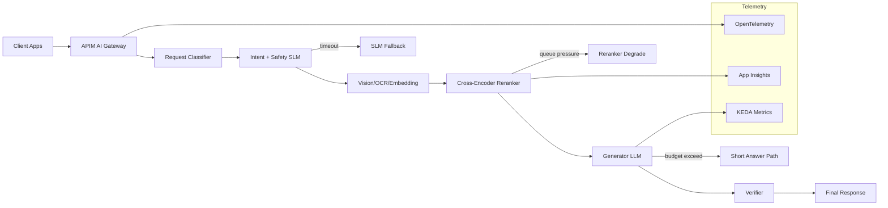
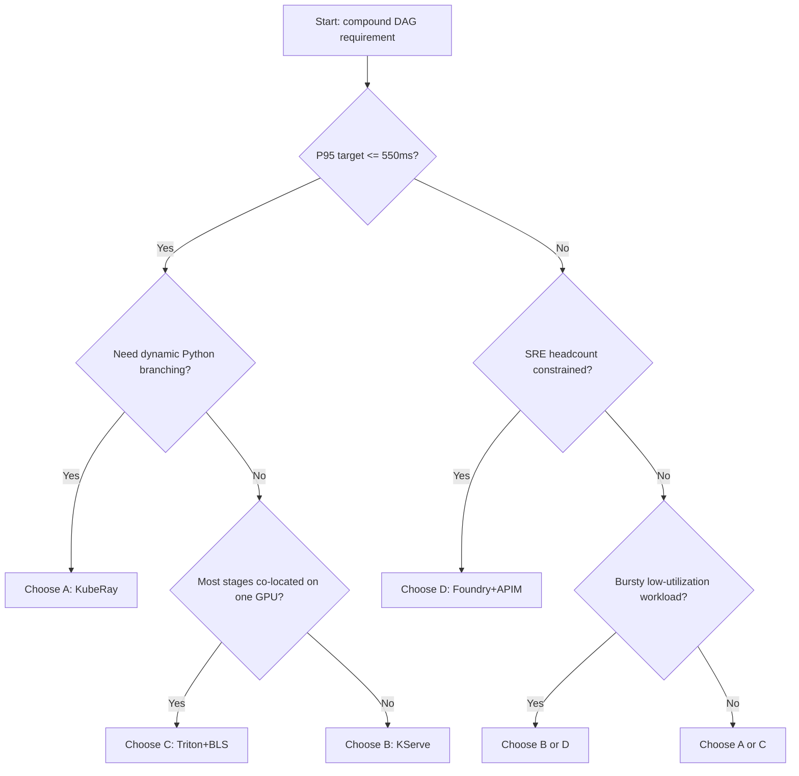

# 企业 Compound Inference DAG 服务选型 FAQ：AKS KubeRay Ray Serve vs KServe InferenceGraph vs Triton Ensemble/BLS vs Foundry+APIM

## 1. 问题定义与架构边界
本指南讨论企业级多阶段复合推理链路。  
目标链路是同步请求内完成。  
目标时延预算是 `P95 < 500–800ms`。  
典型 DAG 为。  
`Intent/Safety SLM -> Vision/OCR/Embedding -> Cross-Encoder Reranker -> Generator LLM -> Verifier`。  
本篇不是离线批处理框架比较。  
本篇不比较训练平台。  
本篇只比较生产在线推理编排。  
并且只比较可落地的 Azure 架构路径。  
同时覆盖 GPU 与 CPU 混合阶段。  
并处理跨阶段回压与超时预算。  

## 2. 目标负载剖面与 SLO 预算
输入负载呈现双峰。  
工作时段有持续请求。  
活动时段会出现洪峰。  
示例峰值是 `300 RPS`。  
P50 预算建议 `220–320ms`。  
P95 预算建议 `500–800ms`。  
P99 可接受上限 `950ms`。  
链路分段预算建议如下。  
意图与安全 SLM `50–90ms`。  
视觉/OCR/Embedding `60–140ms`。  
Reranker `35–85ms`。  
生成 LLM `180–360ms`。  
Verifier `40–90ms`。  
网络与编排开销预留 `25–65ms`。  
超时策略必须按阶段独立设置。  
不能用单一总超时覆盖全链路。  
各阶段需设置 fail-fast 与 fallback。  
并按业务风险定义降级轨道。  

## 3. 四类候选架构总览
方案 A。  
`AKS + KubeRay + Ray Serve DeploymentGraph`。  
主打 Python 原生 DAG 与异构资源调度。  
主打每阶段独立扩缩容。  
主打动态批处理与并行扇出。  

方案 B。  
`AKS + KServe InferenceGraph`。  
主打声明式路由 CRD。  
主打 GitOps 变更与可审计发布。  
主打 Knative scale-to-zero 经济性。  

方案 C。  
`Triton Ensemble + BLS`。  
主打同机 GPU 链式执行。  
主打共享内存零序列化。  
主打亚毫秒阶段拼接。  

方案 D。  
`APIM AI Gateway + Azure AI Foundry + AI Content Safety + AI Search`。  
主打托管化与低 SRE 负担。  
主打区域级故障切换。  
主打策略与治理统一。  

## 4. 端到端参考拓扑（同步 DAG + 分层回压）


该拓扑适用于四种方案。  
差异在于 DAG 执行平面。  
差异也在于阶段间数据搬运。  
差异还在于弹性粒度与运维边界。  
APIM 可统一入口治理。  
路由标签建议包含。  
`x-pipeline-id`、`x-latency-tier`、`x-risk-tier`。  
避免日志聚合时无法按阶段归因。  

## 5. 方案 A：AKS + KubeRay + Ray Serve DeploymentGraph
Ray Serve 的优势在于 Python 原生表达。  
可直接写条件分支。  
可直接写并行扇出。  
可直接写阶段级超时。  
可直接做 DeploymentHandle 链接。  
多节点池可做异构资源编排。  
CPU 池承接 OCR 与解析。  
L4S/A10 池承接 embedding 与 reranker。  
H100/MI300X 池承接生成模型。  
避免“全部阶段绑在 H100”造成空转。  
动态批处理可按阶段单独配置。  
例如 reranker 批量 `32`。  
SLM 批量 `16`。  
LLM 批量 `4`。  
这能匹配 `8:2:1` 扩缩容比例。  
Ray Autoscaler 能按 actor 队列扩容。  
并可绑定对象存储做权重预热。  
适合“编排逻辑频繁变化”的团队。  
适合“Python 工程效率优先”的组织。  
风险在于运维控制面复杂度较高。  
需要平台团队掌握 Ray 运维细节。  

## 6. 方案 B：AKS + KServe InferenceGraph
KServe InferenceGraph 提供 CRD 声明式编排。  
`Sequence` 适合串行推理链。  
`Switch` 适合按特征分流。  
`Splitter` 适合 A/B 或镜像流量。  
声明式定义便于 GitOps 审计。  
适合多语言容器混合。  
并不强制 Python 作为编排语言。  
Knative scale-to-zero 可压低闲时成本。  
适合内部低频长尾管道。  
缺点是复杂条件逻辑表达力有限。  
复杂规则往往要回到 sidecar 或服务内。  
并且冷启动路径需额外预热策略。  
否则活动时段首波 P95 波动明显。  
KServe 与 Istio/Ingress 配合时。  
需避免多层重试叠加。  
否则会放大尾延迟。  

## 7. 方案 C：Triton Ensemble + BLS
Triton Ensemble 适合同机串联模型。  
BLS 适合把前后处理放入同平面。  
CUDA Shared Memory 可减少序列化。  
System Shared Memory 可减少跨进程复制。  
在视觉 + embedding + reranker 同机场景。  
单阶段衔接可做到亚毫秒级。  
这对 `P95 < 500ms` 目标非常关键。  
该方案可用于 AKS GPU 节点。  
也可用于 AML Managed Online Endpoints。  
局限是 DAG 条件分支不如 Ray 灵活。  
跨节点扩展需要额外编排层。  
并且 Python 业务逻辑深度嵌入时。  
BLS 可维护性会成为负担。  
适合“计算密集且链路稳定”的阶段。  
不适合高频变更业务流程编排。  

## 8. 方案 D：Foundry + APIM 托管链路
托管链路优势是交付快。  
平台团队可少管 K8s 与 GPU 集群。  
APIM 提供统一策略面。  
Foundry 提供模型托管与路由。  
AI Content Safety 可串联风险拦截。  
AI Search 可提供语义检索补强。  
区域故障切换可借助托管能力。  
但同步链路会有额外 hop 税。  
常见 `3–5` 个 HTTP/TLS hop。  
额外时延通常 `+25–65ms`。  
当目标是极限低时延时。  
该税费需纳入预算。  
当业务请求量较低且波动大。  
托管链路总体 TCO 反而更优。  
当高 QPS 稳态持续存在。  
自建 GPU 平面更容易达到成本拐点。  

## 9. 定量模型：序列化开销与 GPU 空转浪费
我们比较两类损耗。  
损耗一是 hop 序列化。  
损耗二是 GPU 空转等待。  
定义。  
`T_total = Σ T_stage + T_hop + T_queue + T_retry`。  
其中 `T_hop` 可近似 `N_hop * t_tls_http`。  
若 `N_hop = 4` 且 `t_tls_http = 11ms`。  
则 `T_hop ≈ 44ms`。  
GPU 空转成本近似。  
`Cost_idle = GPU_hour_cost * Idle_ratio * Fleet_hours`。  
若 H100 成本 `\$2.9/h`。  
空转率 `38%`。  
月运行 `10,800h`。  
则月空转约 `\$11,901`。  
若通过异构拆分把空转率降至 `17%`。  
月空转约 `\$5,329`。  
仅此项节省 `\$6,572`。  
因此在高负载下。  
异构分段通常比减少 hop 更划算。  
在低负载场景。  
减少固定集群持有成本更关键。  

## 10. 配置块 A：KubeRay RayService + Python DeploymentHandle
```yaml
apiVersion: ray.io/v1
kind: RayService
metadata:
  name: compound-infer-rayservice
spec:
  serviceUnhealthySecondThreshold: 300
  deploymentUnhealthySecondThreshold: 180
  serveConfigV2: |
    applications:
      - name: compound-dag
        route_prefix: /infer
        import_path: app.graph:build_app
        deployments:
          - name: intent_safety
            num_replicas: 4
            ray_actor_options:
              num_cpus: 1
          - name: vision_embed
            autoscaling_config:
              min_replicas: 2
              max_replicas: 16
              target_num_ongoing_requests_per_replica: 8
            ray_actor_options:
              num_gpus: 0.25
          - name: reranker
            autoscaling_config:
              min_replicas: 4
              max_replicas: 24
            ray_actor_options:
              num_gpus: 0.25
          - name: generator
            autoscaling_config:
              min_replicas: 2
              max_replicas: 8
            ray_actor_options:
              num_gpus: 1
```

```python
from ray import serve
from ray.serve.handle import DeploymentHandle

@serve.deployment
class CompoundGraph:
    def __init__(
        self,
        intent: DeploymentHandle,
        vision: DeploymentHandle,
        reranker: DeploymentHandle,
        generator: DeploymentHandle,
        verifier: DeploymentHandle,
    ) -> None:
        self.intent = intent
        self.vision = vision
        self.reranker = reranker
        self.generator = generator
        self.verifier = verifier

    async def __call__(self, req: dict) -> dict:
        intent = await self.intent.remote(req)
        if intent["block"]:
            return {"status": "blocked", "reason": intent["reason"]}
        v = await self.vision.remote(req)
        r = await self.reranker.remote(v)
        g = await self.generator.remote(r)
        checked = await self.verifier.remote(g)
        return {"status": "ok", "result": checked}
```

## 11. 配置块 B：APIM 托管链式路由策略
```xml
<policies>
  <inbound>
    <base />
    <set-variable name="tier" value="@(context.Request.Headers.GetValueOrDefault("x-latency-tier","standard"))" />
    <choose>
      <when condition="@(context.Variables.GetValueOrDefault<string>("tier") == "premium-lowlatency")">
        <set-backend-service base-url="https://ray-aks.internal/compound" />
      </when>
      <otherwise>
        <set-backend-service base-url="https://foundry-managed.internal/compound" />
      </otherwise>
    </choose>
  </inbound>
  <backend>
    <forward-request timeout="40" />
  </backend>
  <outbound>
    <set-header name="x-pipeline-route" exists-action="override">
      <value>@(context.Variables.GetValueOrDefault<string>("tier"))</value>
    </set-header>
    <base />
  </outbound>
</policies>
```

该策略可实现双轨。  
关键客群走低时延轨。  
长尾客群走托管轨。  
并保持统一入口与审计。  

## 12. 12 维选型矩阵与决策树
| 维度 | A KubeRay | B KServe | C Triton+BLS | D Foundry+APIM |
|---|---|---|---|---|
| 1. 同步低时延上限 | 高 | 中高 | 很高 | 中 |
| 2. DAG 表达力 | 很高 | 中 | 中低 | 中 |
| 3. 异构扩缩容能力 | 很高 | 高 | 中 | 中 |
| 4. 冷启动经济性 | 中 | 高 | 低中 | 高 |
| 5. Python 研发效率 | 很高 | 中 | 中 | 高 |
| 6. GitOps 可审计性 | 中高 | 很高 | 中 | 高 |
| 7. GPU 利用率上限 | 高 | 中高 | 很高 | 中 |
| 8. 平台运维复杂度 | 高 | 中高 | 高 | 低 |
| 9. 多区域托管韧性 | 中 | 中 | 中 | 很高 |
| 10. 供应商锁定程度 | 中 | 中低 | 中高 | 高 |
| 11. 300 RPS 成本效率 | 高 | 中高 | 高 | 中 |
| 12. 低流量成本效率 | 中 | 高 | 低 | 很高 |



## 13. 场景一：实时电商视觉搜索与购物 Copilot（300 RPS）
业务特点。  
白天持续高并发。  
活动时段出现突发。  
用户容忍时延较低。  
并且图文混合请求比例高。  
推荐方案。  
主路径采用 A。  
视觉与 reranker 使用 L4S/A10 池。  
生成模型使用 H100 池。  
异常高风险请求切到 D 做托管保护。  
量化目标。  
P95 保持 `<=620ms`。  
拒答与拦截链路 `<=140ms`。  
GPU 空转率 `<=20%`。  
月度推理成本较全 H100 单池下降 `22%–31%`。  

## 14. 场景二：合规理赔文档到决策管道
业务特点。  
文档解析与结构化占比较高。  
每个请求都要过策略校验。  
审计证据保留要求严格。  
峰值不如电商高。  
但误判成本更高。  
推荐方案。  
默认使用 D。  
关键 OCR+reranker 同机可插入 C。  
策略编排与日志治理放在 APIM。  
高峰季节可补充 B 的 scale-to-zero 节点。  
量化目标。  
理赔初判 P95 `<=780ms`。  
策略漏检率 `<0.3%`。  
审计证据缺失率 `0`。  
相较全自建运维 FTE 下降 `35%–45%`。  

## 15. Day-0/Day-2 清单与定量 FAQ
### Day-0（上线准备）
- 定义每阶段超时预算与重试上限。  
- 定义 `8:2:1` 目标扩缩容比例基线。  
- 建立分阶段队列深度告警。  
- 建立 APIM 按租户/风险分流策略。  
- 建立 OTel trace-id 全链路透传。  
- 建立失败样本回放数据集。  
- 建立 GPU 池预热窗口策略。  
- 建立灰度回滚与一键降级剧本。  

### Day-2（生产运营）
- 每日复盘阶段级 P95 与超时来源。  
- 每周复盘 GPU 利用率与空转成本。  
- 每周复盘慢查询样本与路由命中。  
- 每周复盘策略拦截误报率。  
- 每月复盘扩容阈值与批量参数。  
- 每月复盘跨区故障切换演练。  
- 每月复盘单位请求成本趋势。  
- 每季度复盘架构组合是否需要调整。  

**Q1：为什么 `3–5` hop 会带来 `25–65ms` 的抖动区间？**  
A1：TLS 握手复用、网关策略执行、连接池命中率和后端拥塞共同决定抖动，单 hop 常见 `6–14ms`。  

**Q2：在 300 RPS 下，何时 A 比 D 更省钱？**  
A2：当生成阶段稳定负载超过 `~130 RPS` 且 GPU 利用率可维持 `>58%` 时，A 通常出现月度成本拐点。  

**Q3：`8:2:1` 扩缩容比例如何落地？**  
A3：先用阶段 QPS 与平均服务时长估算并发，再按队列积压阈值自动调整，通常 reranker 副本数约为 SLM 的 `4x`。  

**Q4：C 方案的性能优势主要来自哪里？**  
A4：主要来自共享内存与同机执行减少序列化拷贝，视觉+reranker 链接段常见可减少 `15–40ms`。  

**Q5：B 的 scale-to-zero 何时会成为风险？**  
A5：当业务对首请求冷启动敏感且请求到达呈尖峰时，若未预热，首波 P95 可能上升 `80–220ms`。  

**Q6：D 如何控制托管链路的成本上界？**  
A6：通过 APIM 按租户与风险层做路由配额，配合 PTU 基线与 serverless 溢出上限，避免无上限按量扩张。  
