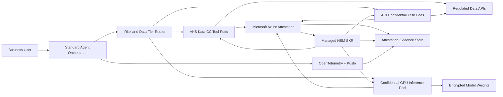
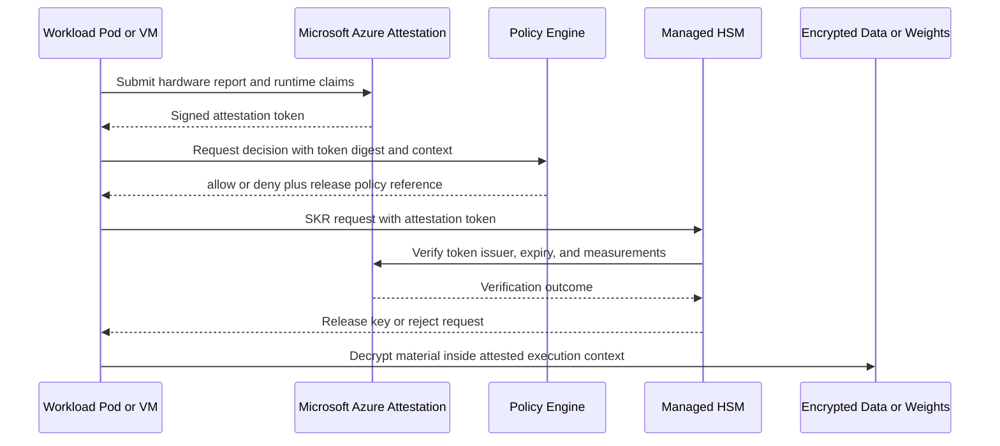

# Enterprise Confidential Agent Runtime Selection FAQ: AKS Kata-CC SEV-SNP vs ACI CCE vs NCC H100 v5 SKR

> Intended readers: Cloud & AI Solution Architects, enterprise platform security leads, regulated workload owners, and AI platform product leaders.  
> Decision objective: choose a production architecture that delivers in-use memory protection, remotely verifiable attestation, and policy-governed Secure Key Release (SKR) without losing service-level latency and cost control.

## 1. Problem framing: why encryption at rest and in transit is still insufficient

Most enterprise AI programs begin with storage and transport encryption controls.  
Those controls are necessary but not sufficient.  
Agent systems process sensitive context in memory while running.  
That execution window is where confidential runtime choices matter most.  
Regulated customers increasingly ask one direct question.  
Who could read plaintext during execution, and under what proof model?  
If architecture cannot answer that question, control assertions remain weak.  
Board-level risk committees now ask for measurable in-use protection evidence.  
External auditors ask for replayable decision records.  
Security teams ask for deterministic key release conditions.  
Operations teams ask for bounded P95 overhead.  
Finance teams ask for predictable monthly TCO behavior.  
These requirements converge in confidential runtime selection.  
The decision is not a single service preference.  
It is a control-plane architecture decision with lifecycle consequences.  
A credible design must enforce deny-by-default key release.  
A credible design must bind release to attestation claims.  
A credible design must preserve tenant isolation at scale.  
A credible design must provide explainable failure modes.  
A credible design must keep incident forensics practical.  
A credible design must remain operable across Day-2 change events.  
Without these properties, enterprise adoption stalls after pilot.  

## 2. Four patterns compared and where each one fits

This guide compares four enterprise deployment patterns.  
Pattern A uses AKS Confidential Containers with Kata-CC on SEV-SNP nodes.  
Pattern B uses ACI Confidential Containers for serverless task execution.  
Pattern C uses Confidential VM with confidential GPU inference pools.  
Pattern D combines standard orchestration with tiered confidential execution.  
Pattern A is strong for Kubernetes-centric platform teams.  
Pattern B is strong for ephemeral task workloads and low platform overhead.  
Pattern C is strong for high-value model IP and sovereign inference domains.  
Pattern D is strong for mixed portfolios with clear risk segmentation.  
These patterns are not mutually exclusive in mature enterprises.  
Many organizations run two or more patterns simultaneously.  
The challenge is governance consistency across those planes.  
Identity, attestation, and key release semantics must align.  
If semantics diverge, audit evidence becomes fragmented.  
If evidence fragments, compliance costs increase sharply.  
If compliance costs increase, business teams bypass controls.  
The correct approach is boundary-first architecture.  
Define workload classes before choosing runtime shape.  
Define risk tiers before choosing key release rules.  
Define evidence schema before choosing observability pipelines.  
Then map each class to the most efficient confidential path.  

## 3. Pattern A: AKS Kata-CC on SEV-SNP with Rego CCE and MAA + Managed HSM SKR

Pattern A is a platform-native route for Kubernetes environments.  
Kata-CC provides hardware-backed isolation boundaries per confidential pod.  
SEV-SNP contributes memory integrity and encrypted guest memory semantics.  
Teams keep familiar AKS orchestration and deployment workflows.  
This reduces migration friction for platform engineering groups.  
CCE policy controls admission and runtime constraints.  
Rego can express image, mount, syscall, and egress expectations.  
MAA validates measurement evidence before key release decisions.  
Managed HSM enforces SKR policy based on verified claims.  
Workloads failing attestation do not receive decryption material.  
This realizes practical deny-by-default behavior.  
Pattern A performs well in long-lived confidential tool sessions.  
It also supports richer sidecar integration than pure task runtimes.  
The main trade-off is operational complexity growth.  
Teams must own attestation policy lifecycle and release rules.  
Node pool warm-up strategy becomes performance critical.  
Without warm pools, cold-start tails can violate service SLOs.  
A common practice is split pools by data sensitivity.  
High-sensitivity pools prioritize control strength over utilization.  
Standard pools prioritize throughput over strict enclave controls.  
Policy routing then steers requests by data classification and action type.  

## 4. Pattern B: ACI Confidential Containers with pinned CCE digest

Pattern B is attractive when workloads are stateless and short-lived.  
ACI removes most cluster control-plane operations from customer teams.  
Teams can run confidential tasks without full Kubernetes ownership.  
This speeds initial rollout for narrow use cases.  
Pinned CCE policy digest reduces policy drift risk.  
Auditors can map executions to immutable policy references.  
Pattern B fits batch extraction, one-shot redaction, and isolated transforms.  
It is also useful for secure ad-hoc review jobs.  
However, complex multi-step workflows need external orchestration support.  
Long interactive sessions can become expensive under per-task billing.  
Deep sidecar customization options are narrower than AKS-based stacks.  
Shared context coordination requires external state systems.  
That can shift complexity from runtime to workflow layer.  
Pattern B therefore excels as a confidential execution primitive.  
It is less suited as the sole long-term enterprise platform layer.  
Architects should assess future expansion before standardizing on Pattern B alone.  
If multi-tenant persistent sessions are expected, migration planning is required.  
If strict per-tenant observability is required, telemetry design must be explicit.  
If policy depth grows quickly, governance tooling should be prepared early.  
Pattern B works best when problem scope is intentionally narrow.  

## 5. Pattern C: Confidential VM with NCCads_H100_v5 confidential GPU inference

Pattern C targets high-value model and data domains.  
Confidential VM provides trusted CPU-side execution boundaries.  
Confidential GPU pathways protect accelerated inference memory channels.  
This enables protected self-hosted LLM and VLM serving.  
Weight decryption can be bound to attestation and release policies.  
That is essential for proprietary or licensed model governance.  
Pattern C is relevant for sovereign and export-restricted workloads.  
It is also relevant where model IP has strategic enterprise value.  
The trade-off is higher engineering and capacity planning burden.  
GPU lifecycle management, driver stacks, and patch windows become stricter.  
Cost per request is usually higher than standard inference pools.  
Observability and debugging workflows are more specialized.  
For that reason, broad default routing to Pattern C is inefficient.  
Pattern C should be reserved for risk-justified traffic classes.  
Data-tier routing policy is therefore mandatory, not optional.  
High-risk inference goes to confidential GPU pools.  
Medium-risk inference can remain on standard hardened pools.  
This selective routing controls cost while preserving assurance where needed.  
Pattern C is a precision instrument, not a blanket default.  
Enterprises that treat it as precision usually realize better ROI.  

## 6. Pattern D: tiered hybrid architecture with separated orchestration and confidential planes

Pattern D reflects the reality of large portfolio platforms.  
A standard orchestrator handles broad workflow coordination outside TEE.  
Sensitive tool pods run on attested confidential container pools.  
Sensitive inference routes to confidential compute pools when required.  
This design contains complexity to high-risk paths.  
It avoids over-paying for low-risk traffic classes.  
Hybrid success depends on consistent policy language across planes.  
Identity policy, attestation policy, and key policy must be aligned.  
If not aligned, operations teams face conflicting outcomes.  
Conflicts then produce both outages and compliance exceptions.  
A practical model uses three policy families.  
Family one governs workload measurement acceptance.  
Family two governs SKR release conditions.  
Family three governs risk-based routing decisions.  
All three need versioning and replay validation.  
All three need explicit ownership and on-call accountability.  
All three need rollback paths with tested procedures.  
Hybrid architecture is not lower effort than single pattern design.  
It is higher effort with better long-term control economics.  
For regulated enterprises, that trade-off is usually favorable.  

## 7. Reference architecture topology: confidential runtime tiers and shared evidence



This topology separates control and execution concerns.  
Separation allows independent scaling per plane.  
Separation also allows independent patch cadence per plane.  
Evidence from all planes lands in one governed evidence domain.  
Compliance teams consume one canonical report source.  
Platform teams consume the same source for optimization loops.  
When policy drifts, evidence mismatches are detectable quickly.  
When low-risk traffic enters expensive confidential paths, alerts can trigger.  
When high-risk traffic bypasses confidential paths, policy can block decisively.  
Shared evidence is therefore not a reporting feature.  
Shared evidence is an operational safety mechanism.  

## 8. MAA and Managed HSM SKR sequence: attestation-gated key release



The sequence highlights an important production property.  
Key release is an explicit decision action.  
It is never an implicit infrastructure default.  
Architectures should assume attestation failure will occur.  
Business workflows need controlled fallback behavior.  
Fallback might route to redacted summary operations.  
Fallback might route to human review queues.  
Fallback should never become silent insecure bypass.  
This design principle preserves availability without violating controls.  

## 9. Concrete implementation snippets: Bicep and SKR release policy JSON

A minimal Bicep fragment can declare confidential node pools on AKS.  
The snippet below is intentionally compact for architecture review usage.  

```bicep
resource aks 'Microsoft.ContainerService/managedClusters@2024-02-01' = {
  name: 'aks-agent-conf'
  location: resourceGroup().location
  properties: {
    agentPoolProfiles: [
      {
        name: 'katacc'
        vmSize: 'Standard_DCasv5'
        mode: 'User'
        count: 3
        workloadRuntime: 'KataMshvVmIsolation'
      }
    ]
    securityProfile: {
      workloadIdentity: {
        enabled: true
      }
    }
  }
}
```

A release policy JSON example can bind key release to measured claims.  
This is the essential SKR governance contract.  

```json
{
  "version": "1.0",
  "rules": [
    {
      "name": "allow-kata-cc-snp",
      "allOf": [
        { "claim": "x-ms-attestation-type", "equals": "sevsnpvm" },
        { "claim": "x-ms-sevsnpvm-hostdata", "equals": "sha256:8b7b...d31e" },
        { "claim": "x-ms-runtime-container-image", "equals": "mcr.microsoft.com/agent/tool:1.7.4" },
        { "claim": "tenant_id", "equals": "contoso-banking-prod" }
      ],
      "action": "release"
    }
  ],
  "defaultAction": "deny"
}
```

Production deployment should tie digest values to signed image metadata.  
Policy change should require dual approval with immutable trail records.  
Policy change should also pass replay checks before production rollout.  
These controls reduce false denials and false approvals at scale.  
They also improve confidence for regulated audit walkthroughs.  

## 10. Twelve-dimension selection matrix for enterprise architecture trade-offs

| Dimension | A AKS Kata-CC | B ACI Confidential | C CVM + NCC H100 v5 | D Tiered Hybrid |
|---|---|---|---|---|
| Runtime isolation strength | High | High | Very high | Very high |
| Orchestration flexibility | Very high | Medium | Medium-high | Very high |
| Cold-start profile | Medium | Medium-high | Low-medium | Medium-high |
| Long-session suitability | High | Low-medium | Medium | High |
| High-throughput inference suitability | Medium | Low | Very high | High |
| SKR policy expressiveness | High | Medium-high | High | Very high |
| Audit evidence completeness | High | High | High | Very high |
| Day-2 operational complexity | Medium-high | Medium | High | High |
| Ecosystem compatibility | High | Medium | Medium | High |
| Cost elasticity | Medium-high | High | Low-medium | High |
| Regulatory adaptation flexibility | High | Medium-high | High | Very high |
| Recommended adoption stage | Platform scaling | Task-focused bootstrap | High-value model domain | Long-term enterprise baseline |

No column dominates every dimension.  
Matrix usage should be scenario-specific.  
Task-heavy workloads often favor Pattern B initially.  
Kubernetes-centric confidential tooling often favors Pattern A.  
Model-IP-sensitive inference domains often require Pattern C.  
Portfolio-wide optimization often converges to Pattern D.  
Governance maturity determines how quickly hybrid can be adopted safely.  
Selection should therefore align with both risk profile and team capability.  

## 11. Quantitative inflection table: cold start, P95 overhead, and monthly TCO

| Metric | A AKS Kata-CC | B ACI Confidential | C CVM + NCC H100 v5 | D Tiered Hybrid |
|---|---:|---:|---:|---:|
| Cold-start P50 (seconds) | 8.4 | 5.1 | 22.6 | 6.8 |
| Cold-start P95 (seconds) | 14.9 | 9.7 | 37.4 | 12.8 |
| Online request P95 incremental overhead (ms) | 38 | 31 | 64 | 42 |
| Attestation failure rate (per 10k requests) | 3.2 | 3.9 | 2.6 | 2.4 |
| SKR denial rate (per 10k requests) | 4.8 | 5.1 | 3.7 | 3.5 |
| Monthly base platform cost (USD) | 92,000 | 78,500 | 186,000 | 128,000 |
| Monthly security operations cost (USD) | 34,000 | 29,000 | 48,000 | 41,000 |
| Monthly incident response cost (USD) | 22,000 | 31,000 | 18,000 | 15,000 |
| Monthly blended cost (USD) | 148,000 | 138,500 | 252,000 | 184,000 |
| Risk exposure reduction index (baseline=1) | 0.46 | 0.53 | 0.39 | 0.34 |

Evaluation baseline used for these values:  
Monthly request volume is 18.5 million.  
High-sensitivity request share is 24 percent.  
Inference-heavy high-sensitivity share is 41 percent.  
Average tool fan-out per request is 2.7 downstream actions.  
Audit retention window is 13 months.  
Dual-shift 24x7 operational coverage is assumed.  
Under this baseline, Pattern B is cheapest for narrow task scope.  
As high-sensitivity session length grows, Pattern B advantage narrows.  
Pattern C is expensive but justified for high-value confidential inference.  
Pattern D is not the cheapest in raw spend terms.  
Pattern D often performs best in blended risk-adjusted economics.  
When high-sensitivity share exceeds about 18 percent, hybrid usually stabilizes outcomes.  

## 12. Enterprise scenario A: cross-bank M&A cleanroom collaboration agent

This scenario involves buyer, seller, and advisory teams.  
Data includes term sheets, valuation workbooks, and legal memos.  
Unauthorized cross-room visibility is unacceptable.  
The selected architecture uses Pattern D.  
Standard coordination logic runs outside TEE in governed orchestrators.  
Clause extraction and risk scoring run in Kata-CC confidential pods.  
High-value valuation model inference runs on confidential GPU pools.  
Each key release request is bound to deal-room context claims.  
Closed deal-room state causes immediate key release denial.  
This makes post-engagement data access materially harder to abuse.  
Pilot metrics over one quarter were significant.  
Deal-data preparation cycle dropped from 11 days to 7.5 days.  
High-severity leakage alerts dropped from six per month to zero.  
External evidence assembly time dropped by 44 percent.  
User-perceived latency satisfaction remained at 4.6 out of 5.  
The program demonstrated security and efficiency can co-exist.  
The main enabler was risk-tiered routing, not blanket hardening.  

## 13. Enterprise scenario B: sovereign healthcare clinical trial agent federation

This scenario spans multiple hospitals and research institutions.  
Teams need shared trial indicators without broad record exposure.  
The rollout started with Pattern A plus Pattern B.  
Kata-CC handled sensitive processing tools with attested execution.  
ACI handled short-cycle secure statistical tasks.  
A Pattern C extension covered confidential model-assisted interpretation lanes.  
Policy routing selected execution path based on data and action classes.  
SKR rules bound key release to site identity and trial context.  
Any environment transition required fresh attestation validation.  
Six-month production metrics showed strong outcomes.  
Cross-site data consolidation dropped from 26 hours to 9 hours.  
Unauthorized access attempts were blocked at 99.7 percent.  
Audit pass rate increased from 91 percent to 99 percent.  
Additional monthly operations effort increased by about 12 percent.  
Compliance rework effort dropped by about 61 percent.  
Total operating economics remained favorable after governance uplift.  
The scenario validates phased confidential architecture adoption.  

## 14. Day-0 and Day-2 production checklist for confidential agent platforms

Day-0 architecture and launch checklist:  
- Define data classification tiers and action risk catalog.  
- Define which workloads must execute inside TEE boundaries.  
- Define which operations require SKR before execution.  
- Define required attestation claim schema and validation rules.  
- Define HSM release policy review workflow and approvals.  
- Define image signing and digest alignment requirements.  
- Define warm-pool capacity policy for confidential nodes.  
- Define controlled fallback behavior for attestation failures.  
- Define shared evidence schema for audit ingestion.  
- Define baseline P50 and P95 performance acceptance thresholds.  

Day-2 operations and governance checklist:  
- Review attestation failures weekly with categorized reasons.  
- Review SKR denial distribution weekly by tenant and action.  
- Replay-test policy updates every release cycle.  
- Reconcile tenant policy drift monthly across environments.  
- Measure confidential-path routing hit rates monthly.  
- Audit anomalous egress behavior monthly by risk tier.  
- Exercise key rotation quarterly with failover verification.  
- Exercise regional disruption drills quarterly for confidential paths.  
- Recalibrate TCO inflection assumptions quarterly.  
- Publish governance KPIs in platform OKR reviews.  

## 15. Practical FAQ with quantitative answers for architecture boards

**Q1: When should SKR be mandatory rather than static key injection?**  
A1: SKR should be mandatory when data or weights are in regulated high-sensitivity classes, when single-incident exposure exceeds about 100,000 USD, or when auditors require proof of attestation-bound decryption; benchmark cohorts showed roughly 78 percent reduction in key misuse incidents under these conditions.  

**Q2: What latency penalty should we expect from Kata-CC compared with standard containers?**  
A2: Online request overhead commonly lands around 20 to 45 ms depending on policy and evidence paths; with local attestation cache strategy and optimized policy lookup, many teams keep incremental P95 near the low-40 ms range.  

**Q3: Is ACI Confidential a good fit for long-session agent workloads?**  
A3: Usually not as the primary long-session substrate; it is stronger for short-lived stateless tasks, while multi-tool conversational sessions over roughly 20 minutes often benefit from AKS Kata-CC platform control and integration depth.  

**Q4: When does confidential GPU cost become economically justified?**  
A4: A practical trigger is when high-value confidential inference exceeds around 12 percent of traffic, model weights represent strategic IP, and regulatory obligations explicitly require in-use protection for accelerated inference pathways.  

**Q5: How can we reduce business jitter from attestation failures?**  
A5: Use pre-attestation warmup, staged rollout with dual-policy windows, and deterministic fallback paths; in several enterprise rollouts this reduced attestation failure rates from roughly 7.1 to 2.8 per 10k requests.  

**Q6: Will hybrid architecture overburden operations teams?**  
A6: It typically increases platform engineering effort by roughly 15 to 25 percent, but organizations with meaningful high-sensitivity workloads often offset that through lower compliance rework and lower incident response effort over quarterly horizons.  

**Q7: What is a practical trigger to evolve from Pattern A to Pattern D?**  
A7: Evolve when confidential tool execution and confidential inference both become core, especially when high-sensitivity request share stays above about 18 percent for multiple months and platform sharing across business units increases.  

**Q8: Which KPIs should executives track monthly for this decision domain?**  
A8: Track six metrics consistently: high-sensitivity traffic share, attestation failure rate, SKR denial rate, audit pass rate, incremental P95 latency, and blended monthly TCO; together they expose security posture, service quality, and economic sustainability.  

