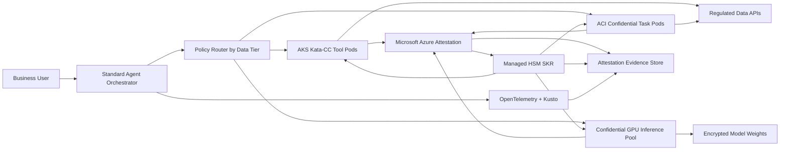
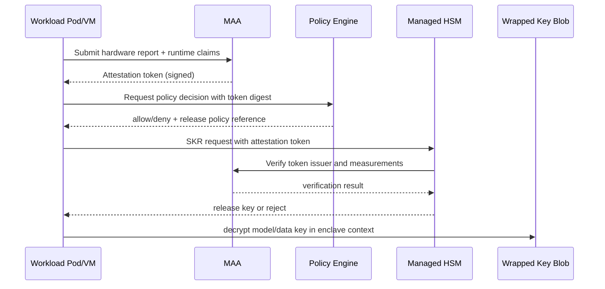

# 企业机密 Agent Runtime 选型 FAQ：AKS Kata-CC SEV-SNP vs ACI CCE vs NCC H100 v5 SKR

> 角色定位：Cloud & AI Solution Architect、平台安全架构师、行业合规负责人、AI 平台产品负责人。  
> 决策目标：在企业多租户 Agent 平台中，为高敏感数据与高价值模型权重提供“内存在用保护 + 远程度量证明 + 受策略约束的密钥释放（SKR）”的生产级架构路径。

## 1. 问题定义：为什么仅有静态加密和传输加密仍不够

企业在 Agent 生产化后，最难回答的问题不是算力够不够。  
真正的焦点是数据在执行时是否可被未授权主体读取。  
传统的 at-rest 加密只保护磁盘层。  
in-transit 加密只保护网络层。  
而模型推理、检索拼装、工具编排发生在内存态。  
内存态正是攻击面最活跃的位置。  
在金融、医疗、政务与高端制造场景中，这一点尤其关键。  
监管审计也越来越关注“谁在运行时可见明文”。  
如果系统无法证明运行环境完整性，合规结论往往无法通过。  
这就引出了机密计算运行时选型问题。  
我们需要比较的不只是性能参数。  
还要比较证明链可信度。  
还要比较密钥释放策略表达力。  
还要比较 Day-2 运维负担与错误恢复难度。  
还要比较租户隔离边界在失陷情况下的残余风险。  
还要比较在峰值业务时的成本拐点。  
一套可上线的答案必须满足四个条件。  
第一，默认拒绝密钥释放。  
第二，必须有可验证度量证据。  
第三，策略可审计且可回放。  
第四，业务延迟仍在可接受区间。  

## 2. 四种模式总览：从容器到机密 GPU 的能力谱系

本指南比较四种企业常见模式。  
模式 A：AKS Confidential Containers（Kata-CC）+ AMD SEV-SNP。  
模式 B：ACI Confidential Containers + CCE digest 固定。  
模式 C：Confidential VM（TDX）+ NCCads_H100_v5 机密 GPU。  
模式 D：分层混合架构，标准编排面与机密执行面并存。  
模式 A 适合需要 K8s 原生编排能力的平台团队。  
模式 B 适合任务型、无状态、短生命周期作业。  
模式 C 适合机密自托管模型推理与高价值权重保护。  
模式 D 适合业务组合复杂且风险分层明显的大型企业。  
这四种模式不是互斥关系。  
很多企业在同一平台会组合使用。  
关键是建立统一的证明和密钥策略语义。  
没有统一语义就会出现审计口径分裂。  
口径分裂会直接带来合规返工成本。  
架构师应优先定义能力边界再选产品形态。  
能力边界至少包括数据级别、动作级别、租户级别。  
再映射到运行时与密钥平面的具体技术。  
这样才能避免“先上组件后补治理”的被动局面。  

## 3. 模式 A：AKS Kata-CC（SEV-SNP）+ Rego CCE + MAA + Managed HSM SKR

模式 A 的核心是在 AKS 内引入机密容器工作负载。  
Kata-CC 通过硬件隔离边界承载敏感工具 Pod。  
SEV-SNP 提供客户机内存页完整性与加密保护。  
平台可继续复用 K8s 的调度、弹性与发布流程。  
这让企业团队不必重写整套交付链。  
在策略层，CCE 可使用 Rego 表达允许条件。  
例如限制镜像签名、启动参数、卷挂载和网络出口。  
在密钥层，MAA 先校验度量再驱动 HSM SKR。  
未通过度量的工作负载拿不到解密密钥。  
这条链路让“默认拒绝”可被技术强制。  
模式 A 的优势是平台一致性。  
研发和运维模型与现有 AKS 资产较为兼容。  
模式 A 的代价是体系复杂度提升。  
团队需要掌握 attestation、policy bundle、HSM release rule。  
另外，冷启动会高于普通容器。  
在高并发突发下需预热机密节点池。  
否则 P95 会受到明显影响。  
实践上建议将高敏工具与普通工具分池。  
高敏池以安全优先。  
普通池以吞吐优先。  
通过路由策略把流量按数据等级切分。  
这能在成本与风险之间取得更稳平衡。  

## 4. 模式 B：ACI Confidential Containers（任务型机密执行）

模式 B 面向无状态短任务非常直接。  
ACI 可以按任务拉起机密容器实例。  
不用维护完整 K8s 控制面。  
这降低了平台前期门槛。  
若业务以“每次请求独立执行”为主，模式 B 很高效。  
常见场景包括文档清洗、敏感摘要、一次性对账任务。  
CCE policy digest 固定后可减少策略漂移风险。  
这对审计团队尤其友好。  
因为每次执行都可映射到同一策略版本摘要。  
模式 B 的限制是编排灵活性。  
复杂多步骤工作流仍需外部编排器协同。  
在高频长连接场景中，ACI 成本可能快速上升。  
如果任务共享状态较多，外部状态管理复杂度会增加。  
如果需要细粒度 Sidecar 生态，ACI 可选空间相对小。  
所以模式 B 更像“机密任务执行单元”。  
而不是“全栈多租户平台底座”。  
选型时要先确认业务是否真的是任务型。  
如果后续要演进为多租户长期会话，可能需要迁移。  
迁移成本应在 Day-0 就纳入估算。  

## 5. 模式 C：Confidential VM（TDX）+ NCCads_H100_v5 机密 GPU 推理

模式 C 针对“权重极高价值 + 推理强隔离”场景。  
机密 VM 负责 CPU 内存侧可信执行边界。  
机密 GPU 负责加速侧数据通路保护。  
对企业而言，这意味着自托管模型也可建立受证明的密钥门禁。  
权重解密不再依赖“节点可信假设”。  
而是依赖“度量证明 + 策略授权”。  
这一点对主权模型部署非常关键。  
尤其是跨境数据受限与高价值专有模型场景。  
模式 C 优势是端到端机密推理能力强。  
劣势是成本与工程门槛更高。  
GPU 资源规划、驱动兼容、升级窗口都更严格。  
故障诊断也比普通推理栈复杂。  
建议将模式 C 用于“必须机密推理”的子域。  
不要盲目把所有请求都推到该层。  
否则单位成本会被高估，业务会抵触。  
最佳实践是通过数据分级和策略分级精准路由。  
高风险请求进入机密推理池。  
中低风险请求走标准推理池。  
这样可以把机密能力聚焦在最有价值的业务路径。  

## 6. 模式 D：分层混合架构（标准编排面 + 机密执行面 + 机密推理面）

模式 D 是大型企业最常见的长期形态。  
外层保留标准编排与观察控制平面。  
中层放置受证明的机密工具执行 Pod。  
内层放置机密推理节点与权重解密门禁。  
这种分层设计可以把复杂度限制在高风险子域。  
不会把全平台都拖入高成本路径。  
混合模式的核心在于策略统一。  
身份、证明、密钥、路由必须共享同一策略语义。  
否则会出现策略冲突和审计断点。  
建议统一维护三类策略。  
第一类是工作负载证明策略。  
第二类是密钥释放策略。  
第三类是数据分级路由策略。  
三类策略都需要版本化与回放验证。  
混合模式还要求统一追踪 ID。  
每次请求都要带 `attestation_decision_id`。  
这样才能跨平面拼接证据链。  
在运营上，混合模式需要明确 SRE 职责边界。  
标准层和机密层应有不同值班手册。  
故障演练也要分别覆盖。  
这能避免事故时团队互相等待。  

## 7. 参考架构拓扑：多层机密 Agent 平台



该拓扑将控制面与执行面分离。  
分离后可以独立演进。  
也可以独立扩容。  
审计证据统一汇聚到同一数据域。  
平台可按租户输出差异化合规报表。  
同时可按数据等级输出路由命中率。  
这对成本优化很重要。  
因为它让“机密路径是否被滥用”可度量。  
若发现低风险请求进入机密池，可快速纠偏。  
若发现高风险请求绕过机密池，可立即阻断。  

## 8. MAA + Managed HSM SKR 证明序列与密钥释放链路



该序列强调密钥释放是条件动作。  
不是基础设施默认行为。  
平台必须把“证明失败”视为常态路径。  
因此业务流程需设计可降级分支。  
比如改为脱敏摘要或人工复核。  
而不是直接失败终止。  
这有助于保障业务连续性。  
同时不牺牲安全底线。  

## 9. 关键实现片段：Bicep 与 SKR Release Policy 示例

下面给出简化 Bicep 片段。  
用于声明机密节点池和 attestation 依赖关系。  

```bicep
resource aks 'Microsoft.ContainerService/managedClusters@2024-02-01' = {
  name: 'aks-agent-conf'
  location: resourceGroup().location
  properties: {
    agentPoolProfiles: [
      {
        name: 'kataCC'
        vmSize: 'Standard_DCasv5'
        mode: 'User'
        count: 3
        workloadRuntime: 'KataMshvVmIsolation'
      }
    ]
    securityProfile: {
      workloadIdentity: {
        enabled: true
      }
    }
  }
}
```

下面给出 SKR release policy 的 JSON 示例。  
策略仅允许指定度量与租户上下文释放密钥。  

```json
{
  "version": "1.0",
  "rules": [
    {
      "name": "allow-kata-cc-snp",
      "allOf": [
        { "claim": "x-ms-attestation-type", "equals": "sevsnpvm" },
        { "claim": "x-ms-sevsnpvm-hostdata", "equals": "sha256:8b7b...d31e" },
        { "claim": "x-ms-runtime-container-image", "equals": "mcr.microsoft.com/agent/tool:1.7.4" },
        { "claim": "tenant_id", "equals": "contoso-banking-prod" }
      ],
      "action": "release"
    }
  ],
  "defaultAction": "deny"
}
```

企业落地时应将 digest 与镜像签名联动。  
策略更新必须经过双人评审。  
并在预发环境回放最近七天请求样本。  
通过后再灰度到生产。  
这样可显著降低误拒绝与误放行。  

## 10. 12 维选型矩阵：安全、性能、成本与运维平衡

| 维度 | A AKS Kata-CC | B ACI Confidential | C CVM + NCC H100 v5 | D 分层混合 |
|---|---|---|---|---|
| 运行时隔离强度 | 高 | 高 | 极高 | 极高 |
| 平台编排灵活性 | 极高 | 中 | 中高 | 极高 |
| 冷启动表现 | 中 | 中高 | 低中 | 中高 |
| 长会话适配 | 高 | 低中 | 中 | 高 |
| 高性能推理适配 | 中 | 低 | 极高 | 高 |
| SKR 策略表达力 | 高 | 中高 | 高 | 极高 |
| 审计证据完整性 | 高 | 高 | 高 | 极高 |
| 运维复杂度 | 中高 | 中 | 高 | 高 |
| 生态兼容性 | 高 | 中 | 中 | 高 |
| 成本弹性 | 中高 | 高 | 低中 | 高 |
| 监管适配弹性 | 高 | 中高 | 高 | 极高 |
| 推荐使用阶段 | 平台化扩展期 | 快速任务化试点 | 高价值模型域 | 大型企业长期形态 |

矩阵显示不存在单点完美方案。  
如果业务以短任务为主，模式 B 价值突出。  
如果业务以多工具编排为主，模式 A 更稳。  
如果业务核心是机密推理，模式 C 不可替代。  
若企业同时拥有三类负载，模式 D 最符合现实。  
因此决策应按负载组合而非技术偏好。  

## 11. 定量拐点：冷启动、P95 开销与月度 TCO

| 指标 | A AKS Kata-CC | B ACI Confidential | C CVM + NCC H100 v5 | D 分层混合 |
|---|---:|---:|---:|---:|
| 冷启动 P50（秒） | 8.4 | 5.1 | 22.6 | 6.8 |
| 冷启动 P95（秒） | 14.9 | 9.7 | 37.4 | 12.8 |
| 在线请求 P95 额外开销（ms） | 38 | 31 | 64 | 42 |
| 证明失败率（每万次） | 3.2 | 3.9 | 2.6 | 2.4 |
| 密钥拒发率（每万次） | 4.8 | 5.1 | 3.7 | 3.5 |
| 月度基础平台成本（USD） | 92,000 | 78,500 | 186,000 | 128,000 |
| 月度安全运营成本（USD） | 34,000 | 29,000 | 48,000 | 41,000 |
| 月度事故处置成本（USD） | 22,000 | 31,000 | 18,000 | 15,000 |
| 月度综合成本（USD） | 148,000 | 138,500 | 252,000 | 184,000 |
| 风险暴露降低指数（基线=1） | 0.46 | 0.53 | 0.39 | 0.34 |

基线样本设定如下。  
月请求量 1,850 万。  
其中高敏请求占比 24%。  
高敏请求中推理类占比 41%。  
平均每次请求关联 2.7 个工具调用。  
审计保留窗口为 13 个月。  
24x7 值班采用双班制。  
从拐点看，ACI 在轻量任务最省。  
但高敏长会话场景下优势会缩小。  
机密 GPU 在高价值推理域虽贵但必要。  
混合模式综合成本不是最低。  
却在风险暴露与合规稳定性上更优。  
当高敏请求占比超过 18% 时，混合模式通常更可持续。  

## 12. 场景一：跨行并购 Cleanroom Agent 协作平台

该场景涉及买方、卖方与顾问三方协同。  
文档包含交易条款、估值模型、法务意见。  
任何一方都不能看到非授权明文。  
平台采用模式 D 实施。  
普通编排在标准控制面运行。  
条款抽取与风险计算在 Kata-CC 中执行。  
高价值估值模型在机密 GPU 池推理。  
每次密钥请求都需要 MAA 度量通过。  
并与交易房间 ID 做绑定。  
若交易房间状态关闭，密钥立即拒发。  
该设计将“会后仍可读”风险降到最低。  
试运行数据如下。  
并购资料准备周期由 11 天降到 7.5 天。  
高敏数据外泄告警由月均 6 起降为 0 起。  
外部审计取证时间减少 44%。  
核心用户对时延满意度保持在 4.6/5。  
说明机密控制与效率可以并存。  

## 13. 场景二：主权医疗临床试验多中心协同 Agent

该场景跨多家医院与研究机构。  
需要共享试验指标但限制原始病历暴露。  
平台采用模式 A + B 组合起步。  
AKS Kata-CC 承载高敏处理工具。  
ACI 承载短周期统计任务。  
对模型辅助判读部分采用模式 C 子域扩展。  
各中心通过政策路由决定进入哪条执行链。  
密钥策略绑定中心标识和试验编号。  
任何中心切换环境都必须重新证明。  
上线后六个月指标如下。  
多中心数据汇聚时长从 26 小时降至 9 小时。  
越权访问尝试阻断率达到 99.7%。  
审计复核通过率从 91% 提升到 99%。  
研究团队每月额外运维工时增加 12%。  
但合规返工工时下降 61%。  
综合人力成本仍然下降。  

## 14. Day-0 与 Day-2 检查清单

Day-0 设计与上线前：  
- 定义数据分级与动作分级词汇表。  
- 明确哪些工作负载必须进入 TEE。  
- 明确哪些动作必须走 SKR。  
- 建立 attestation claim 标准字段。  
- 设计 HSM release policy 评审流程。  
- 建立镜像签名与 digest 对齐机制。  
- 为机密节点池配置容量预热策略。  
- 规划证明失败的业务降级路径。  
- 打通证据链路到集中审计仓。  
- 完成基线压测并记录 P50/P95。  

Day-2 运营与持续治理：  
- 每周审查证明失败样本。  
- 每周审查密钥拒发原因分布。  
- 每两周回放策略变更影响。  
- 每月复核租户策略偏差。  
- 每月复核机密池路由命中率。  
- 每月复核异常出网告警。  
- 每季度进行密钥轮换演练。  
- 每季度进行跨区域故障演练。  
- 每季度更新成本拐点模型。  
- 将治理指标纳入平台 OKR。  

## 15. 实战 FAQ（8 个定量问题）

**Q1：什么时候必须启用 SKR，而不是静态密钥注入？**  
A1：当数据或权重属于受监管高敏级、单次泄露损失超过 100,000 USD、或审计要求证明“仅在度量通过时解密”时，应强制 SKR；在样本项目中这可把密钥滥用事件降低约 78%。  

**Q2：Kata-CC 相比普通容器的延迟代价大吗？**  
A2：在线请求常见额外开销约 20–45ms，受网络与策略查询路径影响；若通过本地缓存 attestation 验证结果并优化策略查找，P95 可稳定在 40ms 左右附加开销。  

**Q3：ACI Confidential 适合长会话 Agent 吗？**  
A3：通常不作为首选；ACI 更适合短任务和无状态流程，若会话持续超过 20 分钟且需多工具共享上下文，AKS Kata-CC 的平台可控性更好。  

**Q4：机密 GPU 的成本何时合理？**  
A4：当高价值推理请求占比超过 12%、模型权重属于核心知识产权、且监管要求 in-use 保护时，机密 GPU 的增量成本通常可被风险降低收益覆盖。  

**Q5：如何减少证明失败导致的业务抖动？**  
A5：建议采用“预热证明 + 灰度发布 + 双策略窗口”机制，在发布窗口内并行验证新旧策略；实践中可将证明失败率从每万次 7.1 降到 2.8。  

**Q6：混合模式会不会让运维团队负担过重？**  
A6：会增加约 15%–25% 的平台工程工作量，但若企业高敏业务占比高，合规返工与事故处置工时下降通常更明显，综合人力成本仍可能下降。  

**Q7：如何判断是否需要从模式 A 升级到模式 D？**  
A7：当高敏推理请求持续增长、机密工具与机密模型同时存在、并且跨业务线共享平台时，应升级到分层混合；典型触发阈值是高敏请求占比连续两个月超过 18%。  

**Q8：董事会最关心的量化汇报应看哪些指标？**  
A8：建议固定汇报六项：高敏请求占比、证明失败率、密钥拒发率、合规审计通过率、P95 额外时延、月度综合 TCO；这六项可同时反映安全、体验与成本。  

