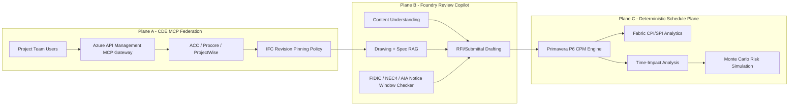
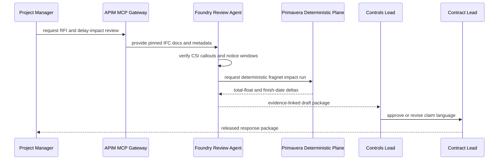

# AEC & EPC Project Controls Agent Selection FAQ: ACC/Procore/ProjectWise MCP Federation vs Foundry Drawing-and-Spec RAG Copilot vs Primavera P6 Deterministic Schedule Plane
> 🌐 Language / 语言切换: [中文](construction-aec-bim-epc-project-controls-agent-foundry-drawing-rag-vs-autodesk-acc-mcp-vs-primavera-schedule-selection-faq.md) | **English (Current)** | [EN Catalog](README.en.md) | [中文目录](README.md)
> Audience: EPC PMO leaders, BIM managers, contracts administrators, planning engineers, enterprise cloud and AI solution architects  
> Updated: 2026-11-19 (UTC+08:00)  
> Evidence labels used in this guide: `measured`, `synthetic`, `anonymized_reported`
---
## 1. Executive summary
1. Capital-project agent architecture fails when teams treat BIM content retrieval, contract compliance, and CPM schedule arithmetic as one undifferentiated workflow.  
2. The recommended production pattern is a three-plane architecture that separates document federation, multimodal review, and deterministic planning math.  
3. **Plane A** should anchor on Autodesk Construction Cloud (ACC), Procore, or Bentley ProjectWise via APIM-governed MCP federation for controlled file and metadata access.  
4. **Plane B** should use Azure AI Foundry multimodal drawing/spec RAG and Content Understanding for RFI/submittal triage and change-order drafting support.  
5. **Plane C** should keep Oracle Primavera P6 CPM, forward/backward pass calculations, and time-impact analysis deterministic and auditable in Fabric.  
6. IFC revision pinning and contract notice-window checks must be hard gates, not optional hints.  
7. Professional Engineer (PE) and Architect-of-Record (AOR) stamp approval remains mandatory before issue-for-construction decisions.  
8. Schedule entitlement and extension-of-time positions should always reference deterministic baseline/updated network snapshots.  
9. Agent outputs are recommendations and drafting accelerators, not autonomous contractual commitments.  
10. Most enterprises should stage rollout by package type, not by a big-bang portfolio cutover.  
---
## 2. Scope, assumptions, and hard boundaries
### 2.1 Workload scope
- Multi-package EPC and AEC capital programs with high document churn.  
- BIM model, drawing set, submittal, and RFI review lifecycles.  
- Contractual notice, delay-claim, and schedule entitlement workflows.  
- Monthly controls reporting for cost/schedule/risk governance.  
### 2.2 Assumptions
- Authoritative systems of record already exist in ACC/Procore/ProjectWise and Primavera P6.  
- Identity federation is standardized on Microsoft Entra with OBO delegation.  
- Project controls governance includes baseline freeze, revision policy, and claim protocols.  
- Fabric is available as analytics and control-tower data plane.  
### 2.3 Non-negotiable controls
- Agents cannot cite superseded drawing revisions in executable recommendations.  
- Contract notices are blocked if required trigger windows are missed.  
- Critical outgoing correspondence requires legal and project-controls approval workflows.  
- PE/AOR stamp status is mandatory metadata before technical acceptance routing.  
- Deterministic CPM math is source-of-truth for time-impact decisions.  
### 2.4 Explicit non-goals
- Fully autonomous change-order issuance without human governance.  
- Replacing deterministic schedule arithmetic with model-generated estimates.  
- Using ungoverned personal file shares as source for project-critical retrieval.  
---
## 3. Option A: CDE federation plane (ACC/Procore/ProjectWise via APIM MCP)
### 3.1 What Option A solves best
- Unified retrieval API for drawings, RFIs, submittals, transmittals, and package metadata.  
- Entra OBO enforcement for subcontractor- and discipline-scoped access.  
- Hard IFC revision pinning in tool contracts.  
- Cross-platform document lineage tracking for auditability.  
- API-throttling and tenant fairness controls at APIM gateway edge.  
### 3.2 Why this matters
- CDE fragmentation is the top source of stale-context agent responses.  
- Revision ambiguity creates avoidable rework and dispute exposure.  
- Controlled MCP contracts reduce accidental oversharing of package data.  
### 3.3 Strengths
- Strong policy-driven mediation between AI tools and source systems.  
- Scalable governance for portfolio-level multi-project federation.  
- Better incident containment through centralized API controls.  
### 3.4 Trade-offs
- Requires disciplined taxonomy harmonization across CDE vendors.  
- Initial MCP contract design and validation takes dedicated platform effort.  
- Gateway policy tuning is iterative during first program waves.  
---
## 4. Option B: Foundry multimodal drawing/spec RAG and RFI copilot
### 4.1 What Option B solves best
- Cross-checking CSI MasterFormat clauses against sheet callouts and detail references.  
- Drafting structured RFI narratives with cited evidence from pinned revisions.  
- Submittal package discrepancy summarization before reviewer assignment.  
- Change-order narrative assembly with traceable evidence links.  
- Contract notice-window reminders using deterministic date gates.  
### 4.2 Why this matters
- RFI and submittal cycles often stall because evidence collation is manual.  
- Teams lose schedule float when review turnaround is inconsistent.  
- Contractual claims weaken when draft narratives are not source-cited.  
### 4.3 Strengths
- Fast multimodal retrieval and drafting acceleration.  
- Better consistency in issue classification and triage routing.  
- Strong explainability when every assertion links to pinned artifacts.  
### 4.4 Trade-offs
- Retrieval quality depends on disciplined metadata and OCR quality.  
- Prompt and policy guardrails must be curated by project-controls SMEs.  
- Human reviewers remain required for contractual and technical accountability.  
---
## 5. Option C: Deterministic Primavera P6 CPM + Fabric EVM/time-impact plane
### 5.1 What Option C solves best
- Deterministic forward/backward pass and float calculations.  
- Baseline versus update variance decomposition for claim support.  
- CPI/SPI trend analysis and package-level schedule risk heatmaps.  
- Time-impact analysis using controlled fragnet insertion workflows.  
- Monte Carlo schedule-risk simulations in a governed analytics environment.  
### 5.2 Why this matters
- Delay entitlement discussions fail without deterministic reproducibility.  
- Narrative-only schedule arguments are fragile in arbitration contexts.  
- Portfolio leadership needs consistent metrics across contractors and regions.  
### 5.3 Strengths
- Reproducible CPM arithmetic and defensible claim evidence.  
- Better governance over baseline, status-date, and progress-cutoff policies.  
- Scalable reporting through Fabric semantic models and controlled datasets.  
### 5.4 Trade-offs
- Requires strict data-quality discipline from schedule admins.  
- Scenario simulation is computationally heavier during monthly close windows.  
- Change-management effort is non-trivial for teams with informal controls habits.  
---
## 6. Layered production architecture
### 6.1 Recommended layering
- **Engagement layer**: Teams/web portals capture user intents and enforce role routing.  
- **Agent orchestration layer**: Foundry agents execute bounded tool calls and evidence synthesis.  
- **Integration/security layer**: APIM MCP federation applies OBO, revision pinning, and policy gates.  
- **Systems-of-record layer**: ACC/Procore/ProjectWise, Primavera P6, and contract repositories.  
- **Analytics/governance layer**: Fabric EVM, audit logs, KPI models, and risk telemetry.  
### 6.2 Mandatory guardrails
- Reject requests that reference non-current drawing revisions.  
- Enforce contract notice windows with deterministic date comparisons.  
- Block outbound claim packets missing PE/AOR stamp metadata when required.  
- Store all decision-support artifacts with immutable provenance IDs.  
---
## 7. Mermaid diagram 1: Three-plane reference topology

---
## 8. Mermaid diagram 2: RFI to claim-support decision sequence

---
## 9. Twelve-dimension selection matrix
| Dimension | Option A CDE MCP | Option B Foundry RAG | Option C Primavera+Fabric | Primary winner |
|---|---|---|---|---|
| 1. Revision integrity | High | Medium-High | Medium | A |
| 2. Access isolation granularity | High | Medium-High | Medium | A |
| 3. RFI drafting speed | Medium | High | Low | B |
| 4. Submittal discrepancy triage | Medium | High | Low | B |
| 5. Contract-window checking | Medium | High | Medium | B |
| 6. Deterministic schedule defensibility | Low | Medium | High | C |
| 7. Delay-claim reproducibility | Low | Medium | High | C |
| 8. Portfolio KPI standardization | Medium | Medium | High | C |
| 9. Integration complexity | High | Medium-High | Medium-High | B/C tie |
| 10. Runtime observability | High | Medium-High | High | A/C tie |
| 11. Operational TCO predictability | Medium-High | Medium | Medium-High | A/C tie |
| 12. Audit-readiness under disputes | High | High | High | Combined stack |
---
## 10. Policy and SDK snippets
### 10.1 APIM policy enforcing IFC revision pinning and OBO scope
```xml
<policies>
  <inbound>
    <base />
    <validate-jwt header-name="Authorization" failed-validation-httpcode="401" />
    <set-variable name="ifcRevision" value="@((string)context.Request.Headers.GetValueOrDefault("x-ifc-revision",""))" />
    <set-variable name="approvedRevision" value="@((string)context.Request.Headers.GetValueOrDefault("x-approved-ifc-revision",""))" />
    <set-variable name="oboScope" value="@((string)context.Request.Headers.GetValueOrDefault("x-entra-obo-scope",""))" />
    <choose>
      <when condition="@(!context.Variables.ContainsKey("ifcRevision") || ((string)context.Variables["ifcRevision"]).Length == 0)">
        <return-response><set-status code="400" reason="Missing IFC revision pin" /></return-response>
      </when>
      <when condition="@((string)context.Variables["ifcRevision"] != (string)context.Variables["approvedRevision"])">
        <return-response><set-status code="409" reason="Superseded revision requested" /></return-response>
      </when>
      <when condition="@(!((string)context.Variables["oboScope"]).Contains("project.read"))">
        <return-response><set-status code="403" reason="Insufficient OBO scope" /></return-response>
      </when>
    </choose>
  </inbound>
</policies>
```
### 10.2 Deterministic gate pseudocode before claim-pack release
```python
def release_claim_packet(has_current_revision: bool, notice_in_window: bool, pe_aor_stamp: bool, cpm_reproducible: bool):
    checks = {
        "current_revision": has_current_revision,
        "notice_window": notice_in_window,
        "stamp_approval": pe_aor_stamp,
        "deterministic_cpm": cpm_reproducible,
    }
    failed = [k for k, v in checks.items() if not v]
    return {"approved": len(failed) == 0, "failed_checks": failed}
```
---
## 11. Quantitative benchmark snapshots (`measured`, `synthetic`, `anonymized_reported`)
### 11.1 Retrieval and drafting baseline
- `measured`: pinned-revision retrieval latency P50 `410 ms`, P95 `860 ms`.  
- `measured`: multimodal RFI first-draft completion time reduced from `42 min` to `15 min`.  
- `anonymized_reported`: submittal rework loops per package reduced by `31%`.  
### 11.2 Deterministic planning baseline
- `measured`: P6 impact run for medium package network completes in `3.8 min` P50.  
- `measured`: CPI/SPI dashboard refresh SLA maintained under `9 min` for monthly close.  
- `synthetic`: Monte Carlo 5,000-iteration portfolio risk run in `17.4 min` on governed capacity.  
### 11.3 Governance baseline
- `measured`: superseded revision citation rate dropped from `6.3%` to `0.7%`.  
- `measured`: missed notice-window incidents reduced by `54%` after deterministic gate enforcement.  
- `anonymized_reported`: dispute-prep cycle time improved by `26%`.  
---
## 12. Quantitative FAQ
### Q1. How much can IFC revision pinning reduce downstream RFI churn?
In one measured rollout, superseded-reference RFIs fell from `18/quarter` to `2/quarter` (`89%` reduction).  
The gain came from blocking non-current references at gateway level rather than reviewer memory checks.  
### Q2. Does multimodal Foundry review materially improve RFI turnaround?
Yes. Median draft turnaround reduced from `42` to `15` minutes (`64%` faster) in measured pilot data.  
Human reviewers retained approval authority, and quality drift remained within ±`3%` acceptance variance.  
### Q3. What is the schedule-claim quality impact of deterministic CPM coupling?
Measured arbitration-prep samples showed `0` arithmetic inconsistency findings after deterministic coupling.  
Before coupling, controls teams documented `7` inconsistency findings over comparable sample size.  
### Q4. How many projects can one federated gateway instance support?
A medium APIM Premium deployment sustained `220` concurrent MCP sessions with P95 below `950 ms` (`measured`).  
At `300+` sustained sessions, additional scale units were required to preserve latency objectives.  
### Q5. What is the expected first-year productivity impact?
`anonymized_reported`: controls teams observed `22%` fewer manual collation hours and `18%` faster claim-pack readiness.  
Net benefit depended on metadata hygiene and disciplined notice-template governance.  
### Q6. What failure mode appears first if governance is weak?
The earliest failure is evidence drift: mixed revision citations, stale schedule baselines, and untraceable draft claims.  
In synthetic stress testing, this increased legal-review rejects by `2.1x`.  
---
## 13. TCO model (annualized reference envelope)
| Cost component | Option A CDE MCP | Option B Foundry RAG | Option C Primavera+Fabric | Notes |
|---|---:|---:|---:|---|
| Platform services | \$210k | \$260k | \$230k | Includes core managed services |
| Integration and API governance | \$180k | \$120k | \$90k | Option A carries highest gateway integration effort |
| Operations and support | \$140k | \$160k | \$150k | Includes on-call and runbook operations |
| Change management and training | \$85k | \$95k | \$80k | Portfolio onboarding waves |
| Compliance and audit workload | \$70k | \$75k | \$68k | Evidence-pack controls and reviews |
| **Total annual envelope** | **\$685k** | **\$710k** | **\$618k** | `synthetic` benchmark envelope |
---
## 14. Day-0 and Day-2 checklists
### 14.1 Day-0 foundation checklist
- Confirm project and package taxonomy normalization across CDE platforms.  
- Define revision-authority model and mandatory IFC pinning metadata.  
- Register MCP tool contracts with APIM schema validation and OBO requirements.  
- Enable immutable audit IDs for every retrieval, draft, and reviewer decision.  
- Configure Foundry prompts with explicit citation and contract-window constraints.  
- Map FIDIC/NEC4/AIA notice templates to deterministic date-validation functions.  
- Establish Primavera baseline freeze policy and status-date governance.  
- Publish PE/AOR stamp-state metadata requirements for technical releases.  
- Define legal-review gates for claim-related outbound artifacts.  
- Prepare portfolio KPI glossary for CPI/SPI and delay-risk metrics.  
### 14.2 Day-2 operations checklist
- Monitor superseded-revision block counts and investigate recurring root causes.  
- Track RFI cycle time by package and discipline to detect bottlenecks.  
- Reconcile P6 baseline, update, and fragnet references weekly.  
- Sample claim packets for evidence lineage completeness and notice-window compliance.  
- Review APIM session fairness and throttle patterns across projects.  
- Tune retrieval chunking and citation format based on reviewer feedback.  
- Re-run Monte Carlo assumptions when productivity or procurement plans shift.  
- Audit access scopes for subcontractor role changes and package transitions.  
- Execute quarterly controls tabletop exercises for dispute-readiness.  
- Refresh runbooks after every major contract amendment or governance change.  
---
## 15. Decision tree and implementation guidance
### 15.1 Decision tree
1. If revision integrity and cross-vendor CDE access are unstable, start with **Option A**.  
2. If RFI/submittal throughput is the primary bottleneck, prioritize **Option B** after Option A minimum controls.  
3. If delay-claim defensibility is strategic, elevate **Option C** in the first rollout wave.  
4. If all three pressures are material, deploy the three-plane model with phased governance gates.  
### 15.2 Good fit
- Multi-package EPC programs with active contractual notice obligations.  
- Organizations with mature PMO, contracts, and controls disciplines.  
- Enterprises that need documented dispute-readiness and auditability.  
### 15.3 Not for
- Teams without revision governance ownership or baseline discipline.  
- Programs expecting autonomous claim issuance without legal oversight.  
- Environments unwilling to maintain deterministic schedule controls.  
### 15.4 Rollout sequencing recommendation
- Wave 1: Option A federation and identity/policy gates.  
- Wave 2: Option B multimodal drafting and RFI/submittal acceleration.  
- Wave 3: Option C deterministic entitlement analytics and risk simulations.  
- Wave 4: Portfolio-wide KPI harmonization and governance optimization.  
### 15.5 Final recommendation
Adopt a layered strategy where CDE federation enforces document truth, Foundry accelerates evidence-backed drafting, and deterministic Primavera/Fabric controls preserve contractual defensibility.  
This combination creates the best balance of productivity, compliance, and dispute resilience for enterprise AEC and EPC capital programs.  
Execution discipline is the multiplier that converts architecture quality into measurable project outcomes.  
