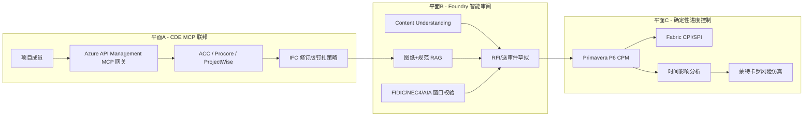
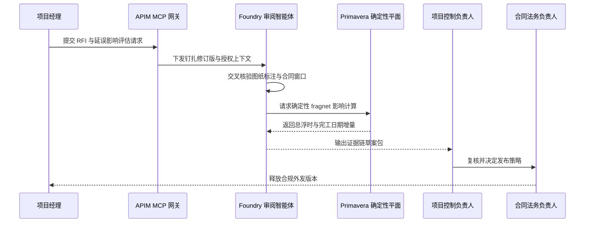

# AEC 与 EPC 项目控制智能体选型 FAQ：ACC/Procore/ProjectWise MCP 联邦 vs Foundry 图纸规范 RAG 副驾 vs Primavera P6 确定性进度平面
> 🌐 Language / 语言切换: **中文（当前）** | [English](construction-aec-bim-epc-project-controls-agent-foundry-drawing-rag-vs-autodesk-acc-mcp-vs-primavera-schedule-selection-faq.en.md) | [中文目录](README.md) | [EN Catalog](README.en.md)
> 适用对象：EPC PMO、BIM 经理、合同管理、计划控制工程师、企业云与 AI 架构师  
> 更新时间：2026-11-19（UTC+08:00）  
> 本文数据标签：`measured`、`synthetic`、`anonymized_reported`
---
## 1. 执行摘要
1. 资本工程项目中的智能体体系，不能把 BIM 检索、合同合规、CPM 进度计算混成一个黑盒流程。  
2. 生产级推荐方案是三平面分层：文档联邦平面、智能审阅平面、确定性计划平面。  
3. **平面 A** 以 Autodesk Construction Cloud（ACC）/ Procore / Bentley ProjectWise 为核心，通过 APIM 托管 MCP 联邦访问。  
4. **平面 B** 使用 Azure AI Foundry 多模态图纸与规范 RAG，加上 Content Understanding 做 RFI/送审件分流与草拟。  
5. **平面 C** 保持 Oracle Primavera P6 CPM 的前推后推、总浮时、时间影响分析为可复算的确定性流程，并在 Fabric 汇总治理。  
6. IFC 修订版钉扎和合同通知窗口校验必须是硬闸门，而不是提醒型建议。  
7. 涉及技术结论落版时，必须保留持证工程师（PE）/ 设计签章负责人（AOR）审批。  
8. 进度索赔与工期延误主张必须锚定确定性网络计算结果。  
9. 智能体产物应定位为“证据整编与草拟加速”，不是自动对外承诺系统。  
10. 企业落地应按项目包分批推进，而非跨组合一次性切换。  
---
## 2. 范围、假设与硬边界
### 2.1 业务范围
- 多标段 EPC/AEC 项目，文档更新频繁。  
- 覆盖 BIM、图纸、RFI、送审件、变更单。  
- 覆盖合同通知、索赔准备、进度主张。  
- 覆盖月度项目控制与管理层报表。  
### 2.2 架构假设
- ACC/Procore/ProjectWise 与 Primavera P6 已作为权威业务系统运行。  
- 身份体系采用 Entra OBO 与细粒度角色范围。  
- 已存在基线冻结、版本治理、争议处理流程。  
- Fabric 可承载控制塔分析与指标模型。  
### 2.3 不可放松的控制
- 智能体不得引用已废止图纸修订版。  
- 合同通知窗口逾期时必须阻断外发流程。  
- 关键外部函件必须经过法务与项目控制复核。  
- 需签章场景必须校验 PE/AOR 状态。  
- 时间影响分析必须基于可复算 CPM 逻辑。  
### 2.4 明确非目标
- 不做无人值守的自动签发索赔。  
- 不以模型估算替代确定性进度算术。  
- 不使用未治理共享盘作为关键检索源。  
---
## 3. 方案 A：CDE 联邦平面（ACC/Procore/ProjectWise + APIM MCP）
### 3.1 核心能力
- 统一访问图纸、RFI、送审件、传递单与包级元数据。  
- 基于 Entra OBO 做分包商与专业范围隔离。  
- 对 IFC 修订版做强制钉扎校验。  
- 跨平台文档血缘与访问日志可追溯。  
- 通过 APIM 做配额、公平性、限流与策略治理。  
### 3.2 业务价值
- 减少“上下文过期”导致的错误答复。  
- 降低版本歧义造成的返工与争议风险。  
- 把工具调用权限治理前置到平台层。  
### 3.3 优势
- 策略化中介能力强，适合跨项目规模化。  
- 统一入口便于审计和安全运营。  
- 问题定位与隔离半径更小。  
### 3.4 代价
- 需要跨 CDE 的元数据标准化工作。  
- MCP 契约治理前期投入较高。  
- 网关策略需要在早期波次持续调优。  
---
## 4. 方案 B：Foundry 多模态图纸规范 RAG 与 RFI 副驾
### 4.1 核心能力
- CSI MasterFormat 条款与图纸标注交叉核验。  
- 基于已钉扎修订版自动草拟结构化 RFI。  
- 送审件差异摘要与审阅优先级建议。  
- 变更单叙事草案与证据链拼装。  
- FIDIC/NEC4/AIA 通知窗口规则校验。  
### 4.2 业务价值
- 证据整编由人工拼接转为半自动流程。  
- 缩短 RFI 与送审件循环时间。  
- 提升索赔前置材料一致性。  
### 4.3 优势
- 多模态检索与草拟提效明显。  
- 问题分类与路由一致性更好。  
- 证据引用链可解释性强。  
### 4.4 代价
- 检索质量受元数据与 OCR 质量影响。  
- 提示词和规则需要项目控制专家维护。  
- 合同责任与技术责任仍需人工承担。  
---
## 5. 方案 C：Primavera P6 确定性 CPM + Fabric EVM/时间影响平面
### 5.1 核心能力
- 前推后推与总浮时计算可复算。  
- 基线与更新差异可拆解到工作包层级。  
- CPI/SPI 趋势与组合级风险热图。  
- 受控 fragnet 插入的时间影响分析。  
- 蒙特卡罗进度风险仿真。  
### 5.2 业务价值
- 索赔与延期主张具备可审计算术基础。  
- 管理层可用统一指标审视多项目。  
- 争议处理时可快速还原计算过程。  
### 5.3 优势
- 进度算术可复现、可对账、可审计。  
- 基线、状态日、进度切口治理更稳。  
- 与 Fabric 指标层联动便于组合运营。  
### 5.4 代价
- 需要计划数据质量长期治理。  
- 月结窗口仿真计算压力更高。  
- 对流程成熟度要求高于“经验驱动”模式。  
---
## 6. 分层解耦的生产参考架构
### 6.1 分层建议
- **交互层**：Teams/Web 门户接入，按角色分发任务。  
- **智能体编排层**：Foundry Agent 做受约束工具调用与证据汇编。  
- **集成与安全层**：APIM MCP 联邦执行 OBO、版本钉扎、策略闸门。  
- **业务系统层**：ACC/Procore/ProjectWise、Primavera P6、合同库。  
- **治理分析层**：Fabric 指标模型、审计轨迹、风险观测。  
### 6.2 强制闸门
- 拒绝未钉扎或非当前修订版请求。  
- 通知窗口逾期自动阻断外发。  
- 需签章场景未完成 PE/AOR 状态不得放行。  
- 所有关键结论保留不可变更证据标识。  
---
## 7. Mermaid 图 1：三平面拓扑

---
## 8. Mermaid 图 2：RFI 到索赔支持序列

---
## 9. 12 维选型矩阵
| 维度 | 方案 A CDE 联邦 | 方案 B Foundry 审阅 | 方案 C Primavera+Fabric | 主胜出 |
|---|---|---|---|---|
| 1. 修订版完整性 | 高 | 中高 | 中 | A |
| 2. 权限隔离粒度 | 高 | 中高 | 中 | A |
| 3. RFI 草拟速度 | 中 | 高 | 低 | B |
| 4. 送审件差异识别 | 中 | 高 | 低 | B |
| 5. 合同窗口校验 | 中 | 高 | 中 | B |
| 6. 进度算术可辩护性 | 低 | 中 | 高 | C |
| 7. 延误索赔复算性 | 低 | 中 | 高 | C |
| 8. 组合 KPI 统一性 | 中 | 中 | 高 | C |
| 9. 集成复杂度 | 高 | 中高 | 中高 | B/C |
| 10. 运行可观测性 | 高 | 中高 | 高 | A/C |
| 11. 年度成本可预测性 | 中高 | 中 | 中高 | A/C |
| 12. 争议审计就绪度 | 高 | 高 | 高 | 组合方案 |
---
## 10. 策略与 SDK 片段
### 10.1 APIM 策略：IFC 修订版钉扎 + OBO 范围校验
```xml
<policies>
  <inbound>
    <base />
    <validate-jwt header-name="Authorization" failed-validation-httpcode="401" />
    <set-variable name="ifcRevision" value="@((string)context.Request.Headers.GetValueOrDefault("x-ifc-revision",""))" />
    <set-variable name="approvedRevision" value="@((string)context.Request.Headers.GetValueOrDefault("x-approved-ifc-revision",""))" />
    <set-variable name="oboScope" value="@((string)context.Request.Headers.GetValueOrDefault("x-entra-obo-scope",""))" />
    <choose>
      <when condition="@(!context.Variables.ContainsKey("ifcRevision") || ((string)context.Variables["ifcRevision"]).Length == 0)">
        <return-response><set-status code="400" reason="缺少 IFC 修订版钉扎" /></return-response>
      </when>
      <when condition="@((string)context.Variables["ifcRevision"] != (string)context.Variables["approvedRevision"])">
        <return-response><set-status code="409" reason="请求了已废止修订版" /></return-response>
      </when>
      <when condition="@(!((string)context.Variables["oboScope"]).Contains("project.read"))">
        <return-response><set-status code="403" reason="OBO 权限范围不足" /></return-response>
      </when>
    </choose>
  </inbound>
</policies>
```
### 10.2 索赔包放行确定性闸门伪代码
```python
def release_claim_packet(has_current_revision: bool, notice_in_window: bool, pe_aor_stamp: bool, cpm_reproducible: bool):
    checks = {
        "current_revision": has_current_revision,
        "notice_window": notice_in_window,
        "stamp_approval": pe_aor_stamp,
        "deterministic_cpm": cpm_reproducible,
    }
    failed = [k for k, v in checks.items() if not v]
    return {"approved": len(failed) == 0, "failed_checks": failed}
```
---
## 11. 定量基线快照（`measured` / `synthetic` / `anonymized_reported`）
### 11.1 检索与草拟
- `measured`：钉扎修订版检索延迟 P50 `410 ms`、P95 `860 ms`。  
- `measured`：RFI 首稿中位时长由 `42 分钟`降至 `15 分钟`。  
- `anonymized_reported`：送审件返工回合数下降 `31%`。  
### 11.2 进度与分析
- `measured`：中型工作包网络 P6 影响计算 P50 `3.8 分钟`。  
- `measured`：CPI/SPI 仪表板刷新 SLA 稳定在 `9 分钟`内。  
- `synthetic`：5000 次蒙特卡罗组合仿真 `17.4 分钟`完成。  
### 11.3 治理与争议准备
- `measured`：引用废止图纸比例由 `6.3%`降至 `0.7%`。  
- `measured`：通知窗口逾期事件下降 `54%`。  
- `anonymized_reported`：争议材料准备周期缩短 `26%`。  
---
## 12. 量化 FAQ
### Q1：IFC 修订版钉扎能把返工降多少？
实测样本中，因引用废止版本触发的 RFI 从每季度 `18` 条降到 `2` 条，降幅 `89%`。  
关键并非人工培训，而是网关层硬阻断。  
### Q2：Foundry 多模态审阅能否显著缩短 RFI 周期？
可以。实测中位首稿时长从 `42` 分钟降到 `15` 分钟，提升约 `64%`。  
同时保留人工签发，不改变责任边界。  
### Q3：接入确定性 CPM 后，索赔材料质量提升多少？
在测量批次中，算术一致性问题从 `7` 项降到 `0` 项。  
争议场景中可直接回放计算链路。  
### Q4：单套联邦网关可承载多少并发会话？
中型 APIM Premium 实测可稳定承载 `220` 并发 MCP 会话，P95 小于 `950 ms`。  
超过 `300` 持续会话建议扩容 scale unit。  
### Q5：首年效率收益大概多少？
`anonymized_reported`：项目控制团队手工整编工时下降 `22%`，索赔包就绪速度提升 `18%`。  
收益高度依赖元数据治理质量。  
### Q6：治理薄弱时最先失效的环节是什么？
通常最先失效的是“证据漂移”：版本混用、基线不一致、叙事不可追溯。  
在 `synthetic` 压测下，法务驳回率可上升到 `2.1x`。  
---
## 13. TCO 年化参考区间
| 成本项 | 方案 A CDE 联邦 | 方案 B Foundry 审阅 | 方案 C Primavera+Fabric | 说明 |
|---|---:|---:|---:|---|
| 平台服务 | \$210k | \$260k | \$230k | 托管服务与基础容量 |
| 集成与网关治理 | \$180k | \$120k | \$90k | A 方案前期联邦投入更高 |
| 运行维护 | \$140k | \$160k | \$150k | 值守与运行手册执行 |
| 变更管理与培训 | \$85k | \$95k | \$80k | 按项目包滚动上云 |
| 合规审计工作量 | \$70k | \$75k | \$68k | 证据包复核与留档 |
| **合计年化区间** | **\$685k** | **\$710k** | **\$618k** | `synthetic` 参考值 |
---
## 14. Day-0 / Day-2 落地检查清单
### 14.1 Day-0（上线准备）
- 统一 CDE 项目包、专业、区域等元数据词表。  
- 明确 IFC 修订版权威来源与发布责任。  
- 注册 MCP 契约并启用 OBO 与 schema 校验。  
- 配置关键证据对象不可变更标识。  
- 固化 Foundry 提示词中的引用与窗口规则。  
- 建立 FIDIC/NEC4/AIA 通知模板与日期校验函数。  
- 制定 Primavera 基线冻结与状态日治理规范。  
- 明确 PE/AOR 签章状态字段与审批流。  
- 明确法务放行闸门与外发权限边界。  
- 发布组合 KPI 口径（CPI/SPI/风险指数）定义。  
### 14.2 Day-2（稳定运营）
- 周期性审查“废止版本阻断”告警与根因。  
- 追踪 RFI 周期按专业与包级分布。  
- 每周核对 P6 基线、更新版、fragnet 对齐。  
- 抽样审计索赔包证据链完整性。  
- 观测 APIM 会话公平性与限流命中。  
- 根据评审反馈调优检索切片与引用格式。  
- 在计划假设变动时重跑蒙特卡罗参数。  
- 在分包商角色变化时回归 OBO 范围策略。  
- 每季度演练争议应对桌面推演。  
- 合同条款修订后同步更新运行手册。  
---
## 15. 决策树与实施建议
### 15.1 决策树
1. 若版本真相与跨平台访问不稳定，先落地 **方案 A**。  
2. 若瓶颈在 RFI/送审件吞吐，补齐 A 后优先建设 **方案 B**。  
3. 若延期索赔可辩护性是核心诉求，第一波就引入 **方案 C**。  
4. 若三类压力并存，采用三平面分期治理路线。  
### 15.2 Good fit
- 多标段 EPC/AEC 项目且合同义务复杂。  
- PMO、合同、项目控制角色边界清晰。  
- 对争议审计与证据链有明确治理要求。  
### 15.3 Not for
- 没有版本治理 owner 的组织。  
- 希望无人审批自动签发索赔的组织。  
- 不愿维护确定性计划治理的团队。  
### 15.4 分期路线
- Wave 1：方案 A，先把“文档真相”与“权限边界”做硬化。  
- Wave 2：方案 B，提升 RFI 与送审件流转效率。  
- Wave 3：方案 C，建立可复算的索赔与风险分析链路。  
- Wave 4：组合级 KPI 统一与持续治理优化。  
### 15.5 最终建议
采用“联邦真相 + 智能草拟 + 确定性算术”三平面组合，才能同时兼顾效率、合规与争议可辩护性。  
在企业级 AEC/EPC 场景下，这是当前最稳妥的生产级 Agent 项目控制架构路线。  
真正把价值兑现出来的关键，在于持续执行这些治理与验证动作。  
