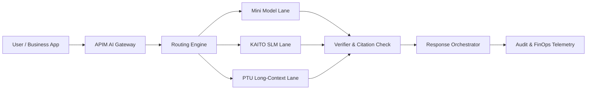
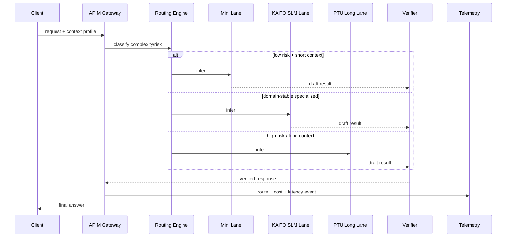

# Enterprise context-window routing selection FAQ: PTU long-context vs Mini short-context vs KAITO SLM domain lane vs three-lane hybrid

> **Audience**: enterprise Cloud & AI SA, platform engineering, FinOps, LLMOps, and application architecture teams.  
> **Decision focus**: under `8k–180k` token request variance, balance latency, factual quality, throughput, and cost per 1,000 requests.

## 1. Problem definition: bigger context is not always better

When enterprises scale agents to contract review,
audit traceability,
incident triage,
and multi-tool orchestration,
many teams default to one rule:
send more context to the largest model.

That works for demos,
but creates production debt:

- TTFT rises sharply.
- Prefill token spend increases quickly.
- Throughput drops under peak concurrency.
- Retrieval noise amplifies factual drift.

The routing decision is therefore not
"which model is strongest,"
but
"which lane should this request take based on risk and context shape."

## 2. Four routing patterns at enterprise scale

This guide compares four practical patterns:

- Pattern A: PTU long-context flagship lane.
- Pattern B: Mini short-context lane with strong retrieval pruning.
- Pattern C: AKS KAITO domain SLM lane.
- Pattern D: hybrid three-lane closed loop.

Evaluation cannot rely on answer quality alone.

You also need:

- TTFT and P95 latency,
- cost per 1,000 requests,
- peak throughput resilience,
- audit explainability,
- rollback and fault-convergence behavior.

## 3. Pattern A: PTU long-context flagship lane

Pattern A routes complex requests to the strongest long-context capability.

Typical setup:

- Reserve PTU capacity for critical workloads.
- Preserve wider history and tool-output windows.
- Enforce strict evidence-aware prompting templates.

Strengths:

- Excellent multi-hop reasoning and cross-span linkage.
- Better tolerance to imperfect pruning.
- Stable quality for high-value tasks.

Weaknesses:

- Cost rises steeply with token growth.
- Capacity planning gets harder at peak.
- Incorrect context can be amplified with high confidence.

Best-fit guidance:

- Use for high-risk, low-frequency, high-accountability tasks.
- Pair with citation verification.
- Enforce strict promotion gates to avoid overuse.

## 4. Pattern B: Mini short-context high-throughput lane

Pattern B optimizes by pruning first and reasoning second.

Typical setup:

- Retrieval and reranking compress candidate context.
- Final prompt window remains in short-context range.
- Mini model handles most routine traffic.

Strengths:

- Low unit cost.
- High concurrency efficiency.
- Strong for standardized FAQ and workflow tasks.

Weaknesses:

- Limited for long-chain cross-document reasoning.
- Poor pruning can miss critical evidence.
- Ambiguous tasks often need escalation.

Best-fit guidance:

- Use as default economy lane.
- Return directly on high-confidence routine tasks.
- Auto-escalate low-confidence responses to A or C.

## 5. Pattern C: KAITO SLM domain lane

Pattern C targets stable domain semantics and bounded corpora.

Typical scenarios:

- ITSM ticket triage and runbook guidance.
- Internal policy Q&A with fixed terminology.
- Departmental structured reporting explanations.

Strengths:

- Predictable and controllable cost profile.
- Strong terminology consistency in domain scope.
- Private-environment deployment for sovereignty-sensitive use cases.

Weaknesses:

- Weaker general reasoning than flagship models.
- Requires ongoing training and evaluation lifecycle.
- Out-of-domain questions degrade quickly.

Best-fit guidance:

- Route high-frequency domain traffic to C.
- Auto-fallback to B or A outside domain boundaries.
- Monitor drift and schedule retraining windows.

## 6. Pattern D: hybrid three-lane control loop

Large enterprises usually converge on three lanes:

- L1: Mini default lane for broad traffic.
- L2: KAITO SLM lane for domain-stable workloads.
- L3: PTU long-context lane for high-risk complex tasks.

Critical controls:

- Routing decisions must be explainable.
- Every escalation event must be logged with reason codes.
- Tenant/domain-specific threshold tuning must be supported.

This model concentrates expensive capacity on truly complex requests
while keeping overall service stability high.

## 7. Reference architecture topology

Topology notes:

- One gateway entry with policy-centered routing.
- Three inference lanes share one validation layer.
- Cost and audit telemetry are unified at egress.

## 8. Request sequence and escalation flow

Sequence governance:

- Escalation must be idempotent and replayable.
- Verification failure can trigger one cross-lane retry.
- Over-budget tenants can be policy-forced into economy lanes.

## 9. 12-dimension enterprise comparison matrix

| Dimension | A PTU Long Context | B Mini Short Context | C KAITO SLM | D Hybrid Three-Lane |
|---|---|---|---|---|
| Complex reasoning depth | Very high | Medium | Medium | Very high |
| Cost per request | High | Low | Low to medium | Medium |
| TTFT profile | Medium | High | High | High |
| Peak throughput | Medium | Very high | High | Very high |
| Evidence fidelity | High | Medium | Medium to high | High |
| Domain consistency | Medium | Medium | Very high | Very high |
| Runtime complexity | Medium | Medium | Medium to high | High |
| Fallback flexibility | Medium | Medium | Medium | Very high |
| Audit explainability | High | Medium | High | Very high |
| Budget controllability | Low | High | High | Very high |
| Multi-tenant policy isolation | Medium | Medium | Medium | High |
| Recommended role | Critical deep tasks | Default economy lane | Domain specialist lane | Enterprise end-state |

## 10. Quantitative comparison: TTFT, cost, and quality breakpoints

| Metric | A PTU | B Mini | C KAITO SLM | D Hybrid |
|---|---:|---:|---:|---:|
| TTFT P95 | 2.8 s | 1.1 s | 1.3 s | 1.5 s |
| Cost per 1,000 requests (USD) | 18.2 | 4.6 | 5.1 | 7.4 |
| Complex-task pass rate | 92% | 74% | 79% | 91% |
| Peak stable throughput (RPS) | 38 | 120 | 95 | 140 |
| Escalations per 10,000 requests | 10000 | 1800 | 2200 | 2600 |

Assumptions:

- 950,000 daily requests.
- 14% complex-task ratio.
- 28% domain-specialized ratio.

Break-even guidance:

- If complex ratio exceeds 20%, pure Mini quality drops quickly.
- As budget pressure rises, hybrid cost advantages become clearer.
- Stable domain workloads strongly improve KAITO ROI.

## 11. Common anti-patterns and corrections

Anti-pattern 1:
sending all traffic to flagship long-context models.

Correction:
route by risk and context length,
and escalate only when necessary.

Anti-pattern 2:
using token length as the only routing signal.

Mitigation:
include business risk, evidence requirement, and historical failure features.

Anti-pattern 3:
returning model output without a verification layer.

Remedy:
add citation validation, format checks, and policy guards.

Anti-pattern 4:
never retuning route thresholds.

Optimization:
replay weekly samples and adjust thresholds continuously.

## 12. Governance model and SLO design

Recommended SLO stack:

- Quality SLO: pass rate and citation-hit consistency.
- Performance SLO: TTFT P95 and end-to-end P95.
- Cost SLO: cap on cost per 1,000 requests.

Operating split:

- Platform team owns gateway and route engine.
- Domain team owns task taxonomy and acceptance gates.
- FinOps team owns budget guardrails and alerting.

Operational indicators:

- Lane-hit distribution.
- Escalation trigger rate.
- Lane-specific failure rate.
- Budget-threshold alert count.

## 13. Five-step rollout roadmap

Step 1: define task-tier taxonomy.  
Classify requests by risk, complexity, and evidence strictness.

Step 2: launch B lane first.  
Use Mini as baseline lane with observability from day one.

Step 3: add C lane.  
Move stable domain traffic into KAITO route.

Step 4: activate A lane.  
Open PTU lane only for high-risk complex classes.

Step 5: converge into D loop.  
Continuously tune thresholds with quality and cost evidence.

## 14. Production readiness checklist

- [ ] All lanes have explicit entry and exit rules.
- [ ] Routing decisions are traceable and replayable.
- [ ] Verification layer enforces citations and response schema.
- [ ] Budget overrun can trigger automatic downgrade controls.
- [ ] Key tenants support custom threshold profiles.
- [ ] Load tests cover burst and escalation storms.
- [ ] One-click fallback to single-lane safe mode exists.
- [ ] Audit reports export by tenant and domain.

## 15. Field FAQ (8 questions)

**Q1: Why not always use long-context flagship models?**  
A1: Cost and latency become unsustainable, and noisy context can still reduce stability.

**Q2: Does Mini always reduce quality?**  
A2: Not for standardized tasks, but complex reasoning usually needs controlled escalation.

**Q3: When is KAITO SLM investment most justified?**  
A3: When domain traffic is high-volume, terminology is stable, and cost pressure is persistent.

**Q4: Is hybrid routing always more complex?**  
A4: Initial complexity rises, but enterprise-scale TCO and reliability usually improve.

**Q5: Who should own routing thresholds?**  
A5: Platform, domain, and FinOps teams should co-own thresholds with scheduled reviews.

**Q6: What if verification fails after inference?**  
A6: Trigger one cross-lane retry, then return a controlled explainable refusal if still failing.

**Q7: How do we prevent cross-tenant policy interference?**  
A7: Isolate thresholds and budget policy in tenant-scoped namespaces.

**Q8: What is the minimum viable adoption order?**  
A8: Start with B, add C, enable A selectively, then converge to D with continuous optimization.

