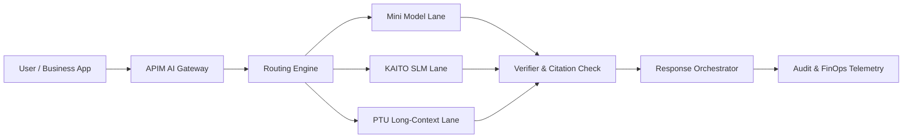
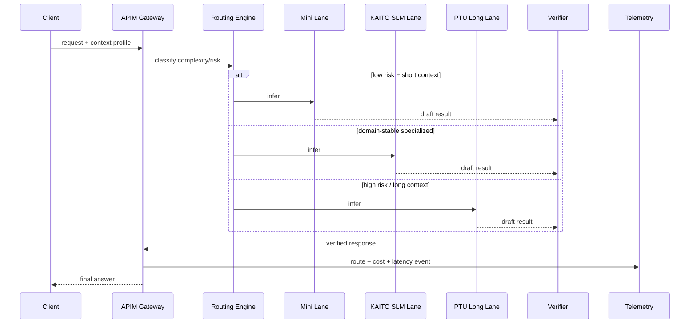

# 企业上下文窗口路由选型 FAQ：PTU 长上下文 vs Mini 短上下文 vs KAITO SLM 专域通道 vs 三层混合策略

> **面向对象**：企业 Cloud & AI SA、平台工程、FinOps、LLMOps 与业务应用架构团队。  
> **核心决策**：在 `8k–180k` token 请求跨度下，如何平衡响应时延、事实准确率、吞吐上限与每千次调用成本。
> **治理目标**：让模型车道选择可解释、可回放、可按租户预算约束动态收敛。

## 1. 问题定义：长上下文并非越大越好

企业在把 Agent 扩展到合同审阅、
审计追溯、
复杂工单排障、
与多工具链协调时，
经常默认“把更多上下文塞给更大模型”。

这种策略在 PoC 能快速提高命中率，
但在生产会触发四个代价：

- 首 token 时延（TTFT）显著增长。
- 前填充 token 成本快速上升。
- 并发峰值下吞吐急剧下降。
- 检索噪音放大导致事实漂移。

因此路由问题不是“选哪一个最强模型”，
而是“按任务风险与上下文形态动态选车道”。

## 2. 四类窗口路由方案概览

本文比较四条企业主流路径：

- 方案 A：`PTU` 长上下文旗舰通道。
- 方案 B：`Mini` 短上下文 + 强检索裁剪通道。
- 方案 C：`AKS KAITO` 专域 SLM 通道。
- 方案 D：三层混合路由（A+B+C）闭环。

评价维度不只看答案质量，
还要看：

- TTFT / P95 时延。
- 每千请求成本。
- 高峰并发稳定性。
- 审计可解释性。
- 回退与故障收敛能力。

## 3. 方案 A：PTU 长上下文旗舰通道

该方案把复杂任务统一送入长上下文能力最强模型。

典型形态：

- 使用 PTU 预留吞吐保障关键链路。
- 保留较长历史对话与工具输出窗口。
- 配置严格的提示模板与证据锚点。

优势：

- 复杂推理与跨段关联能力强。
- 对上下文裁剪误伤容忍度高。
- 在关键高价值任务上可获得更稳质量。

不足：

- 成本曲线随 token 增长更陡。
- 高并发场景容量规划压力大。
- 错误上下文会被“高保真放大”。

适用建议：

- 高风险、低频、强审计任务优先。
- 与证据引用检查联合使用。
- 设置明确的升级准入门槛，避免滥用。

## 4. 方案 B：Mini 短上下文高并发通道

该方案核心是先裁剪再推理。

主要做法：

- 检索层做 chunk 召回与重排。
- 控制最终输入窗口在短上下文区间。
- 使用 Mini 模型承担大部分常规任务。

优势：

- 单位请求成本低。
- 并发表现好，适合作为默认通道。
- 对标准化 FAQ/流程问答效率高。

不足：

- 对跨文档长链推理能力有限。
- 裁剪不当会丢关键证据。
- 在高歧义任务上可能需要二次升级。

适用建议：

- 作为企业默认“经济车道”。
- 对高置信度任务直接返回。
- 低置信度自动升级到 A 或 C。

## 5. 方案 C：KAITO SLM 专域通道

该方案面向稳定领域知识与可控语料边界。

常见场景：

- IT 运维标准工单分类与处置建议。
- 企业内部规范问答与流程指引。
- 部门级结构化报表解释。

优势：

- 成本可预测且可控。
- 专域术语一致性高。
- 可在私有环境内运行满足主权要求。

不足：

- 通用推理能力弱于旗舰模型。
- 训练与评测维护有持续成本。
- 领域外问题容易失真。

适用建议：

- 专域高频任务优先走 C 通道。
- 领域外自动回退到 B 或 A。
- 建立数据漂移监控与再训练节奏。

## 6. 方案 D：三层混合路由闭环

企业规模化场景通常采用三层车道：

- L1：Mini 默认通道，承接大多数请求。
- L2：KAITO 专域通道，承接稳定垂类。
- L3：PTU 长上下文通道，承接高风险与复杂推理。

关键控制点：

- 路由判定必须可解释。
- 每次升级都要记录触发因子。
- 允许按租户或业务域单独调阈值。

该模式把高成本容量集中到必要请求，
同时保持整体服务稳定性。

## 7. 参考架构拓扑图

拓扑解读：

- 网关统一入口，路由引擎做分层判定。
- 三条推理车道共享统一验证层。
- 审计与成本遥测在出口统一汇聚。

## 8. 请求时序与升级路径

时序治理建议：

- 升级路径必须幂等可重放。
- 验证失败可触发一次“跨车道重试”。
- 超预算租户可强制降级到经济通道。

## 9. 12 维企业级选型矩阵

| 维度 | A PTU 长上下文 | B Mini 短上下文 | C KAITO SLM | D 三层混合 |
|---|---|---|---|---|
| 复杂推理能力 | 很高 | 中 | 中 | 很高 |
| 单请求成本 | 高 | 低 | 低到中 | 中 |
| TTFT 表现 | 中 | 高 | 高 | 高 |
| 并发吞吐 | 中 | 很高 | 高 | 很高 |
| 证据保真度 | 高 | 中 | 中到高 | 高 |
| 专域一致性 | 中 | 中 | 很高 | 很高 |
| 运营复杂度 | 中 | 中 | 中到高 | 高 |
| 回退灵活性 | 中 | 中 | 中 | 很高 |
| 审计可解释性 | 高 | 中 | 高 | 很高 |
| 预算可控性 | 低 | 高 | 高 | 很高 |
| 多租户策略分层 | 中 | 中 | 中 | 高 |
| 推荐定位 | 高价值重任务 | 默认经济通道 | 专域高频通道 | 企业长期目标 |

## 10. 定量对比：TTFT / 成本 / 质量拐点

| 指标 | A PTU | B Mini | C KAITO SLM | D 混合 |
|---|---:|---:|---:|---:|
| TTFT P95 | 2.8 s | 1.1 s | 1.3 s | 1.5 s |
| 每千请求成本（美元） | 18.2 | 4.6 | 5.1 | 7.4 |
| 高复杂任务通过率 | 92% | 74% | 79% | 91% |
| 峰值并发稳定区间（RPS） | 38 | 120 | 95 | 140 |
| 每万请求升级率 | 10000 | 1800 | 2200 | 2600 |

测算前提：

- 日均请求量 95 万。
- 复杂任务占比 14%。
- 专域任务占比 28%。

拐点结论：

- 当复杂任务 > 20% 时，纯 Mini 质量下降明显。
- 当预算压力上升时，混合模式成本优势放大。
- 当专域任务稳定时，KAITO 通道可显著节省费用。

## 11. 常见反模式与修正

反模式一：
不做路由，所有请求全上旗舰模型。

修正：
按风险和上下文长度先分层，
只把必要请求升级到 A。

反模式二：
仅按 token 长度判路由，
忽略任务风险等级。

改进：
加入业务风险、证据要求、历史失败率三因子。

反模式三：
缺乏验证层，直接返回模型输出。

缓解：
加入引用检查、格式校验与策略守门。

反模式四：
路由阈值长期不调，
导致成本和质量漂移。

优化：
每周回放样本并重算阈值。

## 12. 治理模型与 SLO 设计

建议建立三类 SLO：

- 质量 SLO：关键任务通过率与证据命中率。
- 性能 SLO：TTFT P95 与端到端 P95。
- 成本 SLO：每千请求成本上限。

职责分工：

- 平台团队负责路由引擎与网关策略。
- 业务团队负责任务分级与质量验收。
- FinOps 团队负责预算护栏与预警。

运维指标：

- 路由命中分布。
- 升级触发率。
- 车道级错误率。
- 预算超限告警次数。

## 13. 五步落地路线图

第一步：建立任务分级字典。  
把请求按风险、复杂度、证据要求分层。

第二步：先上线 B 通道。  
以 Mini 通道承接基线流量并建立监控。

第三步：引入 C 通道。  
将稳定专域任务迁移到 KAITO 车道。

第四步：接入 A 通道。  
仅对高风险高复杂任务开放升级。

第五步：收敛到 D 混合。  
持续调阈值，形成质量与成本双闭环。

## 14. 生产就绪检查清单

- [ ] 三条车道均有明确准入与退出规则。
- [ ] 路由决策可追踪并可回放。
- [ ] 验证层对证据引用与格式做强校验。
- [ ] 预算超限具备自动降级策略。
- [ ] 关键业务租户可配置独立阈值。
- [ ] 压测覆盖峰值并发与升级风暴场景。
- [ ] 异常时可一键切回单车道保底模式。
- [ ] 审计报表可按租户与业务域导出。

## 15. 实战 FAQ（8 问）

**Q1：为什么不能只用长上下文大模型？**  
A1：成本与时延不可持续，且噪音上下文会降低稳定性。

**Q2：Mini 模型会不会牺牲质量？**  
A2：在标准化任务上影响有限，但复杂推理需升级通道。

**Q3：KAITO SLM 何时最值得投入？**  
A3：当专域高频任务规模稳定且术语边界清晰时收益最高。

**Q4：混合路由是不是一定更复杂？**  
A4：初期复杂度上升，但长期可显著降低综合 TCO。

**Q5：路由阈值由谁决定？**  
A5：应由平台、业务、FinOps 三方共同治理并周期复盘。

**Q6：验证层失败后怎么处理？**  
A6：可触发一次跨车道重试，仍失败则返回可解释拒绝。

**Q7：如何防止租户间策略相互影响？**  
A7：将阈值与预算配置做租户命名空间隔离。

**Q8：最小可行落地顺序是什么？**  
A8：先 B，再 C，再 A，最后收敛为 D 的持续优化闭环。

