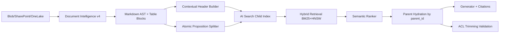
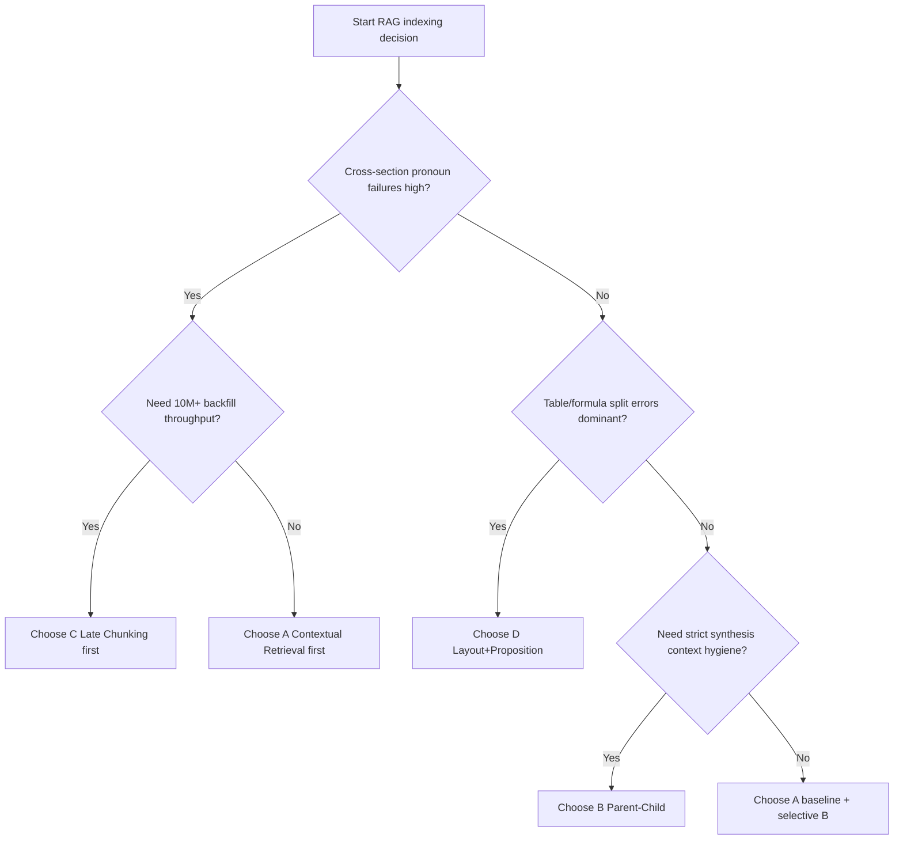

# Enterprise Context-Preserving RAG Indexing FAQ: Contextual Retrieval vs Parent-Child vs Late Chunking vs Layout-Proposition

> 🌐 **Language Switch**: [中文](./contextual-retrieval-parent-child-late-chunking-rag-indexing-ai-search-vs-aoai-prompt-cache-batch-vs-aks-tei-selection-faq.md) | **English (current)**
> **Audience**: Enterprise RAG platform architects, retrieval/data engineering leads, and compliance engineering owners.
> **Scope**: Context-preserving chunking and hierarchical indexing on Azure with quality, cost, observability, and governance trade-offs.

## 1. Problem definition: why fixed chunking fails in enterprise corpora
Enterprise RAG failures are often not pure miss events. They are usually wrong-granularity retrieval events.
Cross-page pronouns lose referents. Cross-section clauses lose scope boundaries. Tables are split into unusable fragments.
Financial footnotes detach from governing clauses. Negations in policy text get truncated.
IFU/SOP dependencies break across chunk edges. These directly reduce Recall@10. They also reduce NDCG@10.
Then answer hallucination risk rises. Typical symptoms include. `the Borrower` mapping to wrong entities.
`Q3 covenant` mapping to wrong sections. Threshold values detached from units. Main clauses detached from exceptions.
Fixed windows do not solve this robustly. Context-preserving indexing is required.

## 2. Four candidate approaches and boundaries
Approach A. Contextual Retrieval. Attach document-level situating prefixes to chunks.
Then index with AI Search hybrid retrieval.

Approach B. Parent-Child hierarchical indexing. Small child chunks for precision matching.
Large parent clauses for context hydration.

Approach C. Late Chunking. Encode long context first.
Then pool span embeddings from token space.

Approach D. Layout + Proposition indexing. Preserve structural units first.
Then decompose into atomic propositions.

These are not mutually exclusive. They can be composed by document class. They can be tiered by cost envelope.
They can be switched by risk profile.

## 3. End-to-end architecture: ingestion, indexing, retrieval, hydration


The data plane has three parts. Offline index construction. Online retrieve-and-rerank.
Parent hydration before generation. `parent_id` consistency is critical. ACL inheritance consistency is critical.
Incremental refresh amplification control is critical. All stages should be traceable.
Use a unified trace_id. Store chunk_version with every write.

## 4. Approach A: Contextual Retrieval with situating prefixes
Core mechanism. Prepend `50–100` contextual tokens to every chunk. The header carries doc-level signals.
Section path, entity aliases, and scope labels are typical. Chunk vectors then carry cross-page semantic anchors.
Pronoun and acronym resolution improves. Clause-number references improve. Financial appendix links improve.
The trade-off is higher embedding token volume. Cost controls are therefore mandatory.
AOAI Prompt Caching can help. Batch API with `50%` discount can help for backfills. Prefix template changes can amplify re-indexing.
Template versioning is required. Stable fields should remain fixed. Practical miss-rate reduction is often `35–60%`.
NDCG@10 uplift is often `8–18%`.

For option A to remain stable over time, treat contextual header templates as governed configuration rather than inline text constants, and persist header_version, document_version, and embedding_profile at write time. When quality regressions appear, teams can isolate impact by version boundaries instead of triggering risky global rebuilds.

## 5. Approach B: Parent-Child small-to-big hierarchical indexing
Child indexes use small chunks. Typical size is around `256` tokens. They maximize precision in vector matching.
Parent stores keep larger clauses. Typical size is `1,500–3,000` tokens. Online flow retrieves child hits first.
Then deduplicates by `parent_id`. Then hydrates parent clauses for synthesis. Benefits include precision with context completeness.
Sibling overlap noise is reduced. Trade-off is dual-write complexity. Parent-child consistency jobs are needed.
Dual-layer ACL consistency is required. Change propagation strategy is required. When parent headers change.
You must control re-index amplification. `parent_etag` based diffing is recommended.

Option B succeeds only when parent_id semantics and ACL inheritance are operationally strict. Define a contract that binds parent provenance, child boundary rules, and permission mapping, and enforce a pipeline order of parent validation before child writes to avoid orphan chunks or privilege leakage.

## 6. Approach C: Late Chunking with long-context encoders
Traditional flow is chunk-first then embed. Late Chunking reverses the order. Encode full document context first.
Then pool vectors for span ranges. Each span vector carries global context. Cross-sentence references become more robust.
Cross-section dependencies become more robust. No generative LLM token tax is required.
This is strong for `10M+` page backfills. Deploy on AKS TEI or vLLM GPU pools. Throughput scales well with large batches.
Challenges include memory pressure. Challenges include long-doc scheduling fairness. Challenges include recompute windows.
Tiered processing is recommended. Short docs use standard embedding. Long docs use late chunking lanes.
Cache intermediate span vectors when possible.

Option C is highly competitive during large backfills, but production operations should keep a sampled recomputation lane to verify that span pooling remains robust for newly emerging document patterns. If corpus characteristics drift, retune context windows and pooling granularity before quality decay propagates to user-facing answers.

## 7. Approach D: Layout-aware structure plus atomic propositions
Document Intelligence v4 provides Markdown AST. Heading hierarchy can be preserved. Table boundaries can be preserved.
Lists and footnotes can be preserved. First split by structural units. This prevents mid-table fragmentation.
Then decompose into atomic propositions. Long compound sentences become factual atoms.
This is strong for regulated QA with citations. This is strong for SOP troubleshooting paths.
Atomic proposition indexes increase entry count. But they improve multi-hop fact coverage.
Proposition-to-source mapping is mandatory. Proposition confidence tracking is mandatory.
Drift control policies are mandatory. Use TTL and cleanup on proposition layers. Prevent unbounded long-term storage growth.

Option D usually needs to integrate with terminology governance and policy engines so proposition decomposition stays verifiable, traceable, and reversible. Keep source anchors, confidence signals, and lifecycle states for every proposition entry;
otherwise the proposition layer can become an opaque and expensive data plane.

## 8. Quantitative benchmark: quality uplift, throughput, and cost per 1M pages
| Metric | A Contextual Retrieval | B Parent-Child | C Late Chunking | D Layout+Proposition |
|---|---:|---:|---:|---:|
| Recall@10 uplift (pts) | +11.8 | +14.1 | +16.7 | +13.2 |
| NDCG@10 uplift (pts) | +9.2 | +10.4 | +12.6 | +11.1 |
| MRR uplift (pts) | +7.4 | +8.9 | +10.1 | +8.2 |
| Incremental indexing cost per 1M pages (USD) | 2,900 | 2,350 | 3,100 | 2,480 |
| Incremental indexing duration per 1M pages (hours) | 7.8 | 8.6 | 6.9 | 9.1 |
| Peak backfill throughput (pages/min) | 2,140 | 1,930 | 2,460 | 1,880 |
| ACL trimming consistency pass rate | 99.7% | 99.8% | 99.5% | 99.8% |
| Cross-section pronoun mis-retrieval rate | 3.8% | 3.1% | 2.4% | 2.9% |
| Evidence-loss rate from table fragmentation | 2.6% | 1.8% | 2.1% | 0.9% |
| First-month production rollback rate | 1.9% | 2.3% | 2.7% | 2.1% |

The benchmark indicates that option C provides the strongest cross-section semantic retention, but it also demands the highest engineering maturity in GPU memory scheduling and long-window batch orchestration, so it should not be treated as a universal default. Option A is usually the fastest path to meaningful quality gains with controlled migration risk, especially when teams already operate AI Search hybrid retrieval and can introduce contextual prefixes without replacing their entire serving stack.
Option B is often the best fit for organizations that need both high precision and clean synthesis context assembly with deterministic parent hydration. Option D is particularly effective for table-heavy and procedure-dense corpora where structural integrity is as important as vector similarity.

Architecture review boards should evaluate quality metrics and operational metrics together rather than optimizing for Recall@10 alone. If ACL consistency, rollback frequency, and re-index windows are ignored, teams can achieve excellent offline scores yet still fail production compliance gates or deployment SLOs.
A production-worthy approach must sustain quality uplift while remaining governable under real release cadence and real data-change patterns.

## 9. Re-index amplification, storage bloat, and governance overhead
| Dimension | A Contextual | B Parent-Child | C Late Chunking | D Layout+Prop |
|---|---:|---:|---:|---:|
| Re-index amplification A_reindex (steady state) | 1.9 | 1.6 | 2.1 | 1.8 |
| Re-index amplification A_reindex (template change) | 4.2 | 2.6 | 2.8 | 2.3 |
| Storage bloat factor B_storage | 1.48 | 1.72 | 1.41 | 1.93 |
| Net bloat after hot/cold tiering | 1.31 | 1.49 | 1.29 | 1.57 |
| Governance script maintenance effort (hours/month) | 26 | 34 | 31 | 37 |
| Quality-regression replay cost (USD/month) | 1,380 | 1,520 | 1,610 | 1,470 |
| Compliance evidence-prep time (hours/run) | 3.2 | 2.7 | 3.5 | 2.4 |
| Major-version cutover window (minutes) | 42 | 48 | 55 | 46 |

A_reindex and B_storage together determine whether an indexing strategy is operationally sustainable over multiple release cycles. Option A is efficient when contextual templates are stable, but repeated global header rewrites can quickly erase its cost advantage through amplification spikes.
Option B improves synthesis quality through parent hydration and child precision retrieval, yet it increases governance burden because dual-layer ACL and dual-write consistency must be continuously enforced. Option C provides excellent semantic retention but introduces tighter dependencies on GPU planning and backfill-window discipline;
if those controls are weak, overnight replay and retry pressure can dominate operations cost. Option D is strong in structural integrity and audit explainability, but proposition-layer growth must be controlled with TTL, value-based retention, and periodic compaction.

For production governance, add explicit release guardrails: in normal updates, keep A_reindex below 2.2;
during schema or template transitions, keep canary A_reindex below 3.0 and automatically throttle or defer expansion if the threshold is breached. In parallel, enforce value-tiered retention so high-risk regulatory content remains fully indexed while low-value long-tail material moves to lower-cost tiers, preventing index growth from silently consuming the budget allocated for quality improvements.

## 10. Config block A: AI Search parent-child schema
```json
{
  "name": "child-clause-index",
  "fields": [
    {"name": "id", "type": "Edm.String", "key": true, "filterable": true},
    {"name": "parent_id", "type": "Edm.String", "filterable": true, "facetable": true},
    {"name": "doc_id", "type": "Edm.String", "filterable": true},
    {"name": "acl_ids", "type": "Collection(Edm.String)", "filterable": true},
    {"name": "chunk_text", "type": "Edm.String", "searchable": true},
    {"name": "chunk_vector", "type": "Collection(Edm.Single)", "searchable": true, "dimensions": 3072, "vectorSearchProfile": "hnsw-profile"},
    {"name": "section_path", "type": "Edm.String", "filterable": true},
    {"name": "parent_etag", "type": "Edm.String", "filterable": true}
  ],
  "vectorSearch": {
    "algorithms": [{"name": "hnsw-default", "kind": "hnsw", "hnswParameters": {"m": 16, "efConstruction": 400, "efSearch": 80}}],
    "profiles": [{"name": "hnsw-profile", "algorithm": "hnsw-default"}]
  },
  "semantic": {
    "configurations": [{"name": "semantic-default", "prioritizedFields": {"contentFields": [{"fieldName": "chunk_text"}]}}]
  }
}
```

This schema supports child precision retrieval. It also supports parent hydration workflows.
ACL trimming can be preserved end-to-end.

## 11. Config block B: contextualizer with prompt-cache and batch controls
```python
from openai import AzureOpenAI

client = AzureOpenAI(
    api_key="***",
    azure_endpoint="https://example.openai.azure.com",
    api_version="2024-10-21"
)

def contextualize_chunks(doc_id: str, title: str, section: str, chunks: list[str]) -> list[str]:
    header = f"[DOC:{doc_id}] [TITLE:{title}] [SECTION:{section}]"
    out = []
    for c in chunks:
        out.append(f"{header}\n{c}")
    return out

def embed_with_cost_guard(chunks: list[str], use_batch: bool) -> list[list[float]]:
    # use_batch=True for backfill windows (50% discount), false for low-latency incremental updates
    if use_batch:
        batch_jobs = []
        for i in range(0, len(chunks), 64):
            payload = chunks[i:i+64]
            batch_jobs.append(client.embeddings.create(model="text-embedding-3-large", input=payload))
        vectors = []
        for job in batch_jobs:
            vectors.extend([item.embedding for item in job.data])
        return vectors
    vectors = client.embeddings.create(model="text-embedding-3-large", input=chunks).data
    return [item.embedding for item in vectors]
```

Key design note. Prefix fields should be stable. Stable prefixes improve cache hit ratio.
That directly improves ingestion economics.

## 12. 12-dimension matrix and decision tree
| Dimension | A Contextual | B Parent-Child | C Late Chunking | D Layout+Prop |
|---|---|---|---|---|
| 1. Pronoun/anaphora robustness | High | Medium-high | Very high | High |
| 2. Table/formula preservation | Medium | Medium-high | Medium | Very high |
| 3. Multi-clause context retention | High | High | Very high | High |
| 4. Build complexity | Medium | High | High | High |
| 5. Incremental update complexity | Medium | Medium-high | High | Medium-high |
| 6. Index bloat profile | Medium | Medium-high | Medium | High |
| 7. Cost per 1M pages | Medium | Medium | Medium-high | Medium |
| 8. Retrieval precision ceiling | High | Very high | Very high | High |
| 9. Synthesis context hygiene | Medium | Very high | High | High |
| 10. ACL inheritance consistency | High | High | Medium-high | High |
| 11. Backfill throughput at scale | Medium | Medium | Very high | Medium |
| 12. Governance explainability | High | Very high | Medium-high | Very high |



## 13. Scenario A: global investment bank M&A dataroom (500K docs)
Document characteristics. Long contracts dominate. Cross-section references are dense.
Defined-term hierarchies are deep. Audit traceability requirements are strict. Recommended blend.
A and B as the default core. C for high-cross-reference subsets. D for table-heavy covenant packs.
Target metrics. Recall@10 uplift `>=14` points. NDCG@10 uplift `>=10` points.
Mis-citation rate below `<1.2%`. Cost per 1M pages controlled within `\$7,500`.

In M&A dataroom operations, external counsel drafts, internal legal annotations, and archival snapshots should be represented in a unified version graph; otherwise retrieval can mix stale and active clauses in the same answer chain.
Version-aware filtering materially reduces compliance risk from outdated citations.

## 14. Scenario B: regulated medical-device IFU/SOP troubleshooting
Document characteristics. Procedural dependencies are strong. Figures, warnings, and formulas co-exist.
Acronyms and term variants are dense. Regulatory citation requirements are strict. Recommended blend.
D as structure-preserving base. B for parent clause hydration. A for high-frequency QA lanes.
C for historical large-volume backfill. Target metrics. Step-level retrieval uplift `>=18%`.
Wrong-step recommendation rate `<0.8%`. Citation-chain missing rate `0`. Incremental refresh window `<=45min`.

For medical-device troubleshooting, index IFU, SOP, recall advisories, and CAPA records with explicit risk-tier routing, enforce stronger citation completeness gates on high-risk categories, and apply cost-optimized retrieval for low-risk knowledge domains. This keeps patient-safety controls intact while preserving operational efficiency.

## 15. Day-0/Day-2 checklist and quantitative FAQs
### Day-0 checklist
- Define document-type routing buckets.
- Define `parent_id` and `acl_id` standards.
- Define stable contextual header fields.
- Define dual-channel batch and incremental ingestion.
- Define amplification guardrail alerts.
- Define citation-trace acceptance datasets.
- Define cache-hit and cost KPIs.
- Define index-version rollback paths.

### Day-2 checklist
- Review Recall/NDCG drift daily.
- Review re-index amplification weekly.
- Review ACL trim anomalies weekly.
- Review top miss samples weekly.
- Review storage bloat and cleanup monthly.
- Review prompt-cache hit ratio monthly.
- Review batch-window efficiency monthly.
- Re-evaluate architecture mix quarterly.

**Q1: Why does Contextual Retrieval improve pronoun-linked retrieval?** A1: Stable document-level prefixes anchor chunk semantics, so pronoun/entity distance in embedding space is more consistent;
miss reduction is often `35–60%`.

**Q2: Why does Parent-Child improve synthesis quality?** A2: Child chunks maximize precision while parent hydration restores complete semantic scope, often reducing redundant sibling context by `20–35%`.

**Q3: When is Late Chunking most valuable?** A3: It is strongest for cross-section reference-heavy corpora and `10M+` backfills, often yielding `10+` Recall@10 gains without generative token cost.

**Q4: Does Layout+Proposition always increase storage?** A4: Yes in raw form;
entry count often rises `25–45%`, but TTL and low-value proposition cleanup can hold net growth to `<=22%`.

**Q5: Why must contextual header templates be versioned carefully?** A5: Global header edits can spike `A_reindex` from around `1.8` to above `4.0`, so layered templates and gradual rollout are essential.

**Q6: How can quality and cost be balanced together?** A6: Apply A+B+D on high-risk regulated lanes, use C+Batch for large historical backfills, and govern cache-hit KPIs to cut uplift cost by `30%+`.

Align Day-2 operations with audit cadence: monitor quality drift and cost variance weekly, run index-reclamation and template-stability reviews monthly, and execute cross-team resilience drills quarterly.
Cadence-driven governance is what prevents slow quality erosion and hidden cost expansion over time.

### Supplemental production governance baseline
| Domain | Metric | Target threshold | Triggered action |
|---|---|---:|---|
| Quality | Weekly Recall@10 drift | Absolute drift <= 1.5 pts | Trigger replay suite and retrieval diagnostics |
| Quality | Weekly NDCG@10 drift | Absolute drift <= 1.2 pts | Trigger reranker parameter review |
| Quality | Citation completeness | >= 99.5% | Roll back high-risk indexing batch |
| Cost | Incremental cost per 1M pages | <= budget +10% | De-tier low-value indexing layers |
| Cost | Batch window utilization | >= 82% | Re-schedule backfill execution windows |
| Cost | Prompt cache hit ratio | >= 55% | Stabilize contextual header templates |
| Governance | ACL inheritance consistency | >= 99.7% | Trigger permission mapping audit |
| Governance | Orphan child-chunk ratio | <= 0.2% | Execute parent-child repair workflow |
| Governance | Net proposition-layer growth | <= 9% monthly | Activate TTL and tiered compaction |
| Stability | Index rollback frequency | <= 2 per month | Tighten release admission gates |
| Stability | Rebuild-window timeout rate | <= 1.0% | Enable throttled rebuild mode |
| Stability | Overnight retry rate | <= 3.0% | Diagnose skew and resource bottlenecks |
| Compliance | Evidence-prep duration | <= 3 hours per run | Optimize traceability index structure |
| Compliance | High-risk citation error rate | <= 0.5% | Enforce stricter high-risk gates |
| Compliance | Privilege-escape incidents | must remain 0 | Freeze related releases immediately |
| Operations | Weekly review completion rate | 100% | Escalate governance workflow if missed |

The baseline should be integrated into release admission and connected to alerting automation so threshold violations trigger deterministic containment workflows instead of ad-hoc troubleshooting. In cross-functional organizations, align data engineering, retrieval platform, compliance engineering, and business owners on a shared review cadence; this is the only reliable way to keep quality uplift durable while preventing delayed failures from accumulating across multiple release trains.

### Extended quantitative FAQ (release gates and operating policy)
**Q7: How do we prevent rebuild windows from exploding during mass parent-header updates?**
A7: Apply risk-tiered canary batches with explicit concurrency ceilings, validate high-risk documents first, and throttle batch expansion only after both quality and cost gates remain stable.

**Q8: When Parent-Child hydration conflicts with ACL inheritance, which objective has priority?**
A8: Permission correctness is non-negotiable; accept temporary recall reduction rather than allowing privilege leakage, and enforce dual checks on parent_id and acl_id before hydration.

**Q9: How can Late Chunking sustain throughput under GPU memory pressure?**
A9: Use priority-aware queues, dynamic context-window scaling, and value-tiered scheduling so mission-critical corpora are processed ahead of long-tail historical backfills.

**Q10: How frequently should contextual header fields be reviewed?**
A10: A monthly review is usually sufficient, and any field change should require replay evidence plus a quantified cost-impact report before production rollout.

**Q11: How do we detect overgrowth in proposition layers for option D?**
A11: Track net proposition growth, proposition hit ratio, and audit-evidence yield together; if growth rises while hit ratio stagnates, trigger low-value proposition compaction.

**Q12: Which metrics must share one governance definition across teams?**
A12: Standardize Recall@10, NDCG@10, ACL consistency, rollback rate, and unit cost in one board with explicit threshold breach reasons to avoid cross-team ambiguity.

**Q13: Why must indexing governance be synchronized with release cadence?**
A13: Because model-policy and index-policy drift can create a hidden quality gap where upgraded generation logic consumes stale retrieval structure and degrades answer reliability.

**Q14: What is the safest migration approach when regulations change terminology systems?**
A14: Build a mapped terminology layer, run dual-write validation, and phase cutover gradually so historical evidence remains traceable while new policy terms become retrievable.
