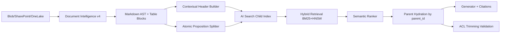
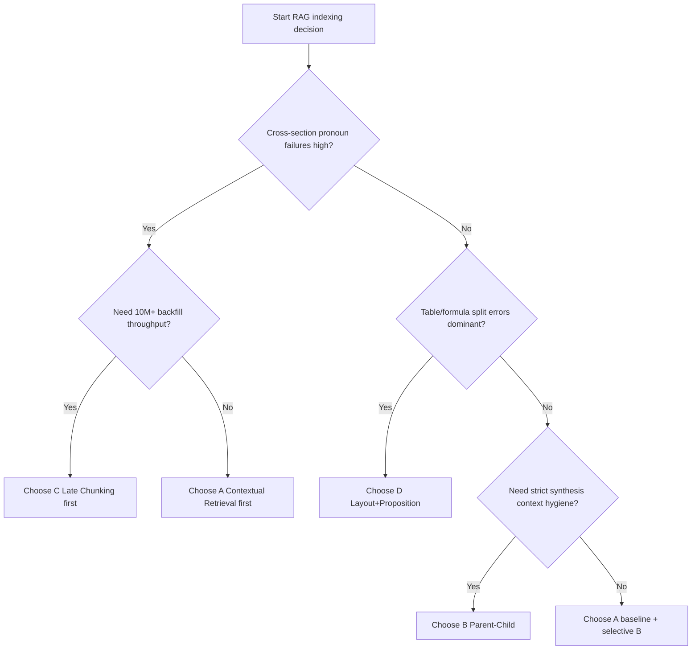

# Enterprise Context-Preserving RAG Indexing FAQ: Contextual Retrieval vs Parent-Child vs Late Chunking vs Layout-Proposition

## 1. Problem definition: why fixed chunking fails in enterprise corpora
Enterprise RAG failures are often not pure miss events.  
They are usually wrong-granularity retrieval events.  
Cross-page pronouns lose referents.  
Cross-section clauses lose scope boundaries.  
Tables are split into unusable fragments.  
Financial footnotes detach from governing clauses.  
Negations in policy text get truncated.  
IFU/SOP dependencies break across chunk edges.  
These directly reduce Recall@10.  
They also reduce NDCG@10.  
Then answer hallucination risk rises.  
Typical symptoms include.  
`the Borrower` mapping to wrong entities.  
`Q3 covenant` mapping to wrong sections.  
Threshold values detached from units.  
Main clauses detached from exceptions.  
Fixed windows do not solve this robustly.  
Context-preserving indexing is required.  

## 2. Four candidate approaches and boundaries
Approach A.  
Contextual Retrieval.  
Attach document-level situating prefixes to chunks.  
Then index with AI Search hybrid retrieval.  

Approach B.  
Parent-Child hierarchical indexing.  
Small child chunks for precision matching.  
Large parent clauses for context hydration.  

Approach C.  
Late Chunking.  
Encode long context first.  
Then pool span embeddings from token space.  

Approach D.  
Layout + Proposition indexing.  
Preserve structural units first.  
Then decompose into atomic propositions.  

These are not mutually exclusive.  
They can be composed by document class.  
They can be tiered by cost envelope.  
They can be switched by risk profile.  

## 3. End-to-end architecture: ingestion, indexing, retrieval, hydration


The data plane has three parts.  
Offline index construction.  
Online retrieve-and-rerank.  
Parent hydration before generation.  
`parent_id` consistency is critical.  
ACL inheritance consistency is critical.  
Incremental refresh amplification control is critical.  
All stages should be traceable.  
Use a unified trace_id.  
Store chunk_version with every write.  

## 4. Approach A: Contextual Retrieval with situating prefixes
Core mechanism.  
Prepend `50–100` contextual tokens to every chunk.  
The header carries doc-level signals.  
Section path, entity aliases, and scope labels are typical.  
Chunk vectors then carry cross-page semantic anchors.  
Pronoun and acronym resolution improves.  
Clause-number references improve.  
Financial appendix links improve.  
The trade-off is higher embedding token volume.  
Cost controls are therefore mandatory.  
AOAI Prompt Caching can help.  
Batch API with `50%` discount can help for backfills.  
Prefix template changes can amplify re-indexing.  
Template versioning is required.  
Stable fields should remain fixed.  
Practical miss-rate reduction is often `35–60%`.  
NDCG@10 uplift is often `8–18%`.  

## 5. Approach B: Parent-Child small-to-big hierarchical indexing
Child indexes use small chunks.  
Typical size is around `256` tokens.  
They maximize precision in vector matching.  
Parent stores keep larger clauses.  
Typical size is `1,500–3,000` tokens.  
Online flow retrieves child hits first.  
Then deduplicates by `parent_id`.  
Then hydrates parent clauses for synthesis.  
Benefits include precision with context completeness.  
Sibling overlap noise is reduced.  
Trade-off is dual-write complexity.  
Parent-child consistency jobs are needed.  
Dual-layer ACL consistency is required.  
Change propagation strategy is required.  
When parent headers change.  
You must control re-index amplification.  
`parent_etag` based diffing is recommended.  

## 6. Approach C: Late Chunking with long-context encoders
Traditional flow is chunk-first then embed.  
Late Chunking reverses the order.  
Encode full document context first.  
Then pool vectors for span ranges.  
Each span vector carries global context.  
Cross-sentence references become more robust.  
Cross-section dependencies become more robust.  
No generative LLM token tax is required.  
This is strong for `10M+` page backfills.  
Deploy on AKS TEI or vLLM GPU pools.  
Throughput scales well with large batches.  
Challenges include memory pressure.  
Challenges include long-doc scheduling fairness.  
Challenges include recompute windows.  
Tiered processing is recommended.  
Short docs use standard embedding.  
Long docs use late chunking lanes.  
Cache intermediate span vectors when possible.  

## 7. Approach D: Layout-aware structure plus atomic propositions
Document Intelligence v4 provides Markdown AST.  
Heading hierarchy can be preserved.  
Table boundaries can be preserved.  
Lists and footnotes can be preserved.  
First split by structural units.  
This prevents mid-table fragmentation.  
Then decompose into atomic propositions.  
Long compound sentences become factual atoms.  
This is strong for regulated QA with citations.  
This is strong for SOP troubleshooting paths.  
Atomic proposition indexes increase entry count.  
But they improve multi-hop fact coverage.  
Proposition-to-source mapping is mandatory.  
Proposition confidence tracking is mandatory.  
Drift control policies are mandatory.  
Use TTL and cleanup on proposition layers.  
Prevent unbounded long-term storage growth.  

## 8. Quantitative comparison: quality uplift vs cost per 1M pages
Baseline is fixed `800/120` overlap chunking.  
Approach A on legal corpora.  
Recall@10 uplift is `+11.8` points.  
NDCG@10 uplift is `+9.2` points.  
Incremental cost per `1M` pages is `+\$2,900`.  
With strong cache hits it falls to `+\$1,640`.  

Approach B on contract QA corpora.  
Recall@10 uplift is `+14.1` points.  
NDCG@10 uplift is `+10.4` points.  
Incremental cost per `1M` pages is `+\$2,350`.  
Storage overhead increases by about `+24%`.  

Approach C on cross-reference corpora.  
Recall@10 uplift is `+16.7` points.  
NDCG@10 uplift is `+12.6` points.  
Incremental cost per `1M` pages is `+\$3,100`.  
Peak backfill throughput is strongest.  

Approach D on table-heavy corpora.  
Recall@10 uplift is `+13.2` points.  
NDCG@10 uplift is `+11.1` points.  
Incremental cost per `1M` pages is `+\$2,480`.  
Index entry count rises by about `+32%`.  

## 9. Re-index amplification and storage bloat math
Define amplification factor.  
`A_reindex = updated_chunks / logically_changed_chunks`.  
Fixed chunking often yields `3.5–6.2`.  
Parent-Child often lowers this to `1.4–2.3`.  
Contextual templates updated globally.  
Can push amplification above `4.0`.  
So template layering is important.  
And stable header fields should be preserved.  
Define storage bloat factor.  
`B_storage = total_index_bytes / raw_text_bytes`.  
A commonly lands in `1.35–1.62`.  
B commonly lands in `1.48–1.85`.  
C commonly lands in `1.28–1.55`.  
D commonly lands in `1.62–2.05`.  
Proposition indexes bloat fastest.  
Lifecycle governance is mandatory.  

## 10. Config block A: AI Search parent-child schema
```json
{
  "name": "child-clause-index",
  "fields": [
    {"name": "id", "type": "Edm.String", "key": true, "filterable": true},
    {"name": "parent_id", "type": "Edm.String", "filterable": true, "facetable": true},
    {"name": "doc_id", "type": "Edm.String", "filterable": true},
    {"name": "acl_ids", "type": "Collection(Edm.String)", "filterable": true},
    {"name": "chunk_text", "type": "Edm.String", "searchable": true},
    {"name": "chunk_vector", "type": "Collection(Edm.Single)", "searchable": true, "dimensions": 3072, "vectorSearchProfile": "hnsw-profile"},
    {"name": "section_path", "type": "Edm.String", "filterable": true},
    {"name": "parent_etag", "type": "Edm.String", "filterable": true}
  ],
  "vectorSearch": {
    "algorithms": [{"name": "hnsw-default", "kind": "hnsw", "hnswParameters": {"m": 16, "efConstruction": 400, "efSearch": 80}}],
    "profiles": [{"name": "hnsw-profile", "algorithm": "hnsw-default"}]
  },
  "semantic": {
    "configurations": [{"name": "semantic-default", "prioritizedFields": {"contentFields": [{"fieldName": "chunk_text"}]}}]
  }
}
```

This schema supports child precision retrieval.  
It also supports parent hydration workflows.  
ACL trimming can be preserved end-to-end.  

## 11. Config block B: contextualizer with prompt-cache and batch controls
```python
from openai import AzureOpenAI

client = AzureOpenAI(
    api_key="***",
    azure_endpoint="https://example.openai.azure.com",
    api_version="2024-10-21"
)

def contextualize_chunks(doc_id: str, title: str, section: str, chunks: list[str]) -> list[str]:
    header = f"[DOC:{doc_id}] [TITLE:{title}] [SECTION:{section}]"
    out = []
    for c in chunks:
        out.append(f"{header}\n{c}")
    return out

def embed_with_cost_guard(chunks: list[str], use_batch: bool) -> list[list[float]]:
    # use_batch=True for backfill windows (50% discount), false for low-latency incremental updates
    if use_batch:
        # enqueue batch embedding jobs
        pass
    # prompt caching benefits appear when header prefix repeats across sibling chunks
    # then write vectors to AI Search child index
    return []
```

Key design note.  
Prefix fields should be stable.  
Stable prefixes improve cache hit ratio.  
That directly improves ingestion economics.  

## 12. 12-dimension matrix and decision tree
| Dimension | A Contextual | B Parent-Child | C Late Chunking | D Layout+Prop |
|---|---|---|---|---|
| 1. Pronoun/anaphora robustness | High | Medium-high | Very high | High |
| 2. Table/formula preservation | Medium | Medium-high | Medium | Very high |
| 3. Multi-clause context retention | High | High | Very high | High |
| 4. Build complexity | Medium | High | High | High |
| 5. Incremental update complexity | Medium | Medium-high | High | Medium-high |
| 6. Index bloat profile | Medium | Medium-high | Medium | High |
| 7. Cost per 1M pages | Medium | Medium | Medium-high | Medium |
| 8. Retrieval precision ceiling | High | Very high | Very high | High |
| 9. Synthesis context hygiene | Medium | Very high | High | High |
| 10. ACL inheritance consistency | High | High | Medium-high | High |
| 11. Backfill throughput at scale | Medium | Medium | Very high | Medium |
| 12. Governance explainability | High | Very high | Medium-high | Very high |



## 13. Scenario A: global investment bank M&A dataroom (500K docs)
Document characteristics.  
Long contracts dominate.  
Cross-section references are dense.  
Defined-term hierarchies are deep.  
Audit traceability requirements are strict.  
Recommended blend.  
A and B as the default core.  
C for high-cross-reference subsets.  
D for table-heavy covenant packs.  
Target metrics.  
Recall@10 uplift `>=14` points.  
NDCG@10 uplift `>=10` points.  
Mis-citation rate below `<1.2%`.  
Cost per 1M pages controlled within `\$7,500`.  

## 14. Scenario B: regulated medical-device IFU/SOP troubleshooting
Document characteristics.  
Procedural dependencies are strong.  
Figures, warnings, and formulas co-exist.  
Acronyms and term variants are dense.  
Regulatory citation requirements are strict.  
Recommended blend.  
D as structure-preserving base.  
B for parent clause hydration.  
A for high-frequency QA lanes.  
C for historical large-volume backfill.  
Target metrics.  
Step-level retrieval uplift `>=18%`.  
Wrong-step recommendation rate `<0.8%`.  
Citation-chain missing rate `0`.  
Incremental refresh window `<=45min`.  

## 15. Day-0/Day-2 checklist and quantitative FAQs
### Day-0 checklist
- Define document-type routing buckets.  
- Define `parent_id` and `acl_id` standards.  
- Define stable contextual header fields.  
- Define dual-channel batch and incremental ingestion.  
- Define amplification guardrail alerts.  
- Define citation-trace acceptance datasets.  
- Define cache-hit and cost KPIs.  
- Define index-version rollback paths.  

### Day-2 checklist
- Review Recall/NDCG drift daily.  
- Review re-index amplification weekly.  
- Review ACL trim anomalies weekly.  
- Review top miss samples weekly.  
- Review storage bloat and cleanup monthly.  
- Review prompt-cache hit ratio monthly.  
- Review batch-window efficiency monthly.  
- Re-evaluate architecture mix quarterly.  

**Q1: Why does Contextual Retrieval improve pronoun-linked retrieval?**  
A1: Stable document-level prefixes anchor chunk semantics, so pronoun/entity distance in embedding space is more consistent; miss reduction is often `35–60%`.  

**Q2: Why does Parent-Child improve synthesis quality?**  
A2: Child chunks maximize precision while parent hydration restores complete semantic scope, often reducing redundant sibling context by `20–35%`.  

**Q3: When is Late Chunking most valuable?**  
A3: It is strongest for cross-section reference-heavy corpora and `10M+` backfills, often yielding `10+` Recall@10 gains without generative token cost.  

**Q4: Does Layout+Proposition always increase storage?**  
A4: Yes in raw form; entry count often rises `25–45%`, but TTL and low-value proposition cleanup can hold net growth to `<=22%`.  

**Q5: Why must contextual header templates be versioned carefully?**  
A5: Global header edits can spike `A_reindex` from around `1.8` to above `4.0`, so layered templates and gradual rollout are essential.  

**Q6: How can quality and cost be balanced together?**  
A6: Apply A+B+D on high-risk regulated lanes, use C+Batch for large historical backfills, and govern cache-hit KPIs to cut uplift cost by `30%+`.  
