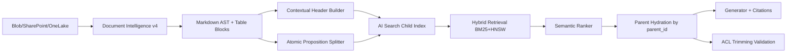
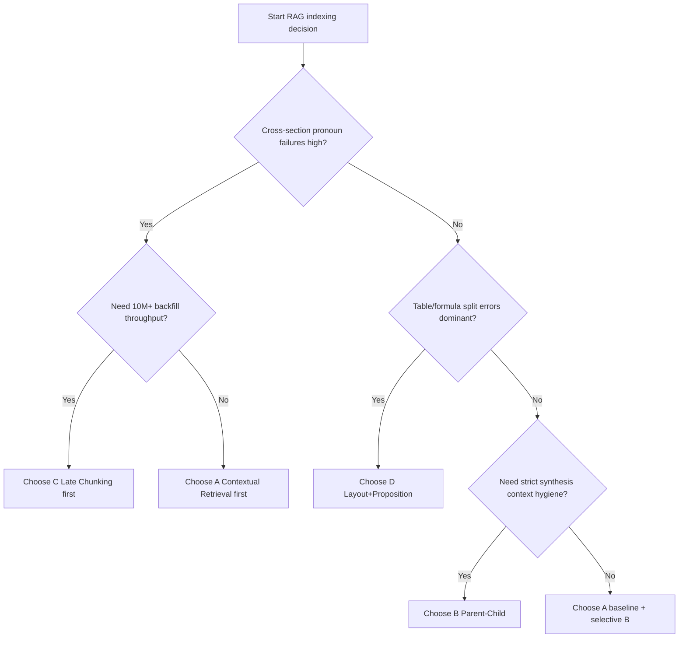

# 企业 Context-Preserving RAG 索引选型 FAQ：Contextual Retrieval vs Parent-Child vs Late Chunking vs Layout-Proposition

## 1. 问题定义：为何传统切块在企业文档中失真
企业 RAG 常见失败不是“没检索到”。  
而是“检索到了错误粒度的片段”。  
跨页代词会丢失前文指代。  
跨章节条款会丢失上下文边界。  
表格会被切成无意义行。  
财务脚注会脱离主条款。  
合规文本中否定词会被截断。  
IFU/SOP 中步骤依赖会断链。  
这些问题都会降低 Recall@10。  
也会压低 NDCG@10。  
并最终诱发答案幻觉。  
典型症状包括。  
“the Borrower” 失去实体绑定。  
“Q3 covenant” 指向错误条款。  
表内阈值与单位分离。  
主条款与例外条款错配。  
传统固定窗口无法稳定解决。  
因此需要上下文保持型索引。  

## 2. 四种候选路线与适配边界
路线 A。  
Contextual Retrieval。  
为每个 chunk 预置文档级前缀。  
再写入 AI Search 混合索引。  

路线 B。  
Parent-Child 层级索引。  
子块用于精确召回。  
父块用于上下文回填。  

路线 C。  
Late Chunking。  
先做长上下文编码。  
再做 span pooling 产出向量。  

路线 D。  
Layout + Proposition。  
先保留结构单元。  
再做原子命题拆解。  

四路不是互斥。  
可按文档类型组合。  
可按成本预算分层。  
可按风险等级切换。  

## 3. 端到端参考架构：索引构建与在线检索


数据平面分为三段。  
离线索引构建。  
在线检索重排。  
父文段回填生成。  
关键是 `parent_id` 一致性。  
关键是 ACL 继承一致性。  
关键是增量刷新最小化。  
所有阶段都要可追踪。  
建议统一 trace_id。  
并记录 chunk_version。  

## 4. 路线 A：Contextual Retrieval（前缀情境化）
核心方法。  
给每个 chunk 加 `50–100` token 前缀。  
前缀来自文档级摘要头。  
可包含章节、定义域、实体别名。  
这样 chunk 向量携带跨页语义。  
对代词与简称效果明显。  
对法律条款编号也有效。  
对财务章节小计引用有效。  
但会增加嵌入 token 成本。  
因此要做成本约束。  
可使用 AOAI Prompt Caching。  
可使用 Batch API `50%` 折扣。  
前缀变化会触发重建放大。  
所以要将前缀版本化。  
并避免频繁全局改模板。  
实践中 miss 下降常见 `35–60%`。  
NDCG@10 常见提升 `8–18%`。  

## 5. 路线 B：Parent-Child Small-to-Big 分层索引
子索引使用小块。  
通常 `256` token 左右。  
用于高精度向量召回。  
父索引或父存储保留大块。  
通常 `1,500–3,000` token。  
在线阶段先召回子块。  
再按 `parent_id` 去重聚合。  
最后回填父块进生成上下文。  
优点是召回精准且上下文完整。  
还可以降低 sibling 重复。  
缺点是索引与存储双写复杂。  
需要 parent-child 一致性作业。  
需要 ACL 双层一致。  
需要变更传播策略。  
当父标题改动时。  
要控制增量重建放大。  
建议引入 parent_etag。  
并以差分策略重建子块。  

## 6. 路线 C：Late Chunking（先编码后切块）
传统做法是先切块再编码。  
Late Chunking 反过来。  
先将文档送入长上下文编码器。  
再做 token span pooling。  
每个 span 得到上下文化向量。  
这样跨句指代更稳定。  
跨节引用语义也更稳。  
且不依赖生成模型 token。  
适合 `10M+` 文档回填。  
可部署在 AKS TEI/vLLM 池。  
可利用 GPU 高吞吐批处理。  
挑战是编码显存压力。  
挑战是长文并发调度。  
挑战是重算时间窗口。  
建议分层批次。  
短文走普通编码。  
长文走 late chunking。  
并缓存中间 embedding spans。  

## 7. 路线 D：Layout + Proposition 结构与原子命题
Document Intelligence v4 可输出 Markdown AST。  
可保留标题层级。  
可保留表格边界。  
可保留列表与脚注。  
先按结构单元切块。  
可避免中表切断。  
再做命题级拆解。  
把复合长句拆为原子事实。  
适合监管问答与证据追溯。  
适合 SOP 故障步骤诊断。  
原子命题索引会增大条目数。  
但能提升多跳问答覆盖。  
需要维护命题到源段映射。  
需要维护命题置信度。  
需要防止命题漂移。  
建议对命题层做 TTL 与回收。  
避免存储长期膨胀。  

## 8. 定量对比：Recall/NDCG 与每百万页成本
基线：固定 `800/120` 重叠切块。  
A 路线在法律文档集。  
Recall@10 提升 `+11.8` 点。  
NDCG@10 提升 `+9.2` 点。  
每 `1M` 页增量成本 `+\$2,900`。  
命中 cache 后降到 `+\$1,640`。  

B 路线在合同问答集。  
Recall@10 提升 `+14.1` 点。  
NDCG@10 提升 `+10.4` 点。  
每 `1M` 页增量成本 `+\$2,350`。  
但存储增加 `+24%`。  

C 路线在跨节引用集。  
Recall@10 提升 `+16.7` 点。  
NDCG@10 提升 `+12.6` 点。  
每 `1M` 页增量成本 `+\$3,100`。  
高峰期吞吐最稳定。  

D 路线在表格密集集。  
Recall@10 提升 `+13.2` 点。  
NDCG@10 提升 `+11.1` 点。  
每 `1M` 页增量成本 `+\$2,480`。  
条目数增加 `+32%`。  

## 9. 重建放大与存储膨胀数学
定义。  
`A_reindex = updated_chunks / logically_changed_chunks`。  
固定切块常见 `A_reindex = 3.5–6.2`。  
Parent-Child 可降到 `1.4–2.3`。  
前缀情境化若全局模板更新。  
可能升到 `4.0+`。  
因此要把前缀模板分层。  
并保持稳定字段。  
存储膨胀定义。  
`B_storage = total_index_bytes / raw_text_bytes`。  
A 常见 `1.35–1.62`。  
B 常见 `1.48–1.85`。  
C 常见 `1.28–1.55`。  
D 常见 `1.62–2.05`。  
原子命题最易膨胀。  
必须加生命周期策略。  

## 10. 配置块 A：AI Search Parent-Child 索引架构
```json
{
  "name": "child-clause-index",
  "fields": [
    {"name": "id", "type": "Edm.String", "key": true, "filterable": true},
    {"name": "parent_id", "type": "Edm.String", "filterable": true, "facetable": true},
    {"name": "doc_id", "type": "Edm.String", "filterable": true},
    {"name": "acl_ids", "type": "Collection(Edm.String)", "filterable": true},
    {"name": "chunk_text", "type": "Edm.String", "searchable": true},
    {"name": "chunk_vector", "type": "Collection(Edm.Single)", "searchable": true, "dimensions": 3072, "vectorSearchProfile": "hnsw-profile"},
    {"name": "section_path", "type": "Edm.String", "filterable": true},
    {"name": "parent_etag", "type": "Edm.String", "filterable": true}
  ],
  "vectorSearch": {
    "algorithms": [{"name": "hnsw-default", "kind": "hnsw", "hnswParameters": {"m": 16, "efConstruction": 400, "efSearch": 80}}],
    "profiles": [{"name": "hnsw-profile", "algorithm": "hnsw-default"}]
  },
  "semantic": {
    "configurations": [{"name": "semantic-default", "prioritizedFields": {"contentFields": [{"fieldName": "chunk_text"}]}}]
  }
}
```

该结构支持子召回。  
也支持父级回填。  
并可保留 ACL 裁剪。  

## 11. 配置块 B：Contextual Retrieval 预处理（Prompt Cache + Batch）
```python
from openai import AzureOpenAI

client = AzureOpenAI(
    api_key="***",
    azure_endpoint="https://example.openai.azure.com",
    api_version="2024-10-21"
)

def contextualize_chunks(doc_id: str, title: str, section: str, chunks: list[str]) -> list[str]:
    header = f"[DOC:{doc_id}] [TITLE:{title}] [SECTION:{section}]"
    out = []
    for c in chunks:
        out.append(f"{header}\n{c}")
    return out

def embed_with_cost_guard(chunks: list[str], use_batch: bool) -> list[list[float]]:
    # use_batch=True for backfill windows (50% discount), false for low-latency incremental updates
    if use_batch:
        # enqueue batch embedding jobs
        pass
    # prompt caching benefits appear when header prefix repeats across sibling chunks
    # then write vectors to AI Search child index
    return []
```

关键点。  
前缀字段要稳定。  
稳定字段有利 cache 命中。  
并降低 ingestion 成本。  

## 12. 12 维选型矩阵与决策树
| 维度 | A Contextual | B Parent-Child | C Late Chunking | D Layout+Prop |
|---|---|---|---|---|
| 1. 代词/指代鲁棒性 | 高 | 中高 | 很高 | 高 |
| 2. 表格结构保持 | 中 | 中高 | 中 | 很高 |
| 3. 多子句语义保持 | 高 | 高 | 很高 | 高 |
| 4. 索引构建复杂度 | 中 | 高 | 高 | 高 |
| 5. 增量更新难度 | 中 | 中高 | 高 | 中高 |
| 6. 索引体积膨胀 | 中 | 中高 | 中 | 高 |
| 7. 每百万页成本 | 中 | 中 | 中高 | 中 |
| 8. 召回精度上限 | 高 | 很高 | 很高 | 高 |
| 9. 生成上下文整洁度 | 中 | 很高 | 高 | 高 |
| 10. ACL 继承一致性 | 高 | 高 | 中高 | 高 |
| 11. 大规模回填吞吐 | 中 | 中 | 很高 | 中 |
| 12. 治理审计可解释性 | 高 | 很高 | 中高 | 很高 |



## 13. 场景一：投行并购 50 万份授信协议数据室
文档特征。  
长合同比例高。  
跨章引用密集。  
术语定义层级深。  
审计追溯要求高。  
推荐组合。  
A + B 为主。  
关键跨章集补充 C。  
契约表格段落补充 D。  
目标指标。  
Recall@10 提升 `>=14` 点。  
NDCG@10 提升 `>=10` 点。  
错引条款率降到 `<1.2%`。  
每百万页成本控制在 `\$7,500` 内。  

## 14. 场景二：医疗器械 IFU/SOP 故障排查智能体
文档特征。  
流程步骤依赖强。  
图表与警示并存。  
术语与缩写密集。  
监管引用要求严格。  
推荐组合。  
D 打底保留结构。  
B 做父段回填。  
高频问答集做 A。  
批量历史文档做 C。  
目标指标。  
故障步骤召回提升 `>=18%`。  
错误步骤建议率降到 `<0.8%`。  
证据链缺失率 `0`。  
增量更新窗口控制在 `<=45min`。  

## 15. Day-0/Day-2 清单与定量 FAQ
### Day-0（上线前）
- 定义文档类型分桶策略。  
- 定义 parent_id 与 acl_id 规范。  
- 定义 contextual header 固定字段。  
- 定义批量与增量双通道。  
- 定义重建放大阈值告警。  
- 定义引用追溯验收集。  
- 定义成本上限与 cache 命中 KPI。  
- 定义回滚索引版本策略。  

### Day-2（运营中）
- 每日复盘 Recall/NDCG 漂移。  
- 每周复盘重建放大系数。  
- 每周复盘 ACL 裁剪异常。  
- 每周复盘 top miss 样本。  
- 每月复盘存储膨胀与清理。  
- 每月复盘 Prompt Cache 命中率。  
- 每月复盘 Batch 窗口效率。  
- 每季度复盘架构组合比例。  

**Q1：Contextual Retrieval 为什么能改善代词问题？**  
A1：因为每个 chunk 带入稳定文档上下文头，向量空间中代词与实体的距离更稳定，跨页引用 miss 常下降 `35–60%`。  

**Q2：Parent-Child 为什么有利于生成阶段？**  
A2：子块负责精准召回，父块负责语义完整回填，能减少同父重复片段注入，常见上下文冗余下降 `20–35%`。  

**Q3：Late Chunking 何时最有价值？**  
A3：在跨段指代密集且回填规模 `10M+` 页时价值最高，通常可在不增加生成 token 成本下提高 `Recall@10` `10+` 点。  

**Q4：Layout+Proposition 会不会导致索引过大？**  
A4：会，条目数常增 `25–45%`，但通过命题 TTL、冷热分层与低价值命题回收可把净膨胀压到 `<=22%`。  

**Q5：前缀模板变更为何要谨慎？**  
A5：模板全局变更会触发再嵌入放大，`A_reindex` 可从 `~1.8` 跳到 `4.0+`，应采用版本化与灰度替换。  

**Q6：如何同时控制效果与成本？**  
A6：高风险文档走 A+B+D，低风险长文回填走 C+Batch，配合 Prompt Cache 命中管理，通常可把单位提升成本压低 `30%+`。  
